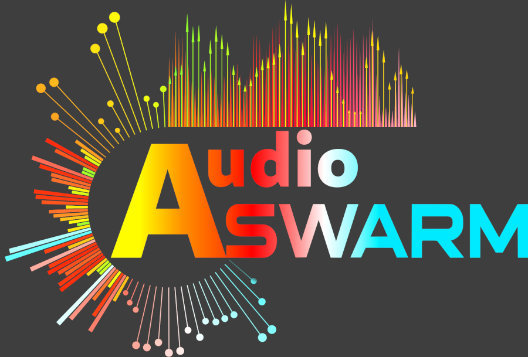
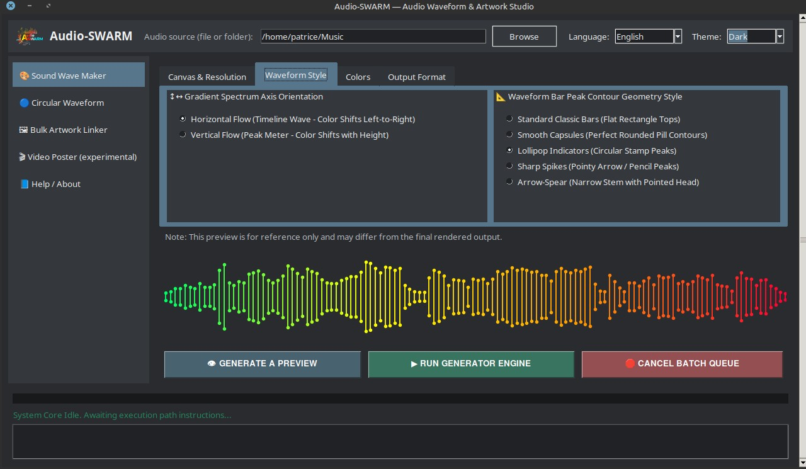
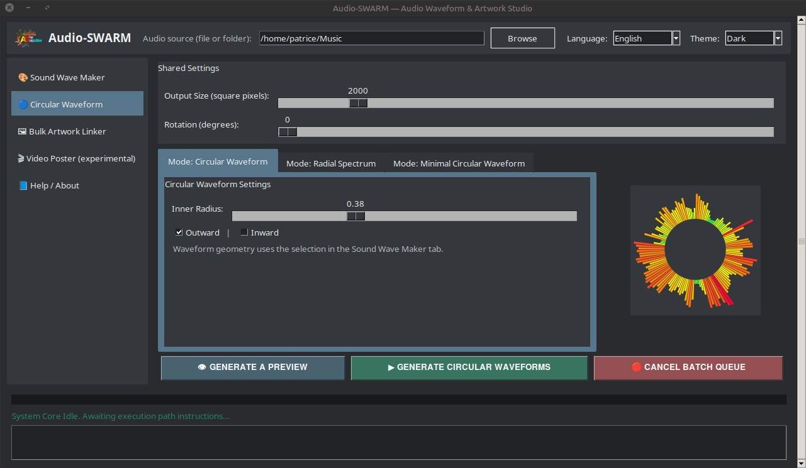
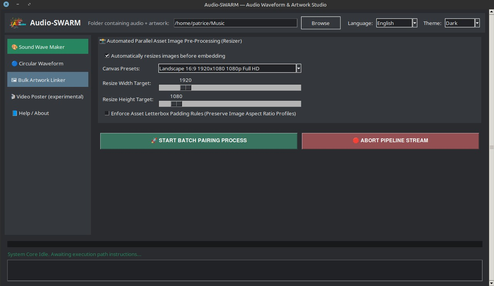
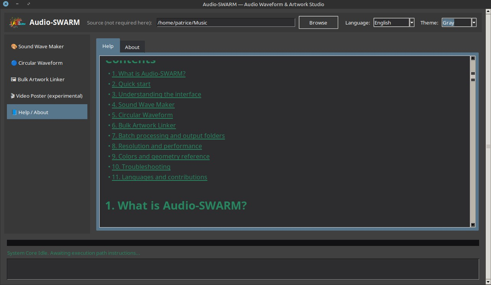
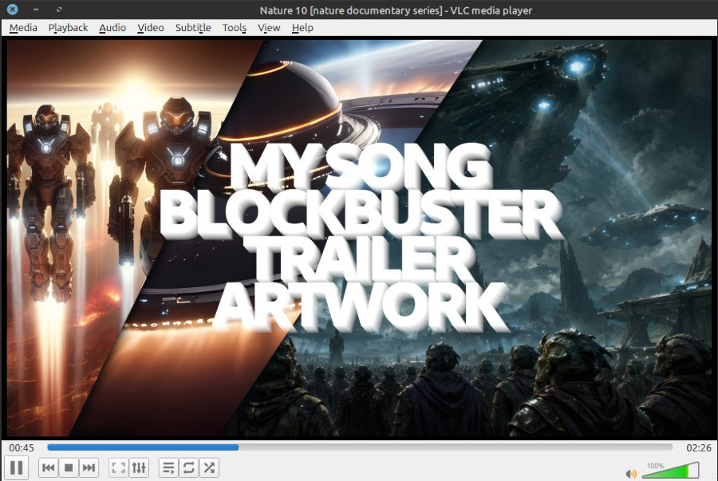
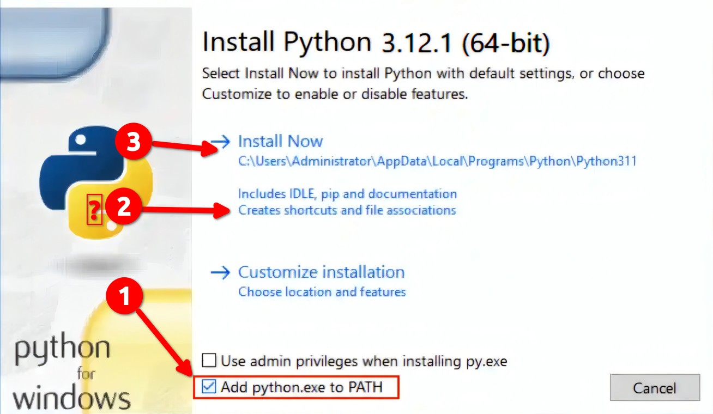
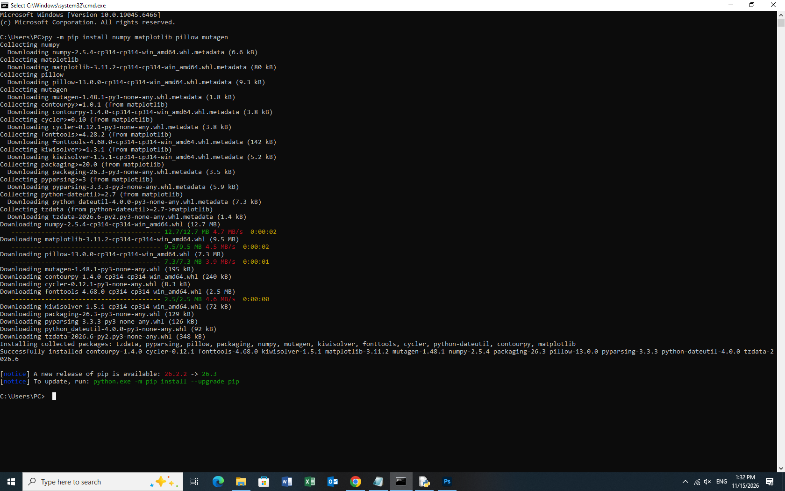

# Audio-SWARM 🎶🖌️

<div align="center"> 

  <p><strong>High-Resolution Audio Waveform Generator & Bulk Album Artwork Tool</strong></p>
  <p>
    <a href="https://github.io"><strong>🌐 Official Website & Gallery (EN)</strong></a> •
    <a href="https://github.iofr.html"><strong>🇫🇷 Site officiel & Galerie (FR)</strong></a> •
    <a href="https://github.com"><strong>🐛 Report a Bug</strong></a>
  </p>
<p align="center">
  
  
  
  
  
</p>

</div>

**Author:** Patrice Laborda

**Audio-S**ound **W**aveform & bulk Album/**A**rtwork-cover batch **R**emix **M**otif is a bulk sound wave & album cover art generator.



---

**Audio-SWARM** is a desktop application for creating beautiful, high-resolution waveform artwork from your music and audio files.

Turn your audio tracks into visual artwork using different waveform styles, including horizontal, vertical and circular designs. Customize their appearance, colors, shapes, gradients and transparency, then generate images ready to use as album covers, music artwork, or visual elements for your projects.

But Audio-SWARM does more than just create pictures. It can also embed your generated artwork directly into supported audio files, so your music and its cover image stay together. You can also use it to add existing images to audio files or create posters for your videos.

Whether you want to decorate a single music track or process hundreds of files, Audio-SWARM makes it possible to automate the work instead of handling everything one file at a time.

---

## ✨ Key Features

### 1. Sound Waveform Maker

Turn your music and audio files into high-resolution waveform artwork.



- **Multiple Waveform Styles:** Create horizontal or vertical waveform designs, with customizable shapes, colors, gradients and visual effects.
- **Unique Vertical Flow:** A distinctive waveform style that displays audio peaks as flowing vertical slices, giving your artwork a different look from traditional audio visualizations.
- **High-Resolution Images:** Generate artwork suitable for Full HD (1080p), 4K and other high-resolution displays.
- **Live Previews:** Preview your waveform design before generating the final artwork.
- **Batch Processing:** Select a folder and automatically process its audio files, including files inside subfolders.
- **Organized Output:** Generated images are saved in a separate `Waveform_Outputs` folder, preserving the original folder structure.

### 2. Circular Waveform Generator

Create eye-catching circular audio visualizations and turn your music into geometric artwork.



- **Different Circular Designs:** Generate Circular Waveforms, Radial Spectrums and Minimal Circular Waves.
- **Customize Your Artwork:** Adjust rotation, direction, sensitivity, amplitude, line width, peak shapes and other visual settings.
- **Inward or Outward Designs:** Choose whether your waveform or spectrum expands outward, points inward or both.
- **Transparent Backgrounds:** Create artwork with transparency for use in other graphic designs and projects.
- **Live Previews:** Check your circular design before generating the final high-resolution image.
- **Batch Processing:** Automatically generate circular waveform artwork for entire folders of audio files, including subfolders.
- **Organized Output:** Results are saved in a separate `Circular_Waveform_Outputs` folder, preserving the original folder structure.

### 3. Bulk Artwork Linker

Add album covers and artwork or your own pictures to multiple audio files in one operation.



Instead of opening every music file individually, simply place your audio files and your own corresponding images/photos together in a folder and let Audio-SWARM do the work.

- **Batch Artwork Embedding:** Automatically match images with audio files and embed the artwork into supported audio formats.
- **Sequential Matching:** Images and audio files are paired in their file order.
- **Flexible File Counts:** You don't need exactly the same number of images and audio files. If the counts differ, Audio-SWARM displays a warning and processes the available matching pairs.
- **Image Conversion:** Automatically resize and convert artwork according to your selected output settings.
- **Background Control:** Choose the background color used when converting images to formats that don't support transparency.
- **Original Filenames:** Keep your original filenames when processing folders. No unnecessary suffixes are added to bulk-processed files.
- **Simple Folder Processing:** Place your images and audio files in the same folder. Subfolders are ignored.

### 4. Video Poster (Experimental)

Give your videos their own visual identity by adding poster artwork.

Similar to the Bulk Artwork Linker, this feature allows you to match images with multiple video files and process them together.

- **Batch Poster Processing:** Automatically match images with video files.
- **Sequential Matching:** Images and videos are paired in their file order.
- **Flexible File Counts:** Different numbers of images and videos are allowed. Audio-SWARM warns you about missing matches and processes the available pairs.
- **Image Conversion:** Resize and convert poster images according to your selected output settings.
- **Background Control:** Customize the background color when converting images that don't support transparency.
- **Original Filenames:** Preserve original filenames during bulk processing.
- **Simple Folder Processing:** Place your images and videos together in one folder. Subfolders are ignored.

*Note: Video Poster is an experimental feature.*

### 5. Integrated Multilingual Help

Get help whenever you need it, directly inside Audio-SWARM.



- Built-in Documentation: Access instructions and explanations without leaving the application.
- Multiple Languages: Help documentation available in several languages, including English, French, German, Spanish, Portuguese, Italian, Dutch, Ukrainian, Japanese, Korean and Chinese.
- Offline Access: All help content is stored locally. No internet connection is required.
- Integrated Images: Illustrations and screenshots help explain features and settings.
- Language Synchronization: Help content automatically follows your selected application language.

---

## 🎶 Supported File Formats

Audio-SWARM supports a variety of audio, video and image formats.

### Audio Formats

Audio-SWARM can read and process the following audio formats:

- MP3
- FLAC
- WAV
- AIFF /AIF
- M4A / AAC
- OGG / OGA
- OPUS

### Video Formats

The experimental Video Poster feature supports:

- MP4
- M4V
- MKV

### Artwork and Image Formats

Image files can be used as waveform artwork, album covers or video posters.

Supported image formats include:

- PNG
- JPG / JPEG

Additional image formats, such as WebP, may be supported in a future release.

*Format compatibility depends on the selected operation and the capabilities of the underlying media container. Not every format supports embedded artwork in the same way.*

---

## 🖼️ Album Artwork Embedding Explained

One of Audio-SWARM's main features is the ability to embed artwork directly into supported audio files.

But what does that actually mean?

Imagine you have an MP3 music file and a picture of its album cover. Normally, these are two separate files.

Audio-SWARM can combine them by placing the image inside the audio file itself.

This allows compatible music players and media applications, such as VLC or Celluloid, to display the album cover when you play or browse your music.



The same principle applies to waveform artwork generated by Audio-SWARM: you can create a waveform image and embed it into the audio file that was used to generate it.

You can also choose whether to:

- Embed the artwork inside the audio file.
- Keep a separate image alongside the audio file.
- Generate images only, without embedding them.

---

## ✅ Who Is Audio-SWARM For?

Audio-SWARM is designed for anyone who works with audio files and wants to create, customize or organize their visual artwork.

It can be useful for:

- **Musicians and Music Producers:** Create custom waveform artwork for your tracks and albums.
- **DJs and Music Collectors:** Add album covers to large music collections without editing every file individually.
- **Audiobook Creators:** Generate waveform artwork for narrated stories and audiobooks.
- **YouTube Creators:** Create visual waveform artwork for music videos, audio stories and other content.
- **Graphic Designers:** Generate high-resolution audio visualizations for creative projects.
- **Media Enthusiasts:** Organize and personalize audio and video collections with custom artwork.

---

## ⚙️ Built for Batch Processing

Audio-SWARM isn't limited to processing one file at a time.

You can select an entire folder and let the application process multiple files automatically.

Depending on the selected feature, Audio-SWARM can:

- Generate waveform artwork for entire music collections.
- Create circular visualizations for multiple audio tracks.
- Embed album covers into multiple audio files.
- Match poster images with multiple video files.

For recursive waveform generation, subfolders are also processed while preserving the original folder structure in the output directory.

This makes Audio-SWARM particularly useful when working with large collections of music, audiobooks or other media files.

---

## 🎨 User Experience Highlights

Audio-SWARM is designed to make audio artwork creation and batch processing as straightforward as possible.

- **Easy Drag & Drop:** Drop an individual audio file or an entire folder directly into the application. You don't need to browse through folders manually. File paths containing spaces are also supported.

- **Consistent Appearance:** The application uses a shared visual style for its buttons, windows, messages and notifications, keeping the interface consistent throughout.

- **Multiple Languages:** Audio-SWARM supports multiple interface languages through separate translation files. You can change the application language without having to reinstall or restart the software.

---

## ⚠️ Advanced Settings & High-Resolution Artwork

Audio-SWARM gives you plenty of freedom to experiment with your waveform designs, including custom configurations and extremely large output sizes of up to **12,000 pixels**.

These high resolutions are particularly useful for large-format printing, high-quality posters, professional artwork and other projects where image detail matters.

However, there are a few things to keep in mind when using advanced settings:

- **High-Resolution Processing:** Generating images at very large sizes requires more memory and processing power. The bigger the image, the longer it may take to generate.
- **Unlimited Creative Combinations:** Advanced settings are intentionally flexible. You can combine different values for waveform thickness, stem count, spacing, gradients, canvas dimensions and other parameters.
- **Manual Adjustments:** Not every combination of settings will produce the expected visual result. Some configurations may require experimentation and manual fine-tuning.

### What does this mean in practice?

Think of it like drawing on a very large canvas. You can choose the number of waveform stems, their tips, stroke spacing, their gradient and the overall canvas size.

But these settings also affect one another.

For example:

- Too many waveform stems on a small canvas can make the image look overcrowded or create an unwanted repetitive pattern.
- Large stems combined with a small canvas can produce overlapping shapes.
- Certain gradient settings combined with unusual stem configurations may not blend as expected.

**If you encounter strange shapes, unexpected spacing, distorted waveforms or unusual rendering results, try adjusting the settings rather than assuming something is wrong with your audio file.**

Audio-SWARM is designed to give you creative freedom, even with unusual configurations. Some of the more extreme combinations may still need manual adjustments, and the rendering algorithms will continue to be improved to handle these situations more consistently.

*In short: Experiment freely, but remember that extreme settings may require a little fine-tuning to get the result you want.*

---

## 🚀 Installation & Setup

Audio-SWARM is a Python application. Before you can use it, your computer needs a few free tools.

Don't worry if you have never installed a Python application before. Just follow the instructions for your computer.

**Choose your operating system:**

- **[Linux (Debian, Ubuntu / Linux Mint)](#linux)**
- **[macOS](#macos)**
- **[Windows 10 / 11](#windows)**

### 🐧 Linux (Debian, Ubuntu / Linux Mint) <!-- anchor: linux -->

Follow these steps in order.

#### Step 1: Install Python, if not already installed (Linux usually comes with python).

Python should already be available through your Linux distribution's software repositories.

For Ubuntu and Linux Mint:

1. Open **Terminal**.
2. Copy and paste this command:

```bash
sudo apt install python3 python3-pip python3-tk
```

3. Press Enter.
4. If Linux asks for your password, type it and press Enter.
5. Wait until the installation finishes.

This installs Python, the package installer and Tkinter, which Audio-SWARM needs for its graphical interface.

#### Step 2: Install FFmpeg (you should have it as well, but if not)

FFmpeg is a free tool that Audio-SWARM uses to read and process audio and video files.

1. Open Terminal.
2. Copy and paste this command:

```bash
sudo apt install ffmpeg
```

3. Press Enter and wait for the installation to finish.

#### Step 3: Download Audio-SWARM

1. Open the Audio-SWARM GitHub repository.
2. Click the green **Code** button.
3. Select **Download ZIP**.
4. Wait for the download to finish.
5. Open your Downloads folder.
6. Right-click the ZIP file and select **Extract Here** or **Extract To**.
7. Move the extracted Audio-SWARM folder wherever you want to keep it.

You should now have an Audio-SWARM folder containing `main.py` and the other application files.

#### Step 4: Install the Remaining Required Packages

Audio-SWARM needs a few additional Python packages to work.

1. Open Terminal.
2. Copy and paste this command:

```bash
python3 -m pip install numpy matplotlib pillow mutagen
```

3. Press Enter and wait until the installation finishes.

You only need to install these packages once.

#### Step 5: Start Audio-SWARM

You have two ways to start the application.

**Option A — Use the Linux launcher (recommended)**

1. Open your Audio-SWARM folder.
2. Find `Audio-SWARM.desktop`.
3. If necessary, right-click the file, open **Properties**, then **Permissions**, and allow it to run as a program.
4. Double-click the launcher to start Audio-SWARM.

Depending on your Linux desktop, you may also need to choose **Allow Launching** when right-clicking the file.

**Option B — Start it manually**

If the launcher does not work, you can start Audio-SWARM from Terminal.

1. Open Terminal.
2. Navigate to your Audio-SWARM folder.
3. Run:

```bash
python3 main.py
```

Audio-SWARM should now start.

---

### 🍏 macOS <!-- anchor: macos -->

Follow these steps in order.

#### Step 1: Install Python

Python is a free program that Audio-SWARM needs to run.

1. Open the official Python website: https://www.python.org/downloads/macos/
2. Download the latest stable Python 3 version supported by Audio-SWARM.
3. Open the downloaded `.pkg` file.
4. Follow the instructions displayed by the installer.
5. Wait until Python has finished installing.

#### Step 2: Install FFmpeg

FFmpeg is a free application that Audio-SWARM uses to read and process audio and video files.

The easiest way to install it is with Homebrew if you already have it.

1. Open **Terminal**. You can find it in Applications → Utilities.
2. Copy and paste this command:

```bash
brew install ffmpeg
```

3. Press Enter and wait for the installation to finish.

If you do not have Homebrew, visit its official website for installation instructions:

https://brew.sh/

You can also find other macOS FFmpeg installation options here (my preferred one):

https://ffmpeg.org/download.html

#### Step 3: Download Audio-SWARM

1. Open the Audio-SWARM GitHub repository.
2. Click the green **Code** button.
3. Select **Download ZIP**.
4. Wait for the download to finish.
5. Open your Downloads folder.
6. Double-click the downloaded ZIP file to extract it.
7. Move the extracted Audio-SWARM folder wherever you want to keep it.

You should now have an Audio-SWARM folder containing `main.py` and the other application files.

#### Step 4: Install the Remaining Required Packages

Audio-SWARM needs a few additional Python packages to work.

1. Open **Terminal** (Applications → Utilities → Terminal).
2. Copy and paste this command:

```bash
python3 -m pip install numpy matplotlib pillow mutagen
```

3. Press Enter and wait until the installation finishes.

You only need to install these packages once.

#### Step 5: Start Audio-SWARM

You have two ways to start the application.

**Option A — Use the macOS application (recommended)**

1. Open your Audio-SWARM folder.
2. Find `Audio-SWARM_macOS.app`.
3. Double-click it to launch Audio-SWARM.

**Option B — Start it manually**

If the application launcher does not work, you can start Audio-SWARM from Terminal.

1. Open Terminal.
2. Type `python3 ` (including the space after the number 3).
3. Drag `main.py` from your Audio-SWARM folder into the Terminal window. This automatically adds its location.
4. Press Enter.

Audio-SWARM should now start.

---

### 🪟 Windows 10 / 11 <!-- anchor: windows -->

Follow these steps in order.

#### Step 1: Install Python

Python is a free program that Audio-SWARM needs to run.

1. Open the official Python website: https://www.python.org/downloads/windows/
2. Download the latest stable Python 3 version supported by Audio-SWARM.
3. Open the downloaded installer.
4. Look for the checkbox called **Add python.exe to PATH** and tick it.
5. Click **Install Now**.
6. Wait for the installation to finish.

**Important:** Remember to tick the PATH checkbox before installing Python.



#### Step 2: Install FFmpeg

FFmpeg is another free tool. Audio-SWARM uses it to read and process audio and video files.

You can download it from the official website:

https://ffmpeg.org/download.html

Follow the Windows download instructions and install an FFmpeg build. Make sure FFmpeg is available in your system PATH.

Alternatively, if you already use a Windows package manager, you can install it with Winget (flawless during my tries):

- `winget install ffmpeg` it will install ffmpeg with PATH automatically.

or you can use Scoop or Chocolatey if you have them:

- Scoop: `scoop install ffmpeg`
- Chocolatey: `choco install ffmpeg`

#### Step 3: Download Audio-SWARM

1. Open the Audio-SWARM GitHub repository.
2. Click the green **Code** button.
3. Select **Download ZIP**.
4. Wait for the download to finish.
5. Find the downloaded ZIP file and right-click it.
6. Select **Extract All**.
7. Choose where you want to keep Audio-SWARM and extract the files.

You should now have an Audio-SWARM folder containing `main.py` and the other application files.

#### Step 4: Install the Required Packages

Audio-SWARM needs a few additional Python packages to work.

1. Click the Windows **Start** button.
2. Type `Command Prompt` in the search box, or  key > <kbd>Win</kbd> + <kbd>R</kbd>
3. Open **Command Prompt**, or CMD.
4. Copy and paste this command, then press Enter:

```bash
py -m pip install numpy matplotlib pillow mutagen
```


Wait until the installation finishes, then just close the command line window (I did not "*upgrade*").

You only need to install these packages once.

#### Step 5: Start Audio-SWARM

You have two ways to start the application.

**Option A — Use the Windows launcher (recommended)**

1. Open your Audio-SWARM folder.
2. Find `Audio-SWARM_Windows.vbs`.
3. Double-click it.
4. A shortcut will be created on your desktop, double click it.

Audio-SWARM should now open without displaying a command window.

When I tried the whole process on an old Windows computer with Windows 10, it was really smooth, surprisingly smooth.

**Option B — Start it manually**

If the launcher does not work, you can start the application yourself:

1. Open the Audio-SWARM folder.
2. Click the folder's address bar.
3. Type `cmd` and press Enter.
4. In the command window, type:

```bash
py main.py
```

5. Press Enter.

Audio-SWARM should now start.

---

### Important Information

- **Python 3.12 or newer** is required.
- **FFmpeg** must be installed and available in your system PATH.
- The required Python packages must be installed before launching the application.
- The launcher files do not install Python, FFmpeg or the required packages. They simply make starting Audio-SWARM easier.
- Keep the launcher files in the main Audio-SWARM folder, alongside `main.py` and the application folders.
- You do not need to install the Python packages again every time you open Audio-SWARM.

---
## ⚙️ Development Status: Public Alpha ⚗️

Audio-SWARM is currently in its **Alpha development stage**.

The application is functional, but development is ongoing. The GUI, processing engine, and available visual styles are still being refined.

**Planned improvements include:**
- Standalone packages for Windows, Linux, and macOS, without requiring users to install Python or external dependencies.
- Further improvements and corrections to the processing engine.
- Additional visual styles for Wave Maker and Circular modes.
- Continued GUI improvements and cross-platform testing.

Some features may change, and bugs are expected at this stage.

#### Feedback, bug reports, and suggestions are welcome.

- **Linux:** Development platform; actively used and tested, should not have any bug... Hopefully.
- **macOS:** Experimental — launcher issue unresolved; Terminal launch is currently possible.
- **Windows 10:** Tested successfully with MP3.

---

## 📂 Project Architecture

Audio-SWARM is organized into separate modules to keep the graphical interface, audio processing engine, localization system and supporting resources independent and hopefully easier to maintain.

## Project Structure

```text
Audio-SWARM-Alpha-6.5/
│
├── main.py                         # Application entry point
├── README.md                       # Project documentation
├── LICENSE                         # Software license
├── requirements.txt                # Python dependencies
│
├── Audio-SWARM.desktop             # Linux desktop launcher
├── Audio-SWARM_Windows.vbs         # Windows launcher
├── Audio-SWARM_macOS.app/          # macOS application launcher
│   └── Contents/
│       ├── Info.plist
│       ├── MacOS/
│       │   └── Audio-SWARMLauncher
│       └── Resources/
│           └── AppIcon.icns
│
├── app/                            # Application source code
│   │
│   ├── __init__.py
│   │
│   ├── core/                       # Audio processing and rendering engine
│   │   ├── __init__.py
│   │   ├── artwork.py              # Artwork preparation and embedding
│   │   ├── audio.py                # Audio decoding and sample extraction
│   │   ├── engine.py               # Main processing engine
│   │   ├── files.py                # File discovery and output handling
│   │   ├── legacy_renderer.py      # Legacy rendering compatibility
│   │   ├── models.py               # Processing settings and result models
│   │   ├── process.py              # External process and FFmpeg utilities
│   │   ├── video.py                # Video artwork processing
│   │   └── waveform.py             # Waveform rendering
│   │
│   ├── gui/                        # Tkinter graphical interface
│   │   ├── __init__.py
│   │   ├── app.py                  # Main application assembly
│   │   ├── artwork_tab.py          # Bulk Artwork Linker interface
│   │   ├── circular_tab.py         # Circular Waveform interface
│   │   ├── color_picker.py         # Custom colour picker
│   │   ├── components.py           # Shared GUI components
│   │   ├── constants.py            # GUI constants
│   │   ├── help_about.py           # Help and About interface
│   │   ├── localization.py         # Language and settings handling
│   │   ├── main_window.py          # Main window and workspace layout
│   │   ├── processing.py           # GUI processing integration
│   │   ├── sound_tab.py            # Sound Wave Maker interface
│   │   ├── styles.py               # Widget styles
│   │   ├── theme.py                # Theme palettes
│   │   └── video_tab.py            # Video Poster interface
│   │
│   └── localization_tool/          # Translation editor
│       ├── __init__.py
│       ├── translation_editor.py   # Translation editor interface
│       ├── translation_engine.py   # Translation processing
│       ├── translation_feedback.py # Translation feedback
│       ├── translation_languages.py# Available languages
│       └── translation_project.py  # Translation project management
│
├── languages/                      # Interface translation files
│   ├── cb.json
│   ├── de.json
│   ├── en.json
│   ├── es.json
│   ├── fr.json
│   ├── it.json
│   ├── ja.json
│   ├── ko.json
│   ├── nl.json
│   ├── obsolete-keys-notes.md
│   ├── pt.json
│   ├── tw.json
│   ├── uk.json
│   └── zh.json
│
├── help/                           # Multilingual help documentation
│   ├── de.md
│   ├── en.md
│   ├── es.md
│   ├── fr.md
│   ├── it.md
│   ├── ja.md
│   ├── ko.md
│   ├── nl.md
│   ├── pt.md
│   ├── tw.md
│   ├── uk.md
│   ├── zh.md
│   └── images/                     # Help illustrations and screenshots
│
├── about/                          # Multilingual About information
│   ├── de.md
│   ├── en.md
│   ├── es.md
│   ├── fr.md
│   ├── it.md
│   ├── ja.md
│   ├── ko.md
│   ├── nl.md
│   ├── pt.md
│   ├── requirements.md
│   ├── tw.md
│   ├── uk.md
│   └── zh.md
│
├── img/                            # Application graphics and artwork
│   ├── audio-swarm-logo.png
│   ├── audio-swarm-logo-2.png
│   ├── audio-swarm-logo-2.ico
│   ├── waveform-style-*.png        # Waveform style examples
│   ├── 4k-waveform-style-*.png     # High-resolution examples
│   ├── circular-*.png              # Circular waveform examples
│   ├── 4k-circular-*.png            # High-resolution circular examples
│   ├── canvas-resolution-*.png     # Canvas resolution examples
│   ├── 4k-canvas-resolution-*.png  # High-resolution canvas examples
│   ├── images-references
│   │
│   └── readme-img/                 # README screenshots and illustrations
│       ├── bulk-artwork-linker.jpg
│       ├── celluloid-player.jpg
│       ├── circular-waveform-main.jpg
│       ├── circular-waveform-minimal-circular.jpg
│       ├── circular-waveform-radial-spectrum.jpg
│       ├── cmd-pip.png
│       ├── help-about.jpg
│       ├── my-poster.jpg
│       ├── python-install-path.jpg
│       ├── sound-waveform-maker-canvas-resolution.jpg
│       ├── sound-waveform-maker-colors.jpg
│       ├── sound-waveform-maker-output-format.jpg
│       ├── sound-waveform-maker-waveform-style.jpg
│       ├── vlc-player.jpg
│
└── vendor/                         # Bundled third-party dependencies
    └── tkinterdnd2/                # Drag-and-drop support
        ├── TkinterDnD.py
        ├── __init__.py
        └── tkdnd/                  # Platform-specific native libraries
            ├── linux-arm64/
            ├── linux-arm64-tcl9/
            ├── linux-x64/
            ├── linux-x64-tcl9/
            ├── osx-arm64/
            ├── osx-arm64-tcl9/
            ├── osx-x64/
            ├── win-arm64/
            ├── win-x64/
            ├── win-x64-tcl9/
            ├── win-x86/
            └── win-x86-tcl9/
```

### Main Application Components

| Component | Responsibility |
|---|---|
| `app/core/` | Audio decoding, waveform rendering, artwork processing, metadata embedding and video processing. |
| `app/gui/` | Main window, workspaces, controls, previews, dialogs, themes and settings. |
| `app/localization_tool/` | Translation editor and translation project management. |
| `languages/` | Translated interface strings. |
| `help/` | Multilingual user documentation and illustrations. |
| `about/` | Application information and requirements. |
| `img/` | Application icons, waveform examples and README images. |
| `vendor/` | Bundled third-party libraries, including platform-specific drag-and-drop support. |

### GUI Workspaces

The graphical interface is divided into five main workspaces:

1. **Sound Wave Maker** – Creates horizontal and vertical waveform artwork with configurable styles, colours, gradients and output settings.
2. **Circular Waveform** – Creates Circular Waveform, Radial Spectrum and Minimal Circular Waveform artwork.
3. **Bulk Artwork Linker** – Matches artwork images with audio files and processes them in batches.
4. **Video Poster** – Matches poster images with video files and processes them in batches.
5. **Help / About** – Provides multilingual documentation, application information and requirements.
6. **Translate** – From Alpha 6.4 a translation editor is available separately through the localization tool in "Help / About."

---

## 🛠️ Development & Code Standards

Audio-SWARM follows Python's **PEP 8** style guidelines to keep the source code readable and consistent.

The project also aims to maintain:

- **Organized Source Code:** Processing routines and interface components are kept in separate modules.
- **Readable Code:** Clear naming, consistent formatting and type hints help make the code easier to understand.
- **Documented Components:** Docstrings describe the purpose of important classes, functions and modules.
- **Reliable Image Display:** Help-page images are kept in memory while needed, preventing Python from removing them before they can be displayed.

---

## 📝 Credits & License

*   Concept, Core Algorithms, and Development: Created by Patrice Laborda.
*   License: AGPLv3. Copyright © 2026 Patrice Laborda.

GNU AFFERO GENERAL PUBLIC LICENSE
Version 3, 19 November 2007

## ©️ License & Trademark

This project is licensed under the **GNU Affero General Public License v3.0 (AGPL-3.0)**. See the AGPLv3 <https://www.gnu.org/licenses/agpl-3.0.html> for the full text.

The GNU Affero General Public License is a free, copyleft license for software and other kinds of works, specifically designed to ensure cooperation with the community in the case of network server software.

You are free to modify, distribute, and host the source code under the terms of the AGPLv3.

#### Trademark Notice
Pursuant to Section 7(e) of the AGPLv3, the copyright holders of this material decline to grant rights under trademark law.

---

## 🚨 ⚠️  Disclaimer

Audio-SWARM is provided **"AS IS"**, without warranty of any kind, express or implied.

This software is offered as a free tool to help users create and manage audio artwork. While every effort has been made to make it reliable, the author makes no guarantees that it will be error-free, uninterrupted, or suitable for every purpose.

☢️ **Use it at your own risk.** The author shall not be held responsible for any data loss, system damage, hardware failure, corrupted files, or other problems arising from the use or inability to use this software.

Always keep backups of your original files and important data before processing them.

By using Audio-SWARM, you acknowledge and accept these conditions.
