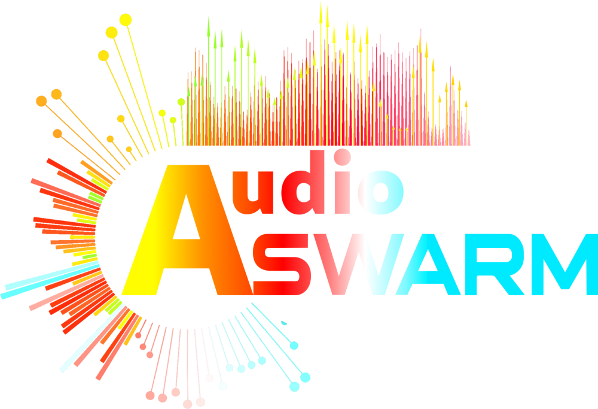

# Audio-SWARM

**Audio-Sound Waveform & bulk Album/Artwork-cover batch Remix Motif** 

Audio-SWARM is a Bulk Sound Waveform & Album Cover Art Generator.

---

## ✍️ Created by

Patrice Laborda

## 📝 About Audio-SWARM

Audio-SWARM is a desktop application for generating audio waveform images and circular visualizations, and for pairing existing artwork with audio files. It is designed to help creators prepare visual assets for their audio projects.

Audio-SWARM creates images; it does not create or modify the sound itself.

 

## 💻 Development status

Audio-SWARM is currently in development.

## ⚗️ Development History

Audio-SWARM did not start as the application it is today.

Its origins go back to a simple Python script initially developed and executed through the terminal. 
It started as a basic script for my personal needs, then evolved into a simple GUI before becoming a project named **WaveStudio**: a single-file Tkinter application combining its graphical interface, waveform generation, audio processing, and artwork management in one large script.

As functionality expanded, that original structure became increasingly difficult to maintain and develop. A major refactoring followed, breaking the application into separate modules and establishing a more organized architecture.

The project subsequently evolved into **Audio-SWARM (Audio-Sound Waveform & bulk Album/Artwork-cover batch Remix Motif)**, with a redesigned interface, an expanded feature set, and continued improvements to its processing engine.

**Alpha 6 represents the sixth major internal development iteration** of this ongoing project. It is the first public release, and development is still actively underway.

---

## ⚖️ Licence for this development build

License: GNU AGPLv3 is the licence selected for the current development build.

[Read the official License: AGPLv3](https://www.gnu.org/licenses/agpl-3.0.html)
