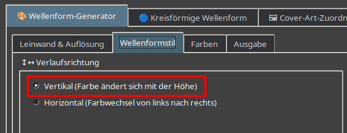
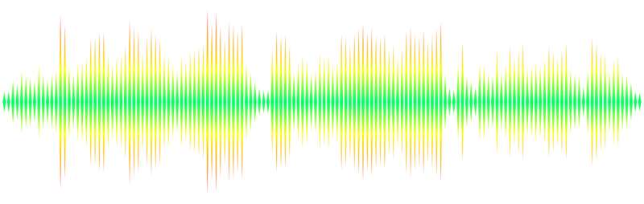

# Audio-SWARM-Hilfe
- [Inhaltsverzeichnis](#contents)

**Audio-SWARM**: Audio-Soundwave-Generator und Stapelverarbeitung für Albumcover, Artwork und Remix-Motive.

Audio-SWARM erstellt aus Audiodateien in großen Mengen visuelle Waveform-Albumcover. Audio-SWARM kann aus nahezu jedem Audiodateiformat herkömmliche lineare Waveform-Bilder mit Farbverläufen generieren.

Audio-SWARM kann kreisförmige Waveform-Bilder, radiale Spektren und minimalistische kreisförmige Designs erstellen oder vorhandene Bilder, Albumcover und Artwork-Coverbilder in einem einzigen Stapelverarbeitungsvorgang mit Audiotiteln kombinieren.

* Durch das Einbetten von Bildern in Audiodateien können kompatible Mediaplayer wie VLC und Celluloid sowie Smartphones und Fernseher beim Abspielen eines Songs oder einer Audiodatei das eingebettete Artwork anzeigen.

### Audio-SWARM erstellt druckbare Waveform-Artworks in extrem hoher Auflösung.

Die von Audio-SWARM generierten Bilder können mit einer Auflösung von bis zu 12.000 Pixeln exportiert werden und eignen sich damit für hochwertige Drucke und hochauflösende Filmplakate.

Audio-SWARM erstellt aus kompakten Waveform-Bildern mit geringer Dateigröße detaillierte Grafiken, die sich **für Albumcover-Drucke, Großformatdrucke, gerahmte Waveform-Artworks, Wandbilder und übergroße Drucke im Format von Filmplakaten** eignen.

Audio-SWARM wurde entwickelt, um außergewöhnliche Details und eine hohe Bildschärfe zu bieten. So lassen sich Artworks für verschiedenste Druckgrößen erstellen – von kleinen Albumcovern bis hin zu riesigen Postern und großformatigen gerahmten Bildern. Ganz gleich, ob du Waveform-Albumcover erstellst, Artwork für den professionellen Druck vorbereitest, gerahmte Kunstdrucke gestaltest oder großformatige Poster produzierst: Audio-SWARM erweckt digitale Kunstwerke als beeindruckende physische Drucke mit außergewöhnlichem Detailreichtum zum Leben.

## Inhalt <!-- anchor: contents -->
- [1. Was ist Audio-SWARM?](#what-is-swarm)
- [2. Schnellstart](#quick-start)
- [3. Die Benutzeroberfläche verstehen](#interface)
- [4. Sound Wave Maker](#sound-wave-maker)
- [5. Circular Waveform](#circular-waveform)
- [6. Bulk Artwork Linker](#bulk-artwork-linker)
- [7. Stapelverarbeitung und Ausgabeordner](#batch-output)
- [8. Auflösung und Leistung](#resolution-performance)
- [9. Referenz zu Farben und Geometrie](#colors-geometry)
- [10. Fehlerbehebung](#troubleshooting)
- [11. Sprachen und Beiträge](#languages-contributions)

## 1. Was ist Audio-SWARM? <!-- anchor: what-is-swarm -->

**Audio-SWARM (Audio-Sound Waveform & bulk Album/Artwork-cover batch Remix Motif)** erstellt Grafiken aus Audiodateien und kann Coverbilder in unterstützte Audioformate einbetten. Es bietet drei Werkzeuge:

- **Sound Wave Maker** erstellt klassische Wellenformbilder mit vertikalem oder horizontalem Verlauf, verschiedenen Balkenformen, Farben, Farbverläufen und Auflösungseinstellungen.
- **Circular Waveform** erstellt kreisförmige Wellenformen, radiale Spektrumanzeigen und minimalistische kreisförmige Liniengrafiken.
- **Bulk Artwork Linker** ordnet vorhandene Bilder den Audiodateien im ausgewählten Ordner zu und bettet Coverbilder ein, sofern das Audioformat dies unterstützt. Die Zuordnung erfolgt anhand der alphabetisch sortierten Dateinamen. Benennen Sie die Dateien daher so, dass die gewünschte Reihenfolge entsteht.

### Bildausgabe

Sound Wave Maker und Circular Waveform exportieren Grafiken als **PNG oder JPG**. Wählen Sie die Bildabmessungen je nach Verwendungszweck: kleinere Bilder für den alltäglichen Einsatz oder große, hochauflösende Bilder für detaillierte Darstellungen und den Druck. Kreisförmige Bilder können mit bis zu 8000 Pixeln gerendert werden. PNG unterstützt Transparenz; JPG verwendet einen einfarbigen Hintergrund.

### Cover einbetten und Audio erhalten

Wenn das Format unterstützt wird, bettet Audio-SWARM das Bild in eine neue Ausgabekopie von Audiodateien im Format **MP3, OGG/OGA, FLAC, M4A und AIFF/AIF** ein. Zum Einbetten von Coverbildern in OGG/OGA und AIFF/AIF wird das optionale Python-Paket `mutagen` benötigt. WAV bettet in diesem Audio-SWARM-Arbeitsablauf keine Coverbilder ein; Audiodatei und Bild werden daher nebeneinander gespeichert.

**Raw AAC ist die Ausnahme:** Für rohes AAC gibt es in diesem Arbeitsablauf keinen standardisierten Container für Coverbilder. Zum Einbetten legt Audio-SWARM den ursprünglichen AAC-Audiostream in einen M4A-Container und erstellt eine Datei mit der Endung `_with_art.m4a`. Der Audiostream selbst wird weder neu kodiert noch neu abgetastet.

Audio-SWARM verändert die Quelldatei nicht. Wenn eine Ausgabedatei mit eingebettetem Cover erstellt wird, kopiert Audio-SWARM den ursprünglichen kodierten Audiostream, ohne ihn neu zu kodieren oder neu abzutasten. Zur Berechnung der Wellenform erstellt Audio-SWARM eine temporäre Audiokopie zur Analyse. Diese wird nur für die Visualisierung verwendet und anschließend gelöscht. Sie dient niemals als gespeicherte Audioausgabe. **Das Audio in der gespeicherten Ausgabe bleibt das Originalaudio.**

## 2. Schnellstart <!-- anchor: quick-start -->

1. **Eingabe auswählen.** Wählen Sie in **Sound Wave Maker** oder **Circular Waveform** eine unterstützte Audiodatei für ein einzelnes Bild oder einen Ordner für die Stapelverarbeitung. Verwenden Sie das Pfadfeld und die Schaltfläche Browse, oder ziehen Sie eine unterstützte Audiodatei bzw. einen Ordner auf eine beliebige Stelle im Audio-SWARM-Fenster.  
   Wählen Sie für **Bulk Artwork Linker** einen Ordner mit Audiodateien und den dazugehörigen Coverbildern aus oder ziehen Sie ihn in das Fenster. Dieses Werkzeug verarbeitet Ordner, keine einzelne Audiodatei.
2. **Hauptregisterkarte auswählen:**
   - **Sound Wave Maker** — klassische Wellenformbilder erstellen.
   - **Circular Waveform** — kreisförmige Wellenformen, radiale Spektren oder minimalistische Kreisdesigns erstellen.
   - **Bulk Artwork Linker** — vorhandene Bilder den Audiodateien in einem Ordner zuordnen.
3. Passen Sie die gewünschten Einstellungen an. Wenn Sie unsicher sind, behalten Sie die Standardwerte bei. Standardmäßig werden Bilder als **PNG mit transparentem Hintergrund** ausgegeben. Unter **Output Format** können Sie JPG oder einen einfarbigen Hintergrund auswählen.
4. Klicken Sie auf die Generierungs- oder Verarbeitungsschaltfläche. Verfolgen Sie Status, Fortschrittsbalken und Protokoll im unteren Bereich. Durch Ziehen und Ablegen wird nur die Eingabe ausgewählt; die Verarbeitung startet dadurch nicht.
5. Überprüfen Sie nach Abschluss den Ausgabeordner, der im Protokoll oder in der Abschlussmeldung angegeben ist.

Sound Wave Maker und Circular Waveform können Ordner rekursiv verarbeiten und die Unterordnerstruktur der Quelle in der Ausgabe beibehalten. Bulk Artwork Linker durchsucht nur die oberste Ebene des ausgewählten Ordners und ordnet Audio- und Bilddateien anhand ihrer jeweils separat sortierten Dateilisten zu. Audio-SWARM erkennt nicht automatisch, welches Bild zu welchem Titel gehört. Achten Sie darauf, dass die Dateinamen in sortierter Reihenfolge den gewünschten Paaren entsprechen.

### ⚠️ Informationen zu Schiebereglern

- Wählen Sie die gewünschte Größe und passen Sie sie anschließend präzise an, indem Sie neben den Reglergriff klicken, um kleine Änderungen vorzunehmen.

### ⚠️ Warnung zu Vertical Flow:

Bei **Sound Wave Maker → Waveform Style → Vertical Flow** kann die Verarbeitung deutlich länger dauern als bei anderen Optionen, insbesondere bei mehrfarbigen Farbverläufen.
- Das Protokoll scheint möglicherweise nicht mehr aktualisiert zu werden, oder Audio-SWARM wirkt vorübergehend nicht mehr ansprechbar. Schließen Sie Audio-SWARM nicht sofort. Dieser Modus kann einfach mehr Zeit benötigen.
- Warten Sie, bis der Vorgang abgeschlossen ist, besonders bei großen Bildern oder Stapeln mit vielen Dateien.

## 3. Die Benutzeroberfläche verstehen <!-- anchor: interface -->

- **Eingabepfadfeld:** zeigt die ausgewählte Audiodatei oder den Quellordner für das aktuelle Werkzeug. Mit der danebenliegenden Schaltfläche **Browse** öffnen Sie die Dateiauswahl oder Ordnerauswahl Ihres Systems.
- **Ziehen und Ablegen:** Sie können auch eine unterstützte Audiodatei oder einen Ordner an beliebiger Stelle auf das Audio-SWARM-Fenster ziehen. Dadurch wird der Eingabepfad aktualisiert, wie bei einer Auswahl über **Browse**. Das Ablegen startet keine Verarbeitung. Bulk Artwork Linker benötigt einen Ordner mit Audio- und Bilddateien, keine einzelne Audiodatei.
- **Sprachauswahl:** ändert die Sprache der Oberfläche und lädt das entsprechende Hilfedokument, sofern es vorhanden ist. Fehlt ein übersetztes Hilfedokument, verwendet Audio-SWARM die englische Hilfe.
- Sie können die Sprache jederzeit ändern, ohne bereits konfigurierte Einstellungen zu verlieren.

Audio-SWARM ist in **Hauptregisterkarten**, **Unterregisterkarten**, Eingabesteuerelemente und Verarbeitungsanzeigen gegliedert. Jeder Bereich hat eine bestimmte Aufgabe:

- **Hauptregisterkarten:** wählen eines der drei Werkzeuge **Sound Wave Maker**, **Circular Waveform** oder **Bulk Artwork Linker** aus. **Help / About** öffnet die Dokumentation und Programminformationen.
- **Unterregisterkarten:** gruppieren die Einstellungen eines Werkzeugs in kleinere Bereiche. Beim Wechsel der Unterregisterkarte startet keine Verarbeitung.
- **Generierungs- oder Verarbeitungsschaltfläche:** startet den Vorgang für das ausgewählte Werkzeug mit der aktuellen Eingabe und den aktuellen Einstellungen. Prüfen Sie vor dem Start den Pfad und die Optionen.

**Wichtiger Hinweis:** Einige Einstellungen in **Sound Wave Maker** wirken sich auch auf **Circular Waveform** aus, darunter Geometrie- und Farbeinstellungen. Um Änderungen auf kreisförmige Grafiken anzuwenden, wählen Sie die gewünschten Einstellungen in Sound Wave Maker, wechseln Sie **zurück** zur Registerkarte Circular Waveform und klicken Sie auf **Generate Circular Waveforms**.

- **Fortschrittsbalken:** zeigt den Fortschritt während der Verarbeitung an, besonders bei Stapelverarbeitung. Manche Verarbeitungsschritte aktualisieren ihn nicht fortlaufend.
- **Statuszeile:** zeigt kurz an, was Audio-SWARM gerade ausführt oder welches Ergebnis erzielt wurde.
- **Protokoll:** erfasst Informationen wie gefundene Dateien, erstellte Ausgaben, Warnungen und Fehler. Bei längeren Aufgaben wird das Protokoll möglicherweise nicht ständig aktualisiert; das bedeutet nicht zwangsläufig, dass Audio-SWARM nicht mehr arbeitet.
- **Cancel:** fordert Audio-SWARM auf, einen laufenden Stapel abzubrechen. Eine Datei, die gerade gerendert oder kodiert wird, muss möglicherweise erst den aktuellen Schritt beenden.

Einige Seiten sind höher als das Fenster. Verwenden Sie die vertikale Bildlaufleiste oder das Mausrad, um weiter unten liegende Steuerelemente zu erreichen.

## 4. Sound Wave Maker <!-- anchor: sound-wave-maker -->

Sound Wave Maker erstellt aus jeder unterstützten Audiodatei ein Wellenformbild. Die Unterregisterkarten gruppieren die Einstellungen nach Zweck.

Bei rekursiver Ordnerverarbeitung werden die Bilder im Ordner `Waveform_Outputs` gespeichert; die Unterordnerstruktur der Quelle wird darunter gespiegelt. Bei einer einzelnen Datei wird die Ausgabe neben der Quelldatei abgelegt. MP3, OGG/OGA, FLAC, M4A und AIFF/AIF können eingebettete Coverbilder erhalten. Bei rohem AAC wird eine Datei mit der Endung `_with_art.m4a` erstellt, da rohes AAC keinen standardisierten Container für Coverbilder hat. Bei WAV wird das Bild separat gespeichert. Zum Einbetten in OGG/OGA und AIFF/AIF wird das Python-Paket `mutagen` benötigt. Ist es nicht verfügbar, behält Audio-SWARM das separate Bild und protokolliert einen Fehler.

### Canvas & Resolution
#### Render Resolution Framework Configuration

- **Preset Dimensions Matrix Selector:** wählt eine vordefinierte Arbeitsflächengröße und ein Seitenverhältnis für gängige Formate, darunter Querformat, Hochformat und quadratische Coverbilder. Die Voreinstellung legt Breite und Höhe automatisch fest.
- **Canvas Width Limit:** legt die Ausgabebreite in Pixeln zwischen 10 und 8000 fest.
- **Canvas Height Limit:** legt die Ausgabehöhe in Pixeln zwischen 10 und 8000 fest.

Wenn Sie Breite oder Höhe manuell ändern, wechselt die Voreinstellung zu **Custom Mapping Coordinates**, sodass Sie eigene Bildabmessungen festlegen können.

Größere Abmessungen ergeben Bilder mit mehr Pixeln und eignen sich für detaillierte Grafiken, hochauflösende Bildschirme und den Druck. Sie benötigen allerdings mehr Verarbeitungszeit und Arbeitsspeicher und erzeugen größere Dateien.

#### Waveform Structural Core Densities

- **Total Grid Bar Count Mapping Layout:** legt die Anzahl der Wellenformbalken zwischen 40 und 500 fest. Ein kleinerer Wert erzeugt weniger, breitere Balken; ein höherer Wert erzeugt eine dichtere Wellenform mit schmaleren Balken. Mehr Balken können die Verarbeitungszeit erhöhen.
- **Gradient Processing Slice Resolution:** legt die Anzahl der Farbschritte für die Darstellung von Farbverläufen fest. Mehr Schritte können weichere Übergänge ergeben, erhöhen aber unter Umständen die Verarbeitungszeit deutlich, insbesondere bei mehrfarbigen Verläufen mit Vertical Flow. **Solid Flat Color** verwendet keine Verlaufssegmente und wird daher wesentlich schneller verarbeitet.
- **Canvas Target Printing Resolution (DPI):** legt die Metadaten zur Druckauflösung des Bildes fest. Die Pixelabmessungen werden dadurch nicht verändert; diese werden separat über Canvas Width und Canvas Height bestimmt. Bei gleicher Pixelgröße führt ein höherer DPI-Wert zu einem kleineren physischen Druck mit mehr Pixeln pro Zoll.

### Waveform Style
#### Gradient Spectrum Axis Orientation

- **Vertical Flow** ordnet die Verlaufsfarben entlang der Höhe jedes Balkens an.
- **Horizontal Flow** ordnet die Farben entlang der Wellenform von links nach rechts an.

### Waveform Bar Peak Geometry Style
Wählen Sie die Form der Wellenformbalken und ihrer Spitzen:

- **Standard Classic Bars:** rechteckige Balken mit flachen Enden.
- **Smooth Capsule:** Balken mit weich abgerundeten Enden.
- **Lollipop:** schmale Stiele mit einer runden Kappe an jeder Spitze.
- **Sharp Spikes:** Balken mit spitz zulaufenden Enden.
- **Arrow-Spear:** Balken mit deutlich pfeilförmigen Spitzen.

Die gewählte Geometrie wirkt sich auch auf die entsprechenden Modi in Circular Waveform und Radial Spectrum aus. Minimal Circular Waveform verwendet eine durchgehende Linie statt einzelner Balken; deshalb gelten diese Geometrieoptionen dort nicht.
Jeder Balken steht für die Amplitude des Audiosignals in einem kurzen Zeitabschnitt. Seine Höhe spiegelt den Signalpegel wider; die gewählte Geometrie bestimmt, ob die Spitze flach, rund, kreisförmig, spitz oder pfeilförmig dargestellt wird.

### Colors
Im Unterregister **Colors** können Sie mehrere Farben zu einem Verlauf kombinieren oder eine einzelne Volltonfarbe verwenden.

- **Color nodes:** jede Schaltfläche **Node Color** steht für einen Farbstopp im Verlauf. Klicken Sie darauf, um die Farbe auszuwählen. Die Vorschauleiste zeigt die Mischung der Farben in ihrer aktuellen Reihenfolge.
- **Add Color Node:** fügt einen weiteren Farbstopp hinzu, bis zu maximal 10.
- **Remove Last Node:** entfernt den letzten Farbstopp. Im Verlaufsmodus bleiben mindestens zwei Knoten erhalten.
- **Invert Layer Core Coordinates Processing Direction (Reverse Vector Flow):** kehrt die Reihenfolge der Verlaufsfarben um und verändert damit ihre Richtung auf der Wellenform.
- **Enable Solid Flat Color:** verwendet eine einzige ausgewählte Farbe für die gesamte Wellenform, ohne Verlaufssegmente zu berechnen. Das ist besonders bei Vertical Flow deutlich schneller. Die Umkehrung der Verlaufsrichtung ist in diesem Modus deaktiviert. Auch Gradient Processing Slice im Register Canvas & Resolution wird deaktiviert. Beim Zurückwechseln zum Verlaufsmodus werden zwei Farbknoten wiederhergestellt; zusätzliche Knoten müssen erneut hinzugefügt werden.

### Output Format

- **Output Raster Format:** wählt PNG oder JPG für die erzeugten Wellenformbilder. PNG ist standardmäßig ausgewählt und unterstützt Transparenz. JPG unterstützt keine Transparenz; bei Auswahl von JPG wird die Transparenzoption automatisch deaktiviert.
- **Enable 100% Alpha Channel Canvas Transparency Block:** aktiviert einen transparenten Hintergrund für PNG-Bilder. Bei aktiver Transparenz ist die Hintergrundfarbschaltfläche gesperrt und zeigt **Locked (Transparent)** an.
- **Pick Backdrop Color:** wenn Transparenz deaktiviert ist, können Sie hier eine einfarbige Hintergrundfarbe auswählen. Die gewählte Farbe bleibt erhalten, wenn Sie zwischen PNG, JPG und Transparenzeinstellungen wechseln.
- **Retain standalone high-res images inside workspace alongside embedded items:** ist standardmäßig aktiviert. Wenn Audio-SWARM das Bild erfolgreich in eine unterstützte Audiodatei eingebettet hat, bleibt die separate hochauflösende Bilddatei neben der Audioausgabe erhalten. Ist die Option deaktiviert, wird das separate Bild nach erfolgreichem Einbetten gelöscht. Bei einem Fehler bleibt das separate Bild erhalten.

Die ausgewählten Farben, Verlaufsrichtung, das Ausgabeformat, die Transparenz- und Hintergrundoptionen, Vertical Flow oder Horizontal Flow sowie Balken-, Spitzen- und Geometrieeinstellungen werden auch von Circular Waveform, Radial Spectrum und Minimal Circular Waveform verwendet. Um Änderungen auf kreisförmige Grafiken anzuwenden, wechseln Sie zurück zur Registerkarte Circular Waveform und klicken Sie auf **Generate Circular Waveforms**.

## 5. Circular Waveform <!-- anchor: circular-waveform -->

Circular Waveform erstellt kreisförmige Visualisierungen aus Audiodateien. Wählen Sie über die Unterregisterkarten einen der drei Modi.

#### Gemeinsame Einstellungen

- **Output Size (square pixels):** legt Breite und Höhe des quadratischen Bildes zwischen 256 und 8000 Pixeln fest.
- **Rotation (degrees):** dreht die Grafik um einen Wert zwischen 0° und 359°.

### Mode: Circular Waveform

Stellt Wellenformbalken kreisförmig angeordnet dar.

- **Inner Radius:** bestimmt die Größe des freien Bereichs in der Mitte. Ein größerer Wert erzeugt eine größere zentrale Öffnung.
- **Outward:** die Balken zeigen von der kreisförmigen Grundlinie nach außen.
- **Inward:** die Balken zeigen zur Mitte.
- **Inward + Outward:** aktivieren Sie beide Kontrollkästchen, damit sich die Balken in beide Richtungen erstrecken. Mindestens eine Richtung bleibt immer ausgewählt; wenn Sie die einzige aktive Richtung abwählen, wird automatisch die andere aktiviert.
- **Wellenformgeometrie:** verwendet die unter Sound Wave Maker → Waveform Style ausgewählte Geometrie, einschließlich Standard Classic Bars, Smooth Capsules, Lollipop, Sharp Spikes und Arrow-Spear.

### Mode: Radial Spectrum

Zeigt die Frequenzenergie des Audios als radial angeordnete Balken rund um einen Kreis.

- **Inner Radius:** bestimmt die Größe der zentralen Öffnung.
- **Frequency Bands:** legt die Anzahl der rund um den Kreis dargestellten Frequenzbänder fest. Mehr Bänder zeigen feinere Frequenzdetails.
- **Sensitivity:** steuert die visuelle Stärke der Spektrumbalken. Erhöhen Sie den Wert, um Frequenzunterschiede deutlicher hervorzuheben.
- **Outward und Inward:** legen fest, ob die Balken von der Grundlinie weg, zur Mitte hin oder in beide Richtungen verlaufen.

### Mode: Minimal Circular Waveform

Zeichnet eine durchgehende Linie um einen Kreis statt einzelner Balken.

- **Base Radius:** bestimmt den Grundradius der Kreislinie.
- **Wave Amplitude:** bestimmt, wie weit sich die Linie vom Grundradius entfernt. Höhere Werte erzeugen stärkere Ausschläge.
- **Line Width:** legt die Linienstärke fest.

In diesem Modus werden weder die Geometrieauswahl für Wellenformen noch die Richtungsoptionen Inward/Outward verwendet.

### Gemeinsame Farb- und Ausgabeeinstellungen

Circular Waveform, Radial Spectrum und Minimal Circular Waveform verwenden gemeinsam die Farbknoten, Verlaufsrichtung, das Ausgabeformat, Transparenz- und Hintergrundoptionen, DPI sowie die Einstellung zum Einbetten von Coverbildern aus Sound Wave Maker.

Die Einstellungen **Vertical Flow** und **Horizontal Flow** unter Sound Wave Maker → Waveform Style beeinflussen ebenfalls, wie Verlaufsfarben auf Circular Waveform, Radial Spectrum und Minimal Circular Waveform angewendet werden. Wählen Sie in Sound Wave Maker die gewünschte Verlaufsrichtung aus.

#### Hinweis
Einige Einstellungen in Sound Wave Maker wirken sich auch auf kreisförmige Grafiken aus, darunter Geometrie und Farben. Wählen Sie die gewünschten Einstellungen in Sound Wave Maker, wechseln Sie **zurück** zu Circular Waveform und klicken Sie auf **Generate Circular Waveforms**, um die Änderungen anzuwenden.

Bei der Verarbeitung eines Ordners erstellt Audio-SWARM den Ordner `Circular_Waveform_Outputs` und erhält die Struktur der Quellunterordner. Verschiedene Modi verwenden eigene Dateinamenszusätze, damit ihre Ausgaben einander nicht überschreiben.

## 6. Bulk Artwork Linker <!-- anchor: bulk-artwork-linker -->

Bulk Artwork Linker ordnet unterstützte Audiodateien (MP3, OGG/OGA, WAV, FLAC, M4A, AAC und AIFF/AIF) PNG-, JPG- oder JPEG-Bildern im ausgewählten Ordner zu. Audio- und Bilddateinamen werden jeweils separat sortiert; anschließend werden die Dateien nach ihrer Position in den beiden Listen gepaart. Benennen Sie die Dateien vor dem Start so um, dass die sortierte Reihenfolge den gewünschten Zuordnungen entspricht.

**Es wird dringend empfohlen**, genauso viele Bilder wie Audiodateien zu verwenden. Bereiten Sie die Bilder möglichst bereits mit den gewünschten Pixelabmessungen und dem gewünschten Seitenverhältnis vor. Der Bildgrößenanpasser von Audio-SWARM dient nur dazu, Bildabmessungen zu vereinheitlichen. Weicht das Seitenverhältnis eines Bildes vom Zielformat ab, können oben und unten oder links und rechts schwarze Balken hinzugefügt werden, um die ursprünglichen Proportionen beizubehalten.

Die Größenanpassungsoption skaliert Bilder auf die gewählten Zielabmessungen. Ist die Beibehaltung des Seitenverhältnisses aktiviert, wird das Bild in die Zielarbeitsfläche eingepasst; andernfalls wird es auf die exakten Abmessungen gestreckt. Für die Größenanpassung wird Pillow benötigt. Ist es nicht verfügbar, verwendet das Werkzeug die Originalbildgröße.

Ausgaben für MP3, OGG/OGA, FLAC, M4A und AIFF/AIF werden als neue Dateien mit `_with_art` im Namen gespeichert. Rohe AAC-Dateien werden mit dem unveränderten AAC-Audiostream in einen M4A-Container verpackt. WAV speichert in diesem Audio-SWARM-Arbeitsablauf keine eingebetteten Coverbilder; daher werden Audiodatei und Bild nebeneinander kopiert. Für OGG/OGA- und AIFF/AIF-Coverbilder wird Mutagen benötigt (siehe optionale Anforderungen). Die Ergebnisse werden im Ordner `Merged_Tracks_Outputs` abgelegt. Dieses Werkzeug durchsucht nur die oberste Ebene des ausgewählten Ordners, nicht dessen Unterordner. Wenn die Anzahl der Audio- und Bilddateien unterschiedlich ist, verarbeitet Audio-SWARM nur die vollständigen Paare und protokolliert eine Warnung.

## 7. Stapelverarbeitung und Ausgabeordner <!-- anchor: batch-output -->

Sound Wave Maker und Circular Waveform verarbeiten Stapel rekursiv. In ihren speziellen Ausgabeordnern bleibt die Unterordnerstruktur der Quelle erhalten, damit gleichnamige Dateien aus unterschiedlichen Quellordnern nicht miteinander kollidieren. Bulk Artwork Linker verarbeitet nur Dateien direkt im ausgewählten Ordner.

Prüfen Sie vor einem großen Stapel den ausgewählten Ordner und den Ausgabeort. Bei einem erneuten Durchlauf können vorhandene Ausgabedateien mit demselben Namen ersetzt werden. Sichern Sie wichtige Dateien und legen Sie keine nicht zugehörigen Eingabedateien in generierten Ausgabeordnern ab.

## 8. Auflösung und Leistung <!-- anchor: resolution-performance -->

Canvas Width und Canvas Height legen die Bildabmessungen in Pixeln fest. DPI steuert die Metadaten zur Druckauflösung; Audio-SWARM rendert weiterhin mit den ausgewählten Pixelabmessungen. Große Bilder benötigen mehr Arbeitsspeicher und Zeit und erzeugen größere Dateien.

Ein höherer Balkenwert erzeugt mehr Balken und kann diese schmaler machen. Gradient Processing Slice Resolution legt fest, wie viele diskrete Farbschritte in segmentierten Verläufen verwendet werden. Mehr Schritte können weichere Übergänge ergeben, benötigen aber möglicherweise mehr Zeit.

**Gradient Smoothness:** Wenn der Farbverlauf nicht glatt genug aussieht, versuchen Sie den Wert **200**. Dabei wird als Alternative ein anderer Algorithmus verwendet.

Solid Flat Color überspringt die Verarbeitung der Verlaufssegmente. Testen Sie zunächst eine mittlere Bildgröße und wenige Audiodateien, bevor Sie einen sehr großen Stapel rendern.

## 9. Referenz zu Farben und Geometrie <!-- anchor: colors-geometry -->

- **Rectangle:** klassische Balken mit flachen Enden.
- **Smooth Capsules:** Balken mit abgerundeten Enden.
- **Lollipop:** schmaler Stiel mit einer runden Kappe an der Spitze.
- **Sharp Spikes:** Balken mit dreieckig zulaufenden Spitzen.
- **Arrow-Spear:** schmale Balken mit einer deutlich pfeilförmigen Spitze.

Verwenden Sie **Vertical Flow**, wenn sich die Farbe entlang der Höhe jedes Balkens ändern soll. Verwenden Sie **Horizontal Flow**, wenn sich der Farbverlauf von einer Seite der Wellenform zur anderen erstrecken soll. **Solid Flat Color** eignet sich für ein einfarbiges Design und vermeidet die Verlaufssegmentierung. Farbknoten legen die Verlaufsstopps fest; die Vorschau zeigt deren Reihenfolge.

## 10. Fehlerbehebung <!-- anchor: troubleshooting -->

- **Keine Dateien gefunden:** Prüfen Sie, ob der Ordnerpfad stimmt und Dateien in einem vom ausgewählten Werkzeug unterstützten Audio- oder Bildformat enthält.
- **Cover fehlt oder Zuordnung unvollständig:** Bulk Artwork Linker ordnet separat sortierte Dateilisten nach Position zu. Prüfen Sie Dateinamen und die Anzahl der Dateien in beiden Listen.
- **Unerwarteter Ausgabeort:** Prüfen Sie die Abschlussmeldung und den Namen des Ausgabeordners.
- **Eine Datei wurde ersetzt:** Ausgaben können bei wiederholten Durchläufen denselben Namen erhalten. Sichern oder verschieben Sie frühere Ergebnisse vor dem erneuten Start.
- **Einbetten fehlgeschlagen:** Prüfen Sie das Anwendungsprotokoll und stellen Sie sicher, dass FFmpeg installiert ist und die Quelldatei lesen kann.
- **Langsames Rendern oder hoher Speicherbedarf:** Verringern Sie die Pixelabmessungen, reduzieren Sie die Stapelgröße oder verwenden Sie weniger Balken bzw. Verlaufssegmente.
- **Hilfe in einer Sprache fehlt:** Wenn das Hilfedokument der ausgewählten Sprache nicht vorhanden ist, verwendet Audio-SWARM `help/en.md`.

Wenn das Problem weiterhin besteht, speichern Sie den Protokolltext und notieren Sie das ausgewählte Werkzeug, den Modus, das Dateiformat und die verwendeten Einstellungen.

## 11. Sprachen und Beiträge <!-- anchor: languages-contributions -->

Übersetzungen der Benutzeroberfläche werden als JSON-Dateien im Ordner `languages/` gespeichert. Hilfedokumente liegen als Markdown-Dateien im Ordner `help/`, Informationen zum Programm als Markdown-Dateien in `about/`. Die JSON- und Markdown-Dateien verwenden den Sprachcode als Dateinamen, beispielsweise `en.md` für Englisch, `fr.md` für Französisch oder `ja.md` für Japanisch.

Um eine Übersetzung beizutragen, **kopieren Sie die englische Datei aus dem entsprechenden Ordner**, übersetzen Sie den Fließtext und die Überschriften und speichern Sie die Datei unter dem passenden Sprachcode. Lassen Sie HTML-Ankerkommentare und Ziele im Inhaltsverzeichnis unverändert, damit die Abschnittslinks funktionieren.

Speichern Sie die Dateien als UTF-8!

Übersetzen Sie keine Dateinamen, Codebeispiele, Einstellungsbezeichnungen oder Ordnernamen, wenn sie exakt mit der Anwendung übereinstimmen müssen. Halten Sie die Übersetzungen mit der englischen Masterdatei synchron und melden Sie unklare Formulierungen oder veraltetes Verhalten. Fehlt eine sprachspezifische Hilfe- oder About-Datei, verwendet Audio-SWARM das entsprechende englische Dokument.
