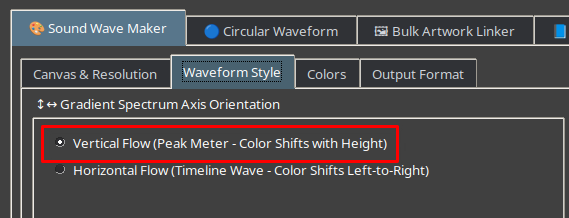
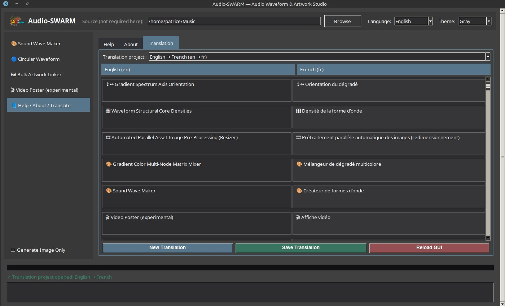
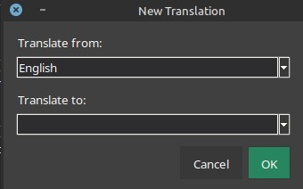
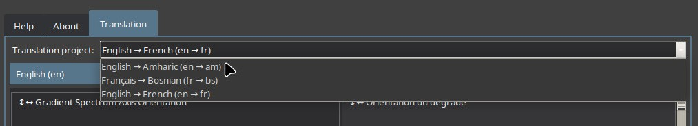

# Audio-SWARM Help
- [Table Of Contents](#contents)

**Audio-SWARM**: Audio-Sound Waveform & bulk Album/Artwork-cover batch Remix Motif.

Audio-SWARM creates visual waveform album artwork from audio files in bulk. Audio-SWARM can generate conventional, linear waveform images with gradient from almost any audio file type.

Audio-SWARM can create circular waveform images, create radial spectrum and minimalist circular designs, or pair existing images, album covers, and artwork cover images with audio tracks in a single batch.

* Embedding images in audio files allows compatible media players, such as VLC and Celluloid, as well as smartphones and TVs, to display the embedded artwork when playing the song or audio file.

### Audio-SWARM creates printable very high-resolution waveform artwork.
The generated images by Audio-SWARM can also be exported at resolutions of up to 12 000 pixels, making them suitable for high-quality printing, and high-resolution movie posters.

Audio-SWARM can create from compact, low-file-size waveform images, to producing detailed visuals suitable **for album cover prints, large-format printing, framed waveform artwork, wall art, and oversized movie-poster-sized prints.**

Designed to deliver exceptional visual detail and clarity, Audio-SWARM enables artwork to be created for a wide range of print sizes, from small album covers to huge posters and large framed displays.
Whether you're creating a waveform album cover art, preparing artwork for professional printing, designing framed prints, or producing large-format posters, Audio-SWARM helps bring digital artwork to life as stunning physical prints with exceptional detail.

## Contents <!-- anchor: contents -->
- [1. What is Audio-SWARM?](#what-is-swarm)
- [2. Quick start](#quick-start)
- [3. Understanding the interface](#interface)
- [4. Sound Wave Maker](#sound-wave-maker)
- [5. Circular Waveform](#circular-waveform)
- [6. Bulk Artwork Linker](#bulk-artwork-linker)
- [7. Batch processing and output folders](#batch-output)
- [8. Resolution and performance](#resolution-performance)
- [9. Colors and geometry reference](#colors-geometry)
- [10. Troubleshooting](#troubleshooting)
- [11. Languages and contributions](#languages-contributions)
- [12. Audio-SWARM's translation tool (YES, you can translate here)](#translation-tool)
- [13. How to submit your translation](#submit-translation)

## 1. What is Audio-SWARM? <!-- anchor: what-is-swarm -->

**Audio-SWARM (Audio-Sound Waveform & bulk Album/Artwork-cover batch Remix Motif)** creates visual artwork from audio files and can add cover images to supported audio formats. It offers three tools:

- **Sound Wave Maker** creates conventional waveform images, with vertical or horizontal flow, different bar styles, colors, gradients, and resolution settings.
- **Circular Waveform** creates circular waveform artwork, radial spectrum visualizations, and minimal circular line designs.
- **Bulk Artwork Linker** pairs existing images with audio files in the selected folder and embeds cover artwork when the audio format supports it. It pairs files by sorted filename order, so arrange names in the order of the intended pairs.

### Image output

Sound Wave Maker and Circular Waveform export artwork as **PNG or JPG**. Choose the image dimensions to create lower-resolution images for everyday use or large, high-resolution images for detailed display or printing. Circular images can be rendered up to 8000 pixels. PNG supports transparency; JPG uses a solid background.

### Embedding artwork and preserving audio

When supported, Audio-SWARM embeds the image in a new output copy of **MP3, OGG/OGA, FLAC, M4A, and AIFF/AIF** audio files. OGG/OGA and AIFF/AIF artwork embedding require the optional Python package `mutagen`. WAV does not embed cover artwork in Audio-SWARM's workflow, so the audio file and image are saved side by side.

**Raw AAC is the one container exception:** raw AAC has no standard cover-art container in this workflow. To embed artwork, Audio-SWARM places the original AAC audio stream inside an M4A container and creates a file ending in `_with_art.m4a`. The audio stream itself is not re-encoded or resampled.

Audio-SWARM does not modify the source audio file. When it creates an output audio file with embedded artwork, it copies the original encoded audio stream without re-encoding or resampling it. To calculate a waveform, Audio-SWARM uses a temporary analysis copy of the audio; that copy is used only to calculate the visualization and is deleted afterward. It is never used as the saved audio output. **The audio in the saved output remains the original audio.**

## 2. Quick start <!-- anchor: quick-start -->

1. **Choose your input.** In **Sound Wave Maker** or **Circular Waveform**, select one supported audio file for a single image, or choose a folder to process a batch. Use the path field and Browse button, or drag and drop a supported audio file or folder anywhere onto the Audio-SWARM window.
For **Bulk Artwork Linker**, choose or drop a folder containing both the audio files and their artwork images; this tool works with a folder, not a single audio file.
2. **Select the main tab** for the tool you want to use:
   - **Sound Wave Maker** — create conventional waveform images.
   - **Circular Waveform** — create circular waveforms, radial spectra, or minimal circular designs.
   - **Bulk Artwork Linker** — pair existing images with audio files in a folder.
3. Adjust any settings you need. If you're not sure where to start, keep the defaults. By default, image output is **PNG with a transparent background**. You can change this under **Output Format** if you prefer JPG or a solid background.
4. Press the generation or processing button. Watch the status, progress bar, and log at the bottom. Dropping a file or folder only selects the input; it does not start processing.
5. When processing finishes, check the output folder named in the log or completion message.

Sound Wave Maker and Circular Waveform can process folders recursively and preserve the source subfolder structure in their output. Bulk Artwork Linker scans only the selected folder's top level and pairs audio and image files by their separately sorted filename lists. It does not guess which image belongs to which song, so make sure the sorted filenames line up as intended.

### ⚠️ About Sliders

- Choose your desired size, then fine-tune it by clicking beside the slider handle to make small adjustments.

### ⚠️ Warning about Vertical Flow:

In **Sound Wave Maker → Waveform Style → Vertical Flow**, processing can take much longer than with other options, especially when using a multicolored gradient.
- The log may not appear to be updating, or stop updating, and Audio-SWARM may seem unresponsive for a while. Don't panic or close Audio-SWARM right away. This mode can simply take more time.
- Please be patient and let it finish, especially when creating large images or processing a batch of files.

## 3. Understanding the interface <!-- anchor: interface -->

- **Input path field:** shows the selected audio file or source folder for the current tool. Use the adjacent **Browse** button to open your system's file or folder picker and choose an input.
- **Drag and drop:** you can also drop a supported audio file or folder anywhere on the Audio-SWARM window. Audio-SWARM uses it to update the input path, just as if you had selected it through the existing Browse control. Dropping an item only selects the input; it does not start processing. Bulk Artwork Linker uses a folder containing both audio files and artwork images, rather than a single audio file.
- **Language selector:** changes the interface language and loads the matching Help document when one is available. If a translated Help document is missing, Audio-SWARM falls back to the English Help file.   
- You can switch languages on the fly without affecting any settings you've already configured.

Audio-SWARM is organized into **main tabs**, **sub-tabs**, input controls, and processing feedback. Each part has a specific purpose:

- **Main tabs:** select one of the three tools: **Sound Wave Maker**, **Circular Waveform**, or **Bulk Artwork Linker**. **Help / About** opens the documentation and application information.
- **Sub-tabs:** organize a tool's settings into smaller groups. Select the sub-tab that contains the settings you want to adjust; changing sub-tabs does not start processing.
- **Generate or processing button:** starts the operation for the selected tool using the current input and settings. Check the selected path and options before starting.

**Important Note:** Some settings in **Sound Wave Maker** also affect **Circular Waveform**, including the geometry style and color settings. To apply changes to your circular artwork, select the desired settings in Sound Wave Maker, **return** to the Circular Waveform tab, and click Generate Circular Waveform.

- **Progress bar:** shows progress while an operation is running, particularly during batch processing. Some processing stages may not update it continuously.
- **Status line:** gives a short indication of what Audio-SWARM is currently doing or the result of an operation.
- **Log:** records information such as files found, outputs created, warnings, and errors. If a task takes a long time, the log may not update continuously; that does not always mean Audio-SWARM has stopped working.
- **Cancel:** asks an active batch to stop. A file that is already being rendered or encoded may need to finish its current step before cancellation takes effect.

Some pages are taller than the window. Use the vertical scrollbar or mouse wheel to reach controls farther down the page.

## 4. Sound Wave Maker <!-- anchor: sound-wave-maker -->

Sound Wave Maker creates a waveform image from each supported audio file. Its sub-tabs group controls by purpose:

For recursive folder runs, generated images are placed in `Waveform_Outputs`, with source subfolders mirrored below it. Single-file output is placed beside the source file. MP3, OGG/OGA, FLAC, M4A, and AIFF/AIF can receive embedded artwork. Raw AAC inputs produce an `_with_art.m4a` file because raw AAC has no standard cover-art container. WAV keeps the image separately. OGG/OGA and AIFF/AIF artwork embedding require the Python `mutagen` package; if it is unavailable, Audio-SWARM keeps the standalone image and records an error.

### Canvas & Resolution
#### Render Resolution Framework Configuration

- Preset Dimensions Matrix Selector: choose a predefined canvas size and aspect ratio for common formats, including landscape, vertical and square cover art. The preset automatically sets the canvas width and height.
- Canvas Width Limit: sets the output image width in pixels, from 10 to 8000 pixels.
- Canvas Height Limit: sets the output image height in pixels, from 10 to 8000 pixels.

When you adjust the width or height manually, the preset changes to Custom Mapping Coordinates, allowing you to define your own image dimensions.

Larger dimensions produce larger images with more pixels, suitable for detailed artwork, high-resolution displays and printing. However, they also require more processing time and memory and produce larger files.

#### Waveform Structural Core Densities

- Total Grid Bar Count Mapping Layout: controls the number of bars used to build the waveform, from 40 to 500. A lower value produces fewer, wider bars, while a higher value creates a denser waveform with more, narrower bars. More bars can increase processing time.

- Gradient Processing Slice Resolution: controls the number of color slices used to render gradients. More slices can produce smoother color transitions, but they can also significantly increase processing time, especially with multicolored gradients in Vertical Flow. Solid Flat Color does not use gradient slices, so processing is much faster.

- Canvas Target Printing Resolution (DPI): sets the image's print-resolution metadata. It does not change the pixel dimensions of the image; those are controlled separately by Canvas Width and Canvas Height. At the same pixel dimensions, a higher DPI produces a smaller physical print with more pixels per inch.

### Waveform Style
#### Gradient Spectrum Axis Orientation
- **Vertical Flow** maps gradient colors along the height of each bar.
- **Horizontal Flow** maps colors along the waveform from left to right.

### Waveform Bar Peak Geometry Style
Choose the shape used for the waveform bars and their peaks:

- Standard Classic Bars: rectangular bars with flat ends.
- Smooth Capsule: bars with smoothly rounded ends.
- Lollipop: narrow stems with a circular cap at each peak.
- Sharp Spikes: bars that taper to pointed peaks.
- Arrow-Spear: bars with distinct arrow-shaped heads.

The available geometry also affects the corresponding modes in Circular Waveform and Radial Spectrum. Minimal Circular Waveform uses a continuous line instead of individual bars, so these geometry styles do not apply to it.
Each bar represents the audio signal's amplitude over a short interval. Its height reflects the signal level, while the selected geometry determines how the bar's peak is drawn: flat, rounded, circular, pointed, or arrow-shaped.

### Colors
The Colors sub-tab lets you create a gradient by combining several colors, or use a single solid color.

- Color nodes: Each Node Color button represents a color stop in the gradient. Click a button to open the color picker and choose a color. The preview bar shows how the selected colors blend together, in their current order.
- Add Color Node: Adds another color stop to the gradient, up to a maximum of 10 nodes.
- Remove Last Node: Removes the last color stop. Gradient mode keeps at least two nodes.
- Invert Layer Core Coordinates Processing Direction (Reverse Vector Flow): Reverses the order of the gradient colors, changing the direction in which the colors appear on the waveform.
- Enable Solid Flat Color: Uses a single selected color across the entire waveform, without calculating gradient slices. This is much faster, especially with Vertical Flow. Reverse Color Flow is disabled in this mode. The Gradient Processing Slice control in the Canvas & Resolution tab is also disabled. Switching back to gradient mode restores two color nodes; any additional nodes must be added again.

### Output Format

- Output Raster Format: choose PNG or JPG for your generated waveform images. PNG is selected by default and supports transparency. JPG does not support transparency, so selecting JPG automatically disables the transparency option.

- Enable 100% Alpha Channel Canvas Transparency Block: enables a transparent background for PNG images. When transparency is enabled, the backdrop color button is locked and displays Locked (Transparent).

- Pick Backdrop Color: when transparency is disabled, click this button to choose a solid background color. Any color you have selected is retained when switching between PNG, JPG and transparency settings.

- Retain standalone high-res images inside workspace alongside embedded items: enabled by default. When Audio-SWARM successfully embeds artwork into a supported audio file, this option keeps the separate, full-resolution image alongside the audio output. If disabled, the separate image is removed after successful embedding. If embedding fails, Audio-SWARM keeps the standalone image.

The selected colors, gradient direction, output format, transparency backdrop settings, vertical or horizontal flow, waveform bar, peak, and geometry are also shared with Circular Waveform, Radial Spectrum, and Minimal Circular Waveform. To apply your changes to circular artwork, return to the Circular Waveform tab and click Generate Circular Waveform.

## 5. Circular Waveform <!-- anchor: circular-waveform -->

Circular Waveform creates circular visualizations from your audio files. Choose one of the three modes in the sub-tabs.

#### Shared Settings

- Output Size (square pixels): sets the width and height of the circular image, from 256 to 8000 pixels.
- Rotation (degrees): rotates the generated artwork from 0° to 359°.

### Mode: Circular Waveform

Displays waveform bars arranged around a circle.

- Inner Radius: controls the size of the empty space at the center. A larger radius creates a larger central opening.
- Outward: bars extend away from the circular baseline.
- Inward: bars extend toward the center.
- Inward + Outward: enable both checkboxes to extend the bars in both directions. At least one direction always remains selected; clicking the only selected direction switches to the other.
- Waveform geometry: uses the geometry selected in Sound Wave Maker → Waveform Style, including Standard Classic Bars, Smooth Capsules, Lollipop, Sharp Spikes and Arrow-Spear.

### Mode: Radial Spectrum

Displays audio frequency energy as radial bars arranged around a circle.

- Inner Radius: controls the size of the central opening.
- Frequency Bands: sets the number of frequency bands represented around the circle. More bands provide finer frequency detail.
- Sensitivity: controls the visual strength of the spectrum bars. Increase it to make frequency variations more pronounced.
- Outward and Inward: determine whether the bars extend away from the baseline, toward the center, or in both directions.

### Mode: Minimal Circular Waveform

Draws a continuous line around a circle rather than individual bars.

- Base Radius: controls the basic radius of the circular line.
- Wave Amplitude: controls how far the line moves away from its base radius. Higher values create more pronounced variations.
- Line Width: controls the thickness of the line.

This mode does not use the waveform geometry selector or the Inward/Outward direction controls.

### Shared colors and output settings

Circular Waveform, Radial Spectrum, and Minimal Circular Waveform share the color nodes, gradient direction, output format, transparency and background settings, DPI, and artwork-embedding preference with Sound Wave Maker.

The Vertical Flow and Horizontal Flow settings in Sound Wave Maker → Waveform Style also affect how gradient colors are applied to Circular Waveform, Radial Spectrum, and Minimal Circular Waveform. To change the way the gradient is applied, select the desired flow in Sound Wave Maker.

#### Note:
Some settings in Sound Wave Maker also affect circular artwork, including geometry and colors. To apply your changes, select the desired settings in Sound Wave Maker, **return** to Circular Waveform, and click Generate Circular Waveforms.

When processing a folder, Audio-SWARM creates the `Circular_Waveform_Outputs` folder and preserves the source subfolder structure. Different modes use their own filename suffixes to avoid overwriting one another's outputs.

## 6. Bulk Artwork Linker <!-- anchor: bulk-artwork-linker -->

Bulk Artwork Linker pairs supported audio files (MP3, OGG/OGA, WAV, FLAC, M4A, AAC, and AIFF/AIF) with PNG, JPG, or JPEG images in the selected folder. It sorts the audio and image filename lists separately, then pairs files by position in those lists. Rename files so the sorted order matches your intended pairs before starting.
- **It is strongly recommended** to use the same number of images as audio files. For best results, prepare your images in advance at the desired pixel dimensions and aspect ratio. Audio-SWARM's resizer is designed only to standardize image dimensions. If an image's aspect ratio differs from the target ratio, black bars may be added to the top and bottom or to the left and right to preserve the image's original proportions.

The resizing option can scale images to the selected target dimensions. With aspect-ratio preservation enabled, the image is fitted inside a target canvas; otherwise, it is stretched to the exact dimensions. Resizing requires Pillow. If it is unavailable, the tool falls back to the original image size.

MP3, OGG/OGA, FLAC, M4A, and AIFF/AIF outputs are written as new files with `_with_art` in the name. Raw AAC inputs are packaged in an M4A container with the unchanged AAC audio stream. WAV does not store embedded cover art in Audio-SWARM's workflow, so Audio-SWARM copies the audio and image side by side. OGG/OGA and AIFF/AIF artwork embedding require Mutagen (read requirements/optional). Results are placed in `Merged_Tracks_Outputs`. This tool scans the selected folder's top level, not its subfolders. If the numbers of audio and image files differ, Audio-SWARM processes only the number of complete pairs and records a warning.

## 7. Batch processing and output folders <!-- anchor: batch-output -->

Sound Wave Maker and Circular Waveform will process batches recursively. Their dedicated output folders preserve the source subfolder tree, so identically named files in different source folders do not collide with each other. Bulk Artwork Linker processes files at the selected folder level only.

Before a large batch, check the selected folder and output location. Running the same job again can replace an existing output with the same name. Keep a backup of important files. Avoid placing unrelated input files inside generated output folders.

## 8. Resolution and performance <!-- anchor: resolution-performance -->

Canvas width and height set the image dimensions in pixels. DPI controls the image's print-resolution metadata while Audio-SWARM renders at the selected pixel dimensions. Large images require more memory and time and produce larger files.

A higher bar count produces more bars and can make each bar narrower. Gradient slice resolution controls how many discrete color steps are used in sliced gradient styles; more slices can create smoother color transitions but may take longer.
Gradient Smoothness: If the gradient does not look smooth enough, try setting this value to 200. This uses a different algorithm (as a backup).
Solid Flat Color avoids gradient-slice processing. For a first test, use a moderate image size and a few audio files before rendering a very large batch.

## 9. Colors and geometry reference <!-- anchor: colors-geometry -->

- **Rectangle:** conventional bars with flat ends.
- **Smooth Capsules:** bars with rounded ends.
- **Lollipop:** a narrow stem with a circular cap at its peak.
- **Sharp Spikes:** bars taper to pointed triangular peaks.
- **Arrow-Spear:** stems with a distinct arrow-like head.

Use Vertical Flow when you want color to change along each bar's height.
Use Horizontal Flow when the gradient should move from one side of the waveform to the other. Solid Flat Color is useful for a single-color design and avoids gradient slicing. Color nodes define the gradient stops; the preview shows their order.

## 10. Troubleshooting <!-- anchor: troubleshooting -->

- **No files found:** confirm the folder path is correct and that it contains a supported audio or image format for the selected tool.
- **Missing artwork or incomplete pairing:** Bulk Artwork Linker pairs sorted lists by position. Check filenames and the number of files in each list.
- **Unexpected output location:** check the completion message and the tool's output-folder name.
- **A file was replaced:** output names can match previous runs. Back up results or move them before repeating a batch.
- **Embedding failed:** check the application log and verify that FFmpeg is installed and can read the source file.
- **Rendering is slow or memory use is high:** lower pixel dimensions, reduce the batch size, or use fewer bars/slices.
- **A language's help is missing:** Audio-SWARM falls back to `help/en.md` if the selected language's help file is not available.

If a problem persists, keep the log text and note the selected tool, mode, file format, and settings when reporting it.

## 11. Languages and contributions <!-- anchor: languages-contributions -->

Interface translations are stored as JSON files in `languages/`.
Help documents are Markdown files in `help/`, and
About documents are Markdown files in `about/`.
Both JSON and Markdown files use the language code as the filename, for example `en.md` = English, `fr.md` = French, or `ja.md` = Japanese.

To contribute a translation, you can do it directly in the Audio-SWARM user interface in Help / About / Translate -> Translation's tab.

## 12. Audio-SWARM's translation tool  <!-- anchor: translation-tool -->

[Submit your translation on GitHub](https://github.com/PatLabGit/Audio-SWARM/discussions/1).

The Translation tool allows you to translate Audio-SWARM into another language, or correct an existing translation, directly from the application, which also allows you to check immediately if the length of a translated function is not too long. And you do not need to edit JSON files manually.

### Creating a translation

Click **New Translation** to create a translation project.

A dialog will appear with two language selectors:

- **Translate from:** The original language you want to translate from. English is recommended, but you can select another language. This list contains only languages for which a translation already exists in Audio-SWARM.
- **Translate to:** The language you want to translate into. The list contains 172 languages available in the language dictionary.

Once you have selected both languages, click **OK** to create the translation.

Audio-SWARM creates a new language file based on a copy of the selected source language. This means the new translation initially contains the original text, including special characters, emojis, line breaks, and variables such as `{filename}` or `{value}`. Nothing is automatically removed or replaced.

The new language is then added to your translation projects.

### Translation interface

The editor displays two columns:

- **Left column — Source:** Displays the original text from the language selected in the **Translate from** field. This column is your reference and cannot be modified.
You can select words or sentences and use <kbd>Ctrl</kbd> + <kbd>C</kbd> to copy text if you accidentally erased something in the other column that shouldn't have been removed. However, that is the only action you can perform in this column.

- **Right column — Translation:** The text from your target language file. This is where you write or correct your translations.

Each entry corresponds to the same entry in the source language. Sections are separated to make the text easier to navigate.

Click a translation entry to edit it. You can select, copy, and paste text between the two columns when needed.

### Important!
- **Keep special elements such as `{variables}`, `\\n`, punctuation, and other formatting markers intact** whenever they are required by the original text. These elements may be used by Audio-SWARM and must not be accidentally removed.

#### You can leave entries untranslated and return to them later by clicking the "Save" button.

### Translation projects

The project list contains the languages you have created or are currently working on.

If you work on several translations, select the language you want to edit from the project list. You can switch between projects without creating a new translation each time.

Your translations are saved in their respective language files, so each project remains separate.

### The three buttons at the bottom

**New Translation**

Creates a new translation project. Choose the source language in **Translate from:** and the destination language in **Translate to:**. The destination language file is created from the source language file and registered as a translation project.

**Save Translation**

Saves your current translation to its language file. You can save your work at any time, even if the translation is incomplete.

It is recommended to save regularly while translating.

**Reload GUI**

Reloads the Audio-SWARM interface using the language of the translation project **currently selected.**

This button is particularly useful while translating because it allows you to see your work in the actual application, rather than relying only on the text displayed in the editor.

For example, you can:

1. Translate several entries.
2. Click **Save Translation**.
3. Click **Reload GUI**.
4. Audio-SWARM switches its interface to the language you are translating.
5. Check menus, buttons, tabs, labels, and other interface elements to see how your translations look in their real context.

This is a live preview of your translation within Audio-SWARM. It can help you identify wording that is too long, unclear, incorrect, or unsuitable for the interface.

**Important:** Reload GUI changes the language currently displayed by Audio-SWARM. If your translation is incomplete, untranslated entries may still appear in the original language. This is normal and allows you to continue using the application while translating.
**Do not delete any entries before clicking "Save"!** If you do, parts of the GUI will be left without text when you click "Reload the GUI" in the language you are translating.

You can return to another language through the language selection/reload mechanism near the "Theme".

### Tips for translators

- You do not need to translate everything in one session.
- Save your work regularly.
- Use Reload GUI to check your translations in context.
- Prefer clear, natural, concise wording suitable for software interfaces.
- Avoid unnecessarily long translations for buttons, tabs, and labels.
- Do not modify variables, formatting markers, or special characters unless you know they are intended to change.
- If a translation looks strange in the application, return to the editor, correct it, save, and reload again.

## [Submit your translation](https://github.com/PatLabGit/Audio-SWARM/discussions/1) <!-- anchor: submit-translation -->

If you would like to contribute your translation to Audio-SWARM, you are welcome to send me your translated language file.

1. **Locate your translation file.** Open the Audio-SWARM installation folder and find the **`languages`** folder (visible alongside `main.py` and the Audio-SWARM launcher). Open it and locate the file bearing the **two-letter code of the language you translated** (e.g., `fr` for French, `de` for German, `ja` for Japanese). File extensions such as `.json` may not be visible, depending on your operating system settings.
2. Visit the **[Audio-SWARM GitHub Discussions page](https://github.com/PatLabGit/Audio-SWARM/discussions/1).**
3. Open the translation submission discussion and attach your file to your comment.

You do not need to modify the source code or submit a pull request.

You are welcome to use a pseudonymous GitHub account if you prefer not to disclose your real identity.

All contributions are welcome. Thank you for helping make Audio-SWARM available to more people!

Thank you for helping make Audio-SWARM available to more people.

## Translate the Help file
**copy the English file from the `help` folder**, translate its prose and headings, and save it using the correct language code. Keep Help HTML anchor comments and table-of-contents targets unchanged so section links continue to work.
Save as UTF-8!

Do not translate filenames, code examples, setting identifiers, or folder names when they must match the actual application. Keep translations aligned with the English master and report unclear wording or outdated behavior. If a language-specific Help or About file is missing, Audio-SWARM falls back to the corresponding English document.
