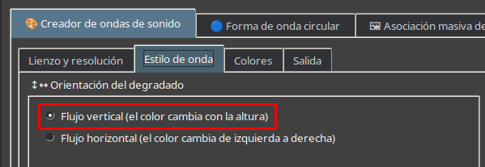

# Ayuda de Audio-SWARM
- [Tabla de contenidos](#contents)

**Audio-SWARM**: Generador de formas de onda de audio y procesamiento por lotes de portadas de álbumes, ilustraciones y motivos para remixes.

Audio-SWARM crea ilustraciones visuales de portadas de álbumes basadas en formas de onda a partir de archivos de audio en grandes cantidades. Audio-SWARM puede generar imágenes convencionales de formas de onda lineales con degradados de color a partir de casi cualquier tipo de archivo de audio.

Audio-SWARM puede crear imágenes de formas de onda circulares, espectros radiales y diseños circulares minimalistas, o combinar imágenes existentes, portadas de álbumes e ilustraciones de portada con pistas de audio en un único proceso por lotes.

* La incorporación de imágenes a los archivos de audio permite que los reproductores multimedia compatibles, como VLC y Celluloid, así como los teléfonos inteligentes y los televisores, muestren las ilustraciones incrustadas al reproducir una canción o un archivo de audio.

### Audio-SWARM crea ilustraciones de formas de onda imprimibles en una resolución extremadamente alta.

Las imágenes generadas por Audio-SWARM también se pueden exportar con resoluciones de hasta 12.000 píxeles, lo que las hace adecuadas para impresiones de alta calidad y carteles de cine de alta resolución.

Audio-SWARM crea, a partir de imágenes compactas de formas de onda con un tamaño de archivo reducido, gráficos detallados adecuados **para impresiones de portadas de álbumes, impresión de gran formato, ilustraciones de formas de onda enmarcadas, arte mural e impresiones extragrandes del tamaño de carteles de cine**.

Diseñado para ofrecer un nivel excepcional de detalle visual y nitidez, Audio-SWARM permite crear ilustraciones para una amplia variedad de tamaños de impresión, desde pequeñas portadas de álbumes hasta enormes pósteres y grandes obras enmarcadas. Tanto si estás creando portadas de álbumes con formas de onda, preparando ilustraciones para impresión profesional, diseñando láminas enmarcadas o produciendo pósteres de gran formato, Audio-SWARM transforma las ilustraciones digitales en impresionantes impresiones físicas con un nivel de detalle excepcional.

## Contenido <!-- anchor: contents -->
- [1. ¿Qué es Audio-SWARM?](#what-is-swarm)
- [2. Inicio rápido](#quick-start)
- [3. Conocer la interfaz](#interface)
- [4. Sound Wave Maker](#sound-wave-maker)
- [5. Circular Waveform](#circular-waveform)
- [6. Bulk Artwork Linker](#bulk-artwork-linker)
- [7. Procesamiento por lotes y carpetas de salida](#batch-output)
- [8. Resolución y rendimiento](#resolution-performance)
- [9. Referencia de colores y geometría](#colors-geometry)
- [10. Solución de problemas](#troubleshooting)
- [11. Idiomas y contribuciones](#languages-contributions)

## 1. ¿Qué es Audio-SWARM? <!-- anchor: what-is-swarm -->

**Audio-SWARM (Audio-Sound Waveform & bulk Album/Artwork-cover batch Remix Motif)** crea gráficos visuales a partir de archivos de audio y puede incrustar imágenes de portada en formatos de audio compatibles. Ofrece tres herramientas:

- **Sound Wave Maker** crea imágenes de forma de onda convencional con flujo vertical u horizontal, diferentes estilos de barras, colores, degradados y ajustes de resolución.
- **Circular Waveform** crea formas de onda circulares, visualizaciones de espectro radial y trazos circulares minimalistas.
- **Bulk Artwork Linker** empareja imágenes existentes con los archivos de audio de la carpeta seleccionada e incrusta la portada cuando el formato lo permite. Los archivos se emparejan según el orden alfabético de sus nombres; renómbralos para que el orden coincida con las parejas deseadas.

### Imágenes generadas

Sound Wave Maker y Circular Waveform exportan los gráficos en **PNG o JPG**. Elige las dimensiones según el uso: imágenes pequeñas para tareas cotidianas o imágenes grandes de alta resolución para visualización detallada o impresión. Las imágenes circulares pueden generarse con hasta 8000 píxeles. PNG admite transparencia; JPG utiliza un fondo sólido.

### Incrustar portadas y conservar el audio

Cuando el formato es compatible, Audio-SWARM incrusta la imagen en una nueva copia de salida de archivos de audio **MP3, OGG/OGA, FLAC, M4A y AIFF/AIF**. Para incrustar portadas en OGG/OGA y AIFF/AIF se necesita el paquete opcional de Python `mutagen`. En el flujo de trabajo de Audio-SWARM, WAV no admite la incrustación de portadas; el audio y la imagen se guardan uno junto al otro.

**AAC sin contenedor es la excepción:** en este flujo de trabajo, AAC sin procesar no dispone de un contenedor estándar para portadas. Para incrustar la imagen, Audio-SWARM coloca el flujo de audio AAC original dentro de un contenedor M4A y crea un archivo que termina en `_with_art.m4a`. El flujo de audio no se vuelve a codificar ni remuestrear.

Audio-SWARM no modifica el archivo de audio de origen. Cuando crea una salida con la portada incrustada, copia el flujo de audio codificado original sin volver a codificarlo ni remuestrearlo. Para calcular la forma de onda, Audio-SWARM utiliza una copia temporal de análisis; solo sirve para calcular la visualización y se elimina después. Nunca se utiliza como audio de salida guardado. **El audio de la salida guardada sigue siendo el audio original.**

## 2. Inicio rápido <!-- anchor: quick-start -->

1. **Elige la entrada.** En **Sound Wave Maker** o **Circular Waveform**, selecciona un archivo de audio compatible para generar una imagen o una carpeta para procesar varios archivos. Utiliza el campo de ruta y el botón Browse, o arrastra un archivo de audio compatible o una carpeta a cualquier lugar de la ventana de Audio-SWARM.  
   Para **Bulk Artwork Linker**, selecciona o arrastra una carpeta que contenga los archivos de audio y las imágenes de portada correspondientes. Esta herramienta funciona con una carpeta, no con un único archivo de audio.
2. **Selecciona la pestaña principal** de la herramienta que quieras usar:
   - **Sound Wave Maker** — crear imágenes de forma de onda convencional.
   - **Circular Waveform** — crear formas de onda circulares, espectros radiales o diseños circulares minimalistas.
   - **Bulk Artwork Linker** — emparejar imágenes existentes con archivos de audio de una carpeta.
3. Ajusta las opciones necesarias. Si no sabes cuáles elegir, conserva los valores predeterminados. De forma predeterminada, las imágenes se generan en **PNG con fondo transparente**. Puedes elegir JPG o un fondo sólido en **Output Format**.
4. Pulsa el botón de generación o procesamiento. Observa el estado, la barra de progreso y el registro en la parte inferior. Arrastrar y soltar solo selecciona la entrada; no inicia el procesamiento.
5. Cuando termine el procesamiento, comprueba la carpeta de salida indicada en el registro o en el mensaje de finalización.

Sound Wave Maker y Circular Waveform pueden procesar carpetas de forma recursiva y conservar la estructura de subcarpetas de origen en la salida. Bulk Artwork Linker solo examina el nivel superior de la carpeta seleccionada y empareja el audio y las imágenes usando listas de nombres ordenadas por separado. Audio-SWARM no adivina qué imagen corresponde a cada pista; asegúrate de que el orden alfabético de los nombres produzca las parejas correctas.

### ⚠️ Acerca de los controles deslizantes

- Elige el tamaño que desees y luego ajústalo con precisión haciendo clic junto al control deslizante para realizar pequeños ajustes.

### ⚠️ Advertencia sobre Vertical Flow

En **Sound Wave Maker → Waveform Style → Vertical Flow**, el procesamiento puede tardar bastante más que con otras opciones, especialmente al usar degradados multicolores.
- Es posible que el registro deje de actualizarse o que Audio-SWARM parezca no responder durante un tiempo. No cierres Audio-SWARM inmediatamente: este modo puede necesitar más tiempo.
- Espera a que termine, sobre todo al crear imágenes grandes o procesar muchos archivos.

## 3. Conocer la interfaz <!-- anchor: interface -->

- **Campo de ruta de entrada:** muestra el archivo de audio o la carpeta de origen seleccionada para la herramienta actual. El botón **Browse** abre el selector de archivos o carpetas del sistema.
- **Arrastrar y soltar:** también puedes soltar un archivo de audio compatible o una carpeta en cualquier parte de la ventana de Audio-SWARM. La ruta de entrada se actualiza como si la hubieras elegido mediante **Browse**. Soltar un elemento no inicia el procesamiento. Bulk Artwork Linker necesita una carpeta que contenga archivos de audio e imágenes, no un único archivo de audio.
- **Selector de idioma:** cambia el idioma de la interfaz y carga el documento de ayuda correspondiente cuando está disponible. Si falta una traducción de la ayuda, Audio-SWARM utiliza la ayuda en inglés.
- Puedes cambiar el idioma en cualquier momento sin perder los ajustes que ya hayas configurado.

Audio-SWARM está organizado en **pestañas principales**, **subpestañas**, controles de entrada e indicadores de procesamiento. Cada parte tiene una función específica:

- **Pestañas principales:** seleccionan una de las tres herramientas: **Sound Wave Maker**, **Circular Waveform** o **Bulk Artwork Linker**. **Help / About** abre la documentación y la información de la aplicación.
- **Subpestañas:** agrupan los ajustes de cada herramienta en categorías más pequeñas. Cambiar de subpestaña no inicia el procesamiento.
- **Botón de generación o procesamiento:** inicia la operación de la herramienta elegida con la entrada y los ajustes actuales. Comprueba la ruta y las opciones antes de empezar.

**Nota importante:** algunos ajustes de **Sound Wave Maker** también afectan a **Circular Waveform**, incluidos la geometría y los colores. Para aplicar los cambios a los gráficos circulares, selecciona los ajustes deseados en Sound Wave Maker, vuelve a la pestaña Circular Waveform y pulsa **Generate Circular Waveforms**.

- **Barra de progreso:** muestra el avance mientras se ejecuta una operación, especialmente durante el procesamiento por lotes. Algunas etapas pueden no actualizarla continuamente.
- **Línea de estado:** indica brevemente qué está haciendo Audio-SWARM o el resultado de una operación.
- **Registro:** guarda información como los archivos encontrados, las salidas creadas, las advertencias y los errores. En tareas largas puede no actualizarse continuamente; esto no significa necesariamente que Audio-SWARM haya dejado de funcionar.
- **Cancel:** solicita que se detenga un lote activo. Si un archivo ya se está renderizando o codificando, puede ser necesario terminar ese paso antes de que la cancelación surta efecto.

Algunas páginas son más altas que la ventana. Usa la barra de desplazamiento vertical o la rueda del ratón para acceder a los controles situados más abajo.

## 4. Sound Wave Maker <!-- anchor: sound-wave-maker -->

Sound Wave Maker crea una imagen de forma de onda para cada archivo de audio compatible. Sus subpestañas agrupan los ajustes según su función.

En el procesamiento recursivo de carpetas, las imágenes se guardan en `Waveform_Outputs`, reproduciendo debajo la estructura de subcarpetas de origen. Cuando se procesa un solo archivo, la salida se coloca junto al archivo de origen. Los formatos MP3, OGG/OGA, FLAC, M4A y AIFF/AIF pueden recibir una portada incrustada. Las entradas AAC sin procesar generan un archivo terminado en `_with_art.m4a`, porque AAC sin procesar no dispone de un contenedor estándar para portadas. En WAV, la imagen se conserva por separado. La incrustación de portadas en OGG/OGA y AIFF/AIF requiere el paquete Python `mutagen`; si no está disponible, Audio-SWARM conserva la imagen independiente y registra un error.

### Canvas & Resolution
#### Render Resolution Framework Configuration

- **Preset Dimensions Matrix Selector:** elige un tamaño de lienzo y una relación de aspecto predefinidos para formatos habituales, incluidos horizontal, vertical y portada cuadrada. El ajuste preestablecido fija automáticamente el ancho y el alto.
- **Canvas Width Limit:** establece el ancho de salida en píxeles, de 10 a 8000.
- **Canvas Height Limit:** establece el alto de salida en píxeles, de 10 a 8000.

Si modificas manualmente el ancho o el alto, el ajuste preestablecido cambia a **Custom Mapping Coordinates**, lo que te permite definir tus propias dimensiones.

Las dimensiones mayores producen imágenes con más píxeles, adecuadas para gráficos detallados, pantallas de alta resolución e impresión. Sin embargo, también requieren más tiempo de procesamiento y memoria, y generan archivos más grandes.

#### Waveform Structural Core Densities

- **Total Grid Bar Count Mapping Layout:** controla el número de barras de la forma de onda, entre 40 y 500. Un valor bajo produce menos barras y más anchas; un valor alto produce una forma de onda más densa con barras más estrechas. Más barras pueden aumentar el tiempo de procesamiento.
- **Gradient Processing Slice Resolution:** controla el número de segmentos de color usados para renderizar degradados. Más segmentos pueden suavizar las transiciones, pero también aumentar considerablemente el tiempo de procesamiento, especialmente con degradados multicolores en Vertical Flow. **Solid Flat Color** no usa segmentos de degradado, por lo que es mucho más rápido.
- **Canvas Target Printing Resolution (DPI):** define los metadatos de resolución de impresión de la imagen. No cambia sus dimensiones en píxeles, que se controlan por separado con Canvas Width y Canvas Height. Con las mismas dimensiones en píxeles, un DPI más alto produce una impresión física más pequeña con más píxeles por pulgada.

### Waveform Style
#### Gradient Spectrum Axis Orientation

- **Vertical Flow** distribuye los colores del degradado a lo largo de la altura de cada barra.
- **Horizontal Flow** distribuye los colores de izquierda a derecha a lo largo de la forma de onda.

### Waveform Bar Peak Geometry Style
Elige la forma de las barras de la onda y de sus extremos:

- **Standard Classic Bars:** barras rectangulares con extremos planos.
- **Smooth Capsule:** barras con extremos redondeados y suaves.
- **Lollipop:** tallos estrechos con una punta circular.
- **Sharp Spikes:** barras que terminan en puntas afiladas.
- **Arrow-Spear:** barras con puntas claramente similares a flechas.

La geometría elegida también afecta a los modos correspondientes de Circular Waveform y Radial Spectrum. Minimal Circular Waveform usa una línea continua en lugar de barras individuales, por lo que estos estilos geométricos no se aplican a ese modo.
Cada barra representa la amplitud de la señal de audio durante un intervalo breve. Su altura refleja el nivel de la señal, mientras que la geometría determina si el extremo es plano, redondeado, circular, puntiagudo o con forma de flecha.

### Colors
La subpestaña Colors permite combinar varios colores en un degradado o utilizar un único color sólido.

- **Color nodes:** cada botón **Node Color** representa una parada de color del degradado. Haz clic para elegir el color. La barra de vista previa muestra cómo se mezclan los colores en el orden actual.
- **Add Color Node:** añade otra parada de color, hasta un máximo de 10.
- **Remove Last Node:** elimina la última parada de color. En el modo degradado se conservan al menos dos nodos.
- **Invert Layer Core Coordinates Processing Direction (Reverse Vector Flow):** invierte el orden de los colores del degradado y cambia la dirección en la que aparecen en la forma de onda.
- **Enable Solid Flat Color:** utiliza un solo color seleccionado para toda la forma de onda, sin calcular segmentos de degradado. Esto resulta mucho más rápido, especialmente con Vertical Flow. En este modo se desactiva la inversión del degradado. También se desactiva el control Gradient Processing Slice de Canvas & Resolution. Al volver al modo degradado se restauran dos nodos de color; los nodos adicionales deben añadirse de nuevo.

### Output Format

- **Output Raster Format:** elige PNG o JPG para las imágenes de forma de onda. PNG está seleccionado de forma predeterminada y admite transparencia. JPG no la admite; al seleccionarlo, la opción de transparencia se desactiva automáticamente.
- **Enable 100% Alpha Channel Canvas Transparency Block:** habilita un fondo transparente para imágenes PNG. Cuando está activa la transparencia, el botón del color de fondo queda bloqueado y muestra **Locked (Transparent)**.
- **Pick Backdrop Color:** cuando la transparencia está desactivada, pulsa este botón para elegir un fondo sólido. El color seleccionado se conserva al cambiar entre PNG, JPG y los ajustes de transparencia.
- **Retain standalone high-res images inside workspace alongside embedded items:** está activado de forma predeterminada. Cuando Audio-SWARM incrusta correctamente una imagen en un archivo de audio compatible, conserva la imagen independiente a resolución completa junto a la salida de audio. Si se desactiva, la imagen independiente se elimina tras una incrustación correcta. Si la incrustación falla, se conserva.

Los colores seleccionados, la dirección del degradado, el formato de salida, las opciones de transparencia y fondo, Vertical Flow u Horizontal Flow, y los estilos de barra, punta y geometría también se comparten con Circular Waveform, Radial Spectrum y Minimal Circular Waveform. Para aplicar cambios a los gráficos circulares, vuelve a la pestaña Circular Waveform y pulsa **Generate Circular Waveforms**.

## 5. Circular Waveform <!-- anchor: circular-waveform -->

Circular Waveform crea visualizaciones circulares a partir de archivos de audio. Elige uno de los tres modos en las subpestañas.

#### Ajustes compartidos

- **Output Size (square pixels):** establece el ancho y el alto de la imagen cuadrada, de 256 a 8000 píxeles.
- **Rotation (degrees):** gira el gráfico entre 0° y 359°.

### Mode: Circular Waveform

Muestra barras de forma de onda dispuestas alrededor de un círculo.

- **Inner Radius:** controla el tamaño del espacio vacío del centro. Un radio mayor crea una abertura central más grande.
- **Outward:** las barras se extienden hacia fuera desde la línea base circular.
- **Inward:** las barras se extienden hacia el centro.
- **Inward + Outward:** activa ambas casillas para extender las barras en las dos direcciones. Siempre debe quedar seleccionada al menos una dirección; si desactivas la única dirección activa, se selecciona automáticamente la otra.
- **Geometría de la forma de onda:** utiliza la geometría elegida en Sound Wave Maker → Waveform Style, incluidos Standard Classic Bars, Smooth Capsules, Lollipop, Sharp Spikes y Arrow-Spear.

### Mode: Radial Spectrum

Muestra la energía de las frecuencias de audio mediante barras radiales dispuestas alrededor de un círculo.

- **Inner Radius:** controla el tamaño de la abertura central.
- **Frequency Bands:** establece el número de bandas de frecuencia alrededor del círculo. Un mayor número permite mostrar detalles más finos de las frecuencias.
- **Sensitivity:** controla la intensidad visual de las barras del espectro. Auméntala para hacer más evidentes las variaciones de frecuencia.
- **Outward e Inward:** determinan si las barras se extienden alejándose de la línea base, hacia el centro o en ambas direcciones.

### Mode: Minimal Circular Waveform

Dibuja una línea continua alrededor de un círculo en lugar de barras individuales.

- **Base Radius:** establece el radio básico de la línea circular.
- **Wave Amplitude:** controla cuánto se aleja la línea de su radio base. Los valores altos crean variaciones más pronunciadas.
- **Line Width:** controla el grosor de la línea.

Este modo no utiliza el selector de geometría de la forma de onda ni los controles de dirección Inward/Outward.

### Colores y ajustes de salida compartidos

Circular Waveform, Radial Spectrum y Minimal Circular Waveform comparten con Sound Wave Maker los nodos de color, la dirección del degradado, el formato de salida, los ajustes de transparencia y fondo, DPI y la preferencia de incrustación de portadas.

Los ajustes **Vertical Flow** y **Horizontal Flow** de Sound Wave Maker → Waveform Style también afectan a la forma en que se aplican los degradados a Circular Waveform, Radial Spectrum y Minimal Circular Waveform. Para cambiar la dirección del degradado, selecciona el flujo deseado en Sound Wave Maker.

#### Nota
Algunos ajustes de Sound Wave Maker también afectan a los gráficos circulares, incluidos la geometría y los colores. Selecciona los ajustes deseados en Sound Wave Maker, vuelve a Circular Waveform y pulsa **Generate Circular Waveforms** para aplicar los cambios.

Al procesar una carpeta, Audio-SWARM crea `Circular_Waveform_Outputs` y conserva la estructura de subcarpetas de origen. Cada modo utiliza un sufijo de archivo diferente para evitar que sus salidas sobrescriban las de otros modos.

## 6. Bulk Artwork Linker <!-- anchor: bulk-artwork-linker -->

Bulk Artwork Linker empareja archivos de audio compatibles (MP3, OGG/OGA, WAV, FLAC, M4A, AAC y AIFF/AIF) con imágenes PNG, JPG o JPEG de la carpeta seleccionada. Ordena por separado los nombres de los archivos de audio y de las imágenes, y después empareja los archivos según su posición en cada lista. Cambia los nombres antes de empezar para que el orden ordenado coincida con las parejas deseadas.

**Se recomienda encarecidamente** utilizar el mismo número de imágenes que de archivos de audio. Para obtener los mejores resultados, prepara las imágenes de antemano con las dimensiones en píxeles y la relación de aspecto deseadas. El redimensionador de Audio-SWARM está pensado únicamente para igualar las dimensiones de las imágenes. Si la relación de aspecto difiere de la relación objetivo, se pueden añadir barras negras arriba y abajo o a los lados para conservar las proporciones originales.

La opción de redimensionamiento ajusta las imágenes a las dimensiones objetivo. Si se mantiene la relación de aspecto, la imagen se ajusta dentro del lienzo de destino; de lo contrario, se estira hasta ocupar las dimensiones exactas. El redimensionamiento requiere Pillow. Si no está disponible, la herramienta utiliza el tamaño original de la imagen.

Las salidas MP3, OGG/OGA, FLAC, M4A y AIFF/AIF se guardan como archivos nuevos con `_with_art` en el nombre. Las entradas AAC sin procesar se colocan en un contenedor M4A con el flujo de audio AAC sin cambios. En el flujo de Audio-SWARM, WAV no guarda portadas incrustadas, por lo que el audio y la imagen se copian uno junto al otro. La incrustación en OGG/OGA y AIFF/AIF requiere Mutagen (consulta los requisitos opcionales). Los resultados se colocan en `Merged_Tracks_Outputs`. Esta herramienta solo examina el nivel superior de la carpeta seleccionada, no sus subcarpetas. Si el número de archivos de audio e imágenes es diferente, Audio-SWARM procesa únicamente las parejas completas y registra una advertencia.

## 7. Procesamiento por lotes y carpetas de salida <!-- anchor: batch-output -->

Sound Wave Maker y Circular Waveform procesan los lotes de forma recursiva. Sus carpetas de salida específicas conservan la estructura de subcarpetas de origen, de modo que los archivos con el mismo nombre de diferentes carpetas no entran en conflicto. Bulk Artwork Linker solo procesa los archivos que están directamente en la carpeta seleccionada.

Antes de procesar un lote grande, comprueba la carpeta seleccionada y la ubicación de salida. Si repites el trabajo, puede reemplazarse una salida existente con el mismo nombre. Haz copias de seguridad de los archivos importantes y no coloques archivos de entrada ajenos al trabajo dentro de las carpetas de salida generadas.

## 8. Resolución y rendimiento <!-- anchor: resolution-performance -->

Canvas Width y Canvas Height establecen las dimensiones de la imagen en píxeles. DPI controla los metadatos de resolución de impresión, mientras que Audio-SWARM renderiza con las dimensiones de píxeles seleccionadas. Las imágenes grandes requieren más memoria y tiempo, y generan archivos de mayor tamaño.

Un valor mayor de barras genera más barras y puede hacer que cada una sea más estrecha. Gradient Processing Slice Resolution controla cuántos pasos de color discretos se utilizan en los degradados por segmentos; más pasos pueden suavizar las transiciones, pero tardar más.

**Gradient Smoothness:** si el degradado no se ve lo bastante suave, prueba a establecer este valor en **200**. Esto utiliza un algoritmo diferente como alternativa.

Solid Flat Color evita el procesamiento de segmentos de degradado. Antes de generar un lote muy grande, prueba con un tamaño de imagen moderado y unos pocos archivos de audio.

## 9. Referencia de colores y geometría <!-- anchor: colors-geometry -->

- **Rectangle:** barras convencionales con extremos planos.
- **Smooth Capsules:** barras con extremos redondeados.
- **Lollipop:** tallo estrecho con una punta circular.
- **Sharp Spikes:** barras que se estrechan hasta formar puntas triangulares.
- **Arrow-Spear:** tallos con una punta claramente similar a una flecha.

Usa **Vertical Flow** cuando quieras que el color cambie a lo largo de la altura de cada barra. Usa **Horizontal Flow** cuando el degradado deba ir de un lado al otro de la forma de onda. **Solid Flat Color** resulta útil para un diseño de un solo color y evita dividir el degradado en segmentos. Los nodos de color definen los puntos del degradado; la vista previa muestra su orden.

## 10. Solución de problemas <!-- anchor: troubleshooting -->

- **No se encuentran archivos:** comprueba que la ruta de la carpeta sea correcta y que contenga un formato de audio o imagen compatible con la herramienta seleccionada.
- **Falta una portada o el emparejamiento está incompleto:** Bulk Artwork Linker empareja las listas ordenadas por posición. Comprueba los nombres y el número de archivos en cada lista.
- **Ubicación de salida inesperada:** revisa el mensaje de finalización y el nombre de la carpeta de salida.
- **Se ha sustituido un archivo:** las salidas pueden tener el mismo nombre en ejecuciones repetidas. Guarda una copia o mueve los resultados anteriores antes de repetir el proceso.
- **Error al incrustar:** consulta el registro de la aplicación y comprueba que FFmpeg esté instalado y pueda leer el archivo de origen.
- **Renderizado lento o uso elevado de memoria:** reduce las dimensiones en píxeles, el tamaño del lote o la cantidad de barras y segmentos.
- **Falta la ayuda en un idioma:** si no existe el documento de ayuda del idioma seleccionado, Audio-SWARM utiliza `help/en.md`.

Si el problema continúa, guarda el texto del registro y anota la herramienta, el modo, el formato del archivo y los ajustes seleccionados.

## 11. Idiomas y contribuciones <!-- anchor: languages-contributions -->

Las traducciones de la interfaz se guardan como archivos JSON en `languages/`. Los documentos de ayuda son archivos Markdown en `help/`, y los documentos About son archivos Markdown en `about/`. Los archivos JSON y Markdown utilizan el código del idioma como nombre, por ejemplo, `en.md` para inglés, `fr.md` para francés o `ja.md` para japonés.

Para contribuir con una traducción, **copia el archivo en inglés de la carpeta correspondiente**, traduce el texto y los encabezados, y guarda el archivo con el código de idioma correcto. Mantén sin cambios los comentarios de ancla HTML de la ayuda y los destinos del índice para que los enlaces a las secciones sigan funcionando.

¡Guarda los archivos en UTF-8!

No traduzcas nombres de archivos, ejemplos de código, identificadores de ajustes ni nombres de carpetas cuando deban coincidir exactamente con la aplicación. Mantén las traducciones alineadas con el documento maestro en inglés e informa de los textos poco claros o de los comportamientos que hayan quedado obsoletos. Si falta un documento de ayuda o About específico para un idioma, Audio-SWARM utiliza el documento correspondiente en inglés.
