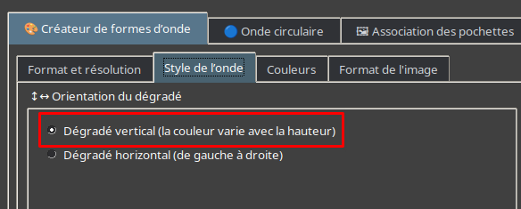
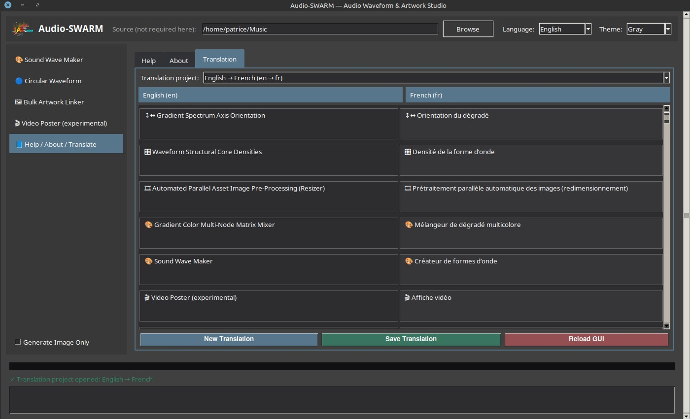
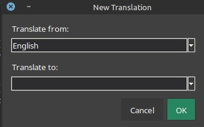
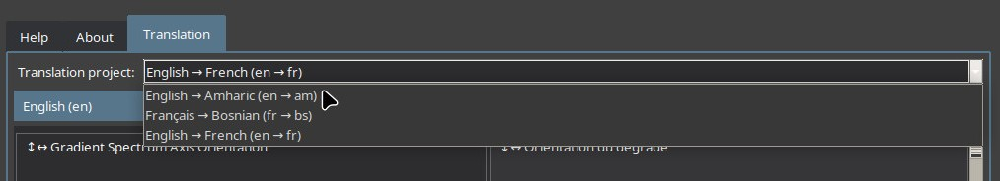

# Aide de Audio-SWARM
- [Table des matières](#contents)

**Audio-SWARM** : générateur de formes d’onde audio et traitement par lots de pochettes d’albums, d’illustrations et de motifs pour remixes.

Audio-SWARM crée en masse des illustrations visuelles de pochettes d’albums à partir de formes d’onde extraites de fichiers audio. Audio-SWARM peut générer des images classiques de formes d’onde linéaires avec des dégradés de couleurs à partir de presque tous les types de fichiers audio.

Audio-SWARM peut créer des images de formes d’onde circulaires, des spectres radiaux et des designs circulaires minimalistes, ou associer des images existantes, des pochettes d’albums et des illustrations de couverture à des pistes audio en un seul traitement par lots.

* L’intégration d’images dans les fichiers audio permet aux lecteurs multimédias compatibles, tels que VLC et Celluloid, ainsi qu’aux smartphones et aux téléviseurs, d’afficher les illustrations intégrées lors de la lecture d’une chanson ou d’un fichier audio.

### Audio-SWARM crée des illustrations de formes d’onde imprimables en très haute résolution.

Les images générées par Audio-SWARM peuvent également être exportées avec une résolution allant jusqu’à 12 000 pixels, ce qui les rend adaptées aux impressions de haute qualité et aux affiches de cinéma haute résolution.

À partir d’images compactes de formes d’onde occupant peu d’espace de stockage, Audio-SWARM crée des visuels détaillés adaptés **à l’impression de pochettes d’albums, à l’impression grand format, aux illustrations de formes d’onde encadrées, à la décoration murale et aux impressions géantes au format affiche de cinéma**.

Conçu pour offrir un niveau exceptionnel de détail visuel et de netteté, Audio-SWARM permet de créer des illustrations pour une large gamme de formats d’impression, des petites pochettes d’albums aux affiches géantes et aux grandes œuvres encadrées. Que vous créiez des pochettes d’albums à formes d’onde, prépariez des illustrations pour l’impression professionnelle, conceviez des tirages encadrés ou produisiez des affiches grand format, Audio-SWARM donne vie aux créations numériques sous la forme d’impressions physiques remarquables, riches en détails.

## Table des matières <!-- anchor: contents -->
- [1. Qu’est-ce que Audio-SWARM ?](#what-is-swarm)
- [2. Démarrage rapide](#quick-start)
- [3. Comprendre l’interface](#interface)
- [4. Sound Wave Maker](#sound-wave-maker)
- [5. Circular Waveform](#circular-waveform)
- [6. Bulk Artwork Linker](#bulk-artwork-linker)
- [7. Traitement par lots et dossiers de sortie](#batch-output)
- [8. Résolution et performances](#resolution-performance)
- [9. Référence des couleurs et des géométries](#colors-geometry)
- [10. Dépannage](#troubleshooting)
- [11. Langues et contributions](#languages-contributions)
- [12. Outil de traduction d’Audio-SWARM](#translation-tool)
- [13. Envoyer votre traduction](#submit-translation)

## 1. Qu’est-ce que Audio-SWARM ? <!-- anchor: what-is-swarm -->

**Audio-SWARM (Audio-Sound Waveform & bulk Album/Artwork-cover batch Remix Motif)** crée des visuels à partir de fichiers audio et peut intégrer des pochettes dans les formats audio pris en charge. Il propose trois outils :

- **Sound Wave Maker** crée des images de formes d’onde classiques avec un flux vertical ou horizontal, différents styles de barres, des couleurs, des dégradés et des réglages de résolution.
- **Circular Waveform** crée des formes d’onde circulaires, des visualisations de spectre radial et des tracés circulaires minimalistes.
- **Bulk Artwork Linker** associe les images existantes aux fichiers audio du dossier sélectionné et intègre les pochettes lorsque le format audio le permet. Les fichiers sont appariés selon l’ordre alphabétique de leurs noms. Renommez-les donc pour obtenir les associations souhaitées.

### Images générées

Sound Wave Maker et Circular Waveform exportent les visuels en **PNG ou JPG**. Choisissez les dimensions adaptées à votre usage : des images plus petites pour un usage courant ou des images volumineuses en haute résolution pour l’affichage détaillé ou l’impression. Les images circulaires peuvent atteindre 8000 pixels. Le PNG prend en charge la transparence ; le JPG utilise un arrière-plan uni.

### Intégrer une pochette tout en préservant l’audio

Lorsque le format est pris en charge, Audio-SWARM intègre l’image dans une nouvelle copie de sortie des fichiers audio **MP3, OGG/OGA, FLAC, M4A et AIFF/AIF**. L’intégration des pochettes aux fichiers OGG/OGA et AIFF/AIF nécessite le paquet Python facultatif `mutagen`. Dans le processus utilisé par Audio-SWARM, les fichiers WAV ne reçoivent pas de pochette intégrée ; le fichier audio et l’image sont donc enregistrés côte à côte.

**Le AAC brut constitue une exception :** dans ce processus, le AAC brut ne dispose pas d’un conteneur standard pour les pochettes. Pour intégrer l’image, Audio-SWARM place le flux audio AAC d’origine dans un conteneur M4A et crée un fichier se terminant par `_with_art.m4a`. Le flux audio lui-même n’est ni réencodé ni rééchantillonné.

Audio-SWARM ne modifie pas le fichier audio source. Lorsqu’il crée un fichier de sortie avec une pochette intégrée, il copie le flux audio encodé d’origine sans le réencoder ni le rééchantillonner. Pour calculer la forme d’onde, Audio-SWARM utilise une copie temporaire destinée à l’analyse. Elle sert uniquement à calculer la visualisation, puis est supprimée. Elle n’est jamais utilisée comme fichier audio de sortie. **L’audio du fichier enregistré reste l’audio d’origine.**

## 2. Démarrage rapide <!-- anchor: quick-start -->

1. **Choisissez l’entrée.** Dans **Sound Wave Maker** ou **Circular Waveform**, sélectionnez un fichier audio pris en charge pour créer une image, ou un dossier pour traiter plusieurs fichiers. Utilisez le champ de chemin et le bouton Browse, ou faites glisser un fichier audio compatible ou un dossier n’importe où dans la fenêtre Audio-SWARM.  
   Pour **Bulk Artwork Linker**, sélectionnez ou déposez un dossier contenant les fichiers audio et leurs images de pochette. Cet outil fonctionne avec un dossier, et non avec un seul fichier audio.
2. **Sélectionnez l’onglet principal** correspondant à l’outil voulu :
   - **Sound Wave Maker** — créer des images de formes d’onde classiques.
   - **Circular Waveform** — créer des formes d’onde circulaires, des spectres radiaux ou des motifs circulaires minimalistes.
   - **Bulk Artwork Linker** — associer des images existantes aux fichiers audio d’un dossier.
3. Réglez les options nécessaires. En cas de doute, conservez les valeurs par défaut. Par défaut, les images sont générées en **PNG avec un arrière-plan transparent**. Vous pouvez choisir JPG ou un arrière-plan uni dans **Output Format**.
4. Cliquez sur le bouton de génération ou de traitement. Suivez l’état, la barre de progression et le journal en bas de la fenêtre. Le glisser-déposer sélectionne uniquement l’entrée ; il ne lance pas le traitement.
5. À la fin du traitement, vérifiez le dossier de sortie indiqué dans le journal ou le message de fin.

Sound Wave Maker et Circular Waveform peuvent parcourir les dossiers récursivement et reproduire la structure des sous-dossiers sources dans leur sortie. Bulk Artwork Linker ne parcourt que le niveau supérieur du dossier sélectionné et associe les fichiers audio et images à partir de listes triées séparément. Audio-SWARM ne devine pas quelle image correspond à quelle piste : vérifiez donc que l’ordre alphabétique des noms donne les bonnes associations.

### ⚠️ À propos des curseurs

- Choisissez la taille souhaitée, puis ajustez-la avec précision en cliquant à côté de la poignée du curseur pour effectuer de petits ajustements.

### ⚠️ Avertissement concernant Vertical Flow

Dans **Sound Wave Maker → Waveform Style → Vertical Flow**, le traitement peut prendre beaucoup plus de temps qu’avec les autres options, surtout avec un dégradé multicolore.
- Le journal peut sembler ne plus se mettre à jour et Audio-SWARM peut paraître bloqué pendant un certain temps. Ne fermez pas immédiatement l’application : ce mode peut simplement nécessiter davantage de temps.
- Patientez jusqu’à la fin, en particulier lors de la création de grandes images ou du traitement d’un lot de fichiers.

## 3. Comprendre l’interface <!-- anchor: interface -->

- **Champ du chemin d’entrée :** affiche le fichier audio ou le dossier source sélectionné pour l’outil actif. Le bouton **Browse** adjacent ouvre le sélecteur de fichiers ou de dossiers du système.
- **Glisser-déposer :** vous pouvez aussi déposer un fichier audio pris en charge ou un dossier n’importe où dans la fenêtre Audio-SWARM. Le chemin d’entrée est mis à jour comme si vous aviez utilisé le bouton **Browse**. Le dépôt ne lance pas le traitement. Bulk Artwork Linker nécessite un dossier contenant à la fois les fichiers audio et les images, et non un seul fichier audio.
- **Sélecteur de langue :** change la langue de l’interface et charge le document d’aide correspondant lorsqu’il existe. Si la traduction de l’aide est absente, Audio-SWARM utilise l’aide en anglais.
- Vous pouvez changer de langue à tout moment sans perdre les réglages déjà configurés.

Audio-SWARM est organisé en **onglets principaux**, **sous-onglets**, commandes d’entrée et indicateurs de traitement. Chaque partie a une fonction précise :

- **Onglets principaux :** sélectionnez l’un des trois outils : **Sound Wave Maker**, **Circular Waveform** ou **Bulk Artwork Linker**. **Help / About** ouvre la documentation et les informations sur l’application.
- **Sous-onglets :** regroupent les réglages d’un outil en catégories plus petites. Le changement de sous-onglet ne lance pas le traitement.
- **Bouton de génération ou de traitement :** lance l’opération de l’outil choisi avec l’entrée et les réglages actuels. Vérifiez le chemin et les options avant de démarrer.

**Remarque importante :** certains réglages de **Sound Wave Maker** affectent également **Circular Waveform**, notamment la géométrie et les couleurs. Pour appliquer les modifications aux visuels circulaires, choisissez les réglages souhaités dans Sound Wave Maker, revenez à l’onglet Circular Waveform, puis cliquez sur **Generate Circular Waveforms**.

- **Barre de progression :** indique l’avancement d’une opération, en particulier lors du traitement par lots. Certaines étapes ne la mettent pas à jour en continu.
- **Ligne d’état :** indique brièvement l’opération en cours ou le résultat obtenu.
- **Journal :** consigne notamment les fichiers trouvés, les sorties créées, les avertissements et les erreurs. Lors d’une tâche longue, il peut ne pas se mettre à jour en permanence ; cela ne signifie pas forcément que Audio-SWARM a cessé de fonctionner.
- **Cancel :** demande l’arrêt d’un traitement par lots en cours. Une opération de rendu ou d’encodage déjà entamée peut devoir se terminer avant que l’annulation prenne effet.

Certaines pages sont plus longues que la fenêtre. Utilisez la barre de défilement verticale ou la molette de la souris pour accéder aux commandes situées plus bas.

## 4. Sound Wave Maker <!-- anchor: sound-wave-maker -->

Sound Wave Maker crée une image de forme d’onde pour chaque fichier audio pris en charge. Ses sous-onglets regroupent les réglages par fonction.

Lors du traitement récursif d’un dossier, les images sont enregistrées dans `Waveform_Outputs`, avec une copie de la structure des sous-dossiers sources. Pour un fichier unique, la sortie est placée à côté du fichier source. Les formats MP3, OGG/OGA, FLAC, M4A et AIFF/AIF peuvent recevoir une pochette intégrée. Le AAC brut produit un fichier se terminant par `_with_art.m4a`, car il ne possède pas de conteneur standard pour les pochettes. Avec WAV, l’image est conservée séparément. L’intégration aux formats OGG/OGA et AIFF/AIF nécessite le paquet Python `mutagen` ; s’il est absent, Audio-SWARM conserve l’image séparée et consigne une erreur.

### Canvas & Resolution
#### Render Resolution Framework Configuration

- **Preset Dimensions Matrix Selector :** sélectionne une taille de canevas et un rapport largeur/hauteur prédéfinis pour des formats courants, notamment paysage, portrait et pochette carrée. Le préréglage définit automatiquement la largeur et la hauteur.
- **Canvas Width Limit :** définit la largeur de l’image de sortie en pixels, de 10 à 8000.
- **Canvas Height Limit :** définit la hauteur de l’image de sortie en pixels, de 10 à 8000.

Si vous modifiez manuellement la largeur ou la hauteur, le préréglage passe à **Custom Mapping Coordinates**, ce qui vous permet de définir vos propres dimensions.

Des dimensions plus grandes produisent des images comportant davantage de pixels, adaptées aux visuels détaillés, aux écrans haute résolution et à l’impression. Elles demandent cependant plus de temps de calcul et de mémoire, et produisent des fichiers plus volumineux.

#### Waveform Structural Core Densities

- **Total Grid Bar Count Mapping Layout :** définit le nombre de barres de la forme d’onde, de 40 à 500. Une valeur faible donne moins de barres, plus larges ; une valeur élevée donne une forme d’onde plus dense composée de barres plus fines. Un nombre de barres plus élevé peut augmenter le temps de traitement.
- **Gradient Processing Slice Resolution :** définit le nombre de tranches de couleur utilisées pour rendre les dégradés. Davantage de tranches peuvent rendre les transitions plus douces, mais peuvent aussi augmenter nettement le temps de traitement, surtout avec les dégradés multicolores en Vertical Flow. **Solid Flat Color** n’utilise pas de tranches de dégradé et s’exécute donc beaucoup plus rapidement.
- **Canvas Target Printing Resolution (DPI) :** définit les métadonnées de résolution d’impression de l’image. Cela ne modifie pas ses dimensions en pixels, contrôlées séparément par Canvas Width et Canvas Height. À dimensions identiques, un DPI plus élevé produit une impression physique plus petite avec davantage de pixels par pouce.

### Waveform Style
#### Gradient Spectrum Axis Orientation

- **Vertical Flow** répartit les couleurs du dégradé sur la hauteur de chaque barre.
- **Horizontal Flow** répartit les couleurs de gauche à droite le long de la forme d’onde.

### Waveform Bar Peak Geometry Style
Choisissez la forme des barres et de leurs pointes :

- **Standard Classic Bars :** barres rectangulaires aux extrémités plates.
- **Smooth Capsule :** barres aux extrémités arrondies.
- **Lollipop :** tiges fines terminées par un embout circulaire.
- **Sharp Spikes :** barres qui se terminent en pointe.
- **Arrow-Spear :** barres dotées de pointes nettement en forme de flèche.

La géométrie choisie affecte également les modes correspondants de Circular Waveform et Radial Spectrum. Minimal Circular Waveform utilise une ligne continue plutôt que des barres individuelles ; ces styles de géométrie ne s’y appliquent donc pas.
Chaque barre représente l’amplitude du signal audio sur un court intervalle. Sa hauteur reflète le niveau du signal, tandis que la géométrie détermine si sa pointe est plate, arrondie, circulaire, pointue ou en forme de flèche.

### Colors
Le sous-onglet Colors permet de combiner plusieurs couleurs en un dégradé ou d’utiliser une seule couleur uniforme.

- **Color nodes :** chaque bouton **Node Color** représente un point de couleur du dégradé. Cliquez dessus pour choisir une couleur. La barre d’aperçu montre le mélange des couleurs dans leur ordre actuel.
- **Add Color Node :** ajoute un point de couleur, jusqu’à un maximum de 10.
- **Remove Last Node :** supprime le dernier point de couleur. Le mode dégradé conserve au moins deux points.
- **Invert Layer Core Coordinates Processing Direction (Reverse Vector Flow) :** inverse l’ordre des couleurs du dégradé et donc leur sens d’application sur la forme d’onde.
- **Enable Solid Flat Color :** applique une seule couleur sélectionnée à toute la forme d’onde sans calculer de tranches de dégradé. Le traitement est ainsi beaucoup plus rapide, surtout avec Vertical Flow. L’inversion du dégradé est désactivée dans ce mode. Le contrôle Gradient Processing Slice de l’onglet Canvas & Resolution est lui aussi désactivé. Au retour au mode dégradé, deux points de couleur sont rétablis ; les points supplémentaires doivent être ajoutés de nouveau.

### Output Format

- **Output Raster Format :** choisissez PNG ou JPG pour les images de forme d’onde. PNG est sélectionné par défaut et prend en charge la transparence. JPG ne la prend pas en charge ; sélectionner JPG désactive automatiquement l’option de transparence.
- **Enable 100% Alpha Channel Canvas Transparency Block :** active un arrière-plan transparent pour les images PNG. Lorsque la transparence est activée, le bouton de couleur d’arrière-plan est verrouillé et affiche **Locked (Transparent)**.
- **Pick Backdrop Color :** lorsque la transparence est désactivée, cliquez sur ce bouton pour choisir une couleur d’arrière-plan unie. La couleur choisie est conservée lorsque vous changez de format PNG/JPG ou de réglage de transparence.
- **Retain standalone high-res images inside workspace alongside embedded items :** cette option est activée par défaut. Lorsque Audio-SWARM intègre correctement une image dans un fichier audio pris en charge, elle conserve l’image séparée en pleine résolution à côté de la sortie audio. Si l’option est désactivée, l’image séparée est supprimée après une intégration réussie. En cas d’échec, elle est conservée.

Les couleurs choisies, le sens du dégradé, le format de sortie, les options de transparence et d’arrière-plan, Vertical Flow ou Horizontal Flow, ainsi que les styles de barre, de pointe et de géométrie sont également utilisés par Circular Waveform, Radial Spectrum et Minimal Circular Waveform. Pour appliquer les modifications aux visuels circulaires, revenez à l’onglet Circular Waveform et cliquez sur **Generate Circular Waveforms**.

## 5. Circular Waveform <!-- anchor: circular-waveform -->

Circular Waveform crée des visualisations circulaires à partir de fichiers audio. Choisissez l’un des trois modes dans les sous-onglets.

#### Réglages communs

- **Output Size (square pixels) :** définit la largeur et la hauteur de l’image carrée, de 256 à 8000 pixels.
- **Rotation (degrees) :** fait pivoter le visuel de 0° à 359°.

### Mode: Circular Waveform

Affiche des barres de forme d’onde réparties autour d’un cercle.

- **Inner Radius :** définit la taille de l’espace vide au centre. Une valeur plus élevée agrandit l’ouverture centrale.
- **Outward :** les barres s’étendent vers l’extérieur à partir de la ligne de base circulaire.
- **Inward :** les barres s’étendent vers le centre.
- **Inward + Outward :** activez les deux cases pour que les barres s’étendent dans les deux sens. Au moins une direction reste toujours sélectionnée ; si vous désactivez la seule direction active, l’autre est automatiquement activée.
- **Géométrie de la forme d’onde :** utilise la géométrie sélectionnée dans Sound Wave Maker → Waveform Style, notamment Standard Classic Bars, Smooth Capsules, Lollipop, Sharp Spikes et Arrow-Spear.

### Mode: Radial Spectrum

Affiche l’énergie des fréquences audio sous forme de barres radiales réparties autour d’un cercle.

- **Inner Radius :** définit la taille de l’ouverture centrale.
- **Frequency Bands :** définit le nombre de bandes de fréquence représentées autour du cercle. Plus de bandes permettent d’afficher des détails fréquentiels plus fins.
- **Sensitivity :** règle l’intensité visuelle des barres du spectre. Augmentez la valeur pour accentuer les variations de fréquence.
- **Outward et Inward :** déterminent si les barres s’éloignent de la ligne de base, se dirigent vers le centre ou s’étendent dans les deux sens.

### Mode: Minimal Circular Waveform

Trace une ligne continue autour d’un cercle, plutôt que des barres individuelles.

- **Base Radius :** définit le rayon de base du tracé circulaire.
- **Wave Amplitude :** détermine l’écart de la ligne par rapport à son rayon de base. Une valeur plus élevée accentue les variations.
- **Line Width :** définit l’épaisseur du trait.

Ce mode n’utilise ni le sélecteur de géométrie des formes d’onde ni les commandes de direction Inward/Outward.

### Couleurs et options de sortie partagées

Circular Waveform, Radial Spectrum et Minimal Circular Waveform partagent avec Sound Wave Maker les points de couleur, le sens du dégradé, le format de sortie, les options de transparence et d’arrière-plan, le DPI et la préférence d’intégration des pochettes.

Les réglages **Vertical Flow** et **Horizontal Flow** de Sound Wave Maker → Waveform Style affectent également l’application des dégradés dans Circular Waveform, Radial Spectrum et Minimal Circular Waveform. Pour changer la direction du dégradé, sélectionnez le flux souhaité dans Sound Wave Maker.

#### Remarque
Certains réglages de Sound Wave Maker, notamment la géométrie et les couleurs, affectent aussi les visuels circulaires. Sélectionnez les réglages souhaités dans Sound Wave Maker, revenez à Circular Waveform, puis cliquez sur **Generate Circular Waveforms** pour appliquer les changements.

Lors du traitement d’un dossier, Audio-SWARM crée `Circular_Waveform_Outputs` et conserve la structure des sous-dossiers sources. Chaque mode utilise un suffixe de nom de fichier distinct afin que ses sorties n’écrasent pas celles des autres modes.

## 6. Bulk Artwork Linker <!-- anchor: bulk-artwork-linker -->

Bulk Artwork Linker associe les fichiers audio pris en charge (MP3, OGG/OGA, WAV, FLAC, M4A, AAC et AIFF/AIF) aux images PNG, JPG ou JPEG du dossier sélectionné. Les listes de noms de fichiers audio et d’images sont triées séparément, puis les fichiers sont associés selon leur position dans les listes. Renommez les fichiers avant de commencer afin que l’ordre trié corresponde aux associations voulues.

**Il est fortement recommandé** d’utiliser autant d’images que de fichiers audio. Pour un résultat optimal, préparez les images à l’avance aux dimensions en pixels et au rapport largeur/hauteur souhaités. Le redimensionneur de Audio-SWARM sert uniquement à uniformiser les dimensions. Si le rapport d’image diffère du rapport cible, des bandes noires peuvent être ajoutées en haut et en bas, ou sur les côtés, afin de préserver les proportions d’origine.

L’option de redimensionnement adapte les images aux dimensions cibles. Lorsque la conservation du rapport largeur/hauteur est activée, l’image est ajustée à l’intérieur du canevas cible ; sinon, elle est étirée aux dimensions exactes. Le redimensionnement nécessite Pillow. Si ce paquet n’est pas disponible, l’outil conserve la taille d’origine de l’image.

Les sorties MP3, OGG/OGA, FLAC, M4A et AIFF/AIF sont enregistrées dans de nouveaux fichiers dont le nom contient `_with_art`. Les fichiers AAC bruts sont placés dans un conteneur M4A avec leur flux audio AAC inchangé. Dans ce processus, WAV ne stocke pas les pochettes intégrées ; le fichier audio et l’image sont donc copiés côte à côte. L’intégration aux formats OGG/OGA et AIFF/AIF nécessite Mutagen (voir les dépendances facultatives). Les résultats sont placés dans `Merged_Tracks_Outputs`. Cet outil ne parcourt que le niveau supérieur du dossier sélectionné, pas ses sous-dossiers. Si les nombres de fichiers audio et d’images diffèrent, Audio-SWARM traite uniquement les paires complètes et consigne un avertissement.

## 7. Traitement par lots et dossiers de sortie <!-- anchor: batch-output -->

Sound Wave Maker et Circular Waveform traitent les lots de façon récursive. Leurs dossiers de sortie dédiés conservent l’arborescence des sous-dossiers sources, ce qui évite les collisions entre des fichiers portant le même nom dans des dossiers différents. Bulk Artwork Linker ne traite que les fichiers situés directement dans le dossier sélectionné.

Avant un traitement volumineux, vérifiez le dossier sélectionné et l’emplacement de sortie. Relancer le même traitement peut remplacer un fichier de sortie portant le même nom. Conservez une sauvegarde des fichiers importants et évitez de placer des fichiers d’entrée sans rapport avec le traitement dans les dossiers de sortie générés.

## 8. Résolution et performances <!-- anchor: resolution-performance -->

Canvas Width et Canvas Height définissent les dimensions de l’image en pixels. Le DPI définit les métadonnées de résolution d’impression, tandis que Audio-SWARM effectue le rendu selon les dimensions en pixels sélectionnées. Les grandes images demandent davantage de mémoire et de temps, et produisent des fichiers plus volumineux.

Un nombre de barres plus élevé produit davantage de barres et peut les rendre plus fines. Gradient Processing Slice Resolution détermine le nombre d’étapes de couleur discrètes utilisées pour les dégradés découpés ; davantage d’étapes peuvent rendre les transitions plus douces, mais allonger le traitement.

**Gradient Smoothness :** si le dégradé manque de fluidité, essayez de régler cette valeur sur **200**. Un autre algorithme est alors utilisé comme solution de remplacement.

Solid Flat Color évite le calcul des tranches de dégradé. Pour un premier essai, utilisez une taille d’image modérée et quelques fichiers audio avant de lancer un très gros lot.

## 9. Référence des couleurs et des géométries <!-- anchor: colors-geometry -->

- **Rectangle :** barres classiques à extrémités plates.
- **Smooth Capsules :** barres aux extrémités arrondies.
- **Lollipop :** tige fine avec un embout circulaire au sommet.
- **Sharp Spikes :** barres dont les pointes sont triangulaires.
- **Arrow-Spear :** tiges terminées par une pointe en forme de flèche bien marquée.

Utilisez **Vertical Flow** si la couleur doit varier sur la hauteur de chaque barre. Utilisez **Horizontal Flow** si le dégradé doit se déplacer d’un côté de la forme d’onde à l’autre. **Solid Flat Color** convient à un visuel monochrome et évite le découpage du dégradé. Les points de couleur définissent les étapes du dégradé ; l’aperçu montre leur ordre.

## 10. Dépannage <!-- anchor: troubleshooting -->

- **Aucun fichier trouvé :** vérifiez le chemin du dossier et assurez-vous qu’il contient un format audio ou image pris en charge par l’outil sélectionné.
- **Pochette manquante ou association incomplète :** Bulk Artwork Linker associe les listes triées par position. Vérifiez les noms et le nombre de fichiers dans chaque liste.
- **Emplacement de sortie inattendu :** vérifiez le message de fin et le nom du dossier de sortie indiqué.
- **Un fichier a été remplacé :** les sorties peuvent porter le même nom lors de traitements répétés. Sauvegardez ou déplacez les anciens résultats avant de recommencer.
- **Échec de l’intégration :** consultez le journal de l’application et vérifiez que FFmpeg est installé et peut lire le fichier source.
- **Rendu lent ou forte consommation mémoire :** réduisez les dimensions en pixels, la taille du lot ou le nombre de barres et de tranches.
- **Aide absente dans une langue :** si le document d’aide de la langue sélectionnée est absent, Audio-SWARM utilise `help/en.md`.

Si le problème persiste, conservez le texte du journal et notez l’outil, le mode, le format du fichier et les réglages sélectionnés.

## 11. Langues et contributions <!-- anchor: languages-contributions -->

Les traductions de l’interface sont stockées dans des fichiers JSON dans `languages/`. Les documents d’aide sont des fichiers Markdown dans `help/`, et les documents À propos sont des fichiers Markdown dans `about/`. Les fichiers JSON et Markdown utilisent le code de langue comme nom, par exemple `en.md` pour l’anglais, `fr.md` pour le français ou `ja.md` pour le japonais.

Vous pouvez contribuer à une traduction directement dans Audio-SWARM, dans Help / About / Translate -> Translation's tab.

## 12. Outil de traduction d’Audio-SWARM <!-- anchor: translation-tool -->

[Envoyer votre traduction sur GitHub](https://github.com/PatLabGit/Audio-SWARM/discussions/1)

L’outil permet de traduire Audio-SWARM dans une autre langue ou de corriger une traduction existante directement depuis l’application. Il permet aussi de vérifier immédiatement si le texte traduit d’un élément est trop long. Il n’est pas nécessaire de modifier les fichiers JSON manuellement.

### Créer une traduction

Cliquez sur **Nouvelle traduction** pour créer un projet. Une boîte de dialogue propose deux langues :

- **Traduire depuis :** langue source. L’anglais est recommandé, mais une autre langue déjà traduite dans Audio-SWARM peut être choisie.
- **Traduire vers :** langue cible. La liste contient 172 langues du dictionnaire.

J’ai utilisé ISO 639-1 (codes de langue à deux lettres) pour la liste. Exception : `tw` n’est pas un code ISO 639-1 officiel ; c’est un code personnalisé pour le chinois traditionnel, plutôt que `zh-TW` ou `zh-Hant`. Par simplicité, j’ai conservé les codes à deux lettres et reporté les codes à trois lettres comme `pcm`.

Cliquez sur **OK**. Le nouveau fichier est créé à partir d’une copie de la langue source, en conservant le texte, les caractères spéciaux, les emojis, les sauts de ligne et les variables (`{filename}`, `{value}`, etc.). Rien n’est automatiquement supprimé ou remplacé. Le projet est ensuite ajouté à la liste.

### Interface de traduction

L’éditeur comporte deux colonnes :

- **Langue source (gauche) :** texte original de la langue choisie dans **Translate from**. Il est en lecture seule. Vous pouvez sélectionner du texte et utiliser %% Ctrl %% + %% C %% pour le copier si vous avez effacé quelque chose par erreur dans l’autre colonne ; c’est la seule action disponible ici.
- **Langue cible (droite) :** texte du fichier cible, à traduire ou corriger.

Chaque entrée correspond à une entrée source ; les sections sont séparées pour faciliter la navigation. Cliquez sur une entrée pour la modifier. Vous pouvez sélectionner, copier et coller entre les colonnes.

### Important !

- **Conservez les éléments spéciaux (`{variables}`, `\n`, ponctuation et marqueurs de formatage) lorsqu’ils sont requis par le texte d’origine.** Audio-SWARM peut les utiliser.

#### Vous pouvez laisser des entrées non traduites et y revenir plus tard avec **Save**.

### Projets de traduction

La liste affiche les langues créées ou en cours de traduction.

Sélectionnez un projet pour le modifier et passez d’un projet à l’autre sans en créer un nouveau. Chaque traduction est enregistrée dans son propre fichier.

### Les trois boutons du bas

**Nouvelle traduction** — crée un projet ; choisissez **Traduire depuis :** et **Traduire vers :**. Le fichier cible est copié depuis la source et enregistré comme projet.

**Enregistrer la traduction** — enregistre le travail, même incomplet. Enregistrez régulièrement.

**Recharger l’interface** — recharge l’interface dans la langue du projet **sélectionné**. Après avoir traduit quelques entrées, enregistrez puis rechargez pour vérifier menus, boutons, onglets et libellés dans l’application. Cette prévisualisation permet de repérer les textes trop longs, peu clairs ou inadaptés.

**Important :** les entrées non traduites peuvent rester dans la langue source, c’est normal. **Ne supprimez aucune entrée avant de l’enregistrer**, sinon certaines parties de l’interface pourraient être vides. Pour revenir à une autre langue, utilisez la sélection/recharge près de « Theme ».

### Conseils

- Traduisez à votre rythme et enregistrez souvent.
- Vérifiez le résultat avec Reload GUI.
- Préférez des formulations claires, naturelles et concises, notamment pour les boutons, onglets et libellés.
- Ne modifiez pas les variables, marqueurs de formatage ou caractères spéciaux sans raison.
- Si le résultat semble étrange, corrigez-le, enregistrez et rechargez.

## [Envoyer votre traduction](https://github.com/PatLabGit/Audio-SWARM/discussions/1) <!-- anchor: submit-translation -->

Vous pouvez m’envoyer votre fichier traduit pour contribuer à Audio-SWARM.

1. **Trouvez le fichier :** dans le dossier d’installation, ouvrez **`languages`** (à côté de `main.py` et du lanceur). Repérez le fichier portant le **code à deux lettres** de votre langue (par exemple `fr`, `de`, `ja`). L’extension `.json` peut être masquée par le système.
2. Ouvrez la **[discussion GitHub d’Audio-SWARM](https://github.com/PatLabGit/Audio-SWARM/discussions/1)**.
3. Dans la discussion de soumission, joignez le fichier à votre commentaire.

Aucun changement du code ni pull request n’est nécessaire. Vous pouvez utiliser un compte GitHub pseudonyme. Merci pour toute contribution et pour aider Audio-SWARM à toucher davantage de personnes !

## Traduire le fichier Help

**Copiez le fichier anglais depuis `help`**, traduisez le texte et les titres et enregistrez-le avec le code de langue approprié. Conservez les commentaires d’ancrage HTML et les cibles du sommaire pour que les liens fonctionnent. Enregistrez en UTF-8.

Ne traduisez pas les noms de fichiers, exemples de code, identifiants de réglages ou dossiers lorsqu’ils doivent correspondre à l’application. Gardez la traduction alignée sur le master anglais et signalez les passages ambigus ou obsolètes. En l’absence de fichier Help ou About dans une langue, Audio-SWARM utilise le document anglais correspondant.
