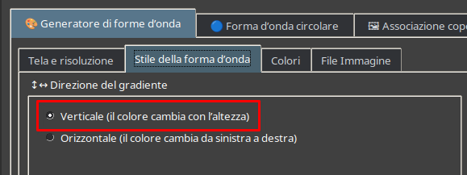
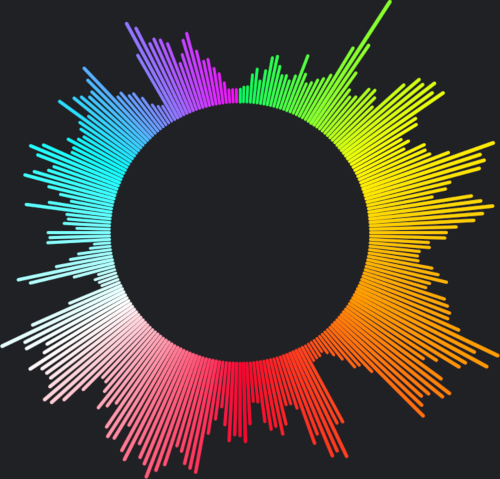

# Guida di Audio-SWARM
- [Indice](#contents)

**Audio-SWARM**: generatore di forme d’onda audio e sistema di elaborazione in batch per copertine di album, artwork e motivi per remix.

Audio-SWARM crea in grandi quantità artwork visivi per copertine di album basati sulle forme d’onda dei file audio. Audio-SWARM può generare immagini convenzionali di forme d’onda lineari con sfumature di colore partendo da quasi qualsiasi tipo di file audio.

Audio-SWARM può creare immagini di forme d’onda circolari, spettri radiali e design circolari minimalisti, oppure combinare immagini esistenti, copertine di album e artwork di copertina con tracce audio in un'unica elaborazione in batch.

* L'incorporamento di immagini nei file audio consente ai lettori multimediali compatibili, come VLC e Celluloid, nonché a smartphone e televisori, di visualizzare l'artwork incorporato durante la riproduzione di una canzone o di un file audio.

### Audio-SWARM crea artwork con forme d’onda stampabili in altissima risoluzione.

Le immagini generate da Audio-SWARM possono essere esportate anche con risoluzioni fino a 12.000 pixel, rendendole adatte a stampe di alta qualità e poster cinematografici ad alta risoluzione.

Audio-SWARM crea, a partire da immagini compatte di forme d’onda con dimensioni ridotte dei file, elementi visivi dettagliati adatti **alla stampa di copertine di album, alla stampa di grande formato, ad artwork con forme d’onda incorniciati, alla decorazione murale e a stampe giganti delle dimensioni di un poster cinematografico**.

Progettato per offrire dettagli visivi e nitidezza eccezionali, Audio-SWARM consente di creare artwork per un'ampia gamma di formati di stampa, dalle piccole copertine degli album agli enormi poster e alle grandi opere incorniciate. Che tu stia creando copertine di album con forme d’onda, preparando artwork per la stampa professionale, progettando stampe incorniciate o realizzando poster di grande formato, Audio-SWARM dà vita alle opere digitali trasformandole in straordinarie stampe fisiche ricche di dettagli.

## Indice <!-- anchor: contents -->
- [1. Che cos’è Audio-SWARM?](#what-is-swarm)
- [2. Avvio rapido](#quick-start)
- [3. Conoscere l’interfaccia](#interface)
- [4. Sound Wave Maker](#sound-wave-maker)
- [5. Circular Waveform](#circular-waveform)
- [6. Bulk Artwork Linker](#bulk-artwork-linker)
- [7. Elaborazione batch e cartelle di output](#batch-output)
- [8. Risoluzione e prestazioni](#resolution-performance)
- [9. Riferimento a colori e geometrie](#colors-geometry)
- [10. Risoluzione dei problemi](#troubleshooting)
- [11. Lingue e contributi](#languages-contributions)

## 1. Che cos’è Audio-SWARM? <!-- anchor: what-is-swarm -->

**Audio-SWARM (Audio-Sound Waveform & bulk Album/Artwork-cover batch Remix Motif)** crea immagini a partire da file audio e può incorporare copertine nei formati audio supportati. Offre tre strumenti:

- **Sound Wave Maker** crea immagini di forme d’onda tradizionali con flusso verticale o orizzontale, vari stili di barre, colori, sfumature e impostazioni di risoluzione.
- **Circular Waveform** crea forme d’onda circolari, visualizzazioni dello spettro radiale e linee circolari minimaliste.
- **Bulk Artwork Linker** abbina le immagini esistenti ai file audio nella cartella selezionata e incorpora la copertina quando il formato audio lo consente. L’abbinamento segue l’ordine alfabetico dei nomi dei file: rinominali quindi in modo che l’ordine corrisponda agli abbinamenti desiderati.

### Immagini generate

Sound Wave Maker e Circular Waveform esportano le immagini in **PNG o JPG**. Scegli le dimensioni in base all’uso previsto: immagini più piccole per l’uso quotidiano oppure immagini grandi ad alta risoluzione per visualizzazioni dettagliate e stampa. Le immagini circolari possono essere generate fino a 8000 pixel. PNG supporta la trasparenza; JPG utilizza uno sfondo uniforme.

### Incorporare le copertine e conservare l’audio

Quando il formato è supportato, Audio-SWARM incorpora l’immagine in una nuova copia di output dei file audio **MP3, OGG/OGA, FLAC, M4A e AIFF/AIF**. Per incorporare copertine in OGG/OGA e AIFF/AIF è necessario il pacchetto Python opzionale `mutagen`. Nel flusso di lavoro di Audio-SWARM, WAV non incorpora le copertine: il file audio e l’immagine vengono quindi salvati separatamente, uno accanto all’altra.

**AAC raw è l’eccezione:** in questo flusso di lavoro AAC raw non dispone di un contenitore standard per le copertine. Per incorporare l’immagine, Audio-SWARM inserisce il flusso audio AAC originale in un contenitore M4A e crea un file che termina con `_with_art.m4a`. Il flusso audio non viene ricodificato né ricampionato.

Audio-SWARM non modifica il file audio sorgente. Quando crea un file di output con la copertina incorporata, copia il flusso audio codificato originale senza ricodificarlo né ricampionarlo. Per calcolare la forma d’onda, Audio-SWARM utilizza una copia temporanea per l’analisi, usata soltanto per calcolare la visualizzazione e poi eliminata. Questa copia non viene mai usata come audio di output salvato. **L’audio nel file salvato rimane quello originale.**

## 2. Avvio rapido <!-- anchor: quick-start -->

1. **Scegli l’ingresso.** In **Sound Wave Maker** o **Circular Waveform**, seleziona un file audio supportato per una singola immagine oppure una cartella per elaborare più file. Usa il campo del percorso e il pulsante Browse, oppure trascina un file audio supportato o una cartella in un punto qualsiasi della finestra Audio-SWARM.  
   Per **Bulk Artwork Linker**, seleziona o trascina una cartella che contenga sia i file audio sia le relative copertine. Questo strumento lavora con una cartella, non con un singolo file audio.
2. **Seleziona la scheda principale** dello strumento desiderato:
   - **Sound Wave Maker** — crea immagini di forme d’onda tradizionali.
   - **Circular Waveform** — crea forme d’onda circolari, spettri radiali o disegni circolari minimalisti.
   - **Bulk Artwork Linker** — abbina immagini esistenti ai file audio di una cartella.
3. Regola le impostazioni necessarie. Se non sai da dove iniziare, mantieni i valori predefiniti. Per impostazione predefinita, le immagini vengono create in **PNG con sfondo trasparente**. In **Output Format** puoi scegliere JPG oppure uno sfondo uniforme.
4. Premi il pulsante di generazione o elaborazione. Controlla lo stato, la barra di avanzamento e il registro nella parte inferiore. Il trascinamento seleziona soltanto l’ingresso e non avvia l’elaborazione.
5. Al termine, controlla la cartella di output indicata nel registro o nel messaggio di completamento.

Sound Wave Maker e Circular Waveform possono elaborare le cartelle in modo ricorsivo e mantenere nella destinazione la struttura delle sottocartelle sorgenti. Bulk Artwork Linker esamina soltanto il livello superiore della cartella selezionata e abbina audio e immagini usando elenchi di nomi ordinati separatamente. Audio-SWARM non indovina quale immagine appartenga a quale traccia: assicurati che l’ordine alfabetico dei nomi produca gli abbinamenti desiderati.

### ⚠️ Informazioni sui cursori

- Scegli la dimensione desiderata, quindi regolala con precisione facendo clic accanto alla maniglia del cursore per apportare piccole modifiche.

### ⚠️ Avviso su Vertical Flow

In **Sound Wave Maker → Waveform Style → Vertical Flow**, l’elaborazione può richiedere molto più tempo rispetto alle altre opzioni, soprattutto con sfumature multicolore.
- Il registro potrebbe non aggiornarsi più visibilmente e Audio-SWARM potrebbe sembrare bloccato per un po’. Non chiudere subito Audio-SWARM: questa modalità può semplicemente richiedere più tempo.
- Attendi il completamento, soprattutto quando crei immagini grandi o elabori molti file.

## 3. Conoscere l’interfaccia <!-- anchor: interface -->

- **Campo del percorso di input:** mostra il file audio o la cartella sorgente selezionata per lo strumento corrente. Il pulsante **Browse** adiacente apre il selettore di file o cartelle del sistema.
- **Trascina e rilascia:** puoi anche rilasciare un file audio supportato o una cartella in qualsiasi punto della finestra Audio-SWARM. Il percorso di input viene aggiornato come se avessi usato **Browse**. Il rilascio non avvia l’elaborazione. Bulk Artwork Linker richiede una cartella contenente sia i file audio sia le immagini, non un singolo file audio.
- **Selettore della lingua:** cambia la lingua dell’interfaccia e carica il documento di guida corrispondente, se disponibile. Se la guida tradotta non esiste, Audio-SWARM utilizza la guida inglese.
- Puoi cambiare lingua in qualsiasi momento senza perdere le impostazioni già configurate.

Audio-SWARM è organizzato in **schede principali**, **sottoschede**, controlli di input e indicatori di elaborazione. Ogni parte ha uno scopo specifico:

- **Schede principali:** selezionano uno dei tre strumenti: **Sound Wave Maker**, **Circular Waveform** o **Bulk Artwork Linker**. **Help / About** apre la documentazione e le informazioni sull’applicazione.
- **Sottoschede:** raggruppano le impostazioni dello strumento in categorie più piccole. Cambiare sottoscheda non avvia l’elaborazione.
- **Pulsante di generazione o elaborazione:** avvia l’operazione dello strumento selezionato usando l’ingresso e le impostazioni correnti. Controlla il percorso e le opzioni prima di iniziare.

**Nota importante:** alcune impostazioni di **Sound Wave Maker** influiscono anche su **Circular Waveform**, comprese geometria e colori. Per applicare le modifiche alle immagini circolari, seleziona le impostazioni desiderate in Sound Wave Maker, torna alla scheda Circular Waveform e fai clic su **Generate Circular Waveforms**.

- **Barra di avanzamento:** mostra l’avanzamento durante un’operazione, soprattutto nell’elaborazione batch. Alcune fasi potrebbero non aggiornarla continuamente.
- **Riga di stato:** indica brevemente l’attività corrente di Audio-SWARM o il risultato dell’operazione.
- **Registro:** registra informazioni come file trovati, output creati, avvisi ed errori. Durante un’attività lunga potrebbe non aggiornarsi continuamente; questo non significa necessariamente che Audio-SWARM abbia smesso di funzionare.
- **Cancel:** richiede l’interruzione di un batch attivo. Se un file è già in fase di rendering o codifica, potrebbe essere necessario completare il passaggio corrente prima che l’annullamento abbia effetto.

Alcune pagine sono più alte della finestra. Usa la barra di scorrimento verticale o la rotellina del mouse per raggiungere i controlli più in basso.

## 4. Sound Wave Maker <!-- anchor: sound-wave-maker -->

Sound Wave Maker crea un’immagine della forma d’onda da ogni file audio supportato. Le sottoschede raggruppano le impostazioni in base alla loro funzione.

Nell’elaborazione ricorsiva delle cartelle, le immagini vengono salvate in `Waveform_Outputs`, mantenendo al suo interno la struttura delle sottocartelle sorgenti. Per un singolo file, l’output viene collocato accanto al file sorgente. MP3, OGG/OGA, FLAC, M4A e AIFF/AIF possono contenere una copertina incorporata. Gli ingressi AAC raw producono un file terminante in `_with_art.m4a`, perché AAC raw non dispone di un contenitore standard per le copertine. Per WAV l’immagine viene mantenuta separatamente. L’incorporamento delle copertine in OGG/OGA e AIFF/AIF richiede il pacchetto Python `mutagen`; se non è disponibile, Audio-SWARM conserva l’immagine autonoma e registra un errore.

### Canvas & Resolution
#### Render Resolution Framework Configuration

- **Preset Dimensions Matrix Selector:** seleziona dimensioni del canvas e rapporto d’aspetto predefiniti per formati comuni, tra cui orizzontale, verticale e copertina quadrata. Il predefinito imposta automaticamente larghezza e altezza.
- **Canvas Width Limit:** imposta la larghezza dell’immagine di output in pixel, da 10 a 8000.
- **Canvas Height Limit:** imposta l’altezza dell’immagine di output in pixel, da 10 a 8000.

Se modifichi manualmente larghezza o altezza, il predefinito passa a **Custom Mapping Coordinates**, permettendoti di specificare dimensioni personalizzate.

Dimensioni maggiori producono immagini con più pixel, adatte a grafiche dettagliate, schermi ad alta risoluzione e stampa. Richiedono però più tempo di elaborazione e memoria e producono file più grandi.

#### Waveform Structural Core Densities

- **Total Grid Bar Count Mapping Layout:** controlla il numero di barre della forma d’onda, da 40 a 500. Un valore più basso produce meno barre, più larghe; un valore più alto produce una forma d’onda più densa con barre più strette. Più barre possono aumentare il tempo di elaborazione.
- **Gradient Processing Slice Resolution:** controlla il numero di segmenti di colore usati per renderizzare le sfumature. Più segmenti possono rendere le transizioni più morbide, ma possono anche aumentare notevolmente il tempo di elaborazione, soprattutto con sfumature multicolore in Vertical Flow. **Solid Flat Color** non usa segmenti di sfumatura, quindi è molto più veloce.
- **Canvas Target Printing Resolution (DPI):** imposta i metadati della risoluzione di stampa. Non cambia le dimensioni in pixel dell’immagine, controllate separatamente tramite Canvas Width e Canvas Height. A parità di dimensioni in pixel, un DPI più alto produce una stampa fisica più piccola con più pixel per pollice.

### Waveform Style
#### Gradient Spectrum Axis Orientation

- **Vertical Flow** distribuisce i colori della sfumatura lungo l’altezza di ogni barra.
- **Horizontal Flow** distribuisce i colori da sinistra a destra lungo la forma d’onda.

### Waveform Bar Peak Geometry Style
Scegli la forma delle barre della forma d’onda e delle loro punte:

- **Standard Classic Bars:** barre rettangolari con estremità piatte.
- **Smooth Capsule:** barre con estremità arrotondate e morbide.
- **Lollipop:** steli sottili con una punta circolare.
- **Sharp Spikes:** barre che terminano con punte affilate.
- **Arrow-Spear:** barre con estremità chiaramente a forma di freccia.

La geometria selezionata influisce anche sulle modalità corrispondenti di Circular Waveform e Radial Spectrum. Minimal Circular Waveform usa una linea continua invece di barre separate, quindi questi stili geometrici non si applicano a tale modalità.
Ogni barra rappresenta l’ampiezza del segnale audio in un breve intervallo. L’altezza indica il livello del segnale, mentre la geometria determina se la punta è piatta, arrotondata, circolare, appuntita o a forma di freccia.

### Colors
La sottoscheda Colors consente di combinare più colori in una sfumatura oppure di usare un solo colore uniforme.

- **Color nodes:** ogni pulsante **Node Color** rappresenta un punto colore della sfumatura. Fai clic per scegliere il colore. La barra di anteprima mostra la fusione dei colori nell’ordine corrente.
- **Add Color Node:** aggiunge un altro punto colore, fino a un massimo di 10.
- **Remove Last Node:** rimuove l’ultimo punto colore. In modalità sfumatura rimangono almeno due nodi.
- **Invert Layer Core Coordinates Processing Direction (Reverse Vector Flow):** inverte l’ordine dei colori della sfumatura e cambia la direzione in cui appaiono sulla forma d’onda.
- **Enable Solid Flat Color:** applica un singolo colore selezionato all’intera forma d’onda senza calcolare i segmenti della sfumatura. È molto più veloce, soprattutto con Vertical Flow. In questa modalità l’inversione della sfumatura è disattivata. È disattivato anche il controllo Gradient Processing Slice nella scheda Canvas & Resolution. Tornando alla modalità sfumatura vengono ripristinati due nodi di colore; gli eventuali nodi aggiuntivi devono essere aggiunti di nuovo.

### Output Format

- **Output Raster Format:** scegli PNG o JPG per le immagini della forma d’onda. PNG è selezionato per impostazione predefinita e supporta la trasparenza. JPG non la supporta e, quando viene selezionato, l’opzione di trasparenza viene disattivata automaticamente.
- **Enable 100% Alpha Channel Canvas Transparency Block:** abilita lo sfondo trasparente per le immagini PNG. Quando la trasparenza è attiva, il pulsante del colore di sfondo è bloccato e mostra **Locked (Transparent)**.
- **Pick Backdrop Color:** quando la trasparenza è disattivata, fai clic per scegliere uno sfondo uniforme. Il colore scelto viene conservato quando passi da PNG a JPG o modifichi le impostazioni di trasparenza.
- **Retain standalone high-res images inside workspace alongside embedded items:** è attivo per impostazione predefinita. Quando Audio-SWARM incorpora correttamente un’immagine in un file audio supportato, conserva anche l’immagine separata ad alta risoluzione accanto all’output audio. Se disattivata, l’immagine separata viene rimossa dopo l’incorporamento riuscito. Se l’incorporamento fallisce, l’immagine viene conservata.

I colori selezionati, la direzione della sfumatura, il formato di output, le impostazioni di trasparenza e sfondo, Vertical Flow o Horizontal Flow e gli stili delle barre, delle punte e della geometria sono condivisi anche con Circular Waveform, Radial Spectrum e Minimal Circular Waveform. Per applicare le modifiche alle immagini circolari, torna alla scheda Circular Waveform e fai clic su **Generate Circular Waveforms**.

## 5. Circular Waveform <!-- anchor: circular-waveform -->

Circular Waveform crea visualizzazioni circolari dai file audio. Scegli una delle tre modalità nelle sottoschede.

#### Impostazioni condivise

- **Output Size (square pixels):** imposta larghezza e altezza dell’immagine quadrata, da 256 a 8000 pixel.
- **Rotation (degrees):** ruota la grafica da 0° a 359°.

### Mode: Circular Waveform

Mostra barre della forma d’onda disposte attorno a un cerchio.

- **Inner Radius:** controlla la dimensione dello spazio vuoto centrale. Un raggio maggiore crea un’apertura centrale più ampia.
- **Outward:** le barre si estendono verso l’esterno dalla linea di base circolare.
- **Inward:** le barre si estendono verso il centro.
- **Inward + Outward:** attiva entrambe le caselle per estendere le barre in entrambe le direzioni. Deve rimanere sempre selezionata almeno una direzione; disattivando l’unica direzione selezionata, viene attivata automaticamente l’altra.
- **Geometria della forma d’onda:** usa la geometria selezionata in Sound Wave Maker → Waveform Style, compresi Standard Classic Bars, Smooth Capsules, Lollipop, Sharp Spikes e Arrow-Spear.

### Mode: Radial Spectrum

Mostra l’energia delle frequenze audio tramite barre radiali disposte attorno a un cerchio.

- **Inner Radius:** controlla la dimensione dell’apertura centrale.
- **Frequency Bands:** imposta il numero di bande di frequenza rappresentate attorno al cerchio. Più bande mostrano dettagli di frequenza più fini.
- **Sensitivity:** controlla l’intensità visiva delle barre dello spettro. Aumentala per rendere più evidenti le variazioni di frequenza.
- **Outward e Inward:** determinano se le barre si allontanano dalla linea di base, si dirigono verso il centro o si estendono in entrambe le direzioni.

### Mode: Minimal Circular Waveform

Disegna una linea continua intorno a un cerchio invece di barre separate.

- **Base Radius:** controlla il raggio di base della linea circolare.
- **Wave Amplitude:** controlla quanto la linea si allontana dal raggio di base. Valori più alti producono variazioni più marcate.
- **Line Width:** controlla lo spessore della linea.

Questa modalità non usa il selettore della geometria della forma d’onda né i controlli di direzione Inward/Outward.

### Colori e impostazioni di output condivisi

Circular Waveform, Radial Spectrum e Minimal Circular Waveform condividono con Sound Wave Maker i nodi colore, la direzione della sfumatura, il formato di output, le impostazioni di trasparenza e sfondo, il DPI e la preferenza per l’incorporamento delle copertine.

Le impostazioni **Vertical Flow** e **Horizontal Flow** in Sound Wave Maker → Waveform Style influiscono anche sul modo in cui i colori sfumati vengono applicati a Circular Waveform, Radial Spectrum e Minimal Circular Waveform. Per cambiare la direzione della sfumatura, seleziona il flusso desiderato in Sound Wave Maker.

#### Nota
Alcune impostazioni di Sound Wave Maker influiscono anche sulle immagini circolari, tra cui geometria e colori. Seleziona le impostazioni desiderate in Sound Wave Maker, torna a Circular Waveform e fai clic su **Generate Circular Waveforms** per applicarle.

Quando elabora una cartella, Audio-SWARM crea `Circular_Waveform_Outputs` e conserva la struttura delle sottocartelle sorgenti. Ogni modalità utilizza un suffisso specifico nel nome del file per evitare di sovrascrivere l’output delle altre modalità.

## 6. Bulk Artwork Linker <!-- anchor: bulk-artwork-linker -->

Bulk Artwork Linker abbina i file audio supportati (MP3, OGG/OGA, WAV, FLAC, M4A, AAC e AIFF/AIF) alle immagini PNG, JPG o JPEG presenti nella cartella selezionata. Ordina separatamente i nomi dei file audio e quelli delle immagini, poi abbina i file in base alla posizione negli elenchi. Prima di iniziare, rinomina i file in modo che l’ordine alfabetico corrisponda agli abbinamenti desiderati.

**È fortemente consigliato** usare lo stesso numero di immagini e file audio. Per ottenere i risultati migliori, prepara prima le immagini con le dimensioni in pixel e il rapporto d’aspetto desiderati. Il ridimensionatore di Audio-SWARM serve soltanto a uniformare le dimensioni delle immagini. Se il rapporto d’aspetto è diverso da quello di destinazione, possono essere aggiunte bande nere in alto e in basso oppure ai lati per mantenere le proporzioni originali.

L’opzione di ridimensionamento adatta le immagini alle dimensioni di destinazione selezionate. Se è attiva la conservazione del rapporto d’aspetto, l’immagine viene adattata all’interno del canvas; altrimenti viene allungata fino alle dimensioni esatte. Il ridimensionamento richiede Pillow. Se non è disponibile, lo strumento mantiene le dimensioni originali dell’immagine.

Le uscite MP3, OGG/OGA, FLAC, M4A e AIFF/AIF vengono salvate come nuovi file con `_with_art` nel nome. Gli ingressi AAC raw vengono inseriti in un contenitore M4A mantenendo invariato il flusso audio AAC. Nel flusso di Audio-SWARM, WAV non memorizza copertine incorporate, quindi audio e immagine vengono copiati uno accanto all’altra. L’incorporamento per OGG/OGA e AIFF/AIF richiede Mutagen (vedi i requisiti opzionali). I risultati vengono salvati in `Merged_Tracks_Outputs`. Questo strumento esamina solo il livello superiore della cartella selezionata, non le sottocartelle. Se il numero di file audio e immagini è diverso, Audio-SWARM elabora soltanto le coppie complete e registra un avviso.

## 7. Elaborazione batch e cartelle di output <!-- anchor: batch-output -->

Sound Wave Maker e Circular Waveform elaborano i batch in modo ricorsivo. Le rispettive cartelle di output conservano la struttura delle sottocartelle sorgenti, così file con lo stesso nome provenienti da cartelle diverse non entrano in conflitto. Bulk Artwork Linker elabora solo i file direttamente nella cartella selezionata.

Prima di un batch grande, controlla la cartella selezionata e la destinazione di output. Eseguire di nuovo lo stesso lavoro può sostituire un file di output esistente con lo stesso nome. Conserva una copia di sicurezza dei file importanti ed evita di collocare file di input estranei nelle cartelle di output generate.

## 8. Risoluzione e prestazioni <!-- anchor: resolution-performance -->

Canvas Width e Canvas Height determinano le dimensioni dell’immagine in pixel. DPI controlla i metadati della risoluzione di stampa, mentre Audio-SWARM esegue il rendering alle dimensioni in pixel selezionate. Le immagini grandi richiedono più memoria e tempo e producono file più voluminosi.

Un numero di barre più alto genera più barre e può renderle più strette. Gradient Processing Slice Resolution controlla il numero di passaggi di colore discreti nei gradienti suddivisi in segmenti: più passaggi possono rendere le transizioni più morbide, ma richiedono più tempo.

**Gradient Smoothness:** se la sfumatura non appare abbastanza uniforme, prova a impostare questo valore su **200**. Verrà utilizzato un algoritmo diverso come alternativa.

Solid Flat Color evita il calcolo dei segmenti di sfumatura. Prima di eseguire un batch molto grande, fai una prova con dimensioni moderate e pochi file audio.

## 9. Riferimento a colori e geometrie <!-- anchor: colors-geometry -->

- **Rectangle:** barre tradizionali con estremità piatte.
- **Smooth Capsules:** barre con estremità arrotondate.
- **Lollipop:** stelo sottile con una punta circolare.
- **Sharp Spikes:** barre che terminano in punte triangolari.
- **Arrow-Spear:** steli con una punta chiaramente simile a una freccia.

Usa **Vertical Flow** se vuoi che il colore cambi lungo l’altezza di ogni barra. Usa **Horizontal Flow** se il gradiente deve spostarsi da un lato all’altro della forma d’onda. **Solid Flat Color** è utile per un design a tinta unita ed evita la suddivisione del gradiente in segmenti. I nodi colore definiscono le tappe del gradiente; l’anteprima ne mostra l’ordine.

## 10. Risoluzione dei problemi <!-- anchor: troubleshooting -->

- **Nessun file trovato:** verifica che il percorso sia corretto e che la cartella contenga un formato audio o immagine supportato dallo strumento selezionato.
- **Copertina mancante o abbinamento incompleto:** Bulk Artwork Linker abbina gli elenchi ordinati in base alla posizione. Controlla i nomi e il numero di file in ciascun elenco.
- **Destinazione di output inattesa:** controlla il messaggio di completamento e il nome della cartella di output.
- **Un file è stato sostituito:** le uscite possono avere lo stesso nome se il processo viene ripetuto. Esegui un backup o sposta i risultati precedenti prima di riprovare.
- **Incorporamento non riuscito:** controlla il registro dell’applicazione e verifica che FFmpeg sia installato e possa leggere il file sorgente.
- **Rendering lento o uso elevato della memoria:** riduci le dimensioni in pixel, la grandezza del batch oppure il numero di barre o segmenti.
- **Guida mancante in una lingua:** se manca il documento di guida della lingua selezionata, Audio-SWARM usa `help/en.md`.

Se il problema persiste, conserva il testo del registro e annota lo strumento, la modalità, il formato del file e le impostazioni selezionate.

## 11. Lingue e contributi <!-- anchor: languages-contributions -->

Le traduzioni dell’interfaccia sono memorizzate come file JSON in `languages/`. Le guide sono file Markdown in `help/`, mentre i documenti About sono file Markdown in `about/`. I file JSON e Markdown usano il codice della lingua nel nome, per esempio `en.md` per l’inglese, `fr.md` per il francese o `ja.md` per il giapponese.

Per contribuire a una traduzione, **copia il file inglese dalla cartella pertinente**, traduci il testo e i titoli, quindi salva il file con il codice della lingua corretto. Mantieni invariati i commenti di ancoraggio HTML della guida e gli obiettivi del sommario, in modo che i collegamenti alle sezioni continuino a funzionare.

Salva i file in UTF-8!

Non tradurre nomi di file, esempi di codice, identificatori delle impostazioni o nomi di cartelle quando devono corrispondere esattamente all’applicazione. Mantieni le traduzioni allineate al documento master inglese e segnala eventuali formulazioni poco chiare o comportamenti non più aggiornati. Se manca una guida o un documento About specifico per una lingua, Audio-SWARM utilizza il documento inglese corrispondente.
