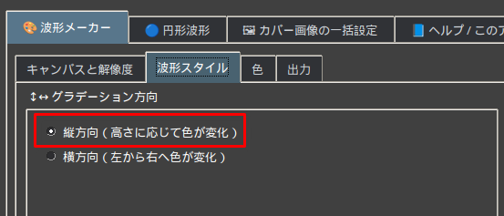

# Audio-SWARM ヘルプ
- [目次](#contents)

**Audio-SWARM**：オーディオ波形ジェネレーター。アルバムカバー、アートワーク、リミックス用モチーフを一括処理できます。

Audio-SWARMは、オーディオファイルから波形を使用したアルバムカバーアートを一括生成します。ほぼあらゆる種類のオーディオファイルから、グラデーション付きの従来型の線形波形画像を生成できます。

円形の波形画像、放射状スペクトル、ミニマルな円形デザインを作成できるほか、既存の画像、アルバムカバー、カバーアート画像とオーディオトラックを1回のバッチ処理で組み合わせることもできます。

* オーディオファイルに画像を埋め込むことで、VLCやCelluloidなどの対応メディアプレーヤーに加え、スマートフォンやテレビでも、曲やオーディオファイルの再生時に埋め込まれたアートワークを表示できます。

### Audio-SWARMは、印刷に適した超高解像度の波形アートワークを作成します。

Audio-SWARMで生成した画像は、最大12,000ピクセルの解像度でエクスポートでき、高品質な印刷や高解像度の映画ポスター制作に適しています。

Audio-SWARMは、ファイルサイズの小さいコンパクトな波形画像をもとに、**アルバムカバーの印刷、大判印刷、額装用の波形アートワーク、壁面アート、映画ポスターサイズの特大プリント**に適した、精細なビジュアルを作成します。

Audio-SWARMは、優れた視覚的ディテールと鮮明さを実現するよう設計されており、小さなアルバムカバーから巨大なポスター、大型の額装作品まで、さまざまな印刷サイズに対応するアートワークを作成できます。波形を使ったアルバムカバーの制作、プロ向け印刷用アートワークの準備、額装プリントのデザイン、大判ポスターの制作など、Audio-SWARMはデジタルアートを、細部まで美しく表現された魅力的な実物のプリント作品へとつなげます。

## 目次 <!-- anchor: contents -->
- [1. Audio-SWARM とは](#what-is-swarm)
- [2. クイックスタート](#quick-start)
- [3. インターフェースについて](#interface)
- [4. Sound Wave Maker](#sound-wave-maker)
- [5. Circular Waveform](#circular-waveform)
- [6. Bulk Artwork Linker](#bulk-artwork-linker)
- [7. バッチ処理と出力フォルダー](#batch-output)
- [8. 解像度とパフォーマンス](#resolution-performance)
- [9. 色とジオメトリのリファレンス](#colors-geometry)
- [10. トラブルシューティング](#troubleshooting)
- [11. 言語と貢献](#languages-contributions)

## 1. Audio-SWARM とは <!-- anchor: what-is-swarm -->

**Audio-SWARM (Audio-Sound Waveform & bulk Album/Artwork-cover batch Remix Motif)** は音声ファイルからビジュアル画像を作成し、対応する音声形式にカバー画像を埋め込むこともできます。次の3つのツールを備えています。

- **Sound Wave Maker** は、垂直または水平のフロー、さまざまなバーの形状、色、グラデーション、解像度設定を使って通常の波形画像を作成します。
- **Circular Waveform** は、円形波形、放射状スペクトルのビジュアライゼーション、ミニマルな円形ラインを作成します。
- **Bulk Artwork Linker** は、選択したフォルダー内の音声ファイルと既存の画像を対応付け、音声形式が対応していればカバー画像を埋め込みます。ファイルは名前を並べ替えた順に対応付けられるため、目的の組み合わせになるようファイル名を調整してください。

### 画像の出力

Sound Wave Maker と Circular Waveform は、画像を **PNG または JPG** で出力します。用途に合わせて画像サイズを選択してください。日常的な利用には小さめの画像、細部の表示や印刷には大きく高解像度の画像が適しています。円形画像は最大 8000 ピクセルで生成できます。PNG は透明背景に対応し、JPG は単色背景を使用します。

### カバー画像の埋め込みと音声の保持

対応形式の場合、Audio-SWARM は **MP3、OGG/OGA、FLAC、M4A、AIFF/AIF** の新しい出力コピーに画像を埋め込みます。OGG/OGA と AIFF/AIF へのカバー画像の埋め込みには、オプションの Python パッケージ `mutagen` が必要です。Audio-SWARM の処理では WAV にカバー画像を埋め込まないため、音声ファイルと画像は同じ場所に別々に保存されます。

**生の AAC は例外です。** この処理では、生の AAC にカバー画像を格納する標準コンテナーがありません。画像を埋め込む際、Audio-SWARM は元の AAC 音声ストリームを M4A コンテナーに格納し、末尾が `_with_art.m4a` のファイルを作成します。音声ストリーム自体の再エンコードやリサンプリングは行いません。

Audio-SWARM は元の音声ファイルを変更しません。カバー画像を埋め込んだ出力ファイルを作成するときも、元のエンコード済み音声ストリームを再エンコードやリサンプリングをせずにコピーします。波形を計算するため、一時的な解析用コピーを作成します。このコピーはビジュアライゼーションの計算だけに使われ、その後削除されます。保存する音声出力として使われることはありません。**保存された出力の音声は元の音声のままです。**

## 2. クイックスタート <!-- anchor: quick-start -->

1. **入力を選択します。** **Sound Wave Maker** または **Circular Waveform** で、1枚の画像を作る場合は対応する音声ファイルを1つ、複数処理する場合はフォルダーを選択します。パス欄と Browse ボタンを使うか、対応する音声ファイルまたはフォルダーを Audio-SWARM ウィンドウ内の任意の場所へドラッグ＆ドロップします。  
   **Bulk Artwork Linker** では、音声ファイルと対応するカバー画像の両方を含むフォルダーを選択するか、ウィンドウにドロップします。このツールは単一の音声ファイルではなく、フォルダーを処理します。
2. 使いたいツールの **メインタブ** を選択します。
   - **Sound Wave Maker** — 通常の波形画像を作成します。
   - **Circular Waveform** — 円形波形、放射状スペクトル、ミニマルな円形デザインを作成します。
   - **Bulk Artwork Linker** — フォルダー内の既存画像を音声ファイルに対応付けます。
3. 必要な設定を調整します。迷った場合は既定値のままにしてください。既定では **透明背景の PNG** が出力されます。JPG または単色背景を使う場合は **Output Format** で変更できます。
4. 生成または処理のボタンを押します。ウィンドウ下部の状態表示、進行状況バー、ログを確認してください。ファイルやフォルダーをドロップしても入力が選択されるだけで、処理は開始されません。
5. 処理が完了したら、ログまたは完了メッセージに表示された出力フォルダーを確認します。

Sound Wave Maker と Circular Waveform はフォルダーを再帰的に処理し、出力先にも元のサブフォルダー構成を保持できます。Bulk Artwork Linker は選択したフォルダーの直下だけを調べ、音声ファイルと画像ファイルをそれぞれ別に並べ替えたリストの順番で対応付けます。Audio-SWARM は曲と画像の組み合わせを自動判定しません。並べ替え後のファイル名の順序が、目的の組み合わせに合っていることを確認してください。

### ⚠️ スライダーについて

- 希望のサイズを選択し、スライダーのつまみの横をクリックして細かく調整してください。

### ⚠️ Vertical Flow に関する警告

**Sound Wave Maker → Waveform Style → Vertical Flow** では、特に複数色のグラデーションを使う場合、ほかの設定より処理にかなり時間がかかることがあります。
- ログの更新が止まったように見えたり、Audio-SWARM が一時的に応答しないように見えたりすることがあります。すぐに Audio-SWARM を閉じないでください。このモードは単に時間がかかっている場合があります。
- 大きな画像や多数のファイルを処理するときは、完了するまで待ってください。

## 3. インターフェースについて <!-- anchor: interface -->

- **入力パス欄：** 現在のツールで選択されている音声ファイルまたはソースフォルダーを表示します。隣の **Browse** ボタンでシステムのファイル／フォルダー選択画面を開けます。
- **ドラッグ＆ドロップ：** 対応する音声ファイルまたはフォルダーを Audio-SWARM ウィンドウの任意の場所にドロップすることもできます。**Browse** で選択した場合と同じように入力パスが更新されます。ドロップしても処理は開始されません。Bulk Artwork Linker では、単一の音声ファイルではなく、音声と画像の両方を含むフォルダーが必要です。
- **言語セレクター：** インターフェースの言語を変更し、利用可能な場合は対応するヘルプ文書を読み込みます。翻訳済みのヘルプがない場合、Audio-SWARM は英語のヘルプを使用します。
- 設定済みの項目を失わずに、いつでも言語を切り替えられます。

Audio-SWARM は **メインタブ**、**サブタブ**、入力コントロール、処理状況の表示で構成されています。それぞれ役割が異なります。

- **メインタブ：** **Sound Wave Maker**、**Circular Waveform**、**Bulk Artwork Linker** のいずれかを選びます。**Help / About** はドキュメントとアプリケーション情報を開きます。
- **サブタブ：** ツールの設定を目的別の小さなグループに分けます。サブタブを切り替えても処理は開始されません。
- **生成／処理ボタン：** 選択中のツールを、現在の入力と設定で実行します。開始前にパスとオプションを確認してください。

**重要：** **Sound Wave Maker** の一部の設定は、ジオメトリや色など **Circular Waveform** にも影響します。円形画像に変更を適用するには、Sound Wave Maker で設定を選び、Circular Waveform タブに**戻って** **Generate Circular Waveforms** をクリックしてください。

- **進行状況バー：** 処理中の進行状況を示します。特にバッチ処理で役立ちますが、処理段階によっては連続して更新されません。
- **状態表示：** Audio-SWARM が現在行っている処理や、処理結果を簡潔に表示します。
- **ログ：** 検出したファイル、作成した出力、警告、エラーなどを記録します。時間のかかる処理ではログが常に更新されるとは限りません。更新が止まっても、必ずしも Audio-SWARM が停止したわけではありません。
- **Cancel：** 実行中のバッチ処理の停止を要求します。レンダリングやエンコードが始まっているファイルは、キャンセルが反映される前に現在の処理段階を完了する場合があります。

ページによってはウィンドウより縦に長くなります。縦スクロールバーまたはマウスホイールで下のコントロールを表示してください。

## 4. Sound Wave Maker <!-- anchor: sound-wave-maker -->

Sound Wave Maker は、対応する各音声ファイルから波形画像を作成します。サブタブには目的ごとに設定がまとめられています。

フォルダーを再帰的に処理すると、画像は `Waveform_Outputs` に保存され、その中にソースのサブフォルダー構成が再現されます。単一ファイルの場合、出力はソースファイルの隣に保存されます。MP3、OGG/OGA、FLAC、M4A、AIFF/AIF にはカバー画像を埋め込めます。生の AAC 入力では、カバー画像用の標準コンテナーがないため、末尾が `_with_art.m4a` のファイルが作成されます。WAV では画像は別に保存されます。OGG/OGA と AIFF/AIF への埋め込みには Python パッケージ `mutagen` が必要です。利用できない場合、Audio-SWARM は独立した画像を保存し、エラーをログに記録します。

### Canvas & Resolution
#### Render Resolution Framework Configuration

- **Preset Dimensions Matrix Selector：** 横長、縦長、正方形のカバー画像など、一般的な形式向けのキャンバスサイズとアスペクト比を選択します。プリセットにより幅と高さが自動設定されます。
- **Canvas Width Limit：** 出力画像の幅を 10～8000 ピクセルで設定します。
- **Canvas Height Limit：** 出力画像の高さを 10～8000 ピクセルで設定します。

幅または高さを手動で変更すると、プリセットは **Custom Mapping Coordinates** に切り替わり、独自の画像サイズを指定できます。

大きいサイズほど画素数が多くなり、細部の多い画像、高解像度ディスプレイ、印刷に適しています。ただし、処理時間とメモリの使用量が増え、ファイルも大きくなります。

#### Waveform Structural Core Densities

- **Total Grid Bar Count Mapping Layout：** 波形バーの数を 40～500 で設定します。値が小さいとバーの数が少なく幅が広くなり、値が大きいと密度が高くバーが細くなります。バーを増やすと処理時間が長くなる場合があります。
- **Gradient Processing Slice Resolution：** グラデーション描画に使用する色のスライス数を設定します。スライスを増やすと色の変化が滑らかになる場合がありますが、特に Vertical Flow の多色グラデーションでは処理時間が大幅に増えることがあります。**Solid Flat Color** はグラデーションのスライスを使わないため、処理が大幅に速くなります。
- **Canvas Target Printing Resolution (DPI)：** 画像の印刷解像度メタデータを設定します。画像のピクセル寸法は変わりません。ピクセル寸法は Canvas Width と Canvas Height で別々に設定します。同じピクセル寸法の場合、DPI が高いほど物理的な印刷サイズは小さくなり、1インチあたりのピクセル数が増えます。

### Waveform Style
#### Gradient Spectrum Axis Orientation

- **Vertical Flow** は、各バーの高さに沿ってグラデーションの色を配置します。
- **Horizontal Flow** は、波形に沿って左から右へ色を配置します。

### Waveform Bar Peak Geometry Style
波形バーとその先端の形状を選択します。

- **Standard Classic Bars：** 端が平らな長方形のバー。
- **Smooth Capsule：** 端が滑らかに丸いバー。
- **Lollipop：** 先端が円形の細いステム。
- **Sharp Spikes：** 先端が鋭く尖ったバー。
- **Arrow-Spear：** 矢印のような形状の先端を持つバー。

選択したジオメトリは、Circular Waveform と Radial Spectrum の対応モードにも影響します。Minimal Circular Waveform は個々のバーではなく連続した線を使うため、これらのジオメトリスタイルは適用されません。
各バーは短い時間区間における音声信号の振幅を表します。高さは信号レベルを示し、ジオメトリは先端が平ら、丸い、円形、尖った形、矢印形のどれになるかを決めます。

### Colors
Colors サブタブでは、複数の色を組み合わせたグラデーション、または単色を使用できます。

- **Color nodes：** 各 **Node Color** ボタンはグラデーションの色の節点を表します。ボタンをクリックして色を選択します。プレビューには現在の順序で色が混ざる様子が表示されます。
- **Add Color Node：** 色の節点を追加します。最大 10 個までです。
- **Remove Last Node：** 最後の色の節点を削除します。グラデーションモードでは、最低 2 個の節点が残ります。
- **Invert Layer Core Coordinates Processing Direction (Reverse Vector Flow)：** グラデーションの色の順序を反転し、波形上で色が現れる方向を変更します。
- **Enable Solid Flat Color：** グラデーションのスライスを計算せず、選択した単色を波形全体に使用します。特に Vertical Flow では処理が大幅に速くなります。このモードではグラデーションの反転は無効になり、Canvas & Resolution タブの Gradient Processing Slice も無効になります。グラデーションモードに戻ると色の節点が 2 個に戻り、追加の節点は再度追加する必要があります。

### Output Format

- **Output Raster Format：** 波形画像の形式として PNG または JPG を選択します。既定は PNG で、透明背景に対応します。JPG は透明に対応しないため、JPG を選ぶと透明化オプションは自動的に無効になります。
- **Enable 100% Alpha Channel Canvas Transparency Block：** PNG 画像の透明背景を有効にします。透明化が有効な場合、背景色ボタンはロックされ、**Locked (Transparent)** と表示されます。
- **Pick Backdrop Color：** 透明化が無効のとき、このボタンで単色背景を選択します。PNG／JPG と透明化設定を切り替えても、選択した色は保持されます。
- **Retain standalone high-res images inside workspace alongside embedded items：** 既定で有効です。対応する音声ファイルへの画像埋め込みに成功すると、音声出力と並べてフル解像度の画像ファイルも保持します。無効にすると、埋め込み成功後に独立画像が削除されます。埋め込みに失敗した場合は画像が保持されます。

選択した色、グラデーション方向、出力形式、透明化と背景の設定、Vertical Flow／Horizontal Flow、バー・先端・ジオメトリの各設定は Circular Waveform、Radial Spectrum、Minimal Circular Waveform にも共有されます。円形画像に変更を適用するには、Circular Waveform タブに戻り **Generate Circular Waveforms** をクリックしてください。

## 5. Circular Waveform <!-- anchor: circular-waveform -->

Circular Waveform は音声ファイルから円形のビジュアライゼーションを作成します。サブタブで 3 つのモードから選択してください。

#### 共通設定

- **Output Size (square pixels)：** 正方形画像の幅と高さを 256～8000 ピクセルで設定します。
- **Rotation (degrees)：** 画像を 0°～359°の範囲で回転します。

### Mode: Circular Waveform

円の周囲に配置された波形バーを表示します。

- **Inner Radius：** 中央の空白部分の大きさを調整します。値を大きくすると中央の穴が大きくなります。
- **Outward：** バーを円形の基準線から外側へ伸ばします。
- **Inward：** バーを中心に向かって伸ばします。
- **Inward + Outward：** 両方のチェックボックスを有効にすると、バーが両方向へ伸びます。少なくとも一方は常に選択されます。唯一選択されている方向を無効にすると、もう一方が自動的に選択されます。
- **波形ジオメトリ：** Sound Wave Maker → Waveform Style で選択したジオメトリを使用します。Standard Classic Bars、Smooth Capsules、Lollipop、Sharp Spikes、Arrow-Spear が含まれます。

### Mode: Radial Spectrum

音声の周波数エネルギーを、円の周囲に並んだ放射状のバーで表示します。

- **Inner Radius：** 中央の穴の大きさを調整します。
- **Frequency Bands：** 円周に表示する周波数帯の数を設定します。帯の数を増やすと、より細かな周波数の変化を表現できます。
- **Sensitivity：** スペクトルバーの視覚的な強さを調整します。値を大きくすると周波数の変化が目立ちます。
- **Outward と Inward：** バーを基準線から外側へ、中心へ、または両方向へ伸ばすかを設定します。

### Mode: Minimal Circular Waveform

個々のバーではなく、円周に沿った連続した線を描きます。

- **Base Radius：** 円形ラインの基本半径を設定します。
- **Wave Amplitude：** ラインが基本半径からどれだけ離れるかを調整します。値が高いほど変化が大きくなります。
- **Line Width：** ラインの太さを設定します。

このモードでは波形ジオメトリの選択や Inward／Outward の方向設定は使用しません。

### 共通の色と出力設定

Circular Waveform、Radial Spectrum、Minimal Circular Waveform は、Sound Wave Maker と色の節点、グラデーション方向、出力形式、透明化と背景の設定、DPI、カバー画像の埋め込み設定を共有します。

Sound Wave Maker → Waveform Style の **Vertical Flow** と **Horizontal Flow** も、Circular Waveform、Radial Spectrum、Minimal Circular Waveform へのグラデーションの適用方法に影響します。方向を変更するには、Sound Wave Maker で希望するフローを選択してください。

#### 注意
Sound Wave Maker の一部の設定（ジオメトリや色など）は円形画像にも影響します。Sound Wave Maker で設定を選び、Circular Waveform に戻って **Generate Circular Waveforms** をクリックすると変更が適用されます。

フォルダーを処理すると、Audio-SWARM は `Circular_Waveform_Outputs` フォルダーを作成し、元のサブフォルダー構成を保持します。モードごとに異なるファイル名の接尾辞が使われるため、各モードの出力が互いに上書きされません。

## 6. Bulk Artwork Linker <!-- anchor: bulk-artwork-linker -->

Bulk Artwork Linker は、対応する音声ファイル（MP3、OGG/OGA、WAV、FLAC、M4A、AAC、AIFF/AIF）を、選択したフォルダー内の PNG、JPG、JPEG 画像と対応付けます。音声ファイルと画像ファイルの名前をそれぞれ別に並べ替え、そのリスト内の位置に基づいてペアにします。開始前に名前を変更し、並べ替え後の順番が希望する組み合わせになるようにしてください。

**音声ファイルと画像は同じ数にすることを強く推奨します。** 最適な結果を得るには、画像を希望するピクセル寸法とアスペクト比にあらかじめ調整してください。Audio-SWARM のリサイズ機能は、画像の寸法をそろえるためのものです。元画像と目標のアスペクト比が異なる場合、元の比率を保つために上下または左右に黒い帯が追加されることがあります。

リサイズ機能は、画像を指定した目標寸法に調整します。アスペクト比を保持する設定が有効な場合、画像は目標キャンバス内に収まるように配置されます。無効の場合は指定寸法いっぱいに引き伸ばされます。リサイズには Pillow が必要です。利用できない場合、元の画像サイズが使われます。

MP3、OGG/OGA、FLAC、M4A、AIFF/AIF の出力は、ファイル名に `_with_art` が付いた新しいファイルとして保存されます。生の AAC は、AAC 音声ストリームを変更せずに M4A コンテナーへ格納されます。Audio-SWARM の処理では WAV にカバー画像を埋め込まないため、音声と画像は同じ場所に別々にコピーされます。OGG/OGA と AIFF/AIF への埋め込みには Mutagen が必要です（オプションの要件を参照）。出力は `Merged_Tracks_Outputs` に保存されます。このツールは選択したフォルダーの直下だけを処理し、サブフォルダーは調べません。音声ファイルと画像の数が違う場合、完全にそろったペアのみを処理し、警告をログに記録します。

## 7. バッチ処理と出力フォルダー <!-- anchor: batch-output -->

Sound Wave Maker と Circular Waveform はフォルダーを再帰的に処理します。専用の出力フォルダー内に元のサブフォルダー構成が保持されるため、異なるソースフォルダーにある同じ名前のファイルが衝突しません。Bulk Artwork Linker は選択したフォルダー直下のファイルだけを処理します。

大きなバッチの前に、選択したフォルダーと出力先を確認してください。同じ処理を再実行すると、同じ名前の既存出力が置き換えられる場合があります。重要なファイルはバックアップし、生成された出力フォルダーに関係のない入力ファイルを置かないでください。

## 8. 解像度とパフォーマンス <!-- anchor: resolution-performance -->

Canvas Width と Canvas Height は画像のピクセル寸法を決定します。DPI は印刷解像度のメタデータを設定しますが、Audio-SWARM は指定されたピクセル寸法でレンダリングします。大きな画像はメモリと処理時間を多く必要とし、ファイルサイズも大きくなります。

バーの数を増やすとバーが増え、1本あたりの幅が狭くなる場合があります。Gradient Processing Slice Resolution は、分割されたグラデーションで使う色の段階数を設定します。段階数が多いほど色の変化が滑らかになることがありますが、処理時間も長くなります。

**Gradient Smoothness：** グラデーションが十分に滑らかでない場合は、この値を **200** に設定してみてください。代替として別のアルゴリズムが使われます。

Solid Flat Color はグラデーションスライスの処理を省略します。非常に大きなバッチを実行する前に、中程度の画像サイズと少数の音声ファイルで試してください。

## 9. 色とジオメトリのリファレンス <!-- anchor: colors-geometry -->

- **Rectangle：** 端が平らな通常のバー。
- **Smooth Capsules：** 端が丸いバー。
- **Lollipop：** 先端に円形キャップの付いた細いステム。
- **Sharp Spikes：** 三角形の尖った先端に向かって細くなるバー。
- **Arrow-Spear：** 矢印のようなはっきりした先端を持つステム。

各バーの高さに沿って色を変えたい場合は **Vertical Flow** を使います。波形の片側から反対側へグラデーションを進めたい場合は **Horizontal Flow** を使います。**Solid Flat Color** は単色のデザインに便利で、グラデーションの分割処理を省略できます。色の節点はグラデーションの色の位置を定義し、プレビューにはその順序が表示されます。

## 10. トラブルシューティング <!-- anchor: troubleshooting -->

- **ファイルが見つからない：** フォルダのパスが正しいこと、および選択したツールが対応する音声または画像形式が含まれていることを確認してください。
- **カバー画像がない／ペアが不完全：** Bulk Artwork Linker は並べ替えたリストの順番で対応付けます。ファイル名と各リストのファイル数を確認してください。
- **予想と異なる出力先：** 完了メッセージと出力フォルダー名を確認してください。
- **ファイルが置き換えられた：** 処理を繰り返すと出力名が同じになる場合があります。再実行前に以前の結果をバックアップするか、別の場所へ移動してください。
- **埋め込みに失敗：** アプリケーションログを確認し、FFmpeg がインストールされていてソースファイルを読み込めることを確かめてください。
- **レンダリングが遅い／メモリ使用量が多い：** ピクセル寸法やバッチの規模を小さくするか、バーやスライスの数を減らしてください。
- **選択した言語のヘルプがない：** その言語のヘルプ文書がない場合、Audio-SWARM は `help/en.md` を使用します。

問題が解決しない場合は、ログのテキストを保存し、使用したツール、モード、ファイル形式、設定を記録してください。

## 11. 言語と貢献 <!-- anchor: languages-contributions -->

インターフェースの翻訳は `languages/` 内の JSON ファイルに保存されます。ヘルプ文書は `help/` 内の Markdown ファイル、About 文書は `about/` 内の Markdown ファイルです。JSON と Markdown のファイル名には言語コードを使用します。たとえば、`en.md` は英語、`fr.md` はフランス語、`ja.md` は日本語です。

翻訳に協力する場合は、**該当するフォルダーから英語のファイルをコピーし**、本文と見出しを翻訳して、正しい言語コードの名前で保存してください。セクションリンクが機能するように、Help 内の HTML アンカーコメントと目次のリンク先は変更しないでください。

ファイルは UTF-8 で保存してください。

アプリケーションの表示や処理と一致させる必要がある場合、ファイル名、コード例、設定識別子、フォルダー名は翻訳しないでください。翻訳内容を英語のマスター文書と一致させ、不明瞭な表現や古くなった動作を報告してください。言語別の Help または About 文書がない場合、Audio-SWARM は対応する英語文書を使用します。
