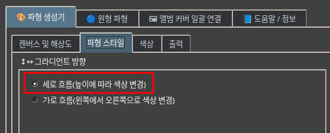

# Audio-SWARM 도움말
- [목차](#contents)

**Audio-SWARM**: 오디오 파형 생성기 및 앨범 커버, 아트워크, 리믹스 모티프 일괄 처리 도구.

Audio-SWARM은 오디오 파일을 기반으로 파형을 활용한 앨범 커버 아트워크를 대량으로 제작합니다. 거의 모든 유형의 오디오 파일에서 그라데이션이 적용된 기존의 선형 파형 이미지를 생성할 수 있습니다.

원형 파형 이미지, 방사형 스펙트럼, 미니멀한 원형 디자인을 제작할 수 있으며, 기존 이미지, 앨범 커버, 커버 아트 이미지와 오디오 트랙을 하나의 일괄 처리 작업으로 결합할 수도 있습니다.

* 오디오 파일에 이미지를 삽입하면 VLC 및 Celluloid와 같은 호환 미디어 플레이어는 물론 스마트폰과 TV에서도 노래나 오디오 파일을 재생할 때 삽입된 아트워크를 표시할 수 있습니다.

### Audio-SWARM은 인쇄에 적합한 초고해상도 파형 아트워크를 제작합니다.

Audio-SWARM으로 생성한 이미지는 최대 12,000픽셀 해상도로 내보낼 수 있어 고품질 인쇄물과 고해상도 영화 포스터 제작에 적합합니다.

Audio-SWARM은 파일 크기가 작은 컴팩트한 파형 이미지를 기반으로 **앨범 커버 인쇄, 대형 포맷 인쇄, 액자용 파형 아트워크, 벽 장식용 아트, 영화 포스터 크기의 초대형 인쇄물**에 적합한 세밀한 비주얼을 제작합니다.

Audio-SWARM은 뛰어난 시각적 디테일과 선명도를 제공하도록 설계되어 작은 앨범 커버부터 거대한 포스터와 대형 액자 작품까지 다양한 인쇄 크기에 맞는 아트워크를 제작할 수 있습니다. 파형 기반 앨범 커버를 제작하거나, 전문 인쇄용 아트워크를 준비하거나, 액자용 프린트를 디자인하거나, 대형 포스터를 제작하는 경우에도 Audio-SWARM은 디지털 아트워크를 세밀하고 인상적인 실물 인쇄 작품으로 구현할 수 있도록 지원합니다.

## 목차 <!-- anchor: contents -->
- [1. Audio-SWARM이란?](#what-is-swarm)
- [2. 빠른 시작](#quick-start)
- [3. 인터페이스 이해하기](#interface)
- [4. Sound Wave Maker](#sound-wave-maker)
- [5. Circular Waveform](#circular-waveform)
- [6. Bulk Artwork Linker](#bulk-artwork-linker)
- [7. 일괄 처리와 출력 폴더](#batch-output)
- [8. 해상도와 성능](#resolution-performance)
- [9. 색상 및 기하 스타일 참고](#colors-geometry)
- [10. 문제 해결](#troubleshooting)
- [11. 언어 및 기여](#languages-contributions)

## 1. Audio-SWARM이란? <!-- anchor: what-is-swarm -->

**Audio-SWARM (Audio-Sound Waveform & bulk Album/Artwork-cover batch Remix Motif)**은 오디오 파일에서 시각 이미지를 만들며, 지원되는 오디오 형식에 커버 이미지를 삽입할 수도 있습니다. 다음 세 가지 도구를 제공합니다.

- **Sound Wave Maker**는 수직 또는 수평 흐름, 다양한 막대 스타일, 색상, 그라데이션 및 해상도 설정을 사용해 일반 파형 이미지를 만듭니다.
- **Circular Waveform**은 원형 파형, 방사형 스펙트럼 시각화 및 미니멀한 원형 선 디자인을 만듭니다.
- **Bulk Artwork Linker**는 선택한 폴더의 기존 이미지를 오디오 파일과 짝지어 주고, 오디오 형식이 지원하면 커버 이미지를 삽입합니다. 파일은 이름을 정렬한 순서대로 짝지어지므로 원하는 조합에 맞게 파일명을 정리하세요.

### 이미지 출력

Sound Wave Maker와 Circular Waveform은 이미지를 **PNG 또는 JPG**로 내보냅니다. 일반적인 용도에는 작은 이미지를, 세밀한 표시나 인쇄에는 크고 해상도가 높은 이미지를 선택하세요. 원형 이미지는 최대 8000픽셀까지 생성할 수 있습니다. PNG는 투명 배경을 지원하고 JPG는 단색 배경을 사용합니다.

### 커버 삽입 및 오디오 보존

형식이 지원되는 경우 Audio-SWARM은 **MP3, OGG/OGA, FLAC, M4A, AIFF/AIF** 오디오 파일의 새 출력 복사본에 이미지를 삽입합니다. OGG/OGA 및 AIFF/AIF에 커버를 삽입하려면 선택 사항인 Python 패키지 `mutagen`이 필요합니다. Audio-SWARM의 작업 방식에서는 WAV에 커버 이미지를 삽입하지 않으므로 오디오 파일과 이미지가 나란히 별도로 저장됩니다.

**원시 AAC는 예외입니다.** 이 작업 방식에서 원시 AAC는 커버 이미지를 담을 표준 컨테이너가 없습니다. 이미지를 삽입하기 위해 Audio-SWARM은 원래 AAC 오디오 스트림을 M4A 컨테이너에 넣고 `_with_art.m4a`로 끝나는 파일을 만듭니다. 오디오 스트림 자체는 재인코딩하거나 리샘플링하지 않습니다.

Audio-SWARM은 원본 오디오 파일을 수정하지 않습니다. 커버가 삽입된 출력 파일을 만들 때도 원래 인코딩된 오디오 스트림을 재인코딩하거나 리샘플링하지 않고 복사합니다. 파형을 계산할 때는 임시 분석용 오디오 복사본을 사용합니다. 이 복사본은 시각화를 계산하는 데만 사용한 뒤 삭제되며, 저장되는 오디오 출력으로 사용되지 않습니다. **저장된 출력의 오디오는 원본 그대로입니다.**

## 2. 빠른 시작 <!-- anchor: quick-start -->

1. **입력을 선택합니다.** **Sound Wave Maker** 또는 **Circular Waveform**에서 이미지 하나를 만들려면 지원되는 오디오 파일 하나를, 여러 파일을 처리하려면 폴더를 선택하세요. 경로 입력란과 Browse 버튼을 사용하거나 지원되는 오디오 파일 또는 폴더를 Audio-SWARM 창의 아무 곳에나 끌어다 놓으세요.  
   **Bulk Artwork Linker**에서는 오디오 파일과 해당 커버 이미지가 함께 들어 있는 폴더를 선택하거나 창에 끌어다 놓으세요. 이 도구는 단일 오디오 파일이 아니라 폴더를 처리합니다.
2. 사용할 도구의 **기본 탭**을 선택합니다.
   - **Sound Wave Maker** — 일반 파형 이미지 생성.
   - **Circular Waveform** — 원형 파형, 방사형 스펙트럼 또는 미니멀 원형 디자인 생성.
   - **Bulk Artwork Linker** — 폴더에 있는 기존 이미지를 오디오 파일과 짝짓기.
3. 필요한 설정을 조정합니다. 어디서부터 시작해야 할지 모르겠다면 기본값을 유지하세요. 기본 출력은 **투명 배경의 PNG**입니다. JPG나 단색 배경을 원하면 **Output Format**에서 변경할 수 있습니다.
4. 생성 또는 처리 버튼을 누릅니다. 창 아래쪽의 상태, 진행률 표시줄 및 로그를 확인하세요. 파일이나 폴더를 끌어다 놓으면 입력만 선택되며 처리가 시작되지는 않습니다.
5. 처리가 끝나면 로그 또는 완료 메시지에 표시된 출력 폴더를 확인합니다.

Sound Wave Maker와 Circular Waveform은 폴더를 재귀적으로 처리하고 출력에 원본 하위 폴더 구조를 유지할 수 있습니다. Bulk Artwork Linker는 선택한 폴더의 최상위만 살펴보며, 오디오와 이미지 파일명을 각각 별도로 정렬한 목록의 순서에 따라 짝짓습니다. Audio-SWARM은 어떤 이미지가 어떤 곡에 속하는지 자동으로 추측하지 않습니다. 정렬된 파일명 순서가 원하는 조합과 일치하는지 확인하세요.

### ⚠️ 슬라이더 사용 안내

- 원하는 크기를 선택한 다음, 슬라이더 손잡이 옆을 클릭하여 조금씩 세밀하게 조정하세요.

### ⚠️ Vertical Flow 사용 시 주의

**Sound Wave Maker → Waveform Style → Vertical Flow**는 다른 옵션보다 처리 시간이 훨씬 길어질 수 있으며, 특히 여러 색상의 그라데이션을 사용할 때 더 그렇습니다.
- 로그가 더 이상 갱신되지 않는 것처럼 보이거나 Audio-SWARM이 잠시 응답하지 않는 것처럼 보일 수 있습니다. 즉시 Audio-SWARM을 닫지 마세요. 이 모드는 단순히 더 많은 시간이 필요할 수 있습니다.
- 특히 큰 이미지를 만들거나 많은 파일을 일괄 처리할 때는 완료될 때까지 기다리세요.

## 3. 인터페이스 이해하기 <!-- anchor: interface -->

- **입력 경로 필드:** 현재 도구에 선택된 오디오 파일 또는 원본 폴더를 표시합니다. 옆의 **Browse** 버튼을 누르면 시스템 파일 또는 폴더 선택기가 열립니다.
- **끌어다 놓기:** 지원되는 오디오 파일이나 폴더를 Audio-SWARM 창의 아무 곳에나 놓을 수 있습니다. **Browse**로 선택한 것처럼 입력 경로가 갱신됩니다. 항목을 놓는 것만으로 처리가 시작되지는 않습니다. Bulk Artwork Linker는 단일 오디오 파일이 아니라 오디오와 이미지가 모두 포함된 폴더를 필요로 합니다.
- **언어 선택기:** 인터페이스 언어를 변경하고 해당 언어의 도움말 문서가 있으면 불러옵니다. 번역된 도움말이 없으면 Audio-SWARM은 영어 도움말을 사용합니다.
- 이미 설정한 값을 잃지 않고 언제든지 언어를 바꿀 수 있습니다.

Audio-SWARM은 **기본 탭**, **하위 탭**, 입력 컨트롤 및 처리 상태 표시로 구성됩니다. 각 부분은 고유한 역할이 있습니다.

- **기본 탭:** **Sound Wave Maker**, **Circular Waveform**, **Bulk Artwork Linker** 중 하나를 선택합니다. **Help / About**은 문서와 애플리케이션 정보를 엽니다.
- **하위 탭:** 도구 설정을 더 작은 범주로 나눕니다. 하위 탭을 바꿔도 처리가 시작되지는 않습니다.
- **생성 또는 처리 버튼:** 현재 입력과 설정을 사용해 선택한 도구의 작업을 시작합니다. 시작하기 전에 경로와 옵션을 확인하세요.

**중요:** **Sound Wave Maker**의 일부 설정은 기하 스타일과 색상을 포함해 **Circular Waveform**에도 영향을 줍니다. 원형 이미지에 변경 사항을 적용하려면 Sound Wave Maker에서 원하는 설정을 선택하고 **Circular Waveform** 탭으로 돌아온 다음 **Generate Circular Waveforms**를 누르세요.

- **진행률 표시줄:** 작업 진행 상황을 보여 줍니다. 특히 일괄 처리 중에 유용하지만 일부 처리 단계에서는 계속 갱신되지 않을 수 있습니다.
- **상태 줄:** Audio-SWARM이 현재 수행 중인 작업이나 작업 결과를 간단히 표시합니다.
- **로그:** 발견한 파일, 생성한 출력, 경고 및 오류 등의 정보를 기록합니다. 오래 걸리는 작업에서는 로그가 계속 갱신되지 않을 수 있지만, 이것만으로 Audio-SWARM이 멈췄다고 볼 수는 없습니다.
- **Cancel:** 실행 중인 일괄 작업을 중지하도록 요청합니다. 이미 렌더링 또는 인코딩 중인 파일은 취소가 적용되기 전에 현재 단계를 마쳐야 할 수 있습니다.

일부 페이지는 창보다 세로로 깁니다. 세로 스크롤바나 마우스 휠을 사용해 아래쪽 컨트롤에 접근하세요.

## 4. Sound Wave Maker <!-- anchor: sound-wave-maker -->

Sound Wave Maker는 지원되는 각 오디오 파일에서 파형 이미지를 만듭니다. 하위 탭은 기능별로 설정을 정리합니다.

폴더를 재귀적으로 처리하면 이미지는 `Waveform_Outputs`에 저장되며, 원본 하위 폴더 구조가 그 아래에 유지됩니다. 단일 파일의 출력은 원본 파일 옆에 저장됩니다. MP3, OGG/OGA, FLAC, M4A 및 AIFF/AIF에는 커버 이미지를 삽입할 수 있습니다. 원시 AAC에는 커버 이미지를 담을 표준 컨테이너가 없기 때문에 `_with_art.m4a`로 끝나는 파일이 만들어집니다. WAV에서는 이미지가 별도로 유지됩니다. OGG/OGA 및 AIFF/AIF 커버 삽입에는 Python 패키지 `mutagen`이 필요합니다. 사용할 수 없는 경우 Audio-SWARM은 별도 이미지를 보존하고 오류를 기록합니다.

### Canvas & Resolution
#### Render Resolution Framework Configuration

- **Preset Dimensions Matrix Selector:** 가로형, 세로형, 정사각형 커버 등 일반적인 형식에 대한 캔버스 크기와 화면 비율 사전 설정을 선택합니다. 사전 설정이 너비와 높이를 자동으로 지정합니다.
- **Canvas Width Limit:** 출력 이미지 너비를 10~8000픽셀 범위에서 설정합니다.
- **Canvas Height Limit:** 출력 이미지 높이를 10~8000픽셀 범위에서 설정합니다.

너비나 높이를 직접 변경하면 사전 설정이 **Custom Mapping Coordinates**로 바뀌어 사용자 지정 크기를 설정할 수 있습니다.

큰 크기는 픽셀 수가 많은 이미지를 만들며, 세밀한 아트워크, 고해상도 화면 및 인쇄에 적합합니다. 다만 처리 시간과 메모리를 더 많이 사용하고 파일 크기도 커집니다.

#### Waveform Structural Core Densities

- **Total Grid Bar Count Mapping Layout:** 파형 막대 수를 40~500개로 조정합니다. 값이 낮으면 막대 수가 적고 폭이 넓어지며, 값이 높으면 더 조밀하고 얇은 막대가 만들어집니다. 막대 수가 많을수록 처리 시간이 늘어날 수 있습니다.
- **Gradient Processing Slice Resolution:** 그라데이션 렌더링에 사용할 색상 구간 수를 조정합니다. 구간이 많으면 색상 전환이 부드러워질 수 있지만, 특히 Vertical Flow에서 다색 그라데이션을 사용할 때 처리 시간이 크게 늘어날 수 있습니다. **Solid Flat Color**는 그라데이션 구간을 사용하지 않아 훨씬 빠릅니다.
- **Canvas Target Printing Resolution (DPI):** 이미지의 인쇄 해상도 메타데이터를 설정합니다. 픽셀 크기는 바뀌지 않으며 Canvas Width와 Canvas Height에서 별도로 설정합니다. 픽셀 크기가 같을 때 DPI가 높으면 실제 인쇄 크기는 작아지고 인치당 픽셀 수는 많아집니다.

### Waveform Style
#### Gradient Spectrum Axis Orientation

- **Vertical Flow**는 각 막대의 높이를 따라 그라데이션 색상을 배치합니다.
- **Horizontal Flow**는 파형을 따라 왼쪽에서 오른쪽으로 색상을 배치합니다.

### Waveform Bar Peak Geometry Style
파형 막대와 끝부분의 모양을 선택합니다.

- **Standard Classic Bars:** 끝이 평평한 직사각형 막대.
- **Smooth Capsule:** 끝이 부드럽게 둥근 막대.
- **Lollipop:** 꼭대기에 원형 캡이 있는 가느다란 막대.
- **Sharp Spikes:** 끝이 뾰족하게 좁아지는 막대.
- **Arrow-Spear:** 화살촉 모양이 뚜렷한 막대.

선택한 기하 스타일은 Circular Waveform 및 Radial Spectrum의 해당 모드에도 적용됩니다. Minimal Circular Waveform은 개별 막대 대신 연속된 선을 사용하므로 이러한 기하 스타일은 적용되지 않습니다.
각 막대는 짧은 구간의 오디오 신호 진폭을 나타냅니다. 높이는 신호 레벨을 반영하고, 기하 스타일은 끝부분이 평평한지 둥근지 원형인지 뾰족한지 화살촉 모양인지 결정합니다.

### Colors
Colors 하위 탭에서는 여러 색상을 조합해 그라데이션을 만들거나 단일 단색을 사용할 수 있습니다.

- **Color nodes:** 각 **Node Color** 버튼은 그라데이션의 색상 지점을 나타냅니다. 버튼을 눌러 색상을 선택하세요. 미리보기 막대는 현재 순서대로 색상이 혼합되는 모습을 보여 줍니다.
- **Add Color Node:** 색상 지점을 추가합니다. 최대 10개까지 추가할 수 있습니다.
- **Remove Last Node:** 마지막 색상 지점을 제거합니다. 그라데이션 모드에서는 최소 두 개의 지점이 유지됩니다.
- **Invert Layer Core Coordinates Processing Direction (Reverse Vector Flow):** 그라데이션 색상 순서를 반전해 파형에 나타나는 색의 방향을 바꿉니다.
- **Enable Solid Flat Color:** 그라데이션 구간을 계산하지 않고 선택한 한 가지 색상을 파형 전체에 적용합니다. 특히 Vertical Flow에서 처리 속도가 크게 빨라집니다. 이 모드에서는 그라데이션 반전이 비활성화됩니다. Canvas & Resolution 탭의 Gradient Processing Slice도 비활성화됩니다. 그라데이션 모드로 돌아가면 색상 지점 두 개가 복원되며, 추가 지점은 다시 추가해야 합니다.

### Output Format

- **Output Raster Format:** 파형 이미지의 출력 형식으로 PNG 또는 JPG를 선택합니다. 기본값은 PNG이며 투명 배경을 지원합니다. JPG는 투명도를 지원하지 않으므로 JPG를 선택하면 투명 옵션이 자동으로 꺼집니다.
- **Enable 100% Alpha Channel Canvas Transparency Block:** PNG 이미지에서 투명 배경을 활성화합니다. 투명도가 켜져 있으면 배경색 버튼이 잠기고 **Locked (Transparent)**로 표시됩니다.
- **Pick Backdrop Color:** 투명도가 꺼져 있을 때 이 버튼으로 단색 배경을 선택합니다. PNG, JPG 및 투명도 설정을 바꿔도 선택한 색상은 유지됩니다.
- **Retain standalone high-res images inside workspace alongside embedded items:** 기본적으로 활성화되어 있습니다. Audio-SWARM이 지원되는 오디오 파일에 이미지를 성공적으로 삽입하면, 오디오 출력 옆에 전체 해상도의 독립 이미지도 유지합니다. 비활성화하면 삽입 성공 후 독립 이미지가 삭제됩니다. 삽입에 실패하면 이미지는 유지됩니다.

선택한 색상, 그라데이션 방향, 출력 형식, 투명도와 배경 설정, Vertical Flow 또는 Horizontal Flow, 막대·끝부분·기하 스타일은 Circular Waveform, Radial Spectrum 및 Minimal Circular Waveform에서도 공유됩니다. 원형 이미지에 변경 사항을 적용하려면 Circular Waveform 탭으로 돌아가 **Generate Circular Waveforms**를 누르세요.

## 5. Circular Waveform <!-- anchor: circular-waveform -->

Circular Waveform은 오디오 파일에서 원형 시각화를 만듭니다. 하위 탭에서 세 가지 모드 중 하나를 선택하세요.

#### 공통 설정

- **Output Size (square pixels):** 정사각형 이미지의 너비와 높이를 256~8000픽셀 범위에서 설정합니다.
- **Rotation (degrees):** 이미지를 0°~359° 범위에서 회전합니다.

### Mode: Circular Waveform

원 주위에 배치된 파형 막대를 표시합니다.

- **Inner Radius:** 중앙의 빈 공간 크기를 조절합니다. 값이 클수록 중앙의 구멍도 커집니다.
- **Outward:** 원형 기준선에서 바깥쪽으로 막대를 뻗습니다.
- **Inward:** 중심 방향으로 막대를 뻗습니다.
- **Inward + Outward:** 두 체크박스를 모두 켜면 막대가 양방향으로 뻗습니다. 항상 최소 한 방향이 선택된 상태여야 하며, 유일하게 선택된 방향을 끄면 다른 방향이 자동으로 선택됩니다.
- **파형 기하 스타일:** Sound Wave Maker → Waveform Style에서 선택한 기하 스타일을 사용합니다. Standard Classic Bars, Smooth Capsules, Lollipop, Sharp Spikes 및 Arrow-Spear가 포함됩니다.

### Mode: Radial Spectrum

오디오 주파수 에너지를 원 둘레에 배치된 방사형 막대로 표시합니다.

- **Inner Radius:** 중앙 구멍의 크기를 조절합니다.
- **Frequency Bands:** 원 주위에 표시할 주파수 대역 수를 설정합니다. 대역 수가 많을수록 더 세밀한 주파수 정보를 표현합니다.
- **Sensitivity:** 스펙트럼 막대의 시각적 강도를 조절합니다. 값을 높이면 주파수 변화가 더 두드러집니다.
- **Outward 및 Inward:** 막대가 기준선에서 바깥쪽으로, 중심 쪽으로 또는 양방향으로 뻗을지 결정합니다.

### Mode: Minimal Circular Waveform

개별 막대 대신 원 둘레에 연속된 선을 그립니다.

- **Base Radius:** 원형 선의 기본 반지름을 설정합니다.
- **Wave Amplitude:** 선이 기본 반지름에서 얼마나 벗어나는지 조절합니다. 값이 높으면 변화가 더 뚜렷해집니다.
- **Line Width:** 선의 두께를 설정합니다.

이 모드에서는 파형 기하 선택기나 Inward/Outward 방향 설정을 사용하지 않습니다.

### 공통 색상 및 출력 설정

Circular Waveform, Radial Spectrum 및 Minimal Circular Waveform은 Sound Wave Maker와 색상 지점, 그라데이션 방향, 출력 형식, 투명도 및 배경 설정, DPI, 커버 삽입 설정을 공유합니다.

Sound Wave Maker → Waveform Style의 **Vertical Flow** 및 **Horizontal Flow** 설정은 Circular Waveform, Radial Spectrum 및 Minimal Circular Waveform에 그라데이션 색상을 적용하는 방식에도 영향을 줍니다. 그라데이션 방향을 변경하려면 Sound Wave Maker에서 원하는 흐름을 선택하세요.

#### 참고
기하 스타일과 색상 등 Sound Wave Maker의 일부 설정은 원형 이미지에도 영향을 줍니다. Sound Wave Maker에서 원하는 설정을 선택하고 Circular Waveform으로 돌아온 다음 **Generate Circular Waveforms**를 눌러 변경 사항을 적용하세요.

폴더를 처리하면 Audio-SWARM은 `Circular_Waveform_Outputs` 폴더를 만들고 원본 하위 폴더 구조를 유지합니다. 모드마다 서로 다른 파일명 접미사를 사용하므로 각 모드의 결과가 서로 덮어쓰이지 않습니다.

## 6. Bulk Artwork Linker <!-- anchor: bulk-artwork-linker -->

Bulk Artwork Linker는 지원되는 오디오 파일(MP3, OGG/OGA, WAV, FLAC, M4A, AAC 및 AIFF/AIF)을 선택한 폴더의 PNG, JPG 또는 JPEG 이미지와 짝짓습니다. 오디오 파일명 목록과 이미지 파일명 목록을 각각 별도로 정렬한 다음, 각 목록에서 같은 위치에 있는 파일끼리 짝짓습니다. 시작하기 전에 파일명을 변경해 정렬 순서가 원하는 조합과 일치하도록 하세요.

**오디오 파일과 이미지의 개수를 동일하게 맞추는 것을 강력히 권장합니다.** 최상의 결과를 얻으려면 원하는 픽셀 크기와 화면 비율에 맞춰 이미지를 미리 준비하세요. Audio-SWARM의 크기 조정 기능은 이미지 크기를 통일하기 위한 용도입니다. 이미지의 화면 비율이 목표 비율과 다르면 원래 비율을 유지하기 위해 위아래 또는 좌우에 검은색 막대가 추가될 수 있습니다.

크기 조정 옵션은 이미지를 선택한 목표 크기로 조절합니다. 화면 비율 유지가 켜져 있으면 이미지가 목표 캔버스 안에 맞춰지고, 꺼져 있으면 정확한 크기로 늘어납니다. 크기 조정에는 Pillow가 필요합니다. 사용할 수 없는 경우 원본 이미지 크기를 그대로 사용합니다.

MP3, OGG/OGA, FLAC, M4A 및 AIFF/AIF 출력은 파일명에 `_with_art`가 붙은 새 파일로 저장됩니다. 원시 AAC 입력은 AAC 오디오 스트림을 변경하지 않은 상태로 M4A 컨테이너에 담깁니다. Audio-SWARM의 작업 방식에서는 WAV에 커버가 삽입되지 않으므로 오디오와 이미지를 나란히 복사합니다. OGG/OGA 및 AIFF/AIF 커버 삽입에는 Mutagen이 필요합니다(선택적 요구 사항 참조). 결과는 `Merged_Tracks_Outputs`에 저장됩니다. 이 도구는 선택한 폴더의 최상위만 처리하고 하위 폴더는 살펴보지 않습니다. 오디오와 이미지 수가 다르면 완전한 짝만 처리하고 경고를 기록합니다.

## 7. 일괄 처리와 출력 폴더 <!-- anchor: batch-output -->

Sound Wave Maker와 Circular Waveform은 폴더를 재귀적으로 처리합니다. 전용 출력 폴더에 원본 하위 폴더 구조가 유지되므로 서로 다른 원본 폴더에 있는 같은 이름의 파일이 충돌하지 않습니다. Bulk Artwork Linker는 선택한 폴더 바로 아래에 있는 파일만 처리합니다.

큰 일괄 작업을 시작하기 전에 선택한 폴더와 출력 위치를 확인하세요. 같은 작업을 다시 실행하면 같은 이름의 기존 출력 파일이 대체될 수 있습니다. 중요한 파일은 백업하고 생성된 출력 폴더 안에 관련 없는 입력 파일을 넣지 마세요.

## 8. 해상도와 성능 <!-- anchor: resolution-performance -->

Canvas Width와 Canvas Height는 이미지의 픽셀 크기를 설정합니다. DPI는 인쇄 해상도 메타데이터를 제어하며, Audio-SWARM은 선택된 픽셀 크기로 렌더링합니다. 큰 이미지는 메모리와 시간이 더 많이 필요하고 파일 크기도 커집니다.

막대 수를 늘리면 막대가 많아지고 각각의 폭이 좁아질 수 있습니다. Gradient Processing Slice Resolution은 분할된 그라데이션에 사용할 개별 색상 단계 수를 제어합니다. 단계가 많을수록 색상 전환이 부드러워질 수 있지만 처리 시간은 길어질 수 있습니다.

**Gradient Smoothness:** 그라데이션이 충분히 부드럽지 않다면 이 값을 **200**으로 설정해 보세요. 대안으로 다른 알고리즘이 사용됩니다.

Solid Flat Color는 그라데이션 구간 처리 과정을 생략합니다. 아주 큰 일괄 작업을 시작하기 전에 중간 크기의 이미지와 몇 개의 오디오 파일로 먼저 시험하세요.

## 9. 색상 및 기하 스타일 참고 <!-- anchor: colors-geometry -->

- **Rectangle:** 끝이 평평한 일반 막대.
- **Smooth Capsules:** 끝이 둥근 막대.
- **Lollipop:** 꼭대기에 원형 캡이 있는 가느다란 막대.
- **Sharp Spikes:** 삼각형의 뾰족한 끝으로 좁아지는 막대.
- **Arrow-Spear:** 화살촉 모양의 끝이 뚜렷한 막대.

각 막대의 높이를 따라 색상이 바뀌게 하려면 **Vertical Flow**를 사용하세요. 파형의 한쪽에서 다른 쪽으로 그라데이션을 이동시키려면 **Horizontal Flow**를 사용하세요. **Solid Flat Color**는 단색 디자인에 유용하며 그라데이션을 구간으로 나누지 않습니다. 색상 지점이 그라데이션의 색상 정지점을 정의하고, 미리보기에 그 순서가 표시됩니다.

## 10. 문제 해결 <!-- anchor: troubleshooting -->

- **파일을 찾을 수 없음:** 폴더 경로가 올바른지, 선택한 도구가 지원하는 오디오 또는 이미지 형식이 들어 있는지 확인하세요.
- **커버가 없거나 짝이 완전하지 않음:** Bulk Artwork Linker는 정렬된 목록을 위치에 따라 짝짓습니다. 파일명과 각 목록의 파일 수를 확인하세요.
- **예상하지 못한 출력 위치:** 완료 메시지와 출력 폴더 이름을 확인하세요.
- **파일이 대체됨:** 반복 실행 시 출력 파일 이름이 같을 수 있습니다. 다시 실행하기 전에 이전 결과를 백업하거나 다른 위치로 옮기세요.
- **삽입 실패:** 애플리케이션 로그를 확인하고 FFmpeg가 설치되어 있으며 원본 파일을 읽을 수 있는지 확인하세요.
- **렌더링이 느리거나 메모리 사용량이 높음:** 픽셀 크기, 일괄 작업 크기 또는 막대와 구간 수를 줄이세요.
- **해당 언어의 도움말이 없음:** 선택한 언어의 도움말 문서가 없으면 Audio-SWARM은 `help/en.md`를 사용합니다.

문제가 계속되면 로그 텍스트를 저장하고 선택한 도구, 모드, 파일 형식 및 설정을 기록하세요.

## 11. 언어 및 기여 <!-- anchor: languages-contributions -->

인터페이스 번역은 `languages/` 폴더의 JSON 파일에 저장됩니다. 도움말 문서는 `help/` 폴더의 Markdown 파일이며 About 문서는 `about/` 폴더의 Markdown 파일입니다. JSON 및 Markdown 파일명에는 언어 코드가 사용됩니다. 예를 들어 `en.md`는 영어, `fr.md`는 프랑스어, `ja.md`는 일본어입니다.

번역에 참여하려면 **해당 폴더의 영어 파일을 복사한 뒤**, 본문과 제목을 번역하고 올바른 언어 코드로 저장하세요. 섹션 링크가 계속 작동하도록 Help의 HTML 앵커 주석과 목차 링크 대상은 변경하지 마세요.

파일은 UTF-8로 저장하세요!

애플리케이션의 실제 이름과 정확히 일치해야 하는 경우 파일명, 코드 예제, 설정 식별자 및 폴더명은 번역하지 마세요. 번역을 영어 마스터 문서와 일치시키고, 이해하기 어렵거나 오래된 동작 설명은 알려 주세요. 특정 언어의 Help 또는 About 문서가 없으면 Audio-SWARM은 해당 영어 문서를 사용합니다.
