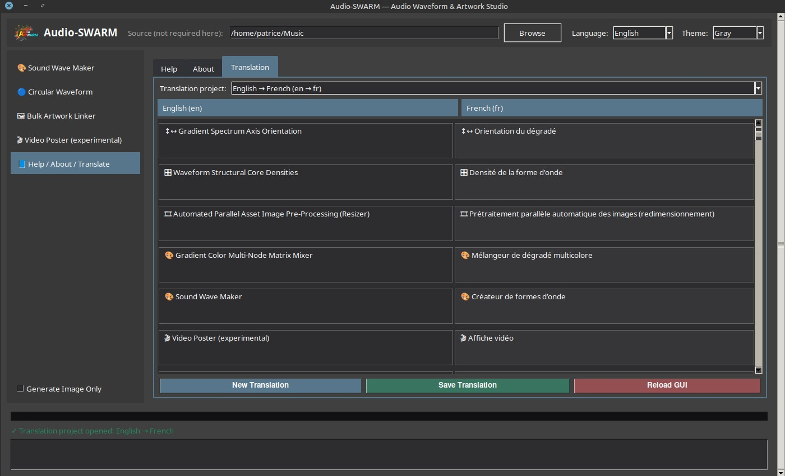
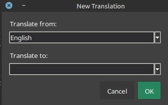
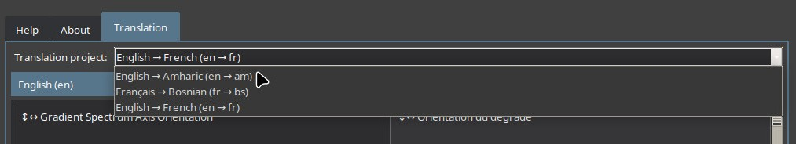

# Audio-SWARM-hulp
- [Inhoudsopgave](#contents)

**Audio-SWARM**: Audio-golfvormgenerator en batchverwerking voor albumhoezen, beeldmateriaal en remixmotieven.

Audio-SWARM maakt op grote schaal visuele golfvorm-albumhoezen op basis van audiobestanden. Audio-SWARM kan traditionele lineaire golfvorm-afbeeldingen met kleurverlopen genereren vanuit vrijwel elk type audiobestand.

Audio-SWARM kan cirkelvormige golfvorm-afbeeldingen, radiale spectrums en minimalistische cirkelvormige ontwerpen maken, of bestaande afbeeldingen, albumhoezen en coverafbeeldingen in één batch combineren met audiotracks.

* Door afbeeldingen in audiobestanden in te sluiten, kunnen compatibele mediaspelers, zoals VLC en Celluloid, maar ook smartphones en televisies, de ingesloten coverafbeelding weergeven tijdens het afspelen van een nummer of audiobestand.

### Audio-SWARM maakt afdrukbare golfvormkunstwerk met een extreem hoge resolutie.

De door Audio-SWARM gegenereerde afbeeldingen kunnen worden geëxporteerd met een resolutie tot 12.000 pixels, waardoor ze geschikt zijn voor hoogwaardige afdrukken en filmposters met een hoge resolutie.

Audio-SWARM maakt vanuit compacte golfvorm-afbeeldingen met een kleine bestandsgrootte gedetailleerde visuals die geschikt zijn **voor albumhoesafdrukken, grootformaatdrukwerk, ingelijste golfvorm-kunstwerken, wanddecoratie en extra grote afdrukken op filmposterformaat**.

Audio-SWARM is ontworpen om uitzonderlijk veel visuele details en een hoge scherpte te leveren. Hierdoor kunnen kunstwerken worden gemaakt voor uiteenlopende afdrukformaten, van kleine albumhoezen tot enorme posters en grote ingelijste kunstwerken. Of je nu golfvorm-albumhoezen maakt, kunstwerken voorbereidt voor professioneel drukwerk, ingelijste prints ontwerpt of grootformaatposters produceert, Audio-SWARM brengt digitale kunst tot leven als indrukwekkende fysieke afdrukken met uitzonderlijk veel detail.

## Inhoud <!-- anchor: contents -->
- [1. Wat is Audio-SWARM?](#what-is-swarm)
- [2. Snel starten](#quick-start)
- [3. De interface begrijpen](#interface)
- [4. Golfvormmaker](#sound-wave-maker)
- [5. Circulaire golfvorm](#circular-golfvorm)
- [6. Albumhoezen koppelen](#bulk-artwork-linker)
- [7. Batchverwerking en uitvoermappen](#batch-output)
- [8. Resolutie en prestaties](#resolution-performance)
- [9. Naslag voor kleuren en geometrie](#colors-geometry)
- [10. Problemen oplossen](#troubleshooting)
- [11. Talen en bijdragen](#languages-contributions)
- [12. De vertaaltool van Audio-SWARM](#translation-tool)
- [13. Je vertaling indienen](#submit-translation)

## 1. Wat is Audio-SWARM? <!-- anchor: what-is-swarm -->

**Audio-SWARM (audio-golfvormen en batchverwerking van albumhoezen en remixmotieven)** maakt visuele afbeeldingen van audiobestanden en kan coverafbeeldingen insluiten in ondersteunde audioformaten. Het biedt drie hulpmiddelen:

- **Golfvormmaker** maakt gewone golfvormafbeeldingen met Verticale kleurverlooprichting of Horizontale kleurverlooprichting, verschillende staafstijlen, kleuren, kleurovergangen en resolutie-instellingen.
- **Circulaire golfvorm** maakt cirkelvormige golfvormen, radiale spectrumvisualisaties en minimalistische cirkellijnen.
- **Albumhoezen koppelen** koppelt bestaande afbeeldingen aan audiobestanden in de geselecteerde map en voegt coverafbeeldingen in wanneer het audioformaat dit ondersteunt. Bestanden worden gekoppeld op basis van de alfabetisch gesorteerde bestandsnamen. Hernoem ze daarom zodat de volgorde overeenkomt met de gewenste koppelingen.

### Afbeeldingsuitvoer

Golfvormmaker en Circulaire golfvorm exporteren afbeeldingen als **PNG of JPG**. Kies de afbeeldingsafmetingen voor het beoogde gebruik: kleinere afbeeldingen voor dagelijks gebruik of grote afbeeldingen met hoge resolutie voor gedetailleerde weergave of afdrukken. Cirkelvormige afbeeldingen kunnen tot 8000 pixels groot worden gerenderd. PNG ondersteunt transparantie; JPG gebruikt een effen achtergrond.

### Coverafbeeldingen insluiten en audio behouden

Wanneer het formaat wordt ondersteund, sluit Audio-SWARM de afbeelding in een nieuwe uitvoerkopie van audioformaten **MP3, OGG/OGA, FLAC, M4A en AIFF/AIF** in. Voor het insluiten van coverafbeeldingen in OGG/OGA en AIFF/AIF is het optionele Python-pakket `mutagen` nodig. WAV slaat in de Audio-SWARM-werkwijze geen ingesloten coverafbeeldingen op; daarom worden het audiobestand en de afbeelding naast elkaar opgeslagen.

**Ruwe AAC is de uitzondering:** ruwe AAC heeft in deze werkwijze geen standaardcontainer voor coverafbeeldingen. Om de afbeelding in te sluiten, plaatst Audio-SWARM de oorspronkelijke AAC-audiostream in een M4A-container en maakt het een bestand dat eindigt op `_with_art.m4a`. De audiostream zelf wordt niet opnieuw gecodeerd of geresampled.

Audio-SWARM wijzigt het bron-audiobestand niet. Wanneer Audio-SWARM een uitvoerbestand met ingesloten coverafbeelding maakt, kopieert het de oorspronkelijke gecodeerde audiostream zonder opnieuw te coderen of te resamplen. Voor de berekening van de golfvorm gebruikt Audio-SWARM een tijdelijke analysekopie. Die wordt uitsluitend gebruikt om de visualisatie te berekenen en daarna verwijderd. Deze kopie wordt nooit gebruikt als opgeslagen audio-uitvoer. **De audio in het opgeslagen uitvoerbestand blijft de oorspronkelijke audio.**

## 2. Snel starten <!-- anchor: quick-start -->

1. **Kies de invoer.** Selecteer in **Golfvormmaker** of **Circulaire golfvorm** één ondersteund audiobestand voor één afbeelding of een map om meerdere bestanden te verwerken. Gebruik het padveld en de knop Bladeren, of sleep een ondersteund audiobestand of een map naar een willekeurige plek in het Audio-SWARM-venster.  
   Kies of sleep voor **Albumhoezen koppelen** een map met zowel audiobestanden als de bijbehorende coverafbeeldingen. Dit hulpmiddel werkt met een map, niet met één audiobestand.
2. **Selecteer het hoofdtabblad** van het gewenste hulpmiddel:
   - **Golfvormmaker** — gewone golfvormafbeeldingen maken.
   - **Circulaire golfvorm** — cirkelvormige golfvormen, radiale spectra of minimalistische cirkelontwerpen maken.
   - **Albumhoezen koppelen** — bestaande afbeeldingen aan audiobestanden in een map koppelen.
3. Pas de gewenste instellingen aan. Als je niet weet waar je moet beginnen, behoud dan de standaardwaarden. Standaard worden afbeeldingen gemaakt als **PNG met een transparante achtergrond**. Je kunt JPG of een effen achtergrond kiezen onder **Uitvoerformaat**.
4. Klik op de knop voor genereren of verwerken. Volg de status, voortgangsbalk en het logboek onderaan. Een bestand of map neerzetten selecteert alleen de invoer; het starten geen verwerking.
5. Controleer na afloop de uitvoermap die in het logboek of de voltooiingsmelding wordt genoemd.

Golfvormmaker en Circulaire golfvorm kunnen mappen recursief verwerken en de bronstructuur van submappen in de uitvoer behouden. Albumhoezen koppelen doorzoekt alleen het hoogste niveau van de geselecteerde map en koppelt audio- en afbeeldingsbestanden via afzonderlijk gesorteerde bestandslijsten. Audio-SWARM raadt niet zelf welke afbeelding bij welk nummer hoort; zorg dat de alfabetische bestandsvolgorde de juiste koppelingen oplevert.

### ⚠️ Over schuifregelaars

- Kies de gewenste grootte en stel deze vervolgens nauwkeurig af door naast de schuifknop te klikken om kleine aanpassingen te maken.

### ⚠️ Waarschuwing voor Verticale kleurverlooprichting

Bij **Golfvormmaker → Golfvormstijl → Verticale kleurverlooprichting** kan de verwerking veel langer duren dan bij andere opties, vooral bij meerkleurige kleurovergangen.
- Het logboek lijkt mogelijk niet meer bij te werken of Audio-SWARM lijkt tijdelijk niet te reageren. Sluit Audio-SWARM niet meteen af; deze modus kan simpelweg meer tijd nodig hebben.
- Wacht tot de verwerking is voltooid, vooral bij grote afbeeldingen of batches met veel bestanden.

## 3. De interface begrijpen <!-- anchor: interface -->

- **Invoerpadveld:** toont het geselecteerde audiobestand of de bronmap voor het huidige hulpmiddel. Met de knop **Bladeren** ernaast open je de bestands- of mapkiezer van je systeem.
- **Slepen en neerzetten:** je kunt ook een ondersteund audiobestand of een map ergens in het Audio-SWARM-venster neerzetten. Het invoerpad wordt bijgewerkt alsof je **Bladeren** had gebruikt. Neerzetten start de verwerking niet. Albumhoezen koppelen vereist een map met zowel audio- als afbeeldingsbestanden, niet één audiobestand.
- **Taalselectie:** wijzigt de interfacetaal en laadt het bijbehorende Help-document als dat beschikbaar is. Als een vertaalde Help ontbreekt, gebruikt Audio-SWARM de Engelse Help.
- Je kunt op elk moment van taal wisselen zonder de instellingen die je al hebt aangepast te verliezen.

Audio-SWARM is opgebouwd uit **hoofdtabbladen**, **subtabbladen**, invoerbedieningselementen en verwerkingsinformatie. Elk onderdeel heeft een eigen functie:

- **Hoofdtabbladen:** selecteer een van de drie hulpmiddelen: **Golfvormmaker**, **Circulaire golfvorm** of **Albumhoezen koppelen**. **Help / Info / Vertaling** opent de documentatie en toepassingsinformatie.
- **Subtabbladen:** groeperen de instellingen van een hulpmiddel in kleinere categorieën. Wisselen tussen subtabbladen start geen verwerking.
- **Knop voor genereren of verwerken:** start de gekozen bewerking met de huidige invoer en instellingen. Controleer vóór de start het pad en de opties.

**Belangrijke opmerking:** sommige instellingen in **Golfvormmaker** zijn ook van invloed op **Circulaire golfvorm**, waaronder geometrie en kleuren. Om wijzigingen toe te passen op cirkelvormige afbeeldingen, kies je de gewenste instellingen in Golfvormmaker, ga je **terug** naar het tabblad Circulaire golfvorm en klik je op **Circulaire golfvormen genereren**.

- **Voortgangsbalk:** toont de voortgang tijdens een bewerking, vooral bij batchverwerking. Sommige verwerkingsfasen werken de balk niet continu bij.
- **Statusregel:** geeft kort aan wat Audio-SWARM doet of wat het resultaat van een bewerking is.
- **Logboek:** registreert onder meer gevonden bestanden, gemaakte uitvoerbestanden, waarschuwingen en fouten. Bij een lange taak wordt het logboek mogelijk niet voortdurend bijgewerkt; dat betekent niet per se dat Audio-SWARM is vastgelopen.
- **Annuleren:** vraagt om een actieve batch te stoppen. Een bestand dat al wordt gerenderd of gecodeerd, moet mogelijk eerst die stap voltooien voordat het annuleren effect heeft.

Sommige pagina’s zijn hoger dan het venster. Gebruik de verticale schuifbalk of het muiswiel om lager geplaatste bedieningselementen te bereiken.

## 4. Golfvormmaker <!-- anchor: sound-wave-maker -->

Golfvormmaker maakt voor elk ondersteund audiobestand een golfvormafbeelding. De subtabbladen groeperen instellingen op basis van hun functie.

Bij recursieve mapverwerking worden afbeeldingen opgeslagen in `Waveform_Outputs`, met daaronder dezelfde structuur als de bron-submappen. Bij één bestand wordt de uitvoer naast het bronbestand geplaatst. MP3, OGG/OGA, FLAC, M4A en AIFF/AIF kunnen een ingesloten coverafbeelding krijgen. Ruwe AAC-invoer levert een bestand op dat eindigt op `_with_art.m4a`, omdat ruwe AAC geen standaardcontainer voor coverafbeeldingen heeft. Bij WAV blijft de afbeelding apart. Voor het insluiten van coverafbeeldingen in OGG/OGA en AIFF/AIF is het Python-pakket `mutagen` vereist; als het ontbreekt, bewaart Audio-SWARM de losse afbeelding en registreert het een fout.

### Tekenveld & resolutie
#### Configuratie van renderresolutie

- **Keuze van vooraf ingestelde afmetingen:** kiest een vooraf ingestelde grootte van het tekenveld en beeldverhouding voor gangbare formaten, waaronder liggend, staand en vierkante coverafbeeldingen. De voorinstelling stelt breedte en hoogte automatisch in.
- **Maximale tekenveldbreedte:** stelt de uitvoerbreedte in pixels in, van 10 tot 8000.
- **Maximale hoogte van het tekenveld:** stelt de uitvoerhoogte in pixels in, van 10 tot 8000.

Als je de breedte of hoogte handmatig aanpast, verandert de voorinstelling in **Aangepaste afmetingen van het tekenveld**, zodat je zelf de afbeeldingsafmetingen kunt instellen.

Grotere afmetingen leveren afbeeldingen met meer pixels op, geschikt voor gedetailleerde afbeeldingen, schermen met hoge resolutie en afdrukken. Ze vereisen echter ook meer verwerkingstijd en geheugen en leveren grotere bestanden op.

#### Dichtheid van de golfvorm

- **Instelling van het totale aantal golfvormbalken:** bepaalt het aantal golfvormbalken, van 40 tot 500. Een lagere waarde geeft minder, bredere balken; een hogere waarde maakt de golfvorm dichter met smallere balken. Meer balken kunnen de verwerking vertragen.
- **Resolutie van kleurverloopsegmenten:** bepaalt het aantal kleursegmenten waarmee kleurverlopen worden weergegeven. Meer segmenten kunnen vloeiendere overgangen geven, maar de verwerking aanzienlijk vertragen, vooral bij meerkleurige verlopen met Verticale kleurverlooprichting. **Effen kleur** gebruikt geen verloopsegmenten en is daardoor veel sneller.
- **Afdrukresolutie (DPI):** stelt de metadata voor afdrukresolutie in. Dit verandert de pixelafmetingen niet; die worden afzonderlijk bepaald door Breedte van het tekenveld en hoogte van het tekenveld. Bij dezelfde pixelafmetingen levert een hogere DPI een kleinere fysieke afdruk met meer pixels per inch op.

### Golfvormstijl
#### Richting van het kleurverloop

- **Verticale kleurverlooprichting** verdeelt verloopkleuren over de hoogte van elke balk.
- **Horizontale kleurverlooprichting** verdeelt de kleuren van links naar rechts langs de golfvorm.

### Vorm van de golfvormbalken
Kies de vorm van de golfvormbalken en hun uiteinden:

- **Klassieke balken:** rechthoekige balken met platte uiteinden.
- **Afgeronde balk:** balken met soepel afgeronde uiteinden.
- **Lollyvorm:** smalle stelen met een ronde top.
- **Scherpe punten:** balken die eindigen in scherpe punten.
- **Pijlvormige punten:** balken met duidelijk pijlvormige uiteinden.

De gekozen geometrie beïnvloedt ook de overeenkomstige modi in Circulaire golfvorm en Radiaal spectrum. Minimalistische cirkelvormige golfvorm gebruikt een doorlopende lijn in plaats van losse balken; daarom zijn deze geometrische stijlen daar niet van toepassing.
Elke balk vertegenwoordigt de amplitude van het audiosignaal gedurende een kort interval. De hoogte weerspiegelt het signaalniveau; de geometrie bepaalt of het uiteinde plat, afgerond, rond, puntig of pijlvormig is.

### Kleuren
Op het subtabblad Kleuren kun je meerdere kleuren combineren tot een kleurverloop of één effen kleur gebruiken.

- **Kleurknooppunten:** elke knop **Knooppuntkleur** staat voor een kleurstop in het verloop. Klik erop om een kleur te kiezen. De voorbeeldbalk toont hoe de kleuren in de huidige volgorde in elkaar overlopen.
- **Kleurknooppunt toevoegen:** voegt een kleurstop toe, tot maximaal 10.
- **Laatste kleurknooppunt verwijderen:** verwijdert de laatste kleurstop. In de verloopmodus blijven minimaal twee knooppunten behouden.
- **Kleurverlooprichting omkeren (vectorstroom omkeren):** keert de volgorde van de verloopkleuren om en verandert daarmee de richting waarin de kleuren op de golfvorm verschijnen.
- **Effen kleur inschakelen:** gebruikt één geselecteerde kleur voor de hele golfvorm zonder verloopsegmenten te berekenen. Dit is veel sneller, vooral bij Verticale kleurverlooprichting. In deze modus is het omkeren van het kleurverloop uitgeschakeld. Ook de instelling Kleurverloopsegmentverwerking op het tabblad Tekenveld & resolutie wordt uitgeschakeld. Wanneer je terugschakelt naar de verloopmodus, worden twee kleurknooppunten hersteld; extra knooppunten moet je opnieuw toevoegen.

### Uitvoerformaat

- **Rasterformaat voor uitvoer:** kies PNG of JPG voor de gegenereerde golfvormafbeeldingen. PNG is standaard geselecteerd en ondersteunt transparantie. JPG ondersteunt geen transparantie; als je JPG selecteert, wordt de transparantieoptie automatisch uitgeschakeld.
- **Volledige tekenveldtransparantie inschakelen (alfakanaal):** schakelt een transparante achtergrond in voor PNG-afbeeldingen. Wanneer transparantie is ingeschakeld, wordt de knop voor de achtergrondkleur vergrendeld en staat er **Vergrendeld (transparant)**.
- **Achtergrondkleur kiezen:** als transparantie is uitgeschakeld, klik je hier om een effen achtergrondkleur te kiezen. De geselecteerde kleur blijft behouden wanneer je wisselt tussen PNG, JPG en transparantie-instellingen.
- **Losse afbeeldingen met hoge resolutie naast ingesloten bestanden bewaren:** staat standaard aan. Wanneer Audio-SWARM een afbeelding succesvol in een ondersteund audiobestand insluit, bewaart deze optie de losse afbeelding op volledige resolutie naast de audio-uitvoer. Als je de optie uitschakelt, wordt de losse afbeelding na succesvol insluiten verwijderd. Bij een fout blijft de afbeelding behouden.

De gekozen kleuren, verlooprichting, uitvoerindeling, transparantie- en achtergrondinstellingen, Verticale kleurverlooprichting of Horizontale kleurverlooprichting en de instellingen voor balken, uiteinden en geometrie worden ook gedeeld met Circulaire golfvorm, Radiaal spectrum en Minimalistische cirkelvormige golfvorm. Om wijzigingen toe te passen op cirkelvormige afbeeldingen, ga je terug naar Circulaire golfvorm en klik je op **Circulaire golfvormen genereren**.

## 5. Circulaire golfvorm <!-- anchor: circular-golfvorm -->

Circulaire golfvorm maakt cirkelvormige visualisaties van audiobestanden. Kies een van de drie modi op de subtabbladen.

#### Gedeelde instellingen

- **Uitvoerformaat (vierkante pixels):** stelt de breedte en hoogte van de vierkante afbeelding in, van 256 tot 8000 pixels.
- **Rotatie (graden):** draait de afbeelding van 0° tot 359°.

### Modus: cirkelvormige golfvorm

Toont golfvormbalken die in een cirkel zijn gerangschikt.

- **Binnenradius:** bepaalt de grootte van de lege ruimte in het midden. Een grotere waarde levert een grotere centrale opening op.
- **Naar buiten:** de balken steken vanaf de cirkelvormige basislijn naar buiten.
- **Naar binnen:** de balken steken naar het midden toe.
- **Naar binnen + naar buiten:** schakel beide selectievakjes in om de balken in beide richtingen te laten uitsteken. Er blijft altijd minstens één richting geselecteerd; als je de enige geselecteerde richting uitschakelt, wordt de andere automatisch ingeschakeld.
- **Golfvormgeometrie:** gebruikt de geometrie die is geselecteerd in Golfvormmaker → Golfvormstijl, waaronder Klassieke balken, Afgeronde balken, Lollyvorm, Scherpe punten en Pijlvormige punten.

### Modus: radiaal spectrum

Toont de frequentie-energie van audio als radiale balken rond een cirkel.

- **Binnenradius:** bepaalt de grootte van de centrale opening.
- **Frequentiebanden:** bepaalt het aantal frequentiebanden rond de cirkel. Meer banden tonen fijnere frequentiedetails.
- **Gevoeligheid:** bepaalt de visuele sterkte van de spectrumbalken. Verhoog de waarde om frequentieverschillen duidelijker te maken.
- **Naar buiten en Naar binnen:** bepalen of de balken van de basislijn af, naar het midden toe of in beide richtingen uitsteken.

### Modus: minimalistische cirkelvormige golfvorm

Tekent een doorlopende lijn rond een cirkel in plaats van losse balken.

- **Basisradius:** bepaalt de basisstraal van de cirkellijn.
- **Golfamplitude:** bepaalt hoe ver de lijn van de basisstraal afwijkt. Hogere waarden geven duidelijkere variaties.
- **Lijndikte:** bepaalt de lijndikte.

Deze modus gebruikt de golfvormgeometrie-instelling en de richtingsopties Naar binnen/Naar buiten niet.

### Gedeelde kleuren en uitvoerinstellingen

Circulaire golfvorm, Radiaal spectrum en Minimalistische cirkelvormige golfvorm delen de kleurnodes, verlooprichting, uitvoerindeling, transparantie- en achtergrondinstellingen, DPI en de voorkeur voor het insluiten van coverafbeeldingen met Golfvormmaker.

De instellingen **Verticale kleurverlooprichting** en **Horizontale kleurverlooprichting** in Golfvormmaker → Golfvormstijl bepalen ook hoe verloopkleuren worden toegepast op Circulaire golfvorm, Radiaal spectrum en Minimalistische cirkelvormige golfvorm. Selecteer de gewenste richting in Golfvormmaker om de verlooprichting te wijzigen.

#### Opmerking
Sommige instellingen in Golfvormmaker beïnvloeden ook cirkelvormige afbeeldingen, waaronder geometrie en kleuren. Selecteer de gewenste instellingen in Golfvormmaker, ga terug naar Circulaire golfvorm en klik op **Circulaire golfvormen genereren** om de wijzigingen toe te passen.

Bij het verwerken van een map maakt Audio-SWARM `Circular_Waveform_Outputs` aan en behoudt het de structuur van de bron-submappen. De verschillende modi gebruiken eigen bestandsnaamsuffixen om te voorkomen dat hun uitvoer elkaar overschrijft.

## 6. Albumhoezen koppelen <!-- anchor: bulk-artwork-linker -->

Albumhoezen koppelen verbindt ondersteunde audiobestanden (MP3, OGG/OGA, WAV, FLAC, M4A, AAC en AIFF/AIF) aan PNG-, JPG- of JPEG-afbeeldingen in de geselecteerde map. De audiobestanden en afbeeldingen worden elk in een aparte lijst op bestandsnaam gesorteerd; vervolgens worden ze gekoppeld op basis van hun positie in de lijsten. Hernoem de bestanden vóór het starten zodat de gesorteerde volgorde bij de bedoelde koppelingen past.

**Het wordt sterk aanbevolen** om evenveel afbeeldingen als audiobestanden te gebruiken. Bereid de afbeeldingen voor het beste resultaat vooraf voor op de gewenste pixelafmetingen en beeldverhouding. De hulpmiddel voor het aanpassen van de afbeeldingsgrootte van Audio-SWARM is alleen bedoeld om de afmetingen van afbeeldingen gelijk te trekken. Als de beeldverhouding afwijkt van de doelverhouding, kunnen boven en onder of links en rechts zwarte balken worden toegevoegd om de oorspronkelijke verhoudingen te behouden.

Met de optie voor formaat aanpassen kunnen afbeeldingen worden geschaald naar de gekozen doelafmetingen. Als behoud van de beeldverhouding is ingeschakeld, wordt de afbeelding binnen het doeltekenveld passend gemaakt; anders wordt deze uitgerekt tot de exacte afmetingen. Voor het aanpassen van de grootte is Pillow nodig. Als dit niet beschikbaar is, gebruikt het hulpmiddel de oorspronkelijke afbeeldingsgrootte.

MP3-, OGG/OGA-, FLAC-, M4A- en AIFF/AIF-uitvoer wordt opgeslagen als nieuwe bestanden met `_with_art` in de naam. Ruwe AAC-invoer wordt in een M4A-container geplaatst met behoud van de oorspronkelijke AAC-audiostream. WAV slaat in deze werkwijze geen ingesloten coverafbeeldingen op, dus het audiobestand en de afbeelding worden naast elkaar gekopieerd. Voor het insluiten van afbeeldingen in OGG/OGA en AIFF/AIF is Mutagen nodig (zie de optionele vereisten). Resultaten worden opgeslagen in `Merged_Tracks_Outputs`. Dit hulpmiddel doorzoekt alleen het hoogste niveau van de geselecteerde map, niet de submappen. Als het aantal audiobestanden en afbeeldingen verschilt, verwerkt Audio-SWARM alleen de complete paren en registreert het een waarschuwing.

## 7. Batchverwerking en uitvoermappen <!-- anchor: batch-output -->

Golfvormmaker en Circulaire golfvorm verwerken batches recursief. Hun speciale uitvoermappen behouden de structuur van de bron-submappen, zodat bestanden met dezelfde naam uit verschillende bronmappen elkaar niet in de weg zitten. Albumhoezen koppelen verwerkt alleen bestanden die rechtstreeks in de geselecteerde map staan.

Controleer vóór een grote batch de geselecteerde map en uitvoerlocatie. Als je dezelfde taak opnieuw uitvoert, kan een bestaande uitvoer met dezelfde naam worden vervangen. Maak een back-up van belangrijke bestanden en plaats geen ongerelateerde invoerbestanden in de gegenereerde uitvoermappen.

## 8. Resolutie en prestaties <!-- anchor: resolution-performance -->

Breedte van het tekenveld en hoogte van het tekenveld bepalen de afbeeldingsafmetingen in pixels. DPI bepaalt de metadata voor afdrukresolutie; Audio-SWARM rendert met de gekozen pixelafmetingen. Grote afbeeldingen vragen meer geheugen en tijd en leveren grotere bestanden op.

Een hoger aantal balken levert meer balken op en kan elke balk smaller maken. Resolutie van kleurverloopsegmenten bepaalt hoeveel afzonderlijke kleurstappen worden gebruikt in segmentverlopen. Meer stappen kunnen vloeiendere kleurovergangen opleveren, maar de verwerking duurt mogelijk langer.

**Vloeiendheid van het kleurverloop:** als het kleurverloop niet vloeiend genoeg oogt, probeer dan deze waarde op **200** in te stellen. Er wordt dan als alternatief een ander algoritme gebruikt.

Effen kleur slaat de verwerking van verloopsegmenten over. Test eerst met een middelgrote afbeelding en enkele audiobestanden voordat je een zeer grote batch start.

## 9. Naslag voor kleuren en geometrie <!-- anchor: colors-geometry -->

- **Rechthoek:** gewone balken met platte uiteinden.
- **Afgeronde balken:** balken met afgeronde uiteinden.
- **Lollyvorm:** een smalle steel met een ronde top.
- **Scherpe punten:** balken die taps toelopen tot driehoekige punten.
- **Pijlvormige punten:** stelen met een duidelijk pijlvormige punt.

Gebruik **Verticale kleurverlooprichting** als de kleur over de hoogte van elke balk moet veranderen. Gebruik **Horizontale kleurverlooprichting** als het kleurverloop van de ene kant van de golfvorm naar de andere moet lopen. **Effen kleur** is geschikt voor een ontwerp met één kleur en voorkomt het opdelen van verlopen in segmenten. Kleurknooppunten bepalen de kleurstops; de voorbeeldweergave toont hun volgorde.

## 10. Problemen oplossen <!-- anchor: troubleshooting -->

- **Geen bestanden gevonden:** controleer of het mappad juist is en of de map een audio- of afbeeldingsformaat bevat dat door het gekozen hulpmiddel wordt ondersteund.
- **Hoes ontbreekt of koppeling onvolledig:** Albumhoezen koppelen verbindt gesorteerde lijsten op positie. Controleer de bestandsnamen en het aantal bestanden in beide lijsten.
- **Onverwachte uitvoerlocatie:** controleer de voltooiingsmelding en de naam van de uitvoermap.
- **Een bestand is vervangen:** uitvoerbestanden kunnen bij herhaalde taken dezelfde naam krijgen. Maak een back-up van eerdere resultaten of verplaats ze voordat je opnieuw begint.
- **Insluiten mislukt:** controleer het toepassingslogboek en verifieer dat FFmpeg is geïnstalleerd en het bronbestand kan lezen.
- **Langzaam renderen of hoog geheugengebruik:** verlaag de pixelafmetingen, verklein de batch of gebruik minder balken of verloopsegmenten.
- **Help ontbreekt in een taal:** als het Help-document voor de geselecteerde taal ontbreekt, gebruikt Audio-SWARM `help/en.md`.

Als het probleem blijft bestaan, bewaar dan de logtekst en noteer het gekozen hulpmiddel, de modus, het bestandsformaat en de gebruikte instellingen.

## 11. Talen en bijdragen <!-- anchor: languages-contributions -->

Interfacevertalingen worden opgeslagen als JSON-bestanden in `languages/`. Help-documenten zijn Markdown-bestanden in `help/` en Info-documenten in `about/`. JSON- en Markdown-bestanden gebruiken de taalcode als bestandsnaam, bijvoorbeeld `en.md` voor Engels, `fr.md` voor Frans of `ja.md` voor Japans.
Je kunt rechtstreeks in Audio-SWARM bijdragen via Help / Info / Vertaling → tabblad Vertaling.

## 12. De vertaaltool van Audio-SWARM <!-- anchor: translation-tool -->

[Je vertaling indienen op GitHub](https://github.com/PatLabGit/Audio-SWARM/discussions/1)

Met deze tool kun je Audio-SWARM in de toepassing naar een andere taal vertalen of een bestaande vertaling corrigeren. Je kunt meteen controleren of vertaalde tekst te lang is. JSON-bestanden hoef je niet handmatig te bewerken.

### Een vertaling maken

Klik op **Nieuwe vertaling**. Er verschijnt een dialoog met twee taalkeuzes:

- **Vertalen vanuit:** brontaal. Engels wordt aanbevolen, maar je kunt ook een andere taal kiezen waarvoor Audio-SWARM al een vertaling heeft.
- **Vertalen naar:** doeltaal. De lijst bevat 172 talen uit het taalwoordenboek.

Voor de taalkeuze gebruikte ik ISO 639-1 (codes van twee letters). `tw` is een uitzondering: geen officiële ISO 639-1-code, maar een eigen code voor Traditioneel Chinees in plaats van `zh-TW` of `zh-Hant`. Om het eenvoudig te houden, behield ik de tweelettercodes en stelde ik drielettercodes zoals `pcm` uit.

Klik op **OK**. Het nieuwe taalbestand wordt gekopieerd van de geselecteerde bron en bevat aanvankelijk alle oorspronkelijke tekst, speciale tekens, emoji, regeleinden en variabelen zoals `{filename}` en `{value}`. Er wordt niets automatisch verwijderd of vervangen. Daarna wordt het project toegevoegd.

### Vertaalinterface

De editor heeft twee kolommen:

- **Bron taal (links):** de originele tekst van de taal bij **Vertalen vanuit**. Deze is alleen-lezen. Je kunt tekst selecteren en %% Ctrl %% + %% C %% gebruiken om iets terug te kopiëren dat je in de andere kolom per ongeluk hebt verwijderd. Dit is de enige actie in deze kolom.
- **Doel taal (rechts):** de doeltekst die je vertaalt of corrigeert.

Elke regel hoort bij dezelfde regel in de brontaal. Secties zijn gescheiden voor gemakkelijker navigeren. Klik op een regel om deze te bewerken; je kunt tussen beide kolommen tekst selecteren, kopiëren en plakken.

### Belangrijk!

- **Behoud benodigde speciale elementen zoals `{variables}`, `\n`, leestekens en opmaakmarkeringen.** Audio-SWARM kan deze gebruiken.

#### Je kunt regels onvertaald laten en later verdergaan met **Opslaan**.

### Vertaalprojecten

De lijst toont talen die je hebt aangemaakt of waaraan je werkt.

Selecteer een project om het te bewerken en wissel tussen projecten zonder telkens een nieuwe vertaling te maken. Elk project wordt in een eigen taalbestand opgeslagen.

### De drie knoppen onderaan

**Nieuwe vertaling** — maakt een project; kies **Vertalen vanuit:** en **Vertalen naar:**. Het doelbestand wordt van de bron gekopieerd en als project geregistreerd.

**Vertaling opslaan** — slaat de vertaling op, ook als deze nog niet af is. Sla regelmatig op.

**Grafische interface herladen** — herlaadt de interface in de taal van het **geselecteerde** project. Vertaal enkele items, sla op en laad opnieuw om menu’s, knoppen, tabbladen en labels in de app te controleren. Zo zie je of teksten te lang of ongeschikt zijn.

**Belangrijk:** onvertaalde items kunnen nog in de brontaal verschijnen; dat is normaal. **Verwijder geen items voordat je opslaat**, anders kunnen delen van de interface leeg zijn. Gebruik de taalkeuze/herlaadfunctie bij „Thema” om terug te schakelen.

### Tips voor vertalers

- Vertaal in je eigen tempo en sla regelmatig op.
- Controleer met Grafische interface herladen.
- Gebruik duidelijke, natuurlijke en beknopte formuleringen, vooral voor knoppen, tabbladen en labels.
- Wijzig variabelen, opmaakmarkeringen of speciale tekens niet onnodig.
- Als iets vreemd oogt, corrigeer, sla op en laad opnieuw.

## [Je vertaling indienen](https://github.com/PatLabGit/Audio-SWARM/discussions/1) <!-- anchor: submit-translation -->

Je kunt je vertaalde taalbestand naar mij sturen om bij te dragen aan Audio-SWARM.

1. **Zoek het bestand:** open de installatiemap en daarna **`languages`** (naast `main.py` en de launcher). Zoek het bestand met de **tweeletterige taalcode** (bijvoorbeeld `fr`, `de`, `ja`). De extensie `.json` kan verborgen zijn.
2. Ga naar de **[GitHub Discussions-pagina van Audio-SWARM](https://github.com/PatLabGit/Audio-SWARM/discussions/1)**.
3. Open de vertalingsdiscussie en voeg het bestand toe aan je reactie.

Je hoeft geen code te wijzigen of pull request te maken. Je kunt een pseudoniem GitHub-account gebruiken. Bedankt voor elke bijdrage en om Audio-SWARM voor meer mensen toegankelijk te maken!

## Het Help-bestand vertalen

**Kopieer het Engelse bestand uit `help`**, vertaal de tekst en koppen en sla het op met de juiste taalcode. Laat de HTML-ankercommentaren en inhoudsopgave-doelen intact zodat sectielinks blijven werken. Sla op als UTF-8.

Vertaal geen bestandsnamen, codevoorbeelden, instellingen-ID’s of mapnamen wanneer die exact moeten overeenkomen met de toepassing. Houd de vertaling bij met het Engelse masterbestand en meld onduidelijke of verouderde inhoud. Als een Help- of About-bestand in een taal ontbreekt, gebruikt Audio-SWARM het Engelse document.
