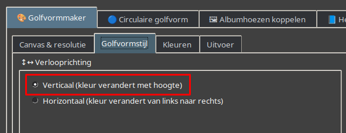

# Audio-SWARM Help
- [Inhoudsopgave](#contents)

**Audio-SWARM**: Audio-soundwavegenerator en batchverwerking voor albumhoezen, artwork en remixmotieven.

Audio-SWARM maakt op grote schaal visuele waveform-albumhoezen op basis van audiobestanden. Audio-SWARM kan traditionele lineaire waveform-afbeeldingen met kleurverlopen genereren vanuit vrijwel elk type audiobestand.

Audio-SWARM kan cirkelvormige waveform-afbeeldingen, radiale spectrums en minimalistische cirkelvormige ontwerpen maken, of bestaande afbeeldingen, albumhoezen en artwork-afbeeldingen in één batch combineren met audiotracks.

* Door afbeeldingen in audiobestanden in te sluiten, kunnen compatibele mediaspelers, zoals VLC en Celluloid, maar ook smartphones en televisies, het ingesloten artwork weergeven tijdens het afspelen van een nummer of audiobestand.

### Audio-SWARM maakt afdrukbare waveform-artwork met een extreem hoge resolutie.

De door Audio-SWARM gegenereerde afbeeldingen kunnen worden geëxporteerd met een resolutie tot 12.000 pixels, waardoor ze geschikt zijn voor hoogwaardige afdrukken en filmposters met een hoge resolutie.

Audio-SWARM maakt vanuit compacte waveform-afbeeldingen met een kleine bestandsgrootte gedetailleerde visuals die geschikt zijn **voor albumhoesafdrukken, grootformaatdrukwerk, ingelijste waveform-kunstwerken, wanddecoratie en extra grote afdrukken op filmposterformaat**.

Audio-SWARM is ontworpen om uitzonderlijk veel visuele details en een hoge scherpte te leveren. Hierdoor kan artwork worden gemaakt voor uiteenlopende afdrukformaten, van kleine albumhoezen tot enorme posters en grote ingelijste kunstwerken. Of je nu waveform-albumhoezen maakt, artwork voorbereidt voor professioneel drukwerk, ingelijste prints ontwerpt of grootformaatposters produceert, Audio-SWARM brengt digitale kunst tot leven als indrukwekkende fysieke afdrukken met uitzonderlijk veel detail.

## Inhoud !-- anchor: contents -->
- [1. Wat is Audio-SWARM?](#what-is-swarm)
- [2. Snel starten](#quick-start)
- [3. De interface begrijpen](#interface)
- [4. Sound Wave Maker](#sound-wave-maker)
- [5. Circular Waveform](#circular-waveform)
- [6. Bulk Artwork Linker](#bulk-artwork-linker)
- [7. Batchverwerking en uitvoermappen](#batch-output)
- [8. Resolutie en prestaties](#resolution-performance)
- [9. Naslag voor kleuren en geometrie](#colors-geometry)
- [10. Problemen oplossen](#troubleshooting)
- [11. Talen en bijdragen](#languages-contributions)

## 1. Wat is Audio-SWARM? <!-- anchor: what-is-swarm -->

**Audio-SWARM (Audio-Sound Waveform & bulk Album/Artwork-cover batch Remix Motif)** maakt visuele afbeeldingen van audiobestanden en kan coverafbeeldingen insluiten in ondersteunde audioformaten. Het biedt drie hulpmiddelen:

- **Sound Wave Maker** maakt gewone golfvormafbeeldingen met Vertical Flow of Horizontal Flow, verschillende staafstijlen, kleuren, kleurovergangen en resolutie-instellingen.
- **Circular Waveform** maakt cirkelvormige golfvormen, radiale spectrumvisualisaties en minimalistische cirkellijnen.
- **Bulk Artwork Linker** koppelt bestaande afbeeldingen aan audiobestanden in de geselecteerde map en voegt coverafbeeldingen in wanneer het audioformaat dit ondersteunt. Bestanden worden gekoppeld op basis van de alfabetisch gesorteerde bestandsnamen. Hernoem ze daarom zodat de volgorde overeenkomt met de gewenste koppelingen.

### Afbeeldingsuitvoer

Sound Wave Maker en Circular Waveform exporteren afbeeldingen als **PNG of JPG**. Kies de afbeeldingsafmetingen voor het beoogde gebruik: kleinere afbeeldingen voor dagelijks gebruik of grote afbeeldingen met hoge resolutie voor gedetailleerde weergave of afdrukken. Cirkelvormige afbeeldingen kunnen tot 8000 pixels groot worden gerenderd. PNG ondersteunt transparantie; JPG gebruikt een effen achtergrond.

### Coverafbeeldingen insluiten en audio behouden

Wanneer het formaat wordt ondersteund, sluit Audio-SWARM de afbeelding in een nieuwe uitvoerkopie van audioformaten **MP3, OGG/OGA, FLAC, M4A en AIFF/AIF** in. Voor het insluiten van coverafbeeldingen in OGG/OGA en AIFF/AIF is het optionele Python-pakket `mutagen` nodig. WAV slaat in de Audio-SWARM-werkwijze geen ingesloten coverafbeeldingen op; daarom worden het audiobestand en de afbeelding naast elkaar opgeslagen.

**Ruwe AAC is de uitzondering:** ruwe AAC heeft in deze werkwijze geen standaardcontainer voor coverafbeeldingen. Om de afbeelding in te sluiten, plaatst Audio-SWARM de oorspronkelijke AAC-audiostream in een M4A-container en maakt het een bestand dat eindigt op `_with_art.m4a`. De audiostream zelf wordt niet opnieuw gecodeerd of geresampled.

Audio-SWARM wijzigt het bron-audiobestand niet. Wanneer Audio-SWARM een uitvoerbestand met ingesloten coverafbeelding maakt, kopieert het de oorspronkelijke gecodeerde audiostream zonder opnieuw te coderen of te resamplen. Voor de berekening van de golfvorm gebruikt Audio-SWARM een tijdelijke analysekopie. Die wordt uitsluitend gebruikt om de visualisatie te berekenen en daarna verwijderd. Deze kopie wordt nooit gebruikt als opgeslagen audio-uitvoer. **De audio in het opgeslagen uitvoerbestand blijft de oorspronkelijke audio.**

## 2. Snel starten <!-- anchor: quick-start -->

1. **Kies de invoer.** Selecteer in **Sound Wave Maker** of **Circular Waveform** één ondersteund audiobestand voor één afbeelding of een map om meerdere bestanden te verwerken. Gebruik het padveld en de knop Browse, of sleep een ondersteund audiobestand of een map naar een willekeurige plek in het Audio-SWARM-venster.  
   Kies of sleep voor **Bulk Artwork Linker** een map met zowel audiobestanden als de bijbehorende coverafbeeldingen. Dit hulpmiddel werkt met een map, niet met één audiobestand.
2. **Selecteer het hoofdtabblad** van het gewenste hulpmiddel:
   - **Sound Wave Maker** — gewone golfvormafbeeldingen maken.
   - **Circular Waveform** — cirkelvormige golfvormen, radiale spectra of minimalistische cirkelontwerpen maken.
   - **Bulk Artwork Linker** — bestaande afbeeldingen aan audiobestanden in een map koppelen.
3. Pas de gewenste instellingen aan. Als je niet weet waar je moet beginnen, behoud dan de standaardwaarden. Standaard worden afbeeldingen gemaakt als **PNG met een transparante achtergrond**. Je kunt JPG of een effen achtergrond kiezen onder **Output Format**.
4. Klik op de knop voor genereren of verwerken. Volg de status, voortgangsbalk en het logboek onderaan. Een bestand of map neerzetten selecteert alleen de invoer; het starten geen verwerking.
5. Controleer na afloop de uitvoermap die in het logboek of de voltooiingsmelding wordt genoemd.

Sound Wave Maker en Circular Waveform kunnen mappen recursief verwerken en de bronstructuur van submappen in de uitvoer behouden. Bulk Artwork Linker doorzoekt alleen het hoogste niveau van de geselecteerde map en koppelt audio- en afbeeldingsbestanden via afzonderlijk gesorteerde bestandslijsten. Audio-SWARM raadt niet zelf welke afbeelding bij welk nummer hoort; zorg dat de alfabetische bestandsvolgorde de juiste koppelingen oplevert.

### ⚠️ Over schuifregelaars

- Kies de gewenste grootte en stel deze vervolgens nauwkeurig af door naast de schuifknop te klikken om kleine aanpassingen te maken.

### ⚠️ Waarschuwing voor Vertical Flow

Bij **Sound Wave Maker → Waveform Style → Vertical Flow** kan de verwerking veel langer duren dan bij andere opties, vooral bij meerkleurige kleurovergangen.
- Het logboek lijkt mogelijk niet meer bij te werken of Audio-SWARM lijkt tijdelijk niet te reageren. Sluit Audio-SWARM niet meteen af; deze modus kan simpelweg meer tijd nodig hebben.
- Wacht tot de verwerking is voltooid, vooral bij grote afbeeldingen of batches met veel bestanden.

## 3. De interface begrijpen <!-- anchor: interface -->

- **Invoerpadveld:** toont het geselecteerde audiobestand of de bronmap voor het huidige hulpmiddel. Met de knop **Browse** ernaast open je de bestands- of mapkiezer van je systeem.
- **Slepen en neerzetten:** je kunt ook een ondersteund audiobestand of een map ergens in het Audio-SWARM-venster neerzetten. Het invoerpad wordt bijgewerkt alsof je **Browse** had gebruikt. Neerzetten start de verwerking niet. Bulk Artwork Linker vereist een map met zowel audio- als afbeeldingsbestanden, niet één audiobestand.
- **Taalselectie:** wijzigt de interfacetaal en laadt het bijbehorende Help-document als dat beschikbaar is. Als een vertaalde Help ontbreekt, gebruikt Audio-SWARM de Engelse Help.
- Je kunt op elk moment van taal wisselen zonder de instellingen die je al hebt aangepast te verliezen.

Audio-SWARM is opgebouwd uit **hoofdtabbladen**, **subtabbladen**, invoerbedieningselementen en verwerkingsinformatie. Elk onderdeel heeft een eigen functie:

- **Hoofdtabbladen:** selecteer een van de drie hulpmiddelen: **Sound Wave Maker**, **Circular Waveform** of **Bulk Artwork Linker**. **Help / About** opent de documentatie en toepassingsinformatie.
- **Subtabbladen:** groeperen de instellingen van een hulpmiddel in kleinere categorieën. Wisselen tussen subtabbladen start geen verwerking.
- **Knop voor genereren of verwerken:** start de gekozen bewerking met de huidige invoer en instellingen. Controleer vóór de start het pad en de opties.

**Belangrijke opmerking:** sommige instellingen in **Sound Wave Maker** zijn ook van invloed op **Circular Waveform**, waaronder geometrie en kleuren. Om wijzigingen toe te passen op cirkelvormige afbeeldingen, kies je de gewenste instellingen in Sound Wave Maker, ga je **terug** naar het tabblad Circular Waveform en klik je op **Generate Circular Waveforms**.

- **Voortgangsbalk:** toont de voortgang tijdens een bewerking, vooral bij batchverwerking. Sommige verwerkingsfasen werken de balk niet continu bij.
- **Statusregel:** geeft kort aan wat Audio-SWARM doet of wat het resultaat van een bewerking is.
- **Logboek:** registreert onder meer gevonden bestanden, gemaakte uitvoerbestanden, waarschuwingen en fouten. Bij een lange taak wordt het logboek mogelijk niet voortdurend bijgewerkt; dat betekent niet per se dat Audio-SWARM is vastgelopen.
- **Cancel:** vraagt om een actieve batch te stoppen. Een bestand dat al wordt gerenderd of gecodeerd, moet mogelijk eerst die stap voltooien voordat het annuleren effect heeft.

Sommige pagina’s zijn hoger dan het venster. Gebruik de verticale schuifbalk of het muiswiel om lager geplaatste bedieningselementen te bereiken.

## 4. Sound Wave Maker <!-- anchor: sound-wave-maker -->

Sound Wave Maker maakt voor elk ondersteund audiobestand een golfvormafbeelding. De subtabbladen groeperen instellingen op basis van hun functie.

Bij recursieve mapverwerking worden afbeeldingen opgeslagen in `Waveform_Outputs`, met daaronder dezelfde structuur als de bron-submappen. Bij één bestand wordt de uitvoer naast het bronbestand geplaatst. MP3, OGG/OGA, FLAC, M4A en AIFF/AIF kunnen een ingesloten coverafbeelding krijgen. Ruwe AAC-invoer levert een bestand op dat eindigt op `_with_art.m4a`, omdat ruwe AAC geen standaardcontainer voor coverafbeeldingen heeft. Bij WAV blijft de afbeelding apart. Voor het insluiten van coverafbeeldingen in OGG/OGA en AIFF/AIF is het Python-pakket `mutagen` vereist; als het ontbreekt, bewaart Audio-SWARM de losse afbeelding en registreert het een fout.

### Canvas & Resolution
#### Render Resolution Framework Configuration

- **Preset Dimensions Matrix Selector:** kiest een vooraf ingestelde canvasgrootte en beeldverhouding voor gangbare formaten, waaronder liggend, staand en vierkante coverafbeeldingen. De preset stelt breedte en hoogte automatisch in.
- **Canvas Width Limit:** stelt de uitvoerbreedte in pixels in, van 10 tot 8000.
- **Canvas Height Limit:** stelt de uitvoerhoogte in pixels in, van 10 tot 8000.

Als je de breedte of hoogte handmatig aanpast, verandert de preset in **Custom Mapping Coordinates**, zodat je zelf de afbeeldingsafmetingen kunt instellen.

Grotere afmetingen leveren afbeeldingen met meer pixels op, geschikt voor gedetailleerde afbeeldingen, schermen met hoge resolutie en afdrukken. Ze vereisen echter ook meer verwerkingstijd en geheugen en leveren grotere bestanden op.

#### Waveform Structural Core Densities

- **Total Grid Bar Count Mapping Layout:** bepaalt het aantal golfvormbalken, van 40 tot 500. Een lagere waarde geeft minder, bredere balken; een hogere waarde maakt de golfvorm dichter met smallere balken. Meer balken kunnen de verwerking vertragen.
- **Gradient Processing Slice Resolution:** bepaalt het aantal kleursegmenten waarmee kleurverlopen worden weergegeven. Meer segmenten kunnen vloeiendere overgangen geven, maar de verwerking aanzienlijk vertragen, vooral bij meerkleurige verlopen met Vertical Flow. **Solid Flat Color** gebruikt geen verloopsegmenten en is daardoor veel sneller.
- **Canvas Target Printing Resolution (DPI):** stelt de metadata voor afdrukresolutie in. Dit verandert de pixelafmetingen niet; die worden afzonderlijk bepaald door Canvas Width en Canvas Height. Bij dezelfde pixelafmetingen levert een hogere DPI een kleinere fysieke afdruk met meer pixels per inch op.

### Waveform Style
#### Gradient Spectrum Axis Orientation

- **Vertical Flow** verdeelt verloopkleuren over de hoogte van elke balk.
- **Horizontal Flow** verdeelt de kleuren van links naar rechts langs de golfvorm.

### Waveform Bar Peak Geometry Style
Kies de vorm van de golfvormbalken en hun uiteinden:

- **Standard Classic Bars:** rechthoekige balken met platte uiteinden.
- **Smooth Capsule:** balken met soepel afgeronde uiteinden.
- **Lollipop:** smalle stelen met een ronde top.
- **Sharp Spikes:** balken die eindigen in scherpe punten.
- **Arrow-Spear:** balken met duidelijk pijlvormige uiteinden.

De gekozen geometrie beïnvloedt ook de overeenkomstige modi in Circular Waveform en Radial Spectrum. Minimal Circular Waveform gebruikt een doorlopende lijn in plaats van losse balken; daarom zijn deze geometrische stijlen daar niet van toepassing.
Elke balk vertegenwoordigt de amplitude van het audiosignaal gedurende een kort interval. De hoogte weerspiegelt het signaalniveau; de geometrie bepaalt of het uiteinde plat, afgerond, rond, puntig of pijlvormig is.

### Colors
Op het subtabblad Colors kun je meerdere kleuren combineren tot een kleurverloop of één effen kleur gebruiken.

- **Color nodes:** elke knop **Node Color** staat voor een kleurstop in het verloop. Klik erop om een kleur te kiezen. De voorbeeldbalk toont hoe de kleuren in de huidige volgorde in elkaar overlopen.
- **Add Color Node:** voegt een kleurstop toe, tot maximaal 10.
- **Remove Last Node:** verwijdert de laatste kleurstop. In de verloopmodus blijven minimaal twee knooppunten behouden.
- **Invert Layer Core Coordinates Processing Direction (Reverse Vector Flow):** keert de volgorde van de verloopkleuren om en verandert daarmee de richting waarin de kleuren op de golfvorm verschijnen.
- **Enable Solid Flat Color:** gebruikt één geselecteerde kleur voor de hele golfvorm zonder verloopsegmenten te berekenen. Dit is veel sneller, vooral bij Vertical Flow. In deze modus is het omkeren van het kleurverloop uitgeschakeld. Ook de instelling Gradient Processing Slice op het tabblad Canvas & Resolution wordt uitgeschakeld. Wanneer je terugschakelt naar de verloopmodus, worden twee kleurknooppunten hersteld; extra knooppunten moet je opnieuw toevoegen.

### Output Format

- **Output Raster Format:** kies PNG of JPG voor de gegenereerde golfvormafbeeldingen. PNG is standaard geselecteerd en ondersteunt transparantie. JPG ondersteunt geen transparantie; als je JPG selecteert, wordt de transparantieoptie automatisch uitgeschakeld.
- **Enable 100% Alpha Channel Canvas Transparency Block:** schakelt een transparante achtergrond in voor PNG-afbeeldingen. Wanneer transparantie is ingeschakeld, wordt de knop voor de achtergrondkleur vergrendeld en staat er **Locked (Transparent)**.
- **Pick Backdrop Color:** als transparantie is uitgeschakeld, klik je hier om een effen achtergrondkleur te kiezen. De geselecteerde kleur blijft behouden wanneer je wisselt tussen PNG, JPG en transparantie-instellingen.
- **Retain standalone high-res images inside workspace alongside embedded items:** staat standaard aan. Wanneer Audio-SWARM een afbeelding succesvol in een ondersteund audiobestand insluit, bewaart deze optie de losse afbeelding op volledige resolutie naast de audio-uitvoer. Als je de optie uitschakelt, wordt de losse afbeelding na succesvol insluiten verwijderd. Bij een fout blijft de afbeelding behouden.

De gekozen kleuren, verlooprichting, uitvoerindeling, transparantie- en achtergrondinstellingen, Vertical Flow of Horizontal Flow en de instellingen voor balken, uiteinden en geometrie worden ook gedeeld met Circular Waveform, Radial Spectrum en Minimal Circular Waveform. Om wijzigingen toe te passen op cirkelvormige afbeeldingen, ga je terug naar Circular Waveform en klik je op **Generate Circular Waveforms**.

## 5. Circular Waveform <!-- anchor: circular-waveform -->

Circular Waveform maakt cirkelvormige visualisaties van audiobestanden. Kies een van de drie modi op de subtabbladen.

#### Gedeelde instellingen

- **Output Size (square pixels):** stelt de breedte en hoogte van de vierkante afbeelding in, van 256 tot 8000 pixels.
- **Rotation (degrees):** draait de afbeelding van 0° tot 359°.

### Mode: Circular Waveform

Toont golfvormbalken die in een cirkel zijn gerangschikt.

- **Inner Radius:** bepaalt de grootte van de lege ruimte in het midden. Een grotere waarde levert een grotere centrale opening op.
- **Outward:** de balken steken vanaf de cirkelvormige basislijn naar buiten.
- **Inward:** de balken steken naar het midden toe.
- **Inward + Outward:** schakel beide selectievakjes in om de balken in beide richtingen te laten uitsteken. Er blijft altijd minstens één richting geselecteerd; als je de enige geselecteerde richting uitschakelt, wordt de andere automatisch ingeschakeld.
- **Golfvormgeometrie:** gebruikt de geometrie die is geselecteerd in Sound Wave Maker → Waveform Style, waaronder Standard Classic Bars, Smooth Capsules, Lollipop, Sharp Spikes en Arrow-Spear.

### Mode: Radial Spectrum

Toont de frequentie-energie van audio als radiale balken rond een cirkel.

- **Inner Radius:** bepaalt de grootte van de centrale opening.
- **Frequency Bands:** bepaalt het aantal frequentiebanden rond de cirkel. Meer banden tonen fijnere frequentiedetails.
- **Sensitivity:** bepaalt de visuele sterkte van de spectrumbalken. Verhoog de waarde om frequentieverschillen duidelijker te maken.
- **Outward en Inward:** bepalen of de balken van de basislijn af, naar het midden toe of in beide richtingen uitsteken.

### Mode: Minimal Circular Waveform

Tekent een doorlopende lijn rond een cirkel in plaats van losse balken.

- **Base Radius:** bepaalt de basisstraal van de cirkellijn.
- **Wave Amplitude:** bepaalt hoe ver de lijn van de basisstraal afwijkt. Hogere waarden geven duidelijkere variaties.
- **Line Width:** bepaalt de lijndikte.

Deze modus gebruikt de golfvormgeometrie-instelling en de richtingsopties Inward/Outward niet.

### Gedeelde kleuren en uitvoerinstellingen

Circular Waveform, Radial Spectrum en Minimal Circular Waveform delen de kleurnodes, verlooprichting, uitvoerindeling, transparantie- en achtergrondinstellingen, DPI en de voorkeur voor het insluiten van coverafbeeldingen met Sound Wave Maker.

De instellingen **Vertical Flow** en **Horizontal Flow** in Sound Wave Maker → Waveform Style bepalen ook hoe verloopkleuren worden toegepast op Circular Waveform, Radial Spectrum en Minimal Circular Waveform. Selecteer de gewenste flow in Sound Wave Maker om de verlooprichting te wijzigen.

#### Opmerking
Sommige instellingen in Sound Wave Maker beïnvloeden ook cirkelvormige afbeeldingen, waaronder geometrie en kleuren. Selecteer de gewenste instellingen in Sound Wave Maker, ga terug naar Circular Waveform en klik op **Generate Circular Waveforms** om de wijzigingen toe te passen.

Bij het verwerken van een map maakt Audio-SWARM `Circular_Waveform_Outputs` aan en behoudt het de structuur van de bron-submappen. De verschillende modi gebruiken eigen bestandsnaamsuffixen om te voorkomen dat hun uitvoer elkaar overschrijft.

## 6. Bulk Artwork Linker <!-- anchor: bulk-artwork-linker -->

Bulk Artwork Linker koppelt ondersteunde audiobestanden (MP3, OGG/OGA, WAV, FLAC, M4A, AAC en AIFF/AIF) aan PNG-, JPG- of JPEG-afbeeldingen in de geselecteerde map. De audiobestanden en afbeeldingen worden elk in een aparte lijst op bestandsnaam gesorteerd; vervolgens worden ze gekoppeld op basis van hun positie in de lijsten. Hernoem de bestanden vóór het starten zodat de gesorteerde volgorde bij de bedoelde koppelingen past.

**Het wordt sterk aanbevolen** om evenveel afbeeldingen als audiobestanden te gebruiken. Bereid de afbeeldingen voor het beste resultaat vooraf voor op de gewenste pixelafmetingen en beeldverhouding. De resizer van Audio-SWARM is alleen bedoeld om de afmetingen van afbeeldingen gelijk te trekken. Als de beeldverhouding afwijkt van de doelverhouding, kunnen boven en onder of links en rechts zwarte balken worden toegevoegd om de oorspronkelijke verhoudingen te behouden.

Met de optie voor formaat aanpassen kunnen afbeeldingen worden geschaald naar de gekozen doelafmetingen. Als behoud van de beeldverhouding is ingeschakeld, wordt de afbeelding binnen het doelcanvas passend gemaakt; anders wordt deze uitgerekt tot de exacte afmetingen. Voor het aanpassen van de grootte is Pillow nodig. Als dit niet beschikbaar is, gebruikt het hulpmiddel de oorspronkelijke afbeeldingsgrootte.

MP3-, OGG/OGA-, FLAC-, M4A- en AIFF/AIF-uitvoer wordt opgeslagen als nieuwe bestanden met `_with_art` in de naam. Ruwe AAC-invoer wordt in een M4A-container geplaatst met behoud van de oorspronkelijke AAC-audiostream. WAV slaat in deze werkwijze geen ingesloten coverafbeeldingen op, dus het audiobestand en de afbeelding worden naast elkaar gekopieerd. Voor het insluiten van afbeeldingen in OGG/OGA en AIFF/AIF is Mutagen nodig (zie de optionele vereisten). Resultaten worden opgeslagen in `Merged_Tracks_Outputs`. Dit hulpmiddel doorzoekt alleen het hoogste niveau van de geselecteerde map, niet de submappen. Als het aantal audiobestanden en afbeeldingen verschilt, verwerkt Audio-SWARM alleen de complete paren en registreert het een waarschuwing.

## 7. Batchverwerking en uitvoermappen <!-- anchor: batch-output -->

Sound Wave Maker en Circular Waveform verwerken batches recursief. Hun speciale uitvoermappen behouden de structuur van de bron-submappen, zodat bestanden met dezelfde naam uit verschillende bronmappen elkaar niet in de weg zitten. Bulk Artwork Linker verwerkt alleen bestanden die rechtstreeks in de geselecteerde map staan.

Controleer vóór een grote batch de geselecteerde map en uitvoerlocatie. Als je dezelfde taak opnieuw uitvoert, kan een bestaande uitvoer met dezelfde naam worden vervangen. Maak een back-up van belangrijke bestanden en plaats geen ongerelateerde invoerbestanden in de gegenereerde uitvoermappen.

## 8. Resolutie en prestaties <!-- anchor: resolution-performance -->

Canvas Width en Canvas Height bepalen de afbeeldingsafmetingen in pixels. DPI bepaalt de metadata voor afdrukresolutie; Audio-SWARM rendert met de gekozen pixelafmetingen. Grote afbeeldingen vragen meer geheugen en tijd en leveren grotere bestanden op.

Een hoger aantal balken levert meer balken op en kan elke balk smaller maken. Gradient Processing Slice Resolution bepaalt hoeveel afzonderlijke kleurstappen worden gebruikt in segmentverlopen. Meer stappen kunnen vloeiendere kleurovergangen opleveren, maar de verwerking duurt mogelijk langer.

**Gradient Smoothness:** als het kleurverloop niet vloeiend genoeg oogt, probeer dan deze waarde op **200** in te stellen. Er wordt dan als alternatief een ander algoritme gebruikt.

Solid Flat Color slaat de verwerking van verloopsegmenten over. Test eerst met een middelgrote afbeelding en enkele audiobestanden voordat je een zeer grote batch start.

## 9. Naslag voor kleuren en geometrie <!-- anchor: colors-geometry -->

- **Rectangle:** gewone balken met platte uiteinden.
- **Smooth Capsules:** balken met afgeronde uiteinden.
- **Lollipop:** een smalle steel met een ronde top.
- **Sharp Spikes:** balken die taps toelopen tot driehoekige punten.
- **Arrow-Spear:** stelen met een duidelijk pijlvormige punt.

Gebruik **Vertical Flow** als de kleur over de hoogte van elke balk moet veranderen. Gebruik **Horizontal Flow** als het kleurverloop van de ene kant van de golfvorm naar de andere moet lopen. **Solid Flat Color** is geschikt voor een ontwerp met één kleur en voorkomt het opdelen van verlopen in segmenten. Kleurknooppunten bepalen de kleurstops; de voorbeeldweergave toont hun volgorde.

## 10. Problemen oplossen <!-- anchor: troubleshooting -->

- **Geen bestanden gevonden:** controleer of het mappad juist is en of de map een audio- of afbeeldingsformaat bevat dat door het gekozen hulpmiddel wordt ondersteund.
- **Cover ontbreekt of koppeling onvolledig:** Bulk Artwork Linker koppelt gesorteerde lijsten op positie. Controleer de bestandsnamen en het aantal bestanden in beide lijsten.
- **Onverwachte uitvoerlocatie:** controleer de voltooiingsmelding en de naam van de uitvoermap.
- **Een bestand is vervangen:** uitvoerbestanden kunnen bij herhaalde taken dezelfde naam krijgen. Maak een back-up van eerdere resultaten of verplaats ze voordat je opnieuw begint.
- **Insluiten mislukt:** controleer het toepassingslogboek en verifieer dat FFmpeg is geïnstalleerd en het bronbestand kan lezen.
- **Langzame rendering of hoog geheugengebruik:** verlaag de pixelafmetingen, verklein de batch of gebruik minder balken of verloopsegmenten.
- **Help ontbreekt in een taal:** als het Help-document voor de geselecteerde taal ontbreekt, gebruikt Audio-SWARM `help/en.md`.

Als het probleem blijft bestaan, bewaar dan de logtekst en noteer het gekozen hulpmiddel, de modus, het bestandsformaat en de gebruikte instellingen.

## 11. Talen en bijdragen <!-- anchor: languages-contributions -->

Vertalingen van de interface worden opgeslagen als JSON-bestanden in `languages/`. Help-documenten zijn Markdown-bestanden in `help/` en About-documenten zijn Markdown-bestanden in `about/`. De JSON- en Markdown-bestanden gebruiken de taalcode als bestandsnaam, bijvoorbeeld `en.md` voor Engels, `fr.md` voor Frans of `ja.md` voor Japans.

Om een vertaling bij te dragen, **kopieer je het Engelse bestand uit de betreffende map**, vertaal je de tekst en koppen en sla je het bestand op met de juiste taalcode. Laat de HTML-ankercommentaren in de Help en de doelen in de inhoudsopgave ongewijzigd, zodat de sectielinks blijven werken.

Sla de bestanden op als UTF-8!

Vertaal geen bestandsnamen, codevoorbeelden, instellingen-ID’s of mapnamen als die exact overeen moeten komen met de toepassing. Houd de vertalingen gelijk aan het Engelse hoofddocument en meld onduidelijke formuleringen of verouderd gedrag. Als een Help- of About-document voor een taal ontbreekt, gebruikt Audio-SWARM het overeenkomstige Engelse document.
