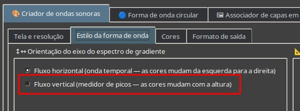
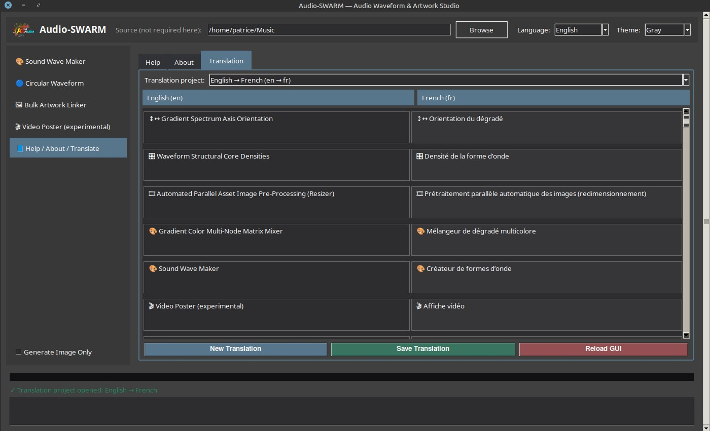
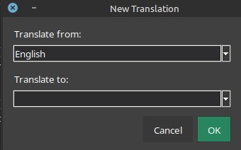
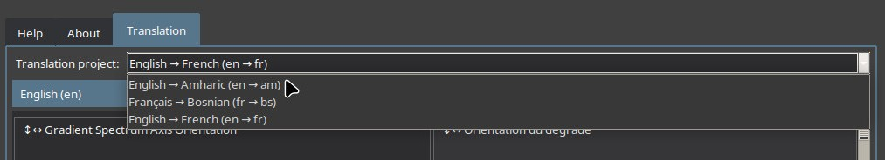

# Ajuda do Audio-SWARM
- [Índice](#contents)

**Audio-SWARM**: formas de onda sonoras e criação em lote de capas de álbuns e imagens artísticas.

O Audio-SWARM cria, em lote, capas de álbuns com formas de onda a partir de ficheiros de áudio. Pode gerar imagens convencionais de formas de onda lineares com gradientes a partir de quase qualquer tipo de ficheiro de áudio.

O Audio-SWARM também pode criar imagens de formas de onda circulares, espectros radiais e composições circulares minimalistas, ou associar imagens existentes, capas de álbuns e outras ilustrações a faixas de áudio num único lote.

* A incorporação de imagens em ficheiros de áudio permite que leitores multimédia compatíveis, como o VLC e o Celluloid, bem como smartphones e televisores, apresentem a imagem incorporada durante a reprodução da música ou do ficheiro de áudio.

### O Audio-SWARM cria ilustrações de formas de onda imprimíveis em resolução muito elevada.
As imagens geradas pelo Audio-SWARM podem ser exportadas com resoluções até 12 000 píxeis, tornando-as adequadas para impressão de alta qualidade e cartazes de filmes em alta resolução.

O Audio-SWARM pode criar desde imagens de formas de onda compactas e de tamanho reduzido até elementos visuais detalhados adequados **para capas de álbuns impressas, impressão de grande formato, ilustrações de formas de onda emolduradas, arte para paredes e impressões de dimensões semelhantes às de grandes cartazes de cinema.**

Concebido para proporcionar um nível excecional de detalhe e nitidez, o Audio-SWARM permite criar ilustrações para uma grande variedade de formatos de impressão, desde pequenas capas de álbuns a cartazes enormes e grandes peças emolduradas.
Quer esteja a criar a capa de um álbum com formas de onda, a preparar ilustrações para impressão profissional, a desenhar impressões emolduradas ou a produzir cartazes de grande formato, o Audio-SWARM ajuda a transformar ilustrações digitais em impressões físicas com um detalhe excecional.

## Índice <!-- anchor: contents -->
- [1. O que é o Audio-SWARM?](#what-is-swarm)
- [2. Início rápido](#quick-start)
- [3. Compreender a interface](#interface)
- [4. Criador de ondas sonoras](#sound-wave-maker)
- [5. Forma de onda circular](#circular-waveform)
- [6. Associador de capas em lote](#bulk-artwork-linker)
- [7. Cartaz de vídeo](#video-poster)
- [8. Processamento em lote e pastas de saída](#batch-output)
- [9. Resolução e desempenho](#resolution-performance)
- [10. Referência de cores e geometria](#colors-geometry)
- [11. Resolução de problemas](#troubleshooting)
- [12. Idiomas e contribuições](#languages-contributions)
- [13. Ferramenta de tradução](#translation-tool)
- [Enviar a tradução](#submit-translation)

## 1. O que é o Audio-SWARM? <!-- anchor: what-is-swarm -->

O **Audio-SWARM (formas de onda sonoras e criação em lote de capas de álbuns e imagens artísticas)** cria ilustrações visuais a partir de ficheiros de áudio e pode adicionar imagens de capa a formatos de áudio compatíveis. Inclui três ferramentas:

- **Criador de ondas sonoras** cria imagens convencionais de formas de onda, com fluxo vertical ou horizontal, diferentes estilos de barras, cores, gradientes e definições de resolução.
- **Forma de onda circular** cria ilustrações de formas de onda circulares, visualizações de espectro radial e composições de linhas circulares minimalistas.
- **Associador de capas em lote** associa imagens existentes a ficheiros de áudio na pasta selecionada e incorpora as imagens de capa quando o formato de áudio o permite. Os ficheiros são associados pela ordem alfabética dos nomes; organize os nomes pela ordem dos pares pretendidos.

### Imagens de saída

O Criador de ondas sonoras e a forma de onda circular exportam ilustrações em **PNG ou JPG**. Escolha as dimensões da imagem para criar imagens de resolução mais baixa para uso quotidiano ou imagens grandes, de alta resolução, para visualização detalhada ou impressão. As imagens circulares podem ser renderizadas até 8000 píxeis. PNG permite transparência; JPG utiliza um fundo sólido.

### Incorporar ilustrações e preservar o áudio

Quando o formato o permite, o Audio-SWARM incorpora a imagem numa nova cópia de saída de ficheiros de áudio **MP3, OGG/OGA, FLAC, M4A e AIFF/AIF**. A incorporação de imagens em OGG/OGA e AIFF/AIF requer o pacote Python opcional `mutagen`. No fluxo de trabalho do Audio-SWARM, WAV não permite incorporar imagens de capa; por isso, o ficheiro de áudio e a imagem são guardados lado a lado.

**AAC bruto é a exceção de contentor:** neste fluxo de trabalho, AAC bruto não tem um contentor padrão para imagens de capa. Para incorporar uma imagem, o Audio-SWARM coloca o fluxo de áudio AAC original num contentor M4A e cria um ficheiro terminado em `_with_art.m4a`. O fluxo de áudio não é recodificado nem reamostrado.

O Audio-SWARM não modifica o ficheiro de áudio de origem. Quando cria um ficheiro de saída de áudio com a imagem incorporada, copia o fluxo de áudio codificado original sem o recodificar nem reamostrar. Para calcular uma forma de onda, o Audio-SWARM utiliza uma cópia temporária do áudio para análise; essa cópia serve apenas para calcular a visualização e é eliminada depois. Nunca é utilizada como ficheiro de áudio guardado. **O áudio na saída guardada permanece igual ao áudio original.**

## 2. Início rápido <!-- anchor: quick-start -->

1. **Escolha a entrada.** Em **Criador de ondas sonoras** ou **Forma de onda circular**, selecione um ficheiro de áudio compatível para criar uma única imagem ou escolha uma pasta para processar um lote. Utilize o campo do caminho e o botão Procurar, ou arraste e largue um ficheiro de áudio ou uma pasta compatível em qualquer ponto da janela do Audio-SWARM.
   Em **Associador de capas em lote**, escolha ou largue uma pasta que contenha os ficheiros de áudio e as respetivas imagens. Esta ferramenta trabalha com uma pasta, não com um único ficheiro de áudio.
2. **Selecione o separador principal** da ferramenta que pretende utilizar:
   - **Criador de ondas sonoras** — criar imagens convencionais de formas de onda.
   - **Forma de onda circular** — criar formas de onda circulares, espectros radiais ou composições circulares minimalistas.
   - **Associador de capas em lote** — associar imagens existentes a ficheiros de áudio numa pasta.
3. Ajuste as definições necessárias. Se não souber por onde começar, mantenha os valores predefinidos. Por predefinição, as imagens de saída são **PNG com fundo transparente**. Pode alterar esta opção em **Formato de saída** se preferir JPG ou um fundo sólido.
4. Prima o botão de geração ou processamento. Acompanhe o estado, a barra de progresso e o registo na parte inferior. Arrastar e largar um ficheiro ou uma pasta apenas seleciona a entrada; não inicia o processamento.
5. Quando o processamento terminar, verifique a pasta de saída indicada no registo ou na mensagem de conclusão.

O Criador de ondas sonoras e a forma de onda circular podem processar pastas recursivamente e preservar a estrutura das subpastas de origem na saída. Associador de capas em lote analisa apenas o nível superior da pasta selecionada e associa os ficheiros de áudio e de imagem pelas respetivas listas de nomes ordenadas separadamente. Não tenta adivinhar qual imagem pertence a cada música; certifique-se de que os nomes ordenados correspondem aos pares pretendidos.

### ⚠️ Sobre os controlos deslizantes

- Escolha o tamanho pretendido e, em seguida, ajuste-o gradualmente clicando junto ao indicador do controlo deslizante.

### ⚠️ Aviso sobre Fluxo vertical:

Em **Criador de ondas sonoras → Estilo da forma de onda → Fluxo vertical**, o processamento pode demorar muito mais do que com outras opções, sobretudo ao utilizar um gradiente multicolorido.
- O registo pode parecer não atualizar, ou deixar de atualizar, e o Audio-SWARM pode parecer não responder durante algum tempo. Não entre em pânico nem feche imediatamente o Audio-SWARM. Este modo pode simplesmente demorar mais.
- Aguarde até terminar, especialmente ao criar imagens grandes ou processar vários ficheiros em lote.

## 3. Compreender a interface <!-- anchor: interface -->

- **Campo do caminho de entrada:** mostra o ficheiro de áudio ou a pasta de origem selecionada para a ferramenta atual. Utilize o botão **Procurar** adjacente para abrir o seletor de ficheiros ou pastas do sistema e escolher uma entrada.
- **Arrastar e largar:** também pode largar um ficheiro de áudio ou uma pasta compatível em qualquer ponto da janela do Audio-SWARM. O caminho de entrada é atualizado como se tivesse selecionado a entrada através do controlo Procurar. Largar um item apenas seleciona a entrada; não inicia o processamento. O Associador de capas em lote utiliza uma pasta com ficheiros de áudio e imagens, e não um único ficheiro de áudio.
- **Seletor de idioma:** altera o idioma da interface e carrega o documento de ajuda correspondente, quando disponível. Se não existir um documento de ajuda traduzido, o Audio-SWARM utiliza o ficheiro de ajuda em inglês.
- Pode mudar de idioma a qualquer momento sem afetar as definições já configuradas.

O Audio-SWARM está organizado em **separadores principais**, **subseparadores**, controlos de entrada e indicadores de processamento. Cada parte tem uma finalidade específica:

- **Separadores principais:** permitem selecionar uma das três ferramentas: **Criador de ondas sonoras**, **Forma de onda circular** ou **Associador de capas em lote**. **Ajuda / Sobre** abre a documentação e as informações da aplicação.
- **Subseparadores:** organizam as definições de uma ferramenta em grupos mais pequenos. Selecione o subseparador que contém as definições que pretende ajustar; mudar de subseparador não inicia o processamento.
- **Botão de geração ou processamento:** inicia a operação da ferramenta selecionada, utilizando a entrada e as definições atuais. Verifique o caminho selecionado e as opções antes de começar.

**Nota importante:** algumas definições de **Criador de ondas sonoras** também afetam **Forma de onda circular**, incluindo o estilo geométrico e as definições de cor. Para aplicar alterações às ilustrações circulares, selecione as definições pretendidas em Criador de ondas sonoras, **regresse** ao separador Forma de onda circular e clique em Gerar forma de onda circular.

- **Barra de progresso:** mostra o progresso durante uma operação, sobretudo no processamento em lote. Algumas etapas podem não atualizar a barra continuamente.
- **Linha de estado:** apresenta uma indicação breve da operação que o Audio-SWARM está a executar ou do resultado de uma operação.
- **Registo:** guarda informações como ficheiros encontrados, saídas criadas, avisos e erros. Se uma tarefa demorar muito tempo, o registo pode não ser atualizado continuamente; isso não significa necessariamente que o Audio-SWARM deixou de funcionar.
- **Cancelar:** pede a interrupção de um lote ativo. Um ficheiro que já esteja a ser gerado ou codificado poderá ter de concluir a etapa atual antes de o cancelamento produzir efeito.

Algumas páginas são mais altas do que a janela. Utilize a barra de deslocamento vertical ou a roda do rato para aceder aos controlos mais abaixo.

## 4. Criador de ondas sonoras <!-- anchor: sound-wave-maker -->

Criador de ondas sonoras gera uma imagem de forma de onda a partir de cada ficheiro de áudio compatível. Os seus subseparadores agrupam os controlos por finalidade:

Em execuções recursivas de pastas, as imagens geradas são colocadas em `Waveform_Outputs`, com as subpastas de origem reproduzidas na estrutura de saída. A saída de um único ficheiro é colocada ao lado do ficheiro de origem. MP3, OGG/OGA, FLAC, M4A e AIFF/AIF podem receber imagens de capa incorporadas. As entradas AAC brutas produzem um ficheiro `_with_art.m4a`, porque AAC bruto não tem um contentor padrão para imagens de capa. WAV mantém a imagem separada. A incorporação de imagens em OGG/OGA e AIFF/AIF requer o pacote Python `mutagen`; se este não estiver disponível, o Audio-SWARM mantém a imagem separada e regista um erro.

### Tela e resolução
#### Configuração da estrutura de resolução de geração

- **Seletor de dimensões predefinidas:** escolha um tamanho de tela e uma proporção predefinidos para formatos comuns, incluindo capas horizontais, verticais e quadradas. A predefinição define automaticamente a largura e a altura da tela.
- **Limite da largura da tela:** define a largura da imagem de saída em píxeis, de 10 a 8000 píxeis.
- **Limite da altura da tela:** define a altura da imagem de saída em píxeis, de 10 a 8000 píxeis.

Quando altera manualmente a largura ou a altura, a predefinição muda para Coordenadas de mapeamento personalizadas, permitindo definir dimensões próprias para a imagem.

Dimensões maiores produzem imagens com mais píxeis, adequadas a ilustrações detalhadas, ecrãs de alta resolução e impressão. No entanto, também exigem mais tempo de processamento e memória, além de produzirem ficheiros maiores.

#### Densidade estrutural da forma de onda

- **Quantidade total de barras da grelha:** controla o número de barras utilizadas para construir a forma de onda, de 40 a 500. Um valor mais baixo produz menos barras, mais largas; um valor mais alto cria uma forma de onda mais densa, com barras mais estreitas. Um número maior de barras pode aumentar o tempo de processamento.

- **Resolução das fatias do gradiente:** controla o número de segmentos de cor utilizados para gerar gradientes. Mais segmentos podem produzir transições de cor mais suaves, mas também podem aumentar significativamente o tempo de processamento, sobretudo com gradientes multicoloridos em Fluxo vertical. Cor sólida uniforme não utiliza segmentos de gradiente, pelo que o processamento é muito mais rápido.

- **DPI (resolução de impressão):** define os metadados de resolução de impressão da imagem. Não altera as dimensões em píxeis; estas são controladas separadamente por Largura da tela e Altura da tela. Com as mesmas dimensões em píxeis, um DPI mais elevado produz uma impressão física menor, com mais píxeis por polegada.

### Estilo da forma de onda
#### Orientação do eixo do gradiente

- **Fluxo vertical** aplica as cores do gradiente ao longo da altura de cada barra.
- **Fluxo horizontal** aplica as cores ao longo da forma de onda, da esquerda para a direita.

### Estilo geométrico dos picos das barras da forma de onda
Escolha a forma utilizada nas barras e nos respetivos picos:

- **Barras clássicas padrão:** barras retangulares com extremidades planas.
- **Cápsulas suaves:** barras com extremidades suavemente arredondadas.
- **Pirulito:** hastes estreitas com uma extremidade circular em cada pico.
- **Picos aguçados:** barras que afunilam até picos pontiagudos.
- **Seta-lança:** barras com extremidades em forma de seta.

A geometria selecionada também afeta os modos correspondentes em Forma de onda circular e Espectro radial. A forma de onda circular minimalista utiliza uma linha contínua em vez de barras individuais, pelo que estes estilos geométricos não se aplicam.
Cada barra representa a amplitude do sinal de áudio durante um intervalo curto. A altura reflete o nível do sinal, enquanto a geometria selecionada determina a forma do pico: plano, arredondado, circular, pontiagudo ou em seta.

### Cores

O separador Cores permite criar um gradiente combinando várias cores ou utilizar uma única cor sólida.

- **Nós de cor:** cada botão Cor do nó representa uma paragem de cor no gradiente. Clique num botão para abrir o seletor de cores e escolher uma cor. A barra de pré-visualização mostra como as cores selecionadas se misturam, pela ordem atual.
- **Adicionar nó de cor:** adiciona outra paragem de cor ao gradiente, até ao máximo de 10 nós.
- **Remover o último nó:** remove a última paragem de cor. O modo de gradiente mantém pelo menos dois nós.
- **Inverter a direção de processamento das coordenadas centrais da camada (fluxo vetorial inverso):** inverte a ordem das cores do gradiente, alterando a direção em que as cores aparecem na forma de onda.
- **Ativar cor sólida uniforme:** utiliza uma única cor selecionada em toda a forma de onda, sem calcular segmentos de gradiente. É muito mais rápido, sobretudo com Fluxo vertical. Inverter fluxo de cores fica desativado neste modo. O controlo Fatia de processamento do gradiente no separador Tela e resolução também fica desativado. Ao voltar ao modo de gradiente, são restaurados dois nós de cor; quaisquer nós adicionais têm de ser novamente adicionados.

### Formato de saída

- **Formato raster de saída:** escolha PNG ou JPG para as imagens de forma de onda geradas. PNG está selecionado por predefinição e suporta transparência. JPG não suporta transparência, pelo que a opção de transparência é automaticamente desativada quando seleciona JPG.

- **Ativar transparência total do canal alfa da tela:** ativa um fundo transparente para imagens PNG. Quando a transparência está ativa, o botão de cor de fundo fica bloqueado e apresenta Bloqueado (transparente).

- **Escolher a cor de fundo:** quando a transparência está desativada, clique neste botão para escolher uma cor de fundo sólida. A cor escolhida é mantida ao alternar entre PNG, JPG e as definições de transparência.

- **Manter imagens de alta resolução junto dos ficheiros com capas incorporadas:** ativada por predefinição. Quando o Audio-SWARM incorpora com êxito uma imagem num ficheiro de áudio compatível, esta opção mantém a imagem separada, em resolução total, junto do ficheiro de áudio de saída. Se estiver desativada, a imagem separada é eliminada após a incorporação bem-sucedida. Se a incorporação falhar, o Audio-SWARM mantém a imagem separada.

As cores selecionadas, a direção do gradiente, o formato de saída, as definições de transparência e fundo, o fluxo vertical ou horizontal, as barras da forma de onda, os picos e a geometria também são partilhados com Forma de onda circular, Espectro radial e Forma de onda circular minimalista. Para aplicar alterações às ilustrações circulares, regresse ao separador Forma de onda circular e clique em Gerar forma de onda circular.

## 5. Forma de onda circular <!-- anchor: circular-waveform -->

A forma de onda circular gera visualizações circulares a partir dos ficheiros de áudio. Escolha um dos três modos nos subseparadores.

#### Definições partilhadas

- **Tamanho de saída (pixels quadrados):** define a largura e a altura da imagem circular, de 256 a 8000 píxeis.
- **Rotação (graus):** roda a ilustração gerada de 0° a 359°.

### Modo: Forma de onda circular

Apresenta barras da forma de onda dispostas em círculo.

- **Raio interno:** controla o tamanho do espaço vazio no centro. Um raio maior cria uma abertura central maior.
- **Para fora:** as barras estendem-se para fora da linha de base circular.
- **Para dentro:** as barras estendem-se em direção ao centro.
- **Para dentro + para fora:** ative ambas as caixas de seleção para estender as barras nas duas direções. Pelo menos uma direção permanece sempre selecionada; se desmarcar a única direção selecionada, a outra é ativada.
- **Geometria da forma de onda:** utiliza a geometria selecionada em Criador de ondas sonoras → Estilo da forma de onda, incluindo Barras clássicas padrão, Cápsulas suaves, Pirulito, Picos aguçados e Seta-lança.

### Modo: Espectro radial

Apresenta a energia das frequências de áudio como barras radiais dispostas em círculo.

- **Raio interno:** controla o tamanho da abertura central.
- **Bandas de frequência:** define o número de bandas de frequência representadas em redor do círculo. Mais bandas proporcionam maior detalhe das frequências.
- **Sensibilidade:** controla a intensidade visual das barras do espectro. Aumente-a para tornar as variações de frequência mais pronunciadas.
- **Para fora e Para dentro:** determinam se as barras se estendem para fora da linha de base, em direção ao centro ou em ambas as direções.

### Modo: Forma de onda circular minimalista

Desenha uma linha contínua em círculo em vez de barras individuais.

- **Raio base:** controla o raio base da linha circular.
- **Amplitude da onda:** controla o quanto a linha se afasta do raio base. Valores mais elevados criam variações mais pronunciadas.
- **Espessura da linha:** controla a espessura da linha.

Este modo não utiliza o seletor de geometria da forma de onda nem os controlos de direção Para dentro/Para fora.

### Definições partilhadas de cores e saída

A forma de onda circular, o espectro radial e a forma de onda circular minimalista partilham os nós de cor, a direção do gradiente, o formato de saída, as definições de transparência e fundo, o DPI e a preferência de incorporação da ilustração com Criador de ondas sonoras.

As definições Fluxo vertical e Fluxo horizontal em Criador de ondas sonoras → Estilo da forma de onda também afetam a forma como as cores do gradiente são aplicadas a Forma de onda circular, Espectro radial e Forma de onda circular minimalista. Para alterar a aplicação do gradiente, selecione o fluxo pretendido em Criador de ondas sonoras.

#### Nota:
Algumas definições de Criador de ondas sonoras também afetam as ilustrações circulares, incluindo a geometria e as cores. Para aplicar as alterações, selecione as definições pretendidas em Criador de ondas sonoras, **regresse** a Forma de onda circular e clique em Gerar formas de onda circulares.

Ao processar uma pasta, o Audio-SWARM cria a pasta `Circular_Waveform_Outputs` e preserva a estrutura das subpastas de origem. Os diferentes modos utilizam sufixos próprios nos nomes dos ficheiros para evitar que as saídas se sobreponham.

## 6. Associador de capas em lote <!-- anchor: bulk-artwork-linker -->

O Associador de capas em lote associa ficheiros de áudio compatíveis (MP3, OGG/OGA, WAV, FLAC, M4A, AAC e AIFF/AIF) a imagens PNG, JPG ou JPEG na pasta selecionada. Ordena separadamente as listas de nomes dos ficheiros de áudio e das imagens e, em seguida, associa os ficheiros pela posição nas listas. Antes de começar, renomeie os ficheiros para que a ordem alfabética corresponda aos pares pretendidos.

- **Recomenda-se vivamente** utilizar o mesmo número de imagens e ficheiros de áudio. Para obter os melhores resultados, prepare previamente as imagens com as dimensões em píxeis e a proporção pretendidas. O redimensionador do Audio-SWARM foi concebido apenas para uniformizar as dimensões das imagens. Se a proporção de uma imagem for diferente da proporção de destino, podem ser adicionadas barras pretas em cima e em baixo ou à esquerda e à direita para preservar as proporções originais.

A opção de redimensionamento pode ajustar as imagens às dimensões de destino selecionadas. Com a preservação da proporção ativada, a imagem é ajustada dentro de uma tela de destino; caso contrário, é esticada para corresponder exatamente às dimensões. O redimensionamento requer Pillow. Se não estiver disponível, a ferramenta utiliza as dimensões originais da imagem.

As saídas MP3, OGG/OGA, FLAC, M4A e AIFF/AIF são gravadas como novos ficheiros com `_with_art` no nome. As entradas AAC brutas são colocadas num contentor M4A com o fluxo de áudio AAC inalterado. No fluxo de trabalho do Audio-SWARM, WAV não guarda imagens de capa incorporadas; por isso, o áudio e a imagem são copiados para junto um do outro. A incorporação de imagens em OGG/OGA e AIFF/AIF requer Mutagen (consulte os requisitos/opcionais). Os resultados são colocados em `Merged_Tracks_Outputs`. Esta ferramenta analisa apenas o nível superior da pasta selecionada, não as subpastas. Se o número de ficheiros de áudio e de imagens for diferente, o Audio-SWARM processa apenas os pares completos possíveis e regista um aviso.

## 7. Cartaz de vídeo (experimental) <!-- anchor: video-poster -->

Esta ferramenta permite associar imagens de cartaz a vários ficheiros de vídeo e processá-los em lote, à semelhança do Associador de capas em lote. Coloque os vídeos e as imagens correspondentes na mesma pasta. As subpastas não são analisadas.

- **Associação por ordem:** os vídeos e as imagens são ordenados separadamente pelos nomes dos ficheiros e associados pela posição nas listas. Renomeie-os, se necessário, para que cada vídeo corresponda à imagem pretendida.
- **Quantidades diferentes:** pode haver números diferentes de vídeos e imagens. O Audio-SWARM apresenta um aviso e processa apenas os pares disponíveis.
- **Redimensionamento de imagens:** pode redimensionar e converter as imagens de cartaz de acordo com as dimensões de saída selecionadas.
- **Proporções:** pode manter a proporção original da imagem; se essa opção estiver desativada, a imagem é ajustada exatamente às dimensões escolhidas.
- **Cor de fundo:** pode escolher a cor de fundo usada ao converter imagens para formatos que não suportam transparência.
- **Nomes dos ficheiros:** os vídeos de saída mantêm os nomes originais.

Os resultados são guardados na pasta `Video_Poster_Outputs`, dentro da pasta selecionada. Esta funcionalidade é experimental.

## 8. Processamento em lote e pastas de saída <!-- anchor: batch-output -->

O Criador de ondas sonoras e a forma de onda circular processam lotes recursivamente. As respetivas pastas de saída preservam a estrutura das subpastas de origem, para que ficheiros com o mesmo nome em pastas de origem diferentes não entrem em conflito. O Associador de capas em lote processa apenas os ficheiros no nível da pasta selecionada.

Antes de executar um lote grande, verifique a pasta selecionada e o local de saída. Executar novamente a mesma tarefa pode substituir uma saída existente com o mesmo nome. Faça uma cópia de segurança dos ficheiros importantes. Evite colocar ficheiros de entrada sem relação com a tarefa dentro das pastas de saída geradas.

## 9. Resolução e desempenho <!-- anchor: resolution-performance -->

A largura e a altura da tela definem as dimensões da imagem em píxeis. O DPI controla os metadados de resolução de impressão, enquanto o Audio-SWARM gera a imagem com as dimensões em píxeis selecionadas. Imagens grandes exigem mais memória e tempo e produzem ficheiros maiores.

Um número de barras mais elevado produz mais barras e pode torná-las mais estreitas. A resolução dos segmentos de gradiente controla o número de passos de cor distintos utilizados nos estilos de gradiente segmentado; mais segmentos podem criar transições mais suaves, mas também podem demorar mais tempo.
**Suavidade do gradiente:** se o gradiente não parecer suficientemente suave, experimente definir este valor como 200. Isto utiliza um algoritmo diferente como alternativa.
A cor sólida uniforme evita o processamento dos segmentos de gradiente. Para um primeiro teste, utilize um tamanho de imagem moderado e alguns ficheiros de áudio antes de gerar um lote muito grande.

## 10. Referência de cores e geometria <!-- anchor: colors-geometry -->

- **Retângulo:** barras convencionais com extremidades planas.
- **Cápsulas suaves:** barras com extremidades arredondadas.
- **Pirulito:** uma haste estreita com uma extremidade circular no pico.
- **Picos aguçados:** barras que afunilam até picos triangulares pontiagudos.
- **Seta-lança:** hastes com uma extremidade distinta semelhante a uma seta.

Utilize Fluxo vertical quando pretender que a cor mude ao longo da altura de cada barra.
Utilize Fluxo horizontal quando pretender que o gradiente percorra a forma de onda de um lado ao outro. A cor sólida uniforme é útil para uma composição de uma só cor e evita a divisão do gradiente em segmentos. Os nós de cor definem os pontos do gradiente; a pré-visualização mostra a respetiva ordem.

## 11. Resolução de problemas <!-- anchor: troubleshooting -->

- **Não foram encontrados ficheiros:** confirme se o caminho da pasta está correto e se contém um formato de áudio ou imagem compatível com a ferramenta selecionada.
- **Ilustração em falta ou associação incompleta:** O Associador de capas em lote associa listas ordenadas por posição. Verifique os nomes dos ficheiros e o número de ficheiros em cada lista.
- **Local de saída inesperado:** consulte a mensagem de conclusão e o nome da pasta de saída da ferramenta.
- **Um ficheiro foi substituído:** os nomes de saída podem corresponder aos de execuções anteriores. Faça cópias de segurança dos resultados ou mova-os antes de repetir um lote.
- **Falha ao incorporar:** consulte o registo da aplicação e confirme que o FFmpeg está instalado e consegue ler o ficheiro de origem.
- **geração lenta ou utilização elevada de memória:** reduza as dimensões em píxeis, diminua o tamanho do lote ou utilize menos barras/segmentos.
- **Falta o ficheiro de ajuda de um idioma:** se o ficheiro de ajuda do idioma selecionado não estiver disponível, o Audio-SWARM utiliza `help/en.md`.

Se o problema persistir, guarde o texto do registo e indique a ferramenta, o modo, o formato do ficheiro e as definições selecionadas ao comunicar o problema.

## 12. Idiomas e contribuições <!-- anchor: languages-contributions -->

As traduções da interface são ficheiros JSON em `languages/`. Os documentos de ajuda são ficheiros Markdown em `help/`, e os documentos About são ficheiros Markdown em `about/`. Os ficheiros usam o código do idioma no nome, por exemplo `en.md` para inglês, `fr.md` para francês ou `ja.md` para japonês.
Pode contribuir diretamente na interface do Audio-SWARM, em Ajuda / Sobre / Tradução → separador Tradução.
## 13. Ferramenta de tradução do Audio-SWARM <!-- anchor: translation-tool -->

[Enviar a tradução no GitHub](https://github.com/PatLabGit/Audio-SWARM/discussions/1)

A ferramenta permite traduzir o Audio-SWARM para outro idioma ou corrigir uma tradução existente diretamente na aplicação. Também permite verificar de imediato se o texto de uma entrada é demasiado longo. Não é necessário editar JSON manualmente.

### Criar uma tradução
Clique em **Nova tradução** para criar um projeto. Surge uma janela com dois seletores:

- **Traduzir de:** idioma de origem. Recomenda-se inglês, mas pode escolher outro idioma já traduzido no Audio-SWARM.
- **Traduzir para:** idioma de destino. A lista inclui 172 idiomas do dicionário.
Utilizei ISO 639-1 (códigos de duas letras). A exceção é `tw`, que não é um código ISO 639-1 oficial: é um código personalizado para chinês tradicional, em vez de `zh-TW` ou `zh-Hant`. Por simplicidade, mantive os códigos de duas letras e adiei os códigos de três letras, como `pcm`.
Clique em **OK**. O novo ficheiro é criado a partir de uma cópia do idioma de origem e mantém inicialmente o texto original, incluindo caracteres especiais, emojis, quebras de linha e variáveis como `{filename}` ou `{value}`. Nada é automaticamente removido ou substituído. O projeto é então adicionado.
### Interface de tradução
O editor tem duas colunas:
- **Origem (esquerda):** texto original do idioma escolhido em **Traduzir de**. É só de leitura. Pode selecionar texto e usar %% Ctrl %% + %% C %% para o copiar caso tenha apagado algo por engano na outra coluna. É a única ação disponível nesta coluna.
- **Tradução (direita):** texto do ficheiro de destino, onde escreve ou corrige a tradução.
Cada entrada corresponde à mesma entrada da origem. As secções facilitam a navegação. Clique numa entrada para editar; pode selecionar, copiar e colar entre as colunas.
### Importante!
- **Preserve os elementos necessários, como `{variables}`, `\n`, pontuação e marcadores de formatação.** O Audio-SWARM pode utilizá-los.
#### Pode deixar entradas por traduzir e retomá-las mais tarde com **Guardar**.
### Projetos de tradução
A lista mostra os idiomas que criou ou está a traduzir.

Selecione um projeto para o editar e alterne entre projetos sem criar uma tradução de cada vez. Cada projeto fica guardado no seu próprio ficheiro de idioma.
### Os três botões inferiores
**Nova tradução** — cria um projeto. Escolha **Traduzir de:** e **Traduzir para:**. O ficheiro de destino é copiado da origem e registado como projeto.
**Guardar tradução** — guarda a tradução, mesmo incompleta. Guarde regularmente.
**Recarregar interface** — recarrega a interface no idioma do projeto **selecionado**. Traduza algumas entradas, guarde e recarregue para verificar menus, botões, separadores e etiquetas na aplicação. Ajuda a detetar textos demasiado longos ou inadequados.
**Importante:** entradas por traduzir podem continuar na língua de origem; é normal. **Não elimine entradas antes de guardar**, ou partes da interface poderão ficar sem texto. Pode voltar a outro idioma através da seleção/recarregamento junto de «Tema».
### Dicas para tradutores
- Traduza ao seu ritmo e guarde regularmente.
- Verifique com Recarregar interface.
- Use linguagem clara, natural e concisa, sobretudo em botões, separadores e etiquetas.
- Não altere variáveis, marcadores de formatação ou caracteres especiais sem necessidade.
- Se algo parecer estranho, corrija, guarde e recarregue.
## [Enviar a tradução](https://github.com/PatLabGit/Audio-SWARM/discussions/1) <!-- anchor: submit-translation -->

Pode enviar-me o ficheiro de idioma traduzido para contribuir com o Audio-SWARM.
1. **Localize o ficheiro:** abra a pasta de instalação e depois **`languages`** (junto de `main.py` e do launcher). Procure o ficheiro com o **código de duas letras** do idioma (por exemplo `fr`, `de`, `ja`). A extensão `.json` pode estar oculta.
2. Visite a **[página GitHub Discussions do Audio-SWARM](https://github.com/PatLabGit/Audio-SWARM/discussions/1)**.
3. Abra a discussão de submissão de traduções e anexe o ficheiro ao comentário.
Não precisa de alterar código nem de enviar um pull request. Pode usar uma conta GitHub com pseudónimo. Obrigado por contribuir e por ajudar a tornar o Audio-SWARM acessível a mais pessoas!
## Traduzir o ficheiro de ajuda
**Copie o ficheiro inglês da pasta `help`**, traduza o texto e os títulos e guarde-o com o código de idioma correto. Mantenha os comentários de âncora HTML e os destinos do índice intactos para que os links das secções funcionem. Guarde em UTF-8.
Não traduza nomes de ficheiros, exemplos de código, identificadores de definições ou pastas quando tiverem de corresponder exatamente à aplicação. Mantenha a tradução alinhada com o original inglês e indique textos ambíguos ou comportamentos desatualizados. Se faltar um documento de Ajuda ou Sobre específico, o Audio-SWARM utiliza o documento correspondente em inglês.
