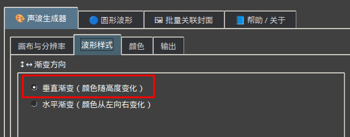

# Audio-SWARM 幫助
- [目錄](#contents)

**Audio-SWARM**：音訊波形生成器，支援專輯封面、藝術作品及混音視覺主題的批次處理。

Audio-SWARM 可批次產生以音訊波形為視覺元素的專輯封面藝術作品。Audio-SWARM 幾乎支援所有類型的音訊檔案，能夠生成帶有漸層效果的傳統線性波形圖像。

Audio-SWARM 可以建立圓形波形圖、放射狀頻譜及極簡風格的圓形設計，也可以在單一批次作業中，將現有圖片、專輯封面及藝術作品封面與音訊曲目結合。

* 將圖片嵌入音訊檔案後，VLC 和 Celluloid 等相容的多媒體播放器，以及智慧型手機和電視，都能在播放歌曲或音訊檔案時顯示內嵌的封面藝術作品。

### Audio-SWARM 可建立適合列印的超高解析度波形藝術作品。

Audio-SWARM 產生的圖像最高可匯出至 12,000 像素的解析度，非常適合高品質列印、大尺寸印刷及高解析度電影海報製作。

Audio-SWARM 能夠以檔案大小精簡的波形圖像為基礎，創作細節豐富的視覺作品，適用於**專輯封面印刷、大圖輸出、波形藝術裝框、牆面藝術裝飾，以及電影海報尺寸的超大型印刷品**。

Audio-SWARM 專為呈現出色的視覺細節與清晰度而設計，能夠製作適用於各種印刷尺寸的藝術作品，從小型專輯封面到超大型海報及大型裝框作品皆能勝任。

無論您是製作波形專輯封面、準備專業印刷用藝術作品、設計裝框藝術印刷品，還是製作大尺寸海報，Audio-SWARM 都能協助您將數位藝術作品呈現為細節精緻、令人驚豔的實體印刷品。

## 目錄 <!-- anchor: contents -->
- [1. 甚麼是 Audio-SWARM？](#what-is-swarm)
- [2. 快速開始](#quick-start)
- [3. 瞭解界面](#interface)
- [4. Sound Wave Maker](#sound-wave-maker)
- [5. Circular Waveform](#circular-waveform)
- [6. Bulk Artwork Linker](#bulk-artwork-linker)
- [7. 批處理與輸出文件夾](#batch-output)
- [8. 分辨率與性能](#resolution-performance)
- [9. 顏色與幾何樣式參考](#colors-geometry)
- [10. 故障排查](#troubleshooting)
- [11. 語言與貢獻](#languages-contributions)

## 1. 甚麼是 Audio-SWARM？ <!-- anchor: what-is-swarm -->

**Audio-SWARM（Audio-Sound Waveform & bulk Album/Artwork-cover batch Remix Motif）** 可根據音頻文件創建視覺圖像，也可以將封面圖片嵌入受支持的音頻格式。它提供三種工具：

- **Sound Wave Maker** 可創建常規波形圖，支持 Vertical Flow 或 Horizontal Flow、不同的波形條樣式、顏色、漸變和分辨率設置。
- **Circular Waveform** 可創建圓形波形、徑向頻譜可視化以及極簡圓形線條設計。
- **Bulk Artwork Linker** 可將現有圖片與所選文件夾中的音頻文件配對，並在音頻格式支持時嵌入封面。文件按照文件名排序後的順序進行配對，因此請整理文件名，使排序結果符合所需的配對關係。

### 圖像輸出

Sound Wave Maker 和 Circular Waveform 可將圖像導出為 **PNG 或 JPG**。請根據用途選擇圖像尺寸：日常使用可選擇較小的圖像，細節展示或打印則適合較大、分辨率較高的圖像。圓形圖像最高可生成 8000 像素。PNG 支持透明背景；JPG 使用純色背景。

### 嵌入封面並保留音頻

在格式支持的情況下，Audio-SWARM 會將圖片嵌入 **MP3、OGG/OGA、FLAC、M4A 和 AIFF/AIF** 音頻文件的新輸出副本中。向 OGG/OGA 和 AIFF/AIF 文件嵌入封面需要可選的 Python 軟件包 `mutagen`。在 Audio-SWARM 的工作流程中，WAV 不嵌入封面圖片，因此音頻文件和圖片會並排單獨保存。

**原始 AAC 是一個例外：** 在此工作流程中，原始 AAC 沒有用於封面圖片的標準容器。要嵌入圖片，Audio-SWARM 會將原始 AAC 音頻流放入 M4A 容器，並創建以 `_with_art.m4a` 結尾的文件。音頻流本身不會重新編碼或重新採樣。

Audio-SWARM 不會修改源音頻文件。創建嵌入封面的輸出文件時，Audio-SWARM 會複製原始編碼音頻流，不進行重新編碼或重新採樣。為計算波形，Audio-SWARM 會使用一個臨時分析副本；該副本僅用於計算可視化，之後便會刪除，絕不會作為保存的音頻輸出使用。**保存的輸出文件仍保留原始音頻。**

## 2. 快速開始 <!-- anchor: quick-start -->

1. **選擇輸入。** 在 **Sound Wave Maker** 或 **Circular Waveform** 中，選擇一個受支持的音頻文件以生成單張圖像，或選擇一個文件夾來批量處理。可以使用路徑輸入框和 Browse 按鈕，也可以將受支持的音頻文件或文件夾拖放到 Audio-SWARM 窗口的任意位置。  
   對於 **Bulk Artwork Linker**，請選擇或拖放一個同時包含音頻文件及其封面圖片的文件夾。此工具處理的是文件夾，而不是單個音頻文件。
2. **選擇主選項卡**，打開所需工具：
   - **Sound Wave Maker** — 創建常規波形圖。
   - **Circular Waveform** — 創建圓形波形、徑向頻譜或極簡圓形設計。
   - **Bulk Artwork Linker** — 將現有圖片與文件夾中的音頻文件配對。
3. 調整需要的設置。如果不確定如何選擇，請保留默認值。默認情況下，圖像以**透明背景的 PNG** 格式輸出。如需 JPG 或純色背景，可在 **Output Format** 中更改。
4. 點擊生成或處理按鈕。查看窗口底部的狀態、進度條和日誌。拖放操作只會選擇輸入，不會自動開始處理。
5. 處理完成後，請檢查日誌或完成提示中顯示的輸出文件夾。

Sound Wave Maker 和 Circular Waveform 可以遞歸處理文件夾，並在輸出中保留源子文件夾結構。Bulk Artwork Linker 只檢查所選文件夾的頂層，並根據分別排序後的音頻和圖片文件名列表進行配對。Audio-SWARM 不會自動判斷哪張圖片屬於哪首曲目，因此請確保文件名排序後的順序與所需配對一致。

### ⚠️ 關於滑塊

- 選擇所需的大小，然後點擊滑塊手柄旁邊的位置進行微調。

### ⚠️ Vertical Flow 注意事項

在 **Sound Wave Maker → Waveform Style → Vertical Flow** 下，處理時間可能明顯長於其他選項，尤其是在使用多色漸變時。
- 日誌可能看起來停止更新，Audio-SWARM 也可能暫時像是沒有響應。請不要立即關閉 Audio-SWARM；此模式可能只是需要更多時間。
- 請耐心等待處理完成，特別是在生成大圖或批量處理大量文件時。

## 3. 瞭解界面 <!-- anchor: interface -->

- **輸入路徑字段：** 顯示當前工具所選的音頻文件或源文件夾。旁邊的 **Browse** 按鈕會打開系統文件或文件夾選擇器。
- **拖放：** 也可以將受支持的音頻文件或文件夾拖放到 Audio-SWARM 窗口的任意位置。輸入路徑會像通過 **Browse** 選擇一樣更新。拖放不會開始處理。Bulk Artwork Linker 需要同時包含音頻和圖片的文件夾，而不是單個音頻文件。
- **語言選擇器：** 更改界面語言，並在對應的幫助文檔存在時加載該文檔。如果缺少翻譯後的幫助文檔，Audio-SWARM 會使用英文幫助。
- 可以隨時切換語言，而不會丟失已經配置的設置。

Audio-SWARM 由**主選項卡**、**子選項卡**、輸入控件和處理狀態信息組成。各部分用途如下：

- **主選項卡：** 在 **Sound Wave Maker**、**Circular Waveform** 和 **Bulk Artwork Linker** 三種工具中選擇。**Help / About** 用於打開文檔和應用程序信息。
- **子選項卡：** 將工具設置分成較小的類別。切換子選項卡不會啓動處理。
- **生成或處理按鈕：** 使用當前輸入和設置啓動所選工具。開始前請檢查路徑和選項。

**重要提示：** **Sound Wave Maker** 中的部分設置也會影響 **Circular Waveform**，包括幾何樣式和顏色。要將更改應用到圓形圖像，請先在 Sound Wave Maker 中選擇所需設置，**返回** Circular Waveform 選項卡，然後點擊 **Generate Circular Waveforms**。

- **進度條：** 顯示操作進度，特別是在批處理過程中。某些處理階段可能不會持續更新進度條。
- **狀態行：** 簡要顯示 Audio-SWARM 當前正在執行的操作或操作結果。
- **日誌：** 記錄找到的文件、創建的輸出、警告和錯誤等信息。長時間運行的任務可能不會持續更新日誌；這並不一定表示 Audio-SWARM 已停止工作。
- **Cancel：** 請求停止正在運行的批處理。如果某個文件已經開始渲染或編碼，可能需要完成當前步驟後才能取消。

有些頁面比窗口更高。請使用垂直滾動條或鼠標滾輪查看下方的控件。

## 4. Sound Wave Maker <!-- anchor: sound-wave-maker -->

Sound Wave Maker 會為每個受支持的音頻文件生成波形圖。子選項卡按用途整理相關設置。

遞歸處理文件夾時，圖像會保存到 `Waveform_Outputs`，並在其中保留源子文件夾結構。處理單個文件時，輸出會放在源文件旁邊。MP3、OGG/OGA、FLAC、M4A 和 AIFF/AIF 可以嵌入封面。原始 AAC 輸入會生成以 `_with_art.m4a` 結尾的文件，因為原始 AAC 沒有用於封面的標準容器。對於 WAV，圖像會單獨保留。向 OGG/OGA 和 AIFF/AIF 嵌入封面需要 Python 軟件包 `mutagen`；如果該軟件包不可用，Audio-SWARM 會保留獨立圖片並在日誌中記錄錯誤。

### Canvas & Resolution
#### Render Resolution Framework Configuration

- **Preset Dimensions Matrix Selector：** 選擇常用格式的預設畫布尺寸和寬高比，包括橫向、縱向和方形封面。預設會自動設置寬度和高度。
- **Canvas Width Limit：** 將輸出圖像寬度設置為 10 到 8000 像素。
- **Canvas Height Limit：** 將輸出圖像高度設置為 10 到 8000 像素。

手動更改寬度或高度後，預設會切換為 **Custom Mapping Coordinates**，以便設置自定義圖像尺寸。

更大的尺寸包含更多像素，適合細節豐富的圖像、高分辨率顯示器和打印。但它們也需要更多處理時間和內存，並產生更大的文件。

#### Waveform Structural Core Densities

- **Total Grid Bar Count Mapping Layout：** 控制波形條的數量，範圍為 40 到 500。數值較低時，波形條較少、寬度較大；數值較高時，波形更密集、波形條更窄。增加波形條數量可能延長處理時間。
- **Gradient Processing Slice Resolution：** 控制渲染漸變時使用的顏色切片數量。更多切片可以使顏色過渡更平滑，但也可能顯著增加處理時間，尤其是在 Vertical Flow 中使用多色漸變時。**Solid Flat Color** 不使用漸變切片，因此速度快得多。
- **Canvas Target Printing Resolution (DPI)：** 設置圖像的打印分辨率元數據，不會改變圖像的像素尺寸。像素尺寸由 Canvas Width 和 Canvas Height 單獨控制。在像素尺寸相同的情況下，DPI 越高，實際打印尺寸越小，每英吋的像素數越多。

### Waveform Style
#### Gradient Spectrum Axis Orientation

- **Vertical Flow** 沿每根波形條的高度分布漸變顏色。
- **Horizontal Flow** 沿波形從左向右分布顏色。

### Waveform Bar Peak Geometry Style
選擇波形條及其頂端的形狀：

- **Standard Classic Bars：** 末端平直的矩形波形條。
- **Smooth Capsule：** 末端平滑圓潤的波形條。
- **Lollipop：** 頂端帶圓形帽的細桿。
- **Sharp Spikes：** 頂端逐漸變尖的波形條。
- **Arrow-Spear：** 具有明顯箭頭狀頂端的波形條。

所選幾何樣式也會影響 Circular Waveform 和 Radial Spectrum 中相應的模式。Minimal Circular Waveform 使用連續線條而不是獨立波形條，因此不使用這些幾何樣式。
每根波形條代表短時間內音頻信號的振幅。高度反映信號電平，而幾何樣式決定頂端是平直、圓角、圓形、尖銳還是箭頭形。

### Colors
Colors 子選項卡可讓你將多個顏色組合成漸變，也可以使用單一純色。

- **Color nodes：** 每個 **Node Color** 按鈕代表漸變中的一個顏色節點。點擊按鈕選擇顏色。預覽條會按當前順序顯示顏色的混合效果。
- **Add Color Node：** 添加一個顏色節點，最多可添加 10 個。
- **Remove Last Node：** 刪除最後一個顏色節點。漸變模式至少保留兩個節點。
- **Invert Layer Core Coordinates Processing Direction (Reverse Vector Flow)：** 反轉漸變顏色的順序，從而改變顏色在波形上出現的方向。
- **Enable Solid Flat Color：** 對整個波形使用所選的一種顏色，不計算漸變切片。這樣處理速度會快得多，尤其是在使用 Vertical Flow 時。在此模式下，漸變反轉功能會被禁用；Canvas & Resolution 選項卡中的 Gradient Processing Slice 控件也會被禁用。切回漸變模式後會恢復兩個顏色節點；其他節點需要重新添加。

### Output Format

- **Output Raster Format：** 為生成的波形圖選擇 PNG 或 JPG。默認選擇 PNG，並支持透明背景。JPG 不支持透明度，因此選擇 JPG 時會自動關閉透明選項。
- **Enable 100% Alpha Channel Canvas Transparency Block：** 為 PNG 圖像啓用透明背景。啓用透明度後，背景顏色按鈕會被鎖定並顯示 **Locked (Transparent)**。
- **Pick Backdrop Color：** 關閉透明度時，可點擊此按鈕選擇純色背景。切換 PNG、JPG 或透明度設置時，已選顏色會保留。
- **Retain standalone high-res images inside workspace alongside embedded items：** 默認啓用。Audio-SWARM 成功將圖像嵌入受支持的音頻文件後，此選項會在音頻輸出旁保留一份完整分辨率的獨立圖片。如果關閉此選項，嵌入成功後會刪除獨立圖片。如果嵌入失敗，圖片仍會保留。

所選顏色、漸變方向、輸出格式、透明度和背景設置、Vertical Flow 或 Horizontal Flow，以及波形條、頂端和幾何樣式也會由 Circular Waveform、Radial Spectrum 和 Minimal Circular Waveform 共享。要將更改應用於圓形圖像，請返回 Circular Waveform 選項卡並點擊 **Generate Circular Waveforms**。

## 5. Circular Waveform <!-- anchor: circular-waveform -->

Circular Waveform 根據音頻文件創建圓形可視化圖像。請在子選項卡中選擇三種模式之一。

#### 共享設置

- **Output Size (square pixels)：** 將正方形圖像的寬度和高度設置為 256 到 8000 像素。
- **Rotation (degrees)：** 將圖像旋轉 0° 到 359°。

### Mode: Circular Waveform

顯示圍繞圓形排列的波形條。

- **Inner Radius：** 控制中心空白區域的大小。數值越大，中心開口越大。
- **Outward：** 波形條從圓形基線向外延伸。
- **Inward：** 波形條向中心延伸。
- **Inward + Outward：** 同時啓用兩個復選框，讓波形條向兩個方向延伸。始終至少有一個方向處於選中狀態；如果取消唯一已選方向，另一個方向會自動啓用。
- **波形幾何樣式：** 使用在 Sound Wave Maker → Waveform Style 中選定的樣式，包括 Standard Classic Bars、Smooth Capsules、Lollipop、Sharp Spikes 和 Arrow-Spear。

### Mode: Radial Spectrum

以圍繞圓形排列的徑向波形條顯示音頻頻率能量。

- **Inner Radius：** 控制中心開口的大小。
- **Frequency Bands：** 設置圓周上顯示的頻帶數量。頻帶越多，表示的頻率細節越精細。
- **Sensitivity：** 控制頻譜條的視覺強度。提高數值可使頻率變化更加明顯。
- **Outward 和 Inward：** 決定波形條是從基線向外、向中心，還是向兩個方向延伸。

### Mode: Minimal Circular Waveform

繪制圍繞圓形的連續線條，而不是獨立的波形條。

- **Base Radius：** 控制圓形線條的基礎半徑。
- **Wave Amplitude：** 控制線條偏離基礎半徑的幅度。數值越高，變化越明顯。
- **Line Width：** 控制線條粗細。

此模式不使用波形幾何樣式選擇器，也不使用 Inward/Outward 方向控制。

### 共享顏色和輸出設置

Circular Waveform、Radial Spectrum 和 Minimal Circular Waveform 與 Sound Wave Maker 共享顏色節點、漸變方向、輸出格式、透明度和背景設置、DPI 以及封面嵌入偏好。

Sound Wave Maker → Waveform Style 中的 **Vertical Flow** 和 **Horizontal Flow** 也會影響漸變顏色應用到 Circular Waveform、Radial Spectrum 和 Minimal Circular Waveform 的方式。要更改漸變方向，請在 Sound Wave Maker 中選擇所需的流向。

#### 注意
Sound Wave Maker 的部分設置（包括幾何樣式和顏色）也會影響圓形圖像。請先在 Sound Wave Maker 中選擇所需設置，再返回 Circular Waveform 並點擊 **Generate Circular Waveforms** 以應用更改。

處理文件夾時，Audio-SWARM 會創建 `Circular_Waveform_Outputs` 文件夾，並保留源子文件夾結構。不同模式使用各自的文件名後綴，避免彼此覆蓋輸出文件。

## 6. Bulk Artwork Linker <!-- anchor: bulk-artwork-linker -->

Bulk Artwork Linker 會將受支持的音頻文件（MP3、OGG/OGA、WAV、FLAC、M4A、AAC 和 AIFF/AIF）與所選文件夾中的 PNG、JPG 或 JPEG 圖片配對。程序會分別對音頻文件名列表和圖片文件名列表排序，然後按兩個列表中的位置進行配對。開始前請重命名文件，使排序後的順序符合預期配對關係。

**強烈建議**讓圖片數量與音頻文件數量相同。為獲得最佳效果，請預先將圖片準備為所需的像素尺寸和寬高比。Audio-SWARM 的縮放器僅用於統一圖片尺寸。如果圖片寬高比與目標寬高比不同，可能會在頂部和底部或左右兩側添加黑邊，以保留原始比例。

縮放選項可將圖片調整到所選目標尺寸。啓用保持寬高比後，圖片會適配到目標畫布內部；否則會拉伸到精確尺寸。調整大小需要 Pillow。如果無法使用 Pillow，工具會保留原始圖片尺寸。

MP3、OGG/OGA、FLAC、M4A 和 AIFF/AIF 輸出會保存為名稱包含 `_with_art` 的新文件。原始 AAC 輸入會被放入 M4A 容器，同時保持 AAC 音頻流不變。在 Audio-SWARM 的工作流程中，WAV 不保存嵌入式封面，因此音頻和圖片會並排複製。向 OGG/OGA 和 AIFF/AIF 嵌入封面需要 Mutagen（請參閱可選依賴項）。結果保存在 `Merged_Tracks_Outputs` 中。此工具只掃描所選文件夾的頂層，不掃描子文件夾。如果音頻文件和圖片的數量不同，Audio-SWARM 只處理完整配對並記錄警告。

## 7. 批處理與輸出文件夾 <!-- anchor: batch-output -->

Sound Wave Maker 和 Circular Waveform 會遞歸處理批次。它們各自的輸出文件夾保留源子文件夾結構，因此不同源文件夾中同名的文件不會相互衝突。Bulk Artwork Linker 只處理所選文件夾中的頂層文件。

在執行大型批處理前，請檢查所選文件夾和輸出位置。重復運行相同任務可能會替換同名的現有輸出文件。請備份重要文件，並避免將無關輸入文件放入生成的輸出文件夾。

## 8. 分辨率與性能 <!-- anchor: resolution-performance -->

Canvas Width 和 Canvas Height 設置圖像的像素尺寸。DPI 控制打印分辨率元數據，而 Audio-SWARM 仍按照所選像素尺寸進行渲染。大圖需要更多內存和時間，並會生成更大的文件。

增加波形條數量會產生更多波形條，並可能使每條更窄。Gradient Processing Slice Resolution 控制分段漸變使用的離散顏色級數。級數越多，顏色過渡可能越平滑，但處理時間也可能更長。

**Gradient Smoothness：** 如果漸變看起來不夠平滑，可以嘗試將該值設為 **200**。此時會改用另一種算法作為替代方案。

Solid Flat Color 不需要處理漸變切片。在運行非常大的批次之前，建議先用中等尺寸的圖像和少量音頻文件進行測試。

## 9. 顏色與幾何樣式參考 <!-- anchor: colors-geometry -->

- **Rectangle：** 末端平直的常規波形條。
- **Smooth Capsules：** 末端圓潤的波形條。
- **Lollipop：** 頂端帶圓形帽的細桿。
- **Sharp Spikes：** 逐漸收窄為三角尖端的波形條。
- **Arrow-Spear：** 帶有明顯箭頭狀尖端的桿狀波形條。

如果希望顏色沿每根波形條的高度變化，請使用 **Vertical Flow**。如果希望漸變從波形的一側向另一側移動，請使用 **Horizontal Flow**。**Solid Flat Color** 適合單色設計，並且不會將漸變切分成多個片段。顏色節點定義漸變中的顏色停靠點，預覽會顯示它們的順序。

## 10. 故障排查 <!-- anchor: troubleshooting -->

- **未找到文件：** 確認文件夾路徑正確，並且其中包含所選工具支持的音頻或圖像格式。
- **封面缺失或配對不完整：** Bulk Artwork Linker 根據排序後的位置配對列表。請檢查文件名以及兩個列表中的文件數量。
- **輸出位置不符合預期：** 查看完成消息和輸出文件夾名稱。
- **文件被替換：** 重復運行時，輸出文件名可能相同。再次運行前請備份或移走先前的結果。
- **嵌入失敗：** 查看應用程序日誌，並確認已安裝 FFmpeg 且能夠讀取源文件。
- **渲染速度慢或內存使用量高：** 減小像素尺寸、批次規模，或減少波形條和顏色切片數量。
- **缺少某種語言的幫助文檔：** 如果所選語言的幫助文檔不存在，Audio-SWARM 會使用 `help/en.md`。

如果問題仍然存在，請保存日誌內容，並記錄所選工具、模式、文件格式和設置。

## 11. 語言與貢獻 <!-- anchor: languages-contributions -->

界面翻譯以 JSON 文件的形式存儲在 `languages/` 中。幫助文檔是 `help/` 中的 Markdown 文件，About 文檔是 `about/` 中的 Markdown 文件。JSON 和 Markdown 文件均使用語言代碼作為文件名，例如 `en.md` 表示英語、`fr.md` 表示法語、`ja.md` 表示日語。

如果要貢獻翻譯，請**從相應文件夾複製英文文件**，翻譯正文和標題，並使用正確的語言代碼保存。請保持 Help 中的 HTML 錨點注釋和目錄鏈接目標不變，以確保章節鏈接正常工作。

請使用 UTF-8 編碼保存文件！

如果文件名、代碼示例、設置標識符或文件夾名稱必須與應用程序完全一致，請不要翻譯這些內容。請讓譯文與英文主文檔保持同步，並報告不清楚的表述或過時的行為說明。如果缺少特定語言的 Help 或 About 文檔，Audio-SWARM 會使用對應的英文文檔。
