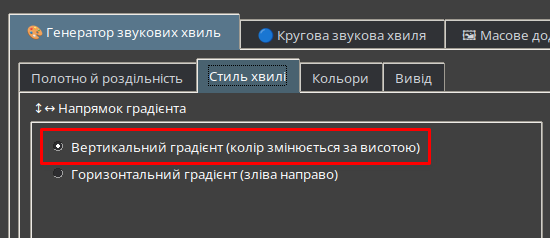
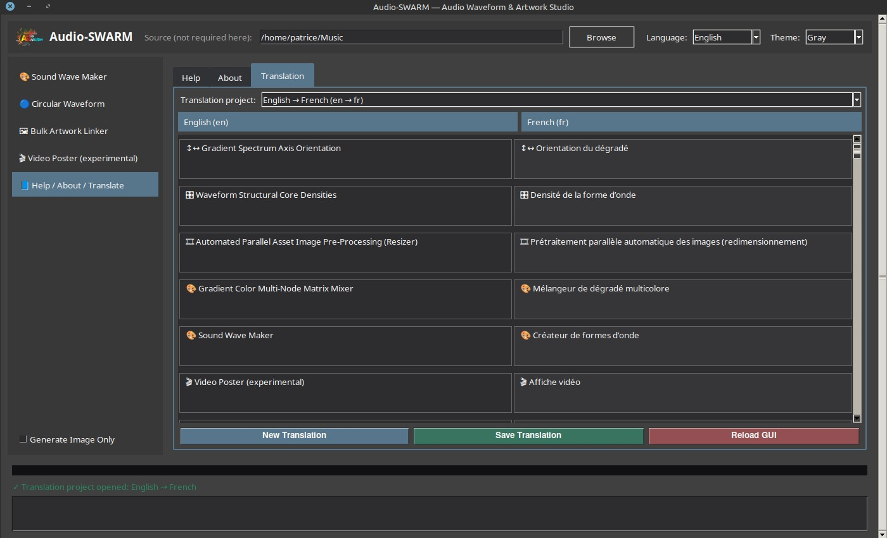
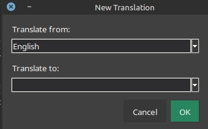
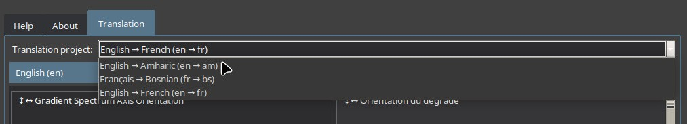

# Довідка Audio-SWARM
- [Зміст](#contents)

**Audio-SWARM**: генератор аудіохвильових форм і пакетна обробка обкладинок альбомів, ілюстрацій та мотивів для реміксів.

Audio-SWARM масово створює візуальні обкладинки альбомів на основі звукових хвиль із аудіофайлів. Audio-SWARM може генерувати традиційні лінійні зображення звукових хвиль із градієнтами кольорів майже з будь-якого типу аудіофайлів.

Audio-SWARM може створювати кругові зображення звукових хвиль, радіальні спектри та мінімалістичні кругові дизайни, а також пакетно поєднувати наявні зображення, обкладинки альбомів та інші ілюстрації з аудіодоріжками в межах одного процесу.

* Вбудовування зображень в аудіофайли дає змогу сумісним медіаплеєрам, таким як VLC і Celluloid, а також смартфонам і телевізорам відображати вбудовані обкладинки та ілюстрації під час відтворення пісні або аудіофайлу.

### Audio-SWARM створює друковані зображення звукових хвиль із надзвичайно високою роздільною здатністю.

Зображення, створені Audio-SWARM, можна експортувати з роздільною здатністю до 12 000 пікселів, що робить їх придатними для високоякісного друку та створення кінопостерів із високою роздільною здатністю.

Audio-SWARM створює на основі компактних зображень звукових хвиль із невеликим розміром файлу деталізовані візуальні матеріали, придатні **для друку обкладинок альбомів, широкоформатного друку, оформлення зображень звукових хвиль у рами, настінного мистецтва та надвеликих відбитків розміром із кінопостер**.

Audio-SWARM розроблено для забезпечення виняткової деталізації та чіткості зображення. Це дає змогу створювати ілюстрації для різних форматів друку — від невеликих обкладинок альбомів до величезних постерів і великих картин у рамах. Незалежно від того, чи створюєте ви обкладинки альбомів зі звуковими хвилями, готуєте ілюстрації до професійного друку, розробляєте оформлені в рами принти чи виготовляєте широкоформатні постери, Audio-SWARM допомагає перетворювати цифрові ілюстрації на вражаючі фізичні відбитки з винятковою деталізацією.

## Зміст <!-- anchor: contents -->
- [1. Що таке Audio-SWARM?](#what-is-swarm)
- [2. Швидкий старт](#quick-start)
- [3. Знайомство з інтерфейсом](#interface)
- [4. Sound Wave Maker](#sound-wave-maker)
- [5. Circular Waveform](#circular-waveform)
- [6. Bulk Artwork Linker](#bulk-artwork-linker)
- [7. Пакетна обробка й вихідні папки](#batch-output)
- [8. Роздільна здатність і продуктивність](#resolution-performance)
- [9. Довідник кольорів і геометрії](#colors-geometry)
- [10. Усунення несправностей](#troubleshooting)
- [11. Мови та внески](#languages-contributions)
- [12. Інструмент перекладу Audio-SWARM](#translation-tool)
- [13. Надіслати переклад](#submit-translation)

## 1. Що таке Audio-SWARM? <!-- anchor: what-is-swarm -->

**Audio-SWARM (Audio-Sound Waveform & bulk Album/Artwork-cover batch Remix Motif)** створює графічні зображення з аудіофайлів і може вбудовувати обкладинки в підтримувані аудіоформати. Програма має три інструменти:

- **Sound Wave Maker** створює звичайні зображення осцилограм із вертикальним або горизонтальним напрямком, різними стилями стовпчиків, кольорами, градієнтами та налаштуваннями роздільної здатності.
- **Circular Waveform** створює кругові осцилограми, візуалізації радіального спектра та мінімалістичні кругові лінії.
- **Bulk Artwork Linker** зіставляє наявні зображення з аудіофайлами у вибраній папці та вбудовує обкладинки, якщо аудіоформат це підтримує. Файли зіставляються за алфавітним порядком назв, тому перейменуйте їх так, щоб порядок відповідав потрібним парам.

### Виведення зображень

Sound Wave Maker і Circular Waveform експортують зображення у форматі **PNG або JPG**. Виберіть розміри відповідно до призначення: менші зображення для звичайного використання або великі з високою роздільною здатністю для детального відображення чи друку. Кругові зображення можна створювати розміром до 8000 пікселів. PNG підтримує прозорість; JPG використовує суцільний фон.

### Вбудовування обкладинок і збереження аудіо

Якщо формат підтримується, Audio-SWARM вбудовує зображення в нову вихідну копію аудіофайлів **MP3, OGG/OGA, FLAC, M4A та AIFF/AIF**. Для вбудовування обкладинок у OGG/OGA та AIFF/AIF потрібен додатковий пакет Python `mutagen`. У робочому процесі Audio-SWARM формат WAV не підтримує вбудовування обкладинок, тому аудіофайл і зображення зберігаються поруч.

**Виняток — AAC без контейнера:** у цьому робочому процесі для такого AAC немає стандартного контейнера обкладинок. Щоб вбудувати зображення, Audio-SWARM поміщає оригінальний аудіопотік AAC у контейнер M4A та створює файл із закінченням `_with_art.m4a`. Сам аудіопотік не перекодовується й не передискретизується.

Audio-SWARM не змінює вихідний аудіофайл. Створюючи вихідний файл із вбудованою обкладинкою, програма копіює оригінальний закодований аудіопотік без повторного кодування чи передискретизації. Для обчислення осцилограми Audio-SWARM використовує тимчасову копію для аналізу. Вона потрібна лише для обчислення візуалізації, а потім видаляється. Ця копія ніколи не використовується як збережений аудіовихід. **Аудіо у збереженому вихідному файлі залишається оригінальним.**

## 2. Швидкий старт <!-- anchor: quick-start -->

1. **Виберіть вхідні дані.** У **Sound Wave Maker** або **Circular Waveform** виберіть один підтримуваний аудіофайл для створення одного зображення або папку для пакетної обробки. Скористайтеся полем шляху та кнопкою Browse або перетягніть підтримуваний аудіофайл чи папку в будь-яке місце вікна Audio-SWARM.  
   Для **Bulk Artwork Linker** виберіть або перетягніть папку, що містить аудіофайли та відповідні зображення обкладинок. Цей інструмент працює з папкою, а не з одним аудіофайлом.
2. **Виберіть головну вкладку** потрібного інструмента:
   - **Sound Wave Maker** — створення звичайних зображень осцилограм.
   - **Circular Waveform** — створення кругових осцилограм, радіальних спектрів або мінімалістичних кругових дизайнів.
   - **Bulk Artwork Linker** — зіставлення наявних зображень з аудіофайлами в папці.
3. Налаштуйте потрібні параметри. Якщо не знаєте, з чого почати, залиште значення за замовчуванням. Типово зображення створюються у форматі **PNG із прозорим фоном**. У **Output Format** можна вибрати JPG або суцільний фон.
4. Натисніть кнопку створення або обробки. Стежте за станом, індикатором прогресу та журналом унизу вікна. Перетягування лише вибирає вхідні дані й не запускає обробку.
5. Після завершення перевірте вихідну папку, зазначену в журналі або повідомленні про завершення.

Sound Wave Maker і Circular Waveform можуть рекурсивно обробляти папки та зберігати структуру вихідних підпапок у результатах. Bulk Artwork Linker перевіряє лише верхній рівень вибраної папки та зіставляє аудіофайли й зображення за окремо відсортованими списками назв. Audio-SWARM не визначає автоматично, яке зображення належить до якої доріжки, тому переконайтеся, що алфавітний порядок назв відповідає потрібним парам.

### ⚠️ Про повзунки

- Виберіть потрібний розмір, а потім точно налаштуйте його, клацаючи поруч із повзунком, щоб вносити невеликі зміни.

### ⚠️ Попередження щодо Vertical Flow

У **Sound Wave Maker → Waveform Style → Vertical Flow** обробка може тривати значно довше, ніж з іншими параметрами, особливо для багатоколірних градієнтів.
- Журнал може перестати помітно оновлюватися, а Audio-SWARM може здаватися тимчасово завислим. Не закривайте програму відразу: цьому режиму може просто знадобитися більше часу.
- Дочекайтеся завершення, особливо під час створення великих зображень або обробки багатьох файлів.

## 3. Знайомство з інтерфейсом <!-- anchor: interface -->

- **Поле шляху вхідних даних:** показує вибраний аудіофайл або вихідну папку для поточного інструмента. Кнопка **Browse** поруч відкриває системний вибір файлу або папки.
- **Перетягування:** також можна перетягнути підтримуваний аудіофайл або папку в будь-яке місце вікна Audio-SWARM. Шлях оновиться так само, як після вибору через **Browse**. Перетягування не запускає обробку. Для Bulk Artwork Linker потрібна папка, що містить аудіофайли та зображення, а не один аудіофайл.
- **Вибір мови:** змінює мову інтерфейсу та завантажує відповідний документ довідки, якщо він доступний. Якщо переклад довідки відсутній, Audio-SWARM використовує англійську довідку.
- Мову можна змінювати в будь-який момент без втрати вже налаштованих параметрів.

Audio-SWARM складається з **головних вкладок**, **підвкладок**, елементів введення та індикаторів обробки. Кожен елемент має певне призначення:

- **Головні вкладки:** виберіть один із трьох інструментів — **Sound Wave Maker**, **Circular Waveform** або **Bulk Artwork Linker**. **Help / About** відкриває документацію та інформацію про програму.
- **Підвкладки:** групують параметри інструмента за категоріями. Перехід між підвкладками не запускає обробку.
- **Кнопка створення або обробки:** запускає операцію для вибраного інструмента з поточними вхідними даними й параметрами. Перед запуском перевірте шлях та параметри.

**Важливо:** деякі параметри **Sound Wave Maker** також впливають на **Circular Waveform**, зокрема геометрія та кольори. Щоб застосувати зміни до кругових зображень, виберіть потрібні параметри в Sound Wave Maker, поверніться на вкладку Circular Waveform і натисніть **Generate Circular Waveforms**.

- **Індикатор прогресу:** показує перебіг операції, особливо під час пакетної обробки. На деяких етапах він може не оновлюватися постійно.
- **Рядок стану:** коротко описує поточну дію Audio-SWARM або результат операції.
- **Журнал:** записує знайдені файли, створені результати, попередження та помилки. Під час тривалої операції він може оновлюватися не постійно; це не завжди означає, що Audio-SWARM перестав працювати.
- **Cancel:** надсилає запит на зупинення активної пакетної обробки. Якщо файл уже рендериться або кодується, поточний етап може завершитися перед тим, як скасування набуде чинності.

Деякі сторінки вищі за вікно. Щоб дістатися до нижніх елементів керування, користуйтеся вертикальною смугою прокручування або коліщатком миші.

## 4. Sound Wave Maker <!-- anchor: sound-wave-maker -->

Sound Wave Maker створює зображення осцилограми для кожного підтримуваного аудіофайлу. Підвкладки групують параметри за призначенням.

Під час рекурсивної обробки папки зображення зберігаються в `Waveform_Outputs`, а структура вихідних підпапок відтворюється всередині цієї папки. Для одного файлу результат розміщується поруч із вихідним файлом. У MP3, OGG/OGA, FLAC, M4A та AIFF/AIF можна вбудовувати обкладинки. Для необроблених файлів AAC створюється файл із закінченням `_with_art.m4a`, оскільки AAC без контейнера не має стандартного контейнера для обкладинок. Для WAV зображення зберігається окремо. Вбудовування обкладинок у OGG/OGA та AIFF/AIF потребує пакета Python `mutagen`; якщо він недоступний, Audio-SWARM залишає окреме зображення та записує помилку.

### Canvas & Resolution
#### Render Resolution Framework Configuration

- **Preset Dimensions Matrix Selector:** вибирає попередньо заданий розмір полотна й співвідношення сторін для поширених форматів, зокрема альбомного, портретного та квадратної обкладинки. Попереднє налаштування автоматично задає ширину й висоту.
- **Canvas Width Limit:** задає ширину вихідного зображення в пікселях від 10 до 8000.
- **Canvas Height Limit:** задає висоту вихідного зображення в пікселях від 10 до 8000.

Якщо вручну змінити ширину або висоту, попереднє налаштування зміниться на **Custom Mapping Coordinates**, що дозволить задати власні розміри.

Більші розміри дають більше пікселів і підходять для детальних зображень, дисплеїв високої роздільної здатності та друку. Водночас вони потребують більше часу й пам’яті та створюють більші файли.

#### Waveform Structural Core Densities

- **Total Grid Bar Count Mapping Layout:** визначає кількість стовпчиків осцилограми від 40 до 500. Менше значення дає менше й ширші стовпчики; більше значення створює щільнішу осцилограму з вужчими стовпчиками. Більша кількість може подовжити обробку.
- **Gradient Processing Slice Resolution:** визначає кількість колірних сегментів для відтворення градієнтів. Більша кількість сегментів може зробити переходи плавнішими, але істотно подовжити обробку, особливо для багатоколірних градієнтів у Vertical Flow. **Solid Flat Color** не використовує сегменти градієнта, тому працює значно швидше.
- **Canvas Target Printing Resolution (DPI):** задає метадані роздільної здатності для друку. Це не змінює розмір зображення в пікселях; його окремо визначають Canvas Width і Canvas Height. За однакового розміру в пікселях вищий DPI дає менший фізичний друк із більшою кількістю пікселів на дюйм.

### Waveform Style
#### Gradient Spectrum Axis Orientation

- **Vertical Flow** розміщує кольори градієнта вздовж висоти кожного стовпчика.
- **Horizontal Flow** розміщує кольори зліва направо вздовж осцилограми.

### Waveform Bar Peak Geometry Style
Виберіть форму стовпчиків осцилограми та їхніх вершин:

- **Standard Classic Bars:** прямокутні стовпчики з плоскими кінцями.
- **Smooth Capsule:** стовпчики із плавно заокругленими кінцями.
- **Lollipop:** вузькі стрижні з круглою верхівкою.
- **Sharp Spikes:** стовпчики із загостреними вершинами.
- **Arrow-Spear:** стовпчики з виразними наконечниками у формі стрілки.

Вибрана геометрія також впливає на відповідні режими Circular Waveform і Radial Spectrum. Minimal Circular Waveform використовує суцільну лінію замість окремих стовпчиків, тому ці геометричні стилі до нього не застосовуються.
Кожен стовпчик представляє амплітуду аудіосигналу за короткий проміжок часу. Його висота відображає рівень сигналу, а геометрія визначає, чи буде вершина плоскою, заокругленою, круглою, гострою або стрілоподібною.

### Colors
Підвкладка Colors дає змогу поєднати кілька кольорів у градієнт або використати один суцільний колір.

- **Color nodes:** кожна кнопка **Node Color** відповідає одній колірній точці градієнта. Натисніть її, щоб вибрати колір. Панель попереднього перегляду показує змішування кольорів у поточному порядку.
- **Add Color Node:** додає ще одну колірну точку, максимум до 10.
- **Remove Last Node:** видаляє останню колірну точку. У режимі градієнта залишається щонайменше дві точки.
- **Invert Layer Core Coordinates Processing Direction (Reverse Vector Flow):** змінює порядок кольорів градієнта на протилежний, змінюючи напрямок їх відображення на осцилограмі.
- **Enable Solid Flat Color:** застосовує один вибраний колір до всієї осцилограми без обчислення сегментів градієнта. Це значно швидше, особливо з Vertical Flow. У цьому режимі інверсія градієнта вимкнена. Також вимикається параметр Gradient Processing Slice на вкладці Canvas & Resolution. Після повернення до режиму градієнта відновлюються дві колірні точки; додаткові точки потрібно додати повторно.

### Output Format

- **Output Raster Format:** виберіть PNG або JPG для зображень осцилограми. PNG вибрано за замовчуванням, він підтримує прозорість. JPG не підтримує прозорість, тому після вибору JPG параметр прозорості автоматично вимикається.
- **Enable 100% Alpha Channel Canvas Transparency Block:** вмикає прозорий фон для PNG. Коли прозорість увімкнена, кнопка кольору тла блокується й показує **Locked (Transparent)**.
- **Pick Backdrop Color:** коли прозорість вимкнена, натисніть цю кнопку, щоб вибрати суцільний колір тла. Вибраний колір зберігається під час перемикання між PNG, JPG і параметрами прозорості.
- **Retain standalone high-res images inside workspace alongside embedded items:** за замовчуванням параметр увімкнено. Коли Audio-SWARM успішно вбудовує зображення в підтримуваний аудіофайл, окреме зображення повної роздільної здатності залишається поруч із вихідним аудіофайлом. Якщо вимкнути цей параметр, після успішного вбудовування окреме зображення видаляється. Якщо вбудовування не вдалося, зображення зберігається.

Вибрані кольори, напрямок градієнта, формат виведення, параметри прозорості та тла, Vertical Flow або Horizontal Flow, а також стилі стовпчиків, вершин і геометрії спільно використовуються з Circular Waveform, Radial Spectrum та Minimal Circular Waveform. Щоб застосувати зміни до кругових зображень, поверніться на вкладку Circular Waveform і натисніть **Generate Circular Waveforms**.

## 5. Circular Waveform <!-- anchor: circular-waveform -->

Circular Waveform створює кругові візуалізації з аудіофайлів. Виберіть один із трьох режимів у підвкладках.

#### Спільні параметри

- **Output Size (square pixels):** задає ширину й висоту квадратного зображення від 256 до 8000 пікселів.
- **Rotation (degrees):** повертає зображення на кут від 0° до 359°.

### Mode: Circular Waveform

Відображає стовпчики осцилограми, розташовані навколо кола.

- **Inner Radius:** визначає розмір порожнього простору в центрі. Більше значення створює більший центральний отвір.
- **Outward:** стовпчики спрямовані від кругової базової лінії назовні.
- **Inward:** стовпчики спрямовані до центра.
- **Inward + Outward:** увімкніть обидва прапорці, щоб стовпчики простягалися в обох напрямках. Завжди залишається вибраним принаймні один напрямок; якщо вимкнути єдиний вибраний напрямок, автоматично вмикається інший.
- **Геометрія осцилограми:** використовує геометрію, вибрану в Sound Wave Maker → Waveform Style, зокрема Standard Classic Bars, Smooth Capsules, Lollipop, Sharp Spikes та Arrow-Spear.

### Mode: Radial Spectrum

Відображає енергію аудіочастот у вигляді радіальних стовпчиків, розташованих навколо кола.

- **Inner Radius:** визначає розмір центрального отвору.
- **Frequency Bands:** задає кількість частотних смуг навколо кола. Більше смуг дає змогу відображати дрібніші частотні деталі.
- **Sensitivity:** контролює візуальну інтенсивність стовпчиків спектра. Збільште значення, щоб частотні зміни були помітнішими.
- **Outward та Inward:** визначають, чи спрямовані стовпчики від базової лінії назовні, до центра або в обох напрямках.

### Mode: Minimal Circular Waveform

Малює суцільну лінію навколо кола замість окремих стовпчиків.

- **Base Radius:** визначає базовий радіус кругової лінії.
- **Wave Amplitude:** визначає, наскільки лінія відхиляється від базового радіуса. Вищі значення створюють виразніші коливання.
- **Line Width:** визначає товщину лінії.

У цьому режимі не використовуються селектор геометрії осцилограми та параметри напрямку Inward/Outward.

### Спільні налаштування кольорів і виведення

Circular Waveform, Radial Spectrum і Minimal Circular Waveform спільно з Sound Wave Maker використовують колірні точки, напрямок градієнта, формат виведення, параметри прозорості та тла, DPI і налаштування вбудовування обкладинок.

Параметри **Vertical Flow** і **Horizontal Flow** у Sound Wave Maker → Waveform Style також впливають на застосування градієнтних кольорів у Circular Waveform, Radial Spectrum і Minimal Circular Waveform. Щоб змінити напрямок градієнта, виберіть потрібний режим потоку в Sound Wave Maker.

#### Примітка
Деякі параметри Sound Wave Maker, зокрема геометрія та кольори, також впливають на кругові зображення. Виберіть потрібні параметри в Sound Wave Maker, поверніться на вкладку Circular Waveform і натисніть **Generate Circular Waveforms**, щоб застосувати зміни.

Під час обробки папки Audio-SWARM створює `Circular_Waveform_Outputs` і зберігає структуру вихідних підпапок. Для різних режимів використовуються окремі суфікси назв файлів, щоб результати не перезаписували один одного.

## 6. Bulk Artwork Linker <!-- anchor: bulk-artwork-linker -->

Bulk Artwork Linker зіставляє підтримувані аудіофайли (MP3, OGG/OGA, WAV, FLAC, M4A, AAC та AIFF/AIF) із зображеннями PNG, JPG або JPEG у вибраній папці. Списки назв аудіофайлів і зображень сортуються окремо, а потім файли зіставляються за позицією в цих списках. Перед запуском перейменуйте файли так, щоб відсортований порядок відповідав потрібним парам.

**Наполегливо рекомендується** використовувати однакову кількість зображень і аудіофайлів. Для найкращих результатів заздалегідь підготуйте зображення з потрібними розмірами в пікселях і співвідношенням сторін. Засіб зміни розміру Audio-SWARM призначений лише для уніфікації розмірів зображень. Якщо співвідношення сторін зображення відрізняється від цільового, зверху й знизу або зліва й справа можуть з’явитися чорні смуги, щоб зберегти оригінальні пропорції.

Параметр зміни розміру масштабує зображення до вибраних цільових розмірів. Якщо збереження співвідношення сторін увімкнено, зображення вписується в цільове полотно; інакше воно розтягується до точних розмірів. Для зміни розміру потрібен Pillow. Якщо він недоступний, інструмент використовує оригінальний розмір зображення.

Результати MP3, OGG/OGA, FLAC, M4A та AIFF/AIF записуються в нові файли з `_with_art` у назві. Вхідний AAC без контейнера поміщається в контейнер M4A без змін аудіопотоку AAC. У робочому процесі Audio-SWARM WAV не зберігає вбудовані обкладинки, тому аудіофайл і зображення копіюються поруч. Для вбудовування обкладинок у OGG/OGA та AIFF/AIF потрібен Mutagen (див. додаткові залежності). Результати містяться в `Merged_Tracks_Outputs`. Цей інструмент перевіряє лише верхній рівень вибраної папки, а не підпапки. Якщо кількість аудіофайлів і зображень різниться, Audio-SWARM обробляє лише повні пари та записує попередження.

## 7. Пакетна обробка й вихідні папки <!-- anchor: batch-output -->

Sound Wave Maker і Circular Waveform рекурсивно обробляють пакетні завдання. Їхні окремі вихідні папки зберігають структуру вихідних підпапок, тому файли з однаковими назвами з різних папок не конфліктують. Bulk Artwork Linker обробляє лише файли безпосередньо у вибраній папці.

Перед запуском великого пакета перевірте вибрану папку та місце збереження результатів. Повторний запуск того самого завдання може замінити наявний вихідний файл з такою самою назвою. Зробіть резервні копії важливих файлів і не розміщуйте сторонні вхідні файли в згенерованих вихідних папках.

## 8. Роздільна здатність і продуктивність <!-- anchor: resolution-performance -->

Canvas Width і Canvas Height визначають розміри зображення в пікселях. DPI керує метаданими роздільної здатності друку, тоді як Audio-SWARM створює зображення у вибраному піксельному розмірі. Великі зображення потребують більше пам’яті та часу й утворюють більші файли.

Більша кількість стовпчиків створює більше й потенційно вужчі стовпчики. Gradient Processing Slice Resolution визначає кількість окремих колірних кроків у градієнтах, розбитих на сегменти. Більше кроків може зробити переходи плавнішими, але збільшує час обробки.

**Gradient Smoothness:** якщо градієнт недостатньо плавний, спробуйте встановити це значення на **200**. Як альтернативу буде використано інший алгоритм.

Solid Flat Color не потребує обробки сегментів градієнта. Перед запуском дуже великого пакета перевірте роботу на зображенні середнього розміру та кількох аудіофайлах.

## 9. Довідник кольорів і геометрії <!-- anchor: colors-geometry -->

- **Rectangle:** звичайні стовпчики з плоскими кінцями.
- **Smooth Capsules:** стовпчики із заокругленими кінцями.
- **Lollipop:** вузький стрижень із круглою верхівкою.
- **Sharp Spikes:** стовпчики із трикутними загостреними вершинами.
- **Arrow-Spear:** стрижні з виразною стрілоподібною верхівкою.

Використовуйте **Vertical Flow**, якщо колір має змінюватися вздовж висоти кожного стовпчика. Використовуйте **Horizontal Flow**, якщо градієнт має переходити від одного краю осцилограми до іншого. **Solid Flat Color** підходить для одноколірного дизайну й не потребує поділу градієнта на сегменти. Колірні точки задають зупинки градієнта; попередній перегляд показує їхній порядок.

## 10. Усунення несправностей <!-- anchor: troubleshooting -->

- **Файли не знайдено:** перевірте правильність шляху до папки та наявність аудіо- чи графічних форматів, підтримуваних вибраним інструментом.
- **Обкладинка відсутня або зіставлення неповне:** Bulk Artwork Linker зіставляє відсортовані списки за позицією. Перевірте назви й кількість файлів у кожному списку.
- **Неочікуване місце результатів:** перевірте повідомлення про завершення та назву вихідної папки.
- **Файл замінено:** під час повторних запусків вихідні файли можуть мати ті самі назви. Збережіть резервну копію або перемістіть попередні результати перед повторним запуском.
- **Не вдалося вбудувати обкладинку:** перевірте журнал програми та переконайтеся, що FFmpeg установлено й він може читати вихідний файл.
- **Повільне створення зображень або високе використання пам’яті:** зменште розміри в пікселях, розмір пакета або кількість стовпчиків чи сегментів.
- **Немає довідки вибраною мовою:** якщо документ довідки вибраною мовою відсутній, Audio-SWARM використовує `help/en.md`.

Якщо проблема не зникає, збережіть текст журналу та вкажіть вибраний інструмент, режим, формат файлу й параметри.

## 11. Мови та внески <!-- anchor: languages-contributions -->

Переклади інтерфейсу зберігаються в JSON-файлах у `languages/`. Документи довідки — Markdown-файли в `help/`, а About — Markdown-файли в `about/`. У назвах файлів використовується код мови, наприклад `en.md` для англійської, `fr.md` для французької або `ja.md` для японської.
Ви можете долучитися до перекладу безпосередньо в Audio-SWARM: Help / About / Translate -> Translation's tab.
## 12. Інструмент перекладу Audio-SWARM <!-- anchor: translation-tool -->

[Надіслати переклад на GitHub](https://github.com/PatLabGit/Audio-SWARM/discussions/1).

Інструмент дає змогу перекладати Audio-SWARM іншою мовою або виправляти наявний переклад прямо в програмі. Також можна відразу перевірити, чи не задовгий текст певного елемента. JSON-файли не потрібно редагувати вручну.

### Створення перекладу

Натисніть **Новий переклад**, щоб створити проєкт. З’явиться вікно з двома списками мов:

- **Переклад з:** вихідна мова. Рекомендується англійська, але можна вибрати іншу мову, для якої Audio-SWARM уже має переклад.
- **Переклад на:** цільова мова. Список містить 172 мови з мовного словника.

Для списку мов я використав ISO 639-1 (двобуквені коди). Виняток — `tw`, неофіційний код ISO 639-1, а власний код для традиційної китайської замість `zh-TW` або `zh-Hant`. Для простоти я залишив двобуквені коди, а трилітерні, як `pcm`, відклали.

Натисніть **OK**. Новий файл створюється копіюванням вибраної вихідної мови й спочатку зберігає весь оригінальний текст, спеціальні символи, емодзі, переноси рядків і змінні на кшталт `{filename}` чи `{value}`. Нічого автоматично не видаляється й не замінюється. Потім проєкт додається до списку.

### Інтерфейс перекладу

Редактор має дві колонки:

- **Мова джерела (ліворуч):** оригінальний текст мови, вибраної в **Translate from**. Колонка лише для читання. Можна виділити текст і натиснути %% Ctrl %% + %% C %% , щоб скопіювати його, якщо в іншій колонці випадково щось видалили. Це єдина дія тут.
- **Мова перекладу (праворуч):** текст цільового файлу, який ви перекладаєте або виправляєте.

Кожен запис відповідає запису вихідної мови. Розділи допомагають навігації. Натисніть запис для редагування; текст можна виділяти, копіювати та вставляти між колонками.

### Важливо!

- **Зберігайте потрібні спеціальні елементи — `{variables}`, `\n`, пунктуацію та маркери форматування.** Audio-SWARM може їх використовувати.

#### Можна залишити записи неперекладеними й повернутися до них пізніше за допомогою **Save**.

### Проєкти перекладу

Список містить створені або поточні мовні проєкти.

Виберіть проєкт для редагування й перемикайтеся між ними без створення нового перекладу щоразу. Кожен проєкт зберігається в окремому мовному файлі.

### Три кнопки внизу

**Новий переклад** — створює проєкт. Виберіть **Переклад з:** та **Переклад на:**. Цільовий файл копіюється з вихідного й реєструється як проєкт.

**Зберегти переклад** — зберігає переклад, навіть незавершений. Зберігайте регулярно.

**Перезавантажити GUI** — перезавантажує інтерфейс мовою **вибраного** проєкту. Перекладіть кілька записів, збережіть і перезавантажте, щоб перевірити меню, кнопки, вкладки й підписи в програмі. Це допомагає помітити задовгі або невідповідні тексти.

**Важливо:** неперекладені записи можуть залишатися вихідною мовою — це нормально. **Не видаляйте записи до збереження**, інакше частини інтерфейсу можуть бути без тексту. Повернутися до іншої мови можна через вибір/перезавантаження біля «Theme».

### Поради перекладачам

- Перекладайте у своєму темпі й регулярно зберігайтеся.
- Перевіряйте результат через Reload GUI.
- Використовуйте чіткі, природні та короткі формулювання, особливо для кнопок, вкладок і підписів.
- Не змінюйте змінні, маркери форматування або спеціальні символи без потреби.
- Якщо щось виглядає дивно, виправте, збережіть і перезавантажте.

## [Надіслати переклад](https://github.com/PatLabGit/Audio-SWARM/discussions/1) <!-- anchor: submit-translation -->

Щоб допомогти Audio-SWARM, можете надіслати мені перекладений мовний файл.

1. **Знайдіть файл:** відкрийте папку встановлення, а потім **`languages`** (поруч із `main.py` і launcher). Знайдіть файл із **двобуквенним кодом** мови (наприклад `fr`, `de`, `ja`). Розширення `.json` може бути приховане.
2. Перейдіть на **[GitHub Discussions Audio-SWARM](https://github.com/PatLabGit/Audio-SWARM/discussions/1)**.
3. Відкрийте обговорення подання перекладу й прикріпіть файл до коментаря.

Не потрібно змінювати код або створювати pull request. Можна використати псевдонім у GitHub. Дякую за внесок і допомогу в поширенні Audio-SWARM!

## Переклад файлу Help

**Скопіюйте англійський файл із `help`**, перекладіть текст і заголовки та збережіть під правильним кодом мови. Не змінюйте HTML-коментарі якорів і цілі змісту, щоб посилання на розділи працювали. Збережіть у UTF-8.

Не перекладайте назви файлів, приклади коду, ідентифікатори налаштувань або папки, якщо вони мають точно відповідати програмі. Синхронізуйте переклад з англійським master і повідомляйте про незрозумілі чи застарілі формулювання. Якщо мовний Help або About відсутній, Audio-SWARM використовує відповідний англійський документ.
