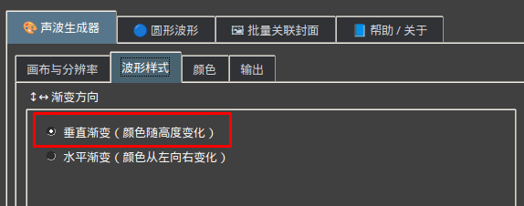

# Audio-SWARM 帮助
- [目录](#contents)

**Audio-SWARM**：音频波形生成器，支持专辑封面、艺术作品及混音视觉主题的批量处理。

Audio-SWARM 可以批量生成以音频波形为视觉元素的专辑封面艺术作品。Audio-SWARM 几乎支持所有类型的音频文件，能够生成带有渐变效果的传统线性波形图像。

Audio-SWARM 可以创建圆形波形图、放射状频谱和极简风格的圆形设计，也可以在一次批量处理中，将现有图片、专辑封面和艺术作品封面与音轨结合起来。

* 将图片嵌入音频文件后，VLC 和 Celluloid 等兼容的多媒体播放器，以及智能手机和电视，都可以在播放歌曲或音频文件时显示嵌入的封面艺术作品。

### Audio-SWARM 可创建适合打印的超高分辨率波形艺术作品。

Audio-SWARM 生成的图像最高可导出为 12,000 像素的分辨率，非常适合高品质打印、大幅面印刷以及高分辨率电影海报制作。

Audio-SWARM 可以基于文件体积小巧的波形图像，创作细节丰富的视觉作品，适用于**专辑封面打印、大幅面印刷、带框波形艺术作品、墙面艺术装饰，以及电影海报尺寸的超大幅面印刷品**。

Audio-SWARM 专为呈现出色的视觉细节和清晰度而设计，能够制作适用于各种印刷尺寸的艺术作品，从小型专辑封面到超大海报和大型装框作品，都能轻松应对。

无论您是制作波形专辑封面、准备专业印刷用艺术作品、设计装框艺术印刷品，还是制作大幅面海报，Audio-SWARM 都能帮助您将数字艺术作品呈现为细节精美、令人惊艳的实体印刷品。

## 目录 <!-- anchor: contents -->
- [1. 什么是 Audio-SWARM？](#what-is-swarm)
- [2. 快速开始](#quick-start)
- [3. 了解界面](#interface)
- [4. Sound Wave Maker](#sound-wave-maker)
- [5. Circular Waveform](#circular-waveform)
- [6. Bulk Artwork Linker](#bulk-artwork-linker)
- [7. 批处理与输出文件夹](#batch-output)
- [8. 分辨率与性能](#resolution-performance)
- [9. 颜色与几何样式参考](#colors-geometry)
- [10. 故障排查](#troubleshooting)
- [11. 语言与贡献](#languages-contributions)

## 1. 什么是 Audio-SWARM？ <!-- anchor: what-is-swarm -->

**Audio-SWARM（Audio-Sound Waveform & bulk Album/Artwork-cover batch Remix Motif）** 可根据音频文件创建视觉图像，也可以将封面图片嵌入受支持的音频格式。它提供三种工具：

- **Sound Wave Maker** 可创建常规波形图，支持 Vertical Flow 或 Horizontal Flow、不同的波形条样式、颜色、渐变和分辨率设置。
- **Circular Waveform** 可创建圆形波形、径向频谱可视化以及极简圆形线条设计。
- **Bulk Artwork Linker** 可将现有图片与所选文件夹中的音频文件配对，并在音频格式支持时嵌入封面。文件按照文件名排序后的顺序进行配对，因此请整理文件名，使排序结果符合所需的配对关系。

### 图像输出

Sound Wave Maker 和 Circular Waveform 可将图像导出为 **PNG 或 JPG**。请根据用途选择图像尺寸：日常使用可选择较小的图像，细节展示或打印则适合较大、分辨率较高的图像。圆形图像最高可生成 8000 像素。PNG 支持透明背景；JPG 使用纯色背景。

### 嵌入封面并保留音频

在格式支持的情况下，Audio-SWARM 会将图片嵌入 **MP3、OGG/OGA、FLAC、M4A 和 AIFF/AIF** 音频文件的新输出副本中。向 OGG/OGA 和 AIFF/AIF 文件嵌入封面需要可选的 Python 软件包 `mutagen`。在 Audio-SWARM 的工作流程中，WAV 不嵌入封面图片，因此音频文件和图片会并排单独保存。

**原始 AAC 是一个例外：** 在此工作流程中，原始 AAC 没有用于封面图片的标准容器。要嵌入图片，Audio-SWARM 会将原始 AAC 音频流放入 M4A 容器，并创建以 `_with_art.m4a` 结尾的文件。音频流本身不会重新编码或重新采样。

Audio-SWARM 不会修改源音频文件。创建嵌入封面的输出文件时，Audio-SWARM 会复制原始编码音频流，不进行重新编码或重新采样。为计算波形，Audio-SWARM 会使用一个临时分析副本；该副本仅用于计算可视化，之后便会删除，绝不会作为保存的音频输出使用。**保存的输出文件仍保留原始音频。**

## 2. 快速开始 <!-- anchor: quick-start -->

1. **选择输入。** 在 **Sound Wave Maker** 或 **Circular Waveform** 中，选择一个受支持的音频文件以生成单张图像，或选择一个文件夹来批量处理。可以使用路径输入框和 Browse 按钮，也可以将受支持的音频文件或文件夹拖放到 Audio-SWARM 窗口的任意位置。  
   对于 **Bulk Artwork Linker**，请选择或拖放一个同时包含音频文件及其封面图片的文件夹。此工具处理的是文件夹，而不是单个音频文件。
2. **选择主选项卡**，打开所需工具：
   - **Sound Wave Maker** — 创建常规波形图。
   - **Circular Waveform** — 创建圆形波形、径向频谱或极简圆形设计。
   - **Bulk Artwork Linker** — 将现有图片与文件夹中的音频文件配对。
3. 调整需要的设置。如果不确定如何选择，请保留默认值。默认情况下，图像以**透明背景的 PNG** 格式输出。如需 JPG 或纯色背景，可在 **Output Format** 中更改。
4. 点击生成或处理按钮。查看窗口底部的状态、进度条和日志。拖放操作只会选择输入，不会自动开始处理。
5. 处理完成后，请检查日志或完成提示中显示的输出文件夹。

Sound Wave Maker 和 Circular Waveform 可以递归处理文件夹，并在输出中保留源子文件夹结构。Bulk Artwork Linker 只检查所选文件夹的顶层，并根据分别排序后的音频和图片文件名列表进行配对。Audio-SWARM 不会自动判断哪张图片属于哪首曲目，因此请确保文件名排序后的顺序与所需配对一致。

### ⚠️ 关于滑块

- 选择所需的大小，然后点击滑块手柄旁边的位置进行微调。

### ⚠️ Vertical Flow 注意事项

在 **Sound Wave Maker → Waveform Style → Vertical Flow** 下，处理时间可能明显长于其他选项，尤其是在使用多色渐变时。
- 日志可能看起来停止更新，Audio-SWARM 也可能暂时像是没有响应。请不要立即关闭 Audio-SWARM；此模式可能只是需要更多时间。
- 请耐心等待处理完成，特别是在生成大图或批量处理大量文件时。

## 3. 了解界面 <!-- anchor: interface -->

- **输入路径字段：** 显示当前工具所选的音频文件或源文件夹。旁边的 **Browse** 按钮会打开系统文件或文件夹选择器。
- **拖放：** 也可以将受支持的音频文件或文件夹拖放到 Audio-SWARM 窗口的任意位置。输入路径会像通过 **Browse** 选择一样更新。拖放不会开始处理。Bulk Artwork Linker 需要同时包含音频和图片的文件夹，而不是单个音频文件。
- **语言选择器：** 更改界面语言，并在对应的帮助文档存在时加载该文档。如果缺少翻译后的帮助文档，Audio-SWARM 会使用英文帮助。
- 可以随时切换语言，而不会丢失已经配置的设置。

Audio-SWARM 由**主选项卡**、**子选项卡**、输入控件和处理状态信息组成。各部分用途如下：

- **主选项卡：** 在 **Sound Wave Maker**、**Circular Waveform** 和 **Bulk Artwork Linker** 三种工具中选择。**Help / About** 用于打开文档和应用程序信息。
- **子选项卡：** 将工具设置分成较小的类别。切换子选项卡不会启动处理。
- **生成或处理按钮：** 使用当前输入和设置启动所选工具。开始前请检查路径和选项。

**重要提示：** **Sound Wave Maker** 中的部分设置也会影响 **Circular Waveform**，包括几何样式和颜色。要将更改应用到圆形图像，请先在 Sound Wave Maker 中选择所需设置，**返回** Circular Waveform 选项卡，然后点击 **Generate Circular Waveforms**。

- **进度条：** 显示操作进度，特别是在批处理过程中。某些处理阶段可能不会持续更新进度条。
- **状态行：** 简要显示 Audio-SWARM 当前正在执行的操作或操作结果。
- **日志：** 记录找到的文件、创建的输出、警告和错误等信息。长时间运行的任务可能不会持续更新日志；这并不一定表示 Audio-SWARM 已停止工作。
- **Cancel：** 请求停止正在运行的批处理。如果某个文件已经开始渲染或编码，可能需要完成当前步骤后才能取消。

有些页面比窗口更高。请使用垂直滚动条或鼠标滚轮查看下方的控件。

## 4. Sound Wave Maker <!-- anchor: sound-wave-maker -->

Sound Wave Maker 会为每个受支持的音频文件生成波形图。子选项卡按用途整理相关设置。

递归处理文件夹时，图像会保存到 `Waveform_Outputs`，并在其中保留源子文件夹结构。处理单个文件时，输出会放在源文件旁边。MP3、OGG/OGA、FLAC、M4A 和 AIFF/AIF 可以嵌入封面。原始 AAC 输入会生成以 `_with_art.m4a` 结尾的文件，因为原始 AAC 没有用于封面的标准容器。对于 WAV，图像会单独保留。向 OGG/OGA 和 AIFF/AIF 嵌入封面需要 Python 软件包 `mutagen`；如果该软件包不可用，Audio-SWARM 会保留独立图片并在日志中记录错误。

### Canvas & Resolution
#### Render Resolution Framework Configuration

- **Preset Dimensions Matrix Selector：** 选择常用格式的预设画布尺寸和宽高比，包括横向、纵向和方形封面。预设会自动设置宽度和高度。
- **Canvas Width Limit：** 将输出图像宽度设置为 10 到 8000 像素。
- **Canvas Height Limit：** 将输出图像高度设置为 10 到 8000 像素。

手动更改宽度或高度后，预设会切换为 **Custom Mapping Coordinates**，以便设置自定义图像尺寸。

更大的尺寸包含更多像素，适合细节丰富的图像、高分辨率显示器和打印。但它们也需要更多处理时间和内存，并产生更大的文件。

#### Waveform Structural Core Densities

- **Total Grid Bar Count Mapping Layout：** 控制波形条的数量，范围为 40 到 500。数值较低时，波形条较少、宽度较大；数值较高时，波形更密集、波形条更窄。增加波形条数量可能延长处理时间。
- **Gradient Processing Slice Resolution：** 控制渲染渐变时使用的颜色切片数量。更多切片可以使颜色过渡更平滑，但也可能显著增加处理时间，尤其是在 Vertical Flow 中使用多色渐变时。**Solid Flat Color** 不使用渐变切片，因此速度快得多。
- **Canvas Target Printing Resolution (DPI)：** 设置图像的打印分辨率元数据，不会改变图像的像素尺寸。像素尺寸由 Canvas Width 和 Canvas Height 单独控制。在像素尺寸相同的情况下，DPI 越高，实际打印尺寸越小，每英寸的像素数越多。

### Waveform Style
#### Gradient Spectrum Axis Orientation

- **Vertical Flow** 沿每根波形条的高度分布渐变颜色。
- **Horizontal Flow** 沿波形从左向右分布颜色。

### Waveform Bar Peak Geometry Style
选择波形条及其顶端的形状：

- **Standard Classic Bars：** 末端平直的矩形波形条。
- **Smooth Capsule：** 末端平滑圆润的波形条。
- **Lollipop：** 顶端带圆形帽的细杆。
- **Sharp Spikes：** 顶端逐渐变尖的波形条。
- **Arrow-Spear：** 具有明显箭头状顶端的波形条。

所选几何样式也会影响 Circular Waveform 和 Radial Spectrum 中相应的模式。Minimal Circular Waveform 使用连续线条而不是独立波形条，因此不使用这些几何样式。
每根波形条代表短时间内音频信号的振幅。高度反映信号电平，而几何样式决定顶端是平直、圆角、圆形、尖锐还是箭头形。

### Colors
Colors 子选项卡可让你将多个颜色组合成渐变，也可以使用单一纯色。

- **Color nodes：** 每个 **Node Color** 按钮代表渐变中的一个颜色节点。点击按钮选择颜色。预览条会按当前顺序显示颜色的混合效果。
- **Add Color Node：** 添加一个颜色节点，最多可添加 10 个。
- **Remove Last Node：** 删除最后一个颜色节点。渐变模式至少保留两个节点。
- **Invert Layer Core Coordinates Processing Direction (Reverse Vector Flow)：** 反转渐变颜色的顺序，从而改变颜色在波形上出现的方向。
- **Enable Solid Flat Color：** 对整个波形使用所选的一种颜色，不计算渐变切片。这样处理速度会快得多，尤其是在使用 Vertical Flow 时。在此模式下，渐变反转功能会被禁用；Canvas & Resolution 选项卡中的 Gradient Processing Slice 控件也会被禁用。切回渐变模式后会恢复两个颜色节点；其他节点需要重新添加。

### Output Format

- **Output Raster Format：** 为生成的波形图选择 PNG 或 JPG。默认选择 PNG，并支持透明背景。JPG 不支持透明度，因此选择 JPG 时会自动关闭透明选项。
- **Enable 100% Alpha Channel Canvas Transparency Block：** 为 PNG 图像启用透明背景。启用透明度后，背景颜色按钮会被锁定并显示 **Locked (Transparent)**。
- **Pick Backdrop Color：** 关闭透明度时，可点击此按钮选择纯色背景。切换 PNG、JPG 或透明度设置时，已选颜色会保留。
- **Retain standalone high-res images inside workspace alongside embedded items：** 默认启用。Audio-SWARM 成功将图像嵌入受支持的音频文件后，此选项会在音频输出旁保留一份完整分辨率的独立图片。如果关闭此选项，嵌入成功后会删除独立图片。如果嵌入失败，图片仍会保留。

所选颜色、渐变方向、输出格式、透明度和背景设置、Vertical Flow 或 Horizontal Flow，以及波形条、顶端和几何样式也会由 Circular Waveform、Radial Spectrum 和 Minimal Circular Waveform 共享。要将更改应用于圆形图像，请返回 Circular Waveform 选项卡并点击 **Generate Circular Waveforms**。

## 5. Circular Waveform <!-- anchor: circular-waveform -->

Circular Waveform 根据音频文件创建圆形可视化图像。请在子选项卡中选择三种模式之一。

#### 共享设置

- **Output Size (square pixels)：** 将正方形图像的宽度和高度设置为 256 到 8000 像素。
- **Rotation (degrees)：** 将图像旋转 0° 到 359°。

### Mode: Circular Waveform

显示围绕圆形排列的波形条。

- **Inner Radius：** 控制中心空白区域的大小。数值越大，中心开口越大。
- **Outward：** 波形条从圆形基线向外延伸。
- **Inward：** 波形条向中心延伸。
- **Inward + Outward：** 同时启用两个复选框，让波形条向两个方向延伸。始终至少有一个方向处于选中状态；如果取消唯一已选方向，另一个方向会自动启用。
- **波形几何样式：** 使用在 Sound Wave Maker → Waveform Style 中选定的样式，包括 Standard Classic Bars、Smooth Capsules、Lollipop、Sharp Spikes 和 Arrow-Spear。

### Mode: Radial Spectrum

以围绕圆形排列的径向波形条显示音频频率能量。

- **Inner Radius：** 控制中心开口的大小。
- **Frequency Bands：** 设置圆周上显示的频带数量。频带越多，表示的频率细节越精细。
- **Sensitivity：** 控制频谱条的视觉强度。提高数值可使频率变化更加明显。
- **Outward 和 Inward：** 决定波形条是从基线向外、向中心，还是向两个方向延伸。

### Mode: Minimal Circular Waveform

绘制围绕圆形的连续线条，而不是独立的波形条。

- **Base Radius：** 控制圆形线条的基础半径。
- **Wave Amplitude：** 控制线条偏离基础半径的幅度。数值越高，变化越明显。
- **Line Width：** 控制线条粗细。

此模式不使用波形几何样式选择器，也不使用 Inward/Outward 方向控制。

### 共享颜色和输出设置

Circular Waveform、Radial Spectrum 和 Minimal Circular Waveform 与 Sound Wave Maker 共享颜色节点、渐变方向、输出格式、透明度和背景设置、DPI 以及封面嵌入偏好。

Sound Wave Maker → Waveform Style 中的 **Vertical Flow** 和 **Horizontal Flow** 也会影响渐变颜色应用到 Circular Waveform、Radial Spectrum 和 Minimal Circular Waveform 的方式。要更改渐变方向，请在 Sound Wave Maker 中选择所需的流向。

#### 注意
Sound Wave Maker 的部分设置（包括几何样式和颜色）也会影响圆形图像。请先在 Sound Wave Maker 中选择所需设置，再返回 Circular Waveform 并点击 **Generate Circular Waveforms** 以应用更改。

处理文件夹时，Audio-SWARM 会创建 `Circular_Waveform_Outputs` 文件夹，并保留源子文件夹结构。不同模式使用各自的文件名后缀，避免彼此覆盖输出文件。

## 6. Bulk Artwork Linker <!-- anchor: bulk-artwork-linker -->

Bulk Artwork Linker 会将受支持的音频文件（MP3、OGG/OGA、WAV、FLAC、M4A、AAC 和 AIFF/AIF）与所选文件夹中的 PNG、JPG 或 JPEG 图片配对。程序会分别对音频文件名列表和图片文件名列表排序，然后按两个列表中的位置进行配对。开始前请重命名文件，使排序后的顺序符合预期配对关系。

**强烈建议**让图片数量与音频文件数量相同。为获得最佳效果，请预先将图片准备为所需的像素尺寸和宽高比。Audio-SWARM 的缩放器仅用于统一图片尺寸。如果图片宽高比与目标宽高比不同，可能会在顶部和底部或左右两侧添加黑边，以保留原始比例。

缩放选项可将图片调整到所选目标尺寸。启用保持宽高比后，图片会适配到目标画布内部；否则会拉伸到精确尺寸。调整大小需要 Pillow。如果无法使用 Pillow，工具会保留原始图片尺寸。

MP3、OGG/OGA、FLAC、M4A 和 AIFF/AIF 输出会保存为名称包含 `_with_art` 的新文件。原始 AAC 输入会被放入 M4A 容器，同时保持 AAC 音频流不变。在 Audio-SWARM 的工作流程中，WAV 不保存嵌入式封面，因此音频和图片会并排复制。向 OGG/OGA 和 AIFF/AIF 嵌入封面需要 Mutagen（请参阅可选依赖项）。结果保存在 `Merged_Tracks_Outputs` 中。此工具只扫描所选文件夹的顶层，不扫描子文件夹。如果音频文件和图片的数量不同，Audio-SWARM 只处理完整配对并记录警告。

## 7. 批处理与输出文件夹 <!-- anchor: batch-output -->

Sound Wave Maker 和 Circular Waveform 会递归处理批次。它们各自的输出文件夹保留源子文件夹结构，因此不同源文件夹中同名的文件不会相互冲突。Bulk Artwork Linker 只处理所选文件夹中的顶层文件。

在执行大型批处理前，请检查所选文件夹和输出位置。重复运行相同任务可能会替换同名的现有输出文件。请备份重要文件，并避免将无关输入文件放入生成的输出文件夹。

## 8. 分辨率与性能 <!-- anchor: resolution-performance -->

Canvas Width 和 Canvas Height 设置图像的像素尺寸。DPI 控制打印分辨率元数据，而 Audio-SWARM 仍按照所选像素尺寸进行渲染。大图需要更多内存和时间，并会生成更大的文件。

增加波形条数量会产生更多波形条，并可能使每条更窄。Gradient Processing Slice Resolution 控制分段渐变使用的离散颜色级数。级数越多，颜色过渡可能越平滑，但处理时间也可能更长。

**Gradient Smoothness：** 如果渐变看起来不够平滑，可以尝试将该值设为 **200**。此时会改用另一种算法作为替代方案。

Solid Flat Color 不需要处理渐变切片。在运行非常大的批次之前，建议先用中等尺寸的图像和少量音频文件进行测试。

## 9. 颜色与几何样式参考 <!-- anchor: colors-geometry -->

- **Rectangle：** 末端平直的常规波形条。
- **Smooth Capsules：** 末端圆润的波形条。
- **Lollipop：** 顶端带圆形帽的细杆。
- **Sharp Spikes：** 逐渐收窄为三角尖端的波形条。
- **Arrow-Spear：** 带有明显箭头状尖端的杆状波形条。

如果希望颜色沿每根波形条的高度变化，请使用 **Vertical Flow**。如果希望渐变从波形的一侧向另一侧移动，请使用 **Horizontal Flow**。**Solid Flat Color** 适合单色设计，并且不会将渐变切分成多个片段。颜色节点定义渐变中的颜色停靠点，预览会显示它们的顺序。

## 10. 故障排查 <!-- anchor: troubleshooting -->

- **未找到文件：** 确认文件夹路径正确，并且其中包含所选工具支持的音频或图像格式。
- **封面缺失或配对不完整：** Bulk Artwork Linker 根据排序后的位置配对列表。请检查文件名以及两个列表中的文件数量。
- **输出位置不符合预期：** 查看完成消息和输出文件夹名称。
- **文件被替换：** 重复运行时，输出文件名可能相同。再次运行前请备份或移走先前的结果。
- **嵌入失败：** 查看应用程序日志，并确认已安装 FFmpeg 且能够读取源文件。
- **渲染速度慢或内存使用量高：** 减小像素尺寸、批次规模，或减少波形条和颜色切片数量。
- **缺少某种语言的帮助文档：** 如果所选语言的帮助文档不存在，Audio-SWARM 会使用 `help/en.md`。

如果问题仍然存在，请保存日志内容，并记录所选工具、模式、文件格式和设置。

## 11. 语言与贡献 <!-- anchor: languages-contributions -->

界面翻译以 JSON 文件的形式存储在 `languages/` 中。帮助文档是 `help/` 中的 Markdown 文件，About 文档是 `about/` 中的 Markdown 文件。JSON 和 Markdown 文件均使用语言代码作为文件名，例如 `en.md` 表示英语、`fr.md` 表示法语、`ja.md` 表示日语。

如果要贡献翻译，请**从相应文件夹复制英文文件**，翻译正文和标题，并使用正确的语言代码保存。请保持 Help 中的 HTML 锚点注释和目录链接目标不变，以确保章节链接正常工作。

请使用 UTF-8 编码保存文件！

如果文件名、代码示例、设置标识符或文件夹名称必须与应用程序完全一致，请不要翻译这些内容。请让译文与英文主文档保持同步，并报告不清楚的表述或过时的行为说明。如果缺少特定语言的 Help 或 About 文档，Audio-SWARM 会使用对应的英文文档。
